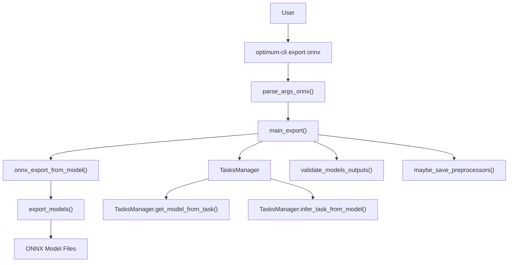
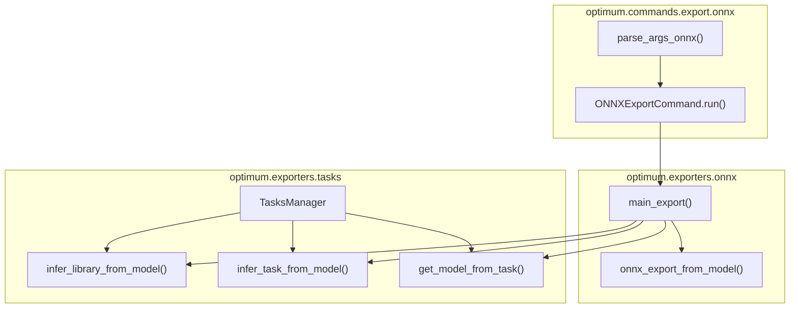

<!-- source: DeepWiki mcp.deepwiki.com · repo huggingface/optimum-onnx · page 2.1 Export Command Line Interface · fetched 2026-10-26 -->

# Export Command Line Interface

<details>
<summary>Relevant source files</summary>

The following files were used as context for generating this wiki page:

- [docs/source/onnx/usage_guides/export_a_model.mdx](docs/source/onnx/usage_guides/export_a_model.mdx)
- [optimum/commands/export/onnx.py](optimum/commands/export/onnx.py)
- [optimum/commands/register/register_export.py](optimum/commands/register/register_export.py)
- [tests/cli/test_cli.py](tests/cli/test_cli.py)

</details>


## Purpose and Scope

This document provides detailed technical documentation for the `optimum-cli export onnx` command line interface. It covers argument parsing, task inference, library detection, model loading, preprocessor management, and execution data flows used when converting Hugging Face models to ONNX via the Optimum CLI [optimum/commands/export/onnx.py:14-165]().

Sources: [optimum/commands/export/onnx.py:14-165]()

---

## CLI Command Structure and Entry Point

The ONNX export command is registered via `REGISTER_COMMANDS` [optimum/commands/register/register_export.py:19-21]() mapping `ONNXExportCommand` to the base export command. When invoked from the terminal, arguments are parsed by `parse_args_onnx()` [optimum/commands/export/onnx.py:33-165]() and handed off to the exporter backend.

```bash
optimum-cli export onnx --model MODEL_NAME_OR_PATH OUTPUT_DIR [OPTIONS]
```

### Basic Usage Flow Diagram



Sources: [optimum/commands/export/onnx.py:33-165](), [optimum/commands/register/register_export.py:19-21]()

---

## Command Line Arguments Reference

The CLI parameters are organized into required inputs, model configuration flags, precision controls, and input shape overrides.

### Required Arguments

| Argument | Type | Description | Code Reference |
|----------|------|-------------|----------------|
| `--model` / `-m` | `str` | Model ID on Hugging Face Hub or local path | [optimum/commands/export/onnx.py:35-37]() |
| `output` | `Path` | Target directory for generated ONNX artifacts | [optimum/commands/export/onnx.py:38-40]() |

### Optional Configuration Arguments

| Argument | Default | Description | Code Reference |
|----------|---------|-------------|----------------|
| `--task` | `"auto"` | Task identifier (supports `-with-past` suffix) | [optimum/commands/export/onnx.py:47-55]() |
| `--library-name` | `None` | Target library (`transformers`, `diffusers`, etc.) | [optimum/commands/export/onnx.py:141-147]() |
| `--framework` | `"pt"` | Framework backend (PyTorch `pt`) | [optimum/commands/export/onnx.py:111-117]() |
| `--opset` | `None` | ONNX opset version | [optimum/commands/export/onnx.py:56-61]() |
| `--device` | `"cpu"` | Device used for export computation | [optimum/commands/export/onnx.py:62-67]() |
| `--dtype` | `None` | Precision (`fp32`, `fp16`, `bf16`) | [optimum/commands/export/onnx.py:68-74]() |
| `--optimize` | `None` | ORT optimization level (`O1`, `O2`, `O3`, `O4`) | [optimum/commands/export/onnx.py:75-87]() |
| `--monolith` | `False` | Export as a single monolithic ONNX file | [optimum/commands/export/onnx.py:88-96]() |
| `--no-post-process` | `False` | Disable post-processing / model merging | [optimum/commands/export/onnx.py:97-104]() |
| `--variant` | `"default"` | Model variant selector | [optimum/commands/export/onnx.py:105-110]() |
| `--atol` | `None` | Absolute tolerance for validation checks | [optimum/commands/export/onnx.py:118-123]() |
| `--trust-remote-code` | `False` | Allow execution of remote custom modeling code | [optimum/commands/export/onnx.py:127-131]() |
| `--slim` | `False` | Enable `onnxslim` graph optimization | [optimum/commands/export/onnx.py:161-165]() |

Sources: [optimum/commands/export/onnx.py:33-165]()

---

## Internal Architecture & Data Flow

The translation layer bridges command-line strings into complex Python model loading calls using `TasksManager`.

### Code Entity Interaction Diagram



Sources: [optimum/commands/export/onnx.py:33-165](), [optimum/commands/register/register_export.py:15-21]()

---

## Preprocessor Management and Dummy Inputs

During export, dummy inputs are generated according to specified modalities (text, vision, audio) to trace the model graph. Preprocessors (such as tokenizers or feature extractors) associated with the model are automatically saved alongside the generated ONNX files into the output directory.

Input shape parameters handled by `parse_args_onnx()` configure the dimensions of these dummy inputs:
- Text: `--batch_size`, `--sequence_length`, `--num_choices` [docs/source/onnx/usage_guides/export_a_model.mdx:76-79]()
- Vision: `--width`, `--height`, `--num_channels` [docs/source/onnx/usage_guides/export_a_model.mdx:77-78]()
- Audio: `--feature_size`, `--nb_max_frames`, `--audio_sequence_length` [docs/source/onnx/usage_guides/export_a_model.mdx:78-79]()

Sources: [optimum/commands/export/onnx.py:33-165](), [docs/source/onnx/usage_guides/export_a_model.mdx:76-79]()

---

## Practical Usage Patterns

### Standard Text Encoder Export
```bash
optimum-cli export onnx --model hf-internal-testing/tiny-random-bert encoder_output/
```

### Decoder Export with KV Cache
For autoregressive generation models, appending `-with-past` to the task instructs the exporter to include past key-value states in the graph structure:
```bash
optimum-cli export onnx --model hf-internal-testing/tiny-random-gpt2 --task text-generation-with-past decoder_output/
```

### GPU-Accelerated Export with Precision and Optimization
```bash
optimum-cli export onnx --model hf-internal-testing/tiny-random-opt --device cuda --dtype fp16 --optimize O4 opt_output/
```

Sources: [tests/cli/test_cli.py:40-114](), [docs/source/onnx/usage_guides/export_a_model.mdx:13-114]()

---

