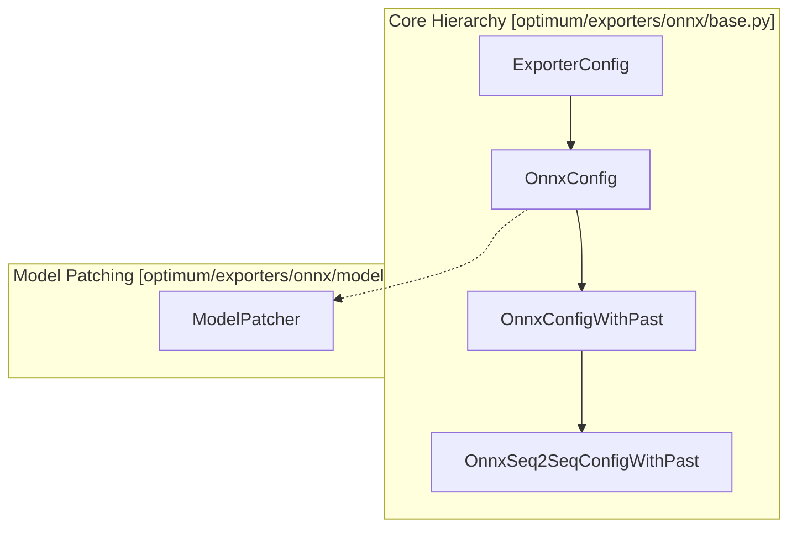
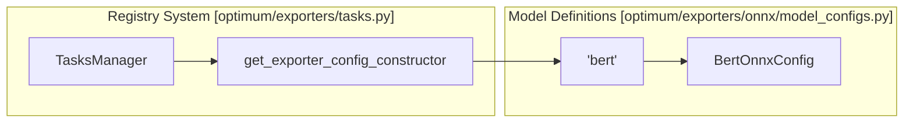
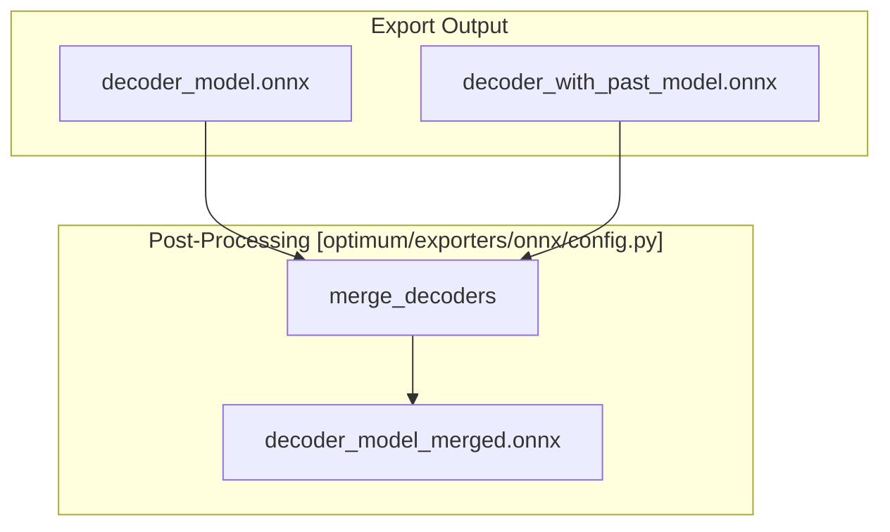

<!-- source: DeepWiki mcp.deepwiki.com · repo huggingface/optimum-onnx · page 2.2 Export Configuration System · fetched 2026-10-26 -->

# Export Configuration System

<details>
<summary>Relevant source files</summary>

The following files were used as context for generating this wiki page:

- [optimum/exporters/onnx/base.py](optimum/exporters/onnx/base.py)
- [optimum/exporters/onnx/config.py](optimum/exporters/onnx/config.py)
- [optimum/exporters/onnx/input_generators.py](optimum/exporters/onnx/input_generators.py)
- [optimum/onnxruntime/modeling_diffusion.py](optimum/onnxruntime/modeling_diffusion.py)
- [tests/exporters/common/test_tasks_manager.py](tests/exporters/common/test_tasks_manager.py)
- [tests/exporters/onnx/test_export_cli.py](tests/exporters/onnx/test_export_cli.py)
- [tests/onnxruntime/test_diffusion.py](tests/onnxruntime/test_diffusion.py)
- [tests/onnxruntime/test_optimization.py](tests/onnxruntime/test_optimization.py)

</details>


This page details the ONNX export configuration system in `optimum-onnx`, which defines how different model architectures should be converted to ONNX format. The configuration system specifies model inputs, outputs, dynamic axes, and export-specific behaviors for each supported model type and task combination.

## Configuration Class Hierarchy

The export configuration system is built around a class hierarchy that provides increasingly specialized functionality for different model types. The base classes handle core logic like dynamic axis definition and model patching.

### Base Configuration Classes

The foundation consists of abstract base classes that define common interfaces for the export pipeline:

| Class | Description |
| :--- | :--- |
| `OnnxConfig` [optimum/exporters/onnx/base.py:92-100]() | Base abstract class for all ONNX export configurations. Defines default opset (18) and task-to-output mappings. |
| `OnnxConfigWithPast` [optimum/exporters/onnx/base.py]() | Specialized for decoder models requiring Key-Value (KV) cache support. |
| `OnnxSeq2SeqConfigWithPast` [optimum/exporters/onnx/config.py:23-25]() | Extends KV cache support to encoder-decoder architectures (e.g., T5, BART). |



Sources: [optimum/exporters/onnx/base.py:92-100](), [optimum/exporters/onnx/config.py:23-25]()

### Specialized Configuration Classes

The system provides intermediate classes in `optimum/exporters/onnx/config.py` that group logic for common modalities:

*   **`TextEncoderOnnxConfig`**: Handles encoder-based text architectures like BERT. [optimum/exporters/onnx/config.py:47-50]()
*   **`TextDecoderOnnxConfig`**: Handles decoder-based text architectures (GPT-like) and manages the merging of decoders with and without past key values. [optimum/exporters/onnx/config.py:53-59]()
*   **`TextDecoderWithPositionIdsOnnxConfig`**: Specifically for models (like GPT2, Llama) that require explicit `position_ids` during export to avoid internal generation issues. [optimum/exporters/onnx/config.py:144-156]()
*   **`TextSeq2SeqOnnxConfig`**: Manages complex encoder-decoder interactions. [optimum/exporters/onnx/config.py:157-164]()

Sources: [optimum/exporters/onnx/config.py:47-164]()

## Configuration Registration System

The `TasksManager` acts as a central registry. Model configurations are associated with model types and tasks using a registration mechanism.

### Registration Mechanism

The `TasksManager` maintains a mapping between model types (e.g., `"bert"`, `"llama"`) and their `OnnxConfig` constructors [tests/exporters/common/test_tasks_manager.py:30-41](). This allows the CLI and programmatic APIs to automatically select the correct configuration based on the model's metadata.



Sources: [tests/exporters/common/test_tasks_manager.py:26-41](), [tests/exporters/onnx/test_export_cli.py:49-51]()

## Input and Output Configuration

The core responsibility of configuration classes is defining the dynamic axes for model inputs and outputs.

### Dynamic Axes and Input Definitions

Each configuration class defines an `inputs` property (returning a `dict[str, dict[int, str]]`) and an `outputs` property. These dictionaries map dimension indices to descriptive names (e.g., `"batch_size"`, `"sequence_length"`), which ONNX Runtime uses to handle variable-sized tensors [optimum/exporters/onnx/config.py:81-91]().

Example of input definition for a decoder with past key values:
```python
@property
def inputs(self) -> dict[str, dict[int, str]]:
    if self.use_past_in_inputs:
        common_inputs = {"input_ids": {0: "batch_size", 1: "sequence_length"}}
        common_inputs["attention_mask"] = {0: "batch_size", 1: "past_sequence_length + sequence_length"}
        self.add_past_key_values(common_inputs, direction="inputs")
    # ...
```

Sources: [optimum/exporters/onnx/config.py:81-91](), [optimum/exporters/onnx/base.py:99-140]()

### Task-Specific Common Outputs

The `OnnxConfig` class maintains a `_TASK_TO_COMMON_OUTPUTS` map that provides standard output names and dynamic axes for various tasks:

| Task | Output Name | Dynamic Axes |
| :--- | :--- | :--- |
| `text-classification` | `logits` | `{0: "batch_size"}` |
| `token-classification` | `logits` | `{0: "batch_size", 1: "sequence_length"}` |
| `question-answering` | `start_logits`, `end_logits` | `{0: "batch_size", 1: "sequence_length"}` |
| `image-classification` | `logits` | `{0: "batch_size"}` |

Sources: [optimum/exporters/onnx/base.py:99-140]()

## Dummy Input Generation

To export a model via tracing (e.g., `torch.onnx.export`), sample inputs are required. `OnnxConfig` uses `DummyInputGenerator` classes to produce these.

### Generator Classes and Custom Generators

Configurations specify their required generators in `DUMMY_INPUT_GENERATOR_CLASSES`. Common generators include `DummyTextInputGenerator`, `DummyVisionInputGenerator`, `DummyAudioInputGenerator`, and `DummyPastKeyValuesGenerator` [optimum/exporters/onnx/config.py:27-37]().

Specialized architectures implement custom dummy input generators, such as `GPTBigCodeDummyPastKeyValuesGenerator` [optimum/exporters/onnx/input_generators.py:25-72](), `DummyMoonshineAudioInputGenerator` [optimum/exporters/onnx/input_generators.py:75-95](), and `DummySanaTransforemerTextInputGenerator` [optimum/exporters/onnx/input_generators.py:97-110]().

Sources: [optimum/exporters/onnx/config.py:27-37](), [optimum/exporters/onnx/input_generators.py:25-110]()

## Model Post-Processing and Merging

For architectures like Causal LM (Decoders), the export often produces two files: one for the first forward pass (no cache) and one for subsequent steps (using past key values). 

The `TextDecoderOnnxConfig` includes a `post_process_exported_models` method that calls `optimum.onnx.merge_decoders` [optimum/exporters/onnx/config.py:104-124](). This utility merges the two ONNX graphs into a single file with a control-flow branch (using an `if` node), simplifying deployment.



Sources: [optimum/exporters/onnx/config.py:104-141](), [optimum/exporters/onnx/constants.py:38]()

## Special Handling: Position IDs

Many modern transformer architectures (Llama, Mistral, Falcon, etc.) require explicit `position_ids` to be passed during export. This prevents the model from generating static position indices that would break during variable-length inference.

The `TextDecoderWithPositionIdsOnnxConfig` ensures the configuration adds `position_ids` to the dynamic axes for tasks like text generation [optimum/exporters/onnx/config.py:144-154]().

Sources: [optimum/exporters/onnx/config.py:144-154]()

---

