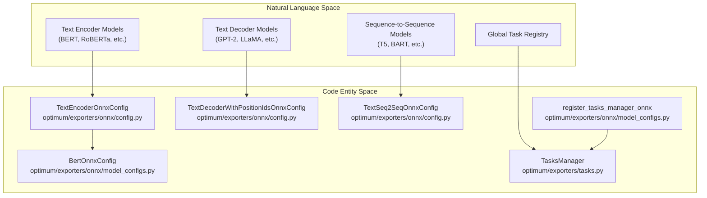
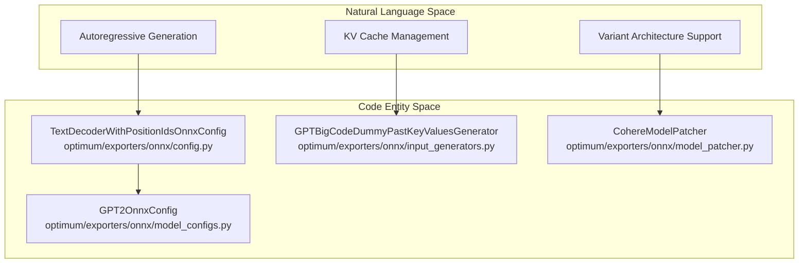

<!-- source: DeepWiki mcp.deepwiki.com · repo huggingface/optimum-onnx · page 2.3 Model-Specific Export Configurations · fetched 2026-10-26 -->

# Model-Specific Export Configurations

Relevant source files

The following files were used as context for generating this wiki page:

- [optimum/exporters/onnx/constants.py](optimum/exporters/onnx/constants.py)
- [optimum/exporters/onnx/model_configs.py](optimum/exporters/onnx/model_configs.py)

This page details the specific ONNX configurations and model architectures supported by `optimum-onnx`. It covers text encoders, decoders, seq2seq, vision, audio, and diffusion models, along with KV cache management, model patching, and task registration mechanisms.

## Configuration Hierarchy and Registration System

The configuration system relies on a rich hierarchy of base configuration classes defined in `optimum/exporters/onnx/config.py` and `optimum/exporters/onnx/base.py`, paired with concrete subclasses in `optimum/exporters/onnx/model_configs.py`. The `TasksManager` and its decorator `@register_tasks_manager_onnx` register these configurations against specific Hugging Face model types and downstream tasks [optimum/exporters/onnx/model_configs.py:121-147]().

### Diagram: Natural Language Space to Code Entity Space (Registration and Base Configs)

Sources: [optimum/exporters/onnx/config.py:51-288](), [optimum/exporters/onnx/model_configs.py:121-164]()

## Text Encoders and Sequence Classification

Text encoders process input sequences and return contextualized representations or task-specific predictions. Classes such as `BertOnnxConfig` inherit from `TextEncoderOnnxConfig` [optimum/exporters/onnx/model_configs.py:150-151]().

### Implementation Details
- Input tensors include `input_ids`, `attention_mask`, and `token_type_ids` [optimum/exporters/onnx/model_configs.py:159-163]().
- Supports common text tasks such as `feature-extraction`, `fill-mask`, `multiple-choice`, `question-answering`, `text-classification`, and `token-classification` [optimum/exporters/onnx/model_configs.py:122-129]().
- Dynamic axes manage variable batch sizes and sequence lengths [optimum/exporters/onnx/model_configs.py:155-158]().

Sources: [optimum/exporters/onnx/model_configs.py:122-164]()

## Text Decoders and KV Cache Handling

Autoregressive text decoders (e.g., GPT-2, LLaMA, Mistral, Falcon) manage past key-values (KV cache) to accelerate token generation.

### Diagram: Natural Language Space to Code Entity Space (Decoders and KV Caching)

Sources: [optimum/exporters/onnx/config.py:133-150](), [optimum/exporters/onnx/input_generators.py:25-72](), [optimum/exporters/onnx/model_patcher.py:44-51]()

## Seq2Seq, Vision, Audio, and Diffusion Configurations

Encoder-decoder models (`TextSeq2SeqOnnxConfig`), vision models (`VisionOnnxConfig`), audio models (`AudioOnnxConfig`), and diffusion pipelines require specialized input generators and configuration parameters [optimum/exporters/onnx/config.py:25-35]().

### Task and Configuration Matrix

| Model Category | Base Configuration Class | Example Model Classes | Key Dummy Input Generators / Patchers |
|----------------|--------------------------|-----------------------|---------------------------------------|
| Text Encoder | `TextEncoderOnnxConfig` | `BertOnnxConfig`, `AlbertOnnxConfig` | `DummyTextInputGenerator` [optimum/exporters/onnx/model_configs.py:150-193]() |
| Text Decoder | `TextDecoderWithPositionIdsOnnxConfig` | `GPT2OnnxConfig` [optimum/exporters/onnx/model_configs.py:371]() | `DummyPastKeyValuesGenerator` |
| Seq2Seq | `TextSeq2SeqOnnxConfig` | `T5OnnxConfig` [optimum/exporters/onnx/model_configs.py:650]() | `T5DummySeq2SeqPastKeyValuesGenerator` [optimum/exporters/onnx/model_configs.py:648]() |
| Vision | `VisionOnnxConfig` | `ViTOnnxConfig` [optimum/exporters/onnx/model_configs.py:887]() | `DummyVisionInputGenerator`, `VitPoseModelPatcher` [optimum/exporters/onnx/model_patcher.py:56]() |
| Audio | `AudioOnnxConfig`, `AudioToTextOnnxConfig` | Whisper, Moonshine | `DummyMoonshineAudioInputGenerator`, `MoonshineModelPatcher` [optimum/exporters/onnx/model_configs.py:37-49]() |
| Diffusion | Component Sessions (UNet, VAE) | Stable Diffusion, Flux | `DummyFluxTransformerTextInputGenerator`, `FluxTransformerModelPatcher` [optimum/exporters/onnx/model_configs.py:38-45]() |

Sources: [optimum/exporters/onnx/config.py:25-35](), [optimum/exporters/onnx/model_configs.py:36-57]()

---

