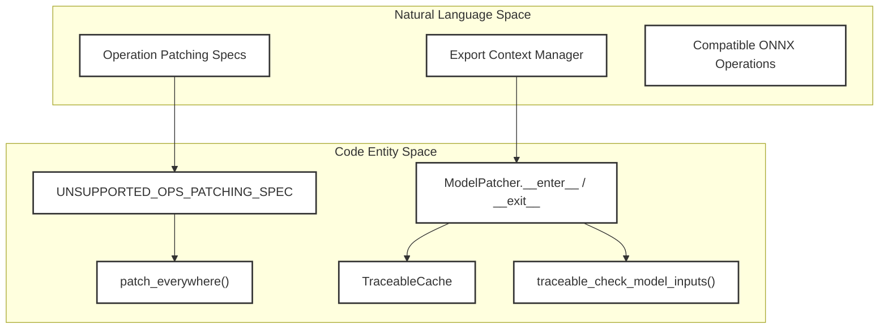
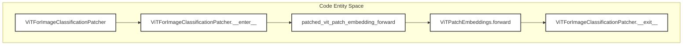

<!-- source: DeepWiki mcp.deepwiki.com · repo huggingface/optimum-onnx · page 2.4 Advanced Export Topics · fetched 2026-10-26 -->

# Advanced Export Topics

Relevant source files

The following files were used as context for generating this wiki page:

- [optimum/exporters/onnx/_debug_tool.py](optimum/exporters/onnx/_debug_tool.py)
- [optimum/exporters/onnx/_traceable_cache.py](optimum/exporters/onnx/_traceable_cache.py)
- [optimum/exporters/onnx/_traceable_decorator.py](optimum/exporters/onnx/_traceable_decorator.py)
- [optimum/exporters/onnx/model_patcher.py](optimum/exporters/onnx/model_patcher.py)
- [optimum/exporters/onnx/model_patcher_dynamo.py](optimum/exporters/onnx/model_patcher_dynamo.py)

This document covers advanced ONNX export techniques including model patching, custom configurations, the TorchDynamo export path, traceable cache and decorator utilities, and troubleshooting complex export scenarios within `optimum-onnx`.

## Model Patching System Overview

The ONNX export process frequently requires runtime modifications to model behavior to ensure compatibility with ONNX's static graph representation and limitations in PyTorch's export mechanisms. The model patching system in `optimum-onnx` provides a robust framework for applying temporary modifications during export while preserving the original model state.

### Why Model Patching is Necessary

ONNX export faces several fundamental challenges:
- **Dynamic Operations**: PyTorch models often use dynamic operations (like `unfold` or `repeat_interleave`) that cannot be directly represented in ONNX's static graph format without specific workarounds [optimum/exporters/onnx/model_patcher.py:129-204]().
- **Runtime-Specific Behavior**: Certain operations behave differently during inference versus training, requiring export-time adjustments.
- **Version Compatibility**: Different versions of `transformers` introduce breaking changes (e.g., masking logic or cache classes) that need version-specific patches [optimum/exporters/onnx/model_patcher.py:32-59]().
- **Operator Support**: Some PyTorch operations lack direct ONNX equivalents and require custom symbolic implementations [optimum/exporters/onnx/model_patcher.py:72-154]().

Sources: [optimum/exporters/onnx/model_patcher.py:32-154](), [optimum/exporters/onnx/model_patcher.py:284-346]()

## Core Patching Architecture

### PatchingSpec and ModelPatcher

The `ModelPatcher` context manager orchestrates the application and teardown of patches [optimum/exporters/onnx/model_patcher.py:284-346](). It leverages `UNSUPPORTED_OPS_PATCHING_SPEC` to swap out unsupported PyTorch functions with ONNX-friendly alternatives.

| Method / Class | Purpose | Key Functionality |
|----------------|---------|-------------------|
| `ModelPatcher` | Context Manager | Manages entry and exit states, applying and reverting monkey-patches [optimum/exporters/onnx/model_patcher.py:284-346]() |
| `patch_everywhere()` | Utility function | Replaces attributes across modules dynamically [optimum/exporters/onnx/model_patcher.py:157-166]() |
| `UNSUPPORTED_OPS_PATCHING_SPEC` | Dictionary/Spec | Maps unsupported tensor methods to compatible implementations [optimum/exporters/onnx/model_patcher.py:129-204]() |

Sources: [optimum/exporters/onnx/model_patcher.py:129-204](), [optimum/exporters/onnx/model_patcher.py:284-346]()

### Traceable Utilities

To ensure compatibility across various `transformers` versions, `optimum-onnx` implements specialized traceable decorators and cache structures:

- **`TraceableCache`**: A base class for caches that removes `nn.Module` inheritance, avoiding graph-breaking tracing issues in `transformers` versions `4.44` through `4.50` [optimum/exporters/onnx/_traceable_cache.py:26-107]().
- **`traceable_check_model_inputs`**: A decorator fixing input validation issues during ONNX tracing, preventing double-passing of positional arguments like `use_cache` [optimum/exporters/onnx/_traceable_decorator.py:32-154]().

Sources: [optimum/exporters/onnx/_traceable_cache.py:26-107](), [optimum/exporters/onnx/_traceable_decorator.py:32-154]()

## TorchDynamo Export Path and Specialized Patchers

The repository supports the modern `torch.export` (Dynamo) path alongside traditional tracing. Specialized patchers handle architecture-specific quirks under Dynamo.

### ViTForImageClassificationPatcher

For vision models, subclasses like `ViTForImageClassificationPatcher` override forward passes (e.g., in `ViTPatchEmbeddings`) to remove internal `torch._check` assertions that fail under dynamic shape tracing [optimum/exporters/onnx/model_patcher_dynamo.py:20-59]().

Sources: [optimum/exporters/onnx/model_patcher_dynamo.py:47-59]()

## Troubleshooting Export Issues

When model exports fail due to tracing or shape validation errors, `optimum-onnx` provides diagnostic tooling.

### Debugging Shape Validation

The `debug_torch_export_export` utility helps pinpoint the exact line or operation causing dynamic shape validation errors by wrapping `torch.export.export` with diagnostic patches (`onnx_diagnostic`) [optimum/exporters/onnx/_debug_tool.py:16-35]().

Sources: [optimum/exporters/onnx/_debug_tool.py:16-35]()

---

