<!-- source: DeepWiki mcp.deepwiki.com · repo huggingface/optimum-onnx · page 3 ONNX Runtime Inference · fetched 2026-10-26 -->

# ONNX Runtime Inference

Relevant source files

The following files were used as context for generating this wiki page:

- [docs/source/_toctree.yml](docs/source/_toctree.yml)
- [docs/source/onnxruntime/overview.mdx](docs/source/onnxruntime/overview.mdx)
- [docs/source/onnxruntime/package_reference/modeling.mdx](docs/source/onnxruntime/package_reference/modeling.mdx)
- [docs/source/onnxruntime/usage_guides/models.mdx](docs/source/onnxruntime/usage_guides/models.mdx)
- [optimum/exporters/onnx/__init__.py](optimum/exporters/onnx/__init__.py)
- [optimum/onnxruntime/__init__.py](optimum/onnxruntime/__init__.py)
- [optimum/onnxruntime/base.py](optimum/onnxruntime/base.py)
- [optimum/onnxruntime/modeling.py](optimum/onnxruntime/modeling.py)
- [optimum/onnxruntime/pipelines.py](optimum/onnxruntime/pipelines.py)

This document covers the ONNX Runtime inference system in `optimum-onnx`, which provides optimized execution of ONNX models through the `ORTModel` class hierarchy. This system enables loading pre-exported ONNX models and running inference with ONNX Runtime's execution providers for accelerated performance on CPU, GPU, and specialized hardware.

For information about exporting models to ONNX format, see [ONNX Model Export](#2). For model optimization and quantization, see [Model Optimization and Quantization](#4).

## ORTModel System Overview

The ONNX Runtime inference system is built around the `ORTModel` base class, the `ORTSessionMixin` utility, and various task-specific subclasses that provide optimized inference for different machine learning tasks. Each model class wraps ONNX Runtime sessions and provides a Transformers-compatible API.

### ORTModel Class Hierarchy

The following diagram maps the high-level task abstractions to the specific code entities defined in `optimum/onnxruntime/modeling.py`, `optimum/onnxruntime/modeling_seq2seq.py`, and `optimum/onnxruntime/modeling_decoder.py`.

```mermaid
graph TD
    subgraph "Base Infrastructure"
        ORTModel["ORTModel<br/>[optimum/onnxruntime/modeling.py]"]
        ORTSessionMixin["ORTSessionMixin<br/>[optimum/onnxruntime/base.py]"]
    end

    subgraph "Natural Language Processing"
        ORTModel --> ORTModelForSequenceClassification["ORTModelForSequenceClassification"]
        ORTModel --> ORTModelForQuestionAnswering["ORTModelForQuestionAnswering"]
        ORTModel --> ORTModelForFeatureExtraction["ORTModelForFeatureExtraction"]
        ORTModel --> ORTModelForCausalLM["ORTModelForCausalLM<br/>[optimum/onnxruntime/modeling_decoder.py]"]
        ORTModel --> ORTModelForSeq2SeqLM["ORTModelForSeq2SeqLM<br/>[optimum/onnxruntime/modeling_seq2seq.py]"]
    end
    
    subgraph "Computer Vision"
        ORTModel --> ORTModelForImageClassification["ORTModelForImageClassification"]
        ORTModel --> ORTModelForSemanticSegmentation["ORTModelForSemanticSegmentation"]
    end
    
    subgraph "Audio & Multimodal"
        ORTModel --> ORTModelForAudioClassification["ORTModelForAudioClassification"]
        ORTModel --> ORTModelForSpeechSeq2Seq["ORTModelForSpeechSeq2Seq"]
        ORTModel --> ORTModelForVision2Seq["ORTModelForVision2Seq"]
    end

    subgraph "Custom"
        ORTModel --> ORTModelForCustomTasks["ORTModelForCustomTasks"]
    end

    ORTSessionMixin -.-> ORTModel
```

**Sources:** [optimum/onnxruntime/__init__.py:47-71](), [optimum/onnxruntime/modeling.py:78-80](), [optimum/onnxruntime/base.py:44-48]()

For a comprehensive breakdown of task-specific classes and their roles, see [ORTModel Classes Overview](#3.1).

---

## Loading and Using Models

Models are loaded via `from_pretrained` or integrated directly into Hugging Face `pipeline` wrappers using `optimum.onnxruntime.pipeline`. When an ONNX checkpoint is not pre-existing, passing `export=True` triggers on-the-fly conversion.

**Sources:** [optimum/onnxruntime/pipelines.py:63-81](), [optimum/onnxruntime/pipelines.py:156-175]()

For detailed instructions on configuration, saving, execution providers, and IO binding integration, see [Loading and Using Models](#3.2).

---

## Text Generation Models

For causal language models like LLaMA and GPT variants, `ORTModelForCausalLM` inherits from Transformers `GenerationMixin` to support standard token generation loops. These architectures leverage Key-Value (KV) caching and merged decoder sessions to optimize autoregressive execution.

For detailed coverage on caching strategies, position IDs, and legacy architectures like Bloom and GPT BigCode, see [Text Generation Models](#3.3).

**Sources:** [optimum/onnxruntime/modeling_decoder.py](), [optimum/onnxruntime/__init__.py:36-42]()

---

## Diffusion Pipelines

Image generation workflows are managed through dedicated diffusion pipeline classes such as `ORTStableDiffusionPipeline`. These classes coordinate multiple underlying ONNX Runtime sessions for text encoders, UNet/Diffusion models, and VAE components alongside schedulers.

For details on component session handling and scheduler integration, see [Diffusion Pipelines](#3.4).

**Sources:** [optimum/onnxruntime/__init__.py:106-128](), [docs/source/onnxruntime/usage_guides/models.mdx:44-60]()

---

## Encoder-Decoder and Speech Models

Sequence-to-sequence, speech recognition, and vision-to-text models rely on `ORTModelForConditionalGeneration` and its specialized subclasses (e.g., `ORTModelForSeq2SeqLM`, `ORTModelForSpeechSeq2Seq`, `ORTModelForVision2Seq`, and `ORTModelForPix2Struct`). These multi-component models manage encoder sessions, decoder sessions, and decoder-with-past sessions with cross-attention caching.

For architectural layouts and session management details, see [Encoder-Decoder and Speech Models](#3.5).

**Sources:** [optimum/onnxruntime/__init__.py:65-70](), [optimum/onnxruntime/modeling_seq2seq.py]()

---

## IO Binding and Performance

The `ORTSessionMixin` manages lower-level interactions with ONNX Runtime sessions. A key optimization feature is **IO Binding**, which binds PyTorch or NumPy tensors directly to device memory buffers (such as CUDA memory), preventing unnecessary host-device copies during inference.

| Feature | Description | Code Entity |
| :--- | :--- | :--- |
| **IO Binding** | Direct device-to-device buffer transfer | `self._io_binding` [optimum/onnxruntime/base.py:75]() |
| **Execution Provider** | Hardware backend (CUDA, CPU, etc.) | `self.providers` [optimum/onnxruntime/base.py:105]() |
| **Device Management** | Moving sessions between hardware devices | `self.to(device)` [optimum/onnxruntime/base.py:159]() |

**Sources:** [optimum/onnxruntime/base.py:44-158](), [optimum/onnxruntime/modeling.py:81]()

---

