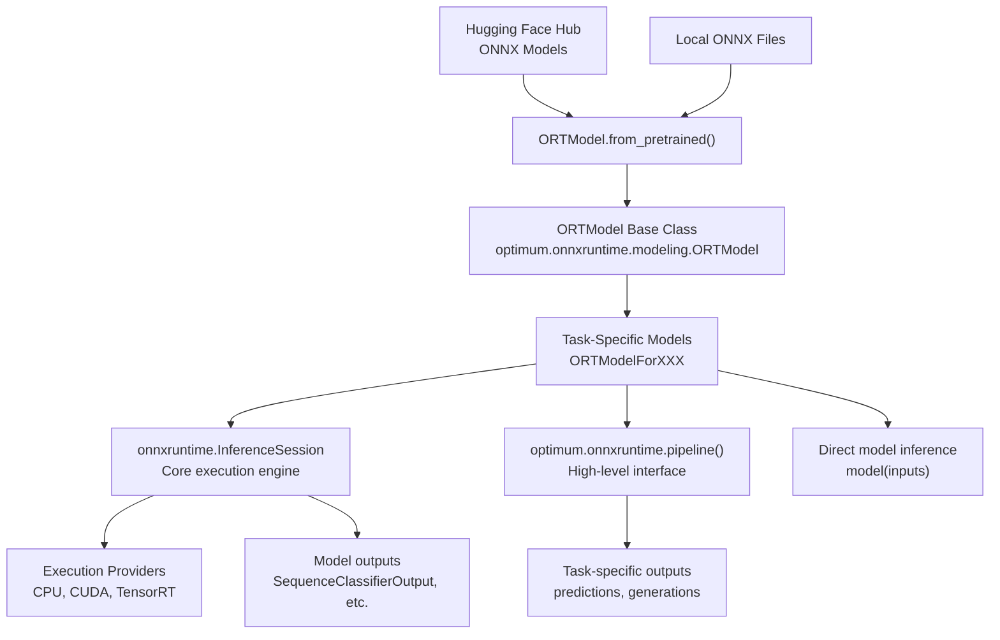
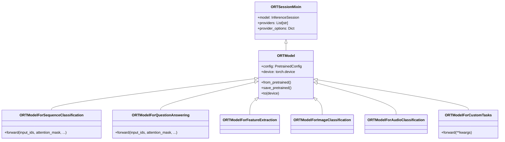
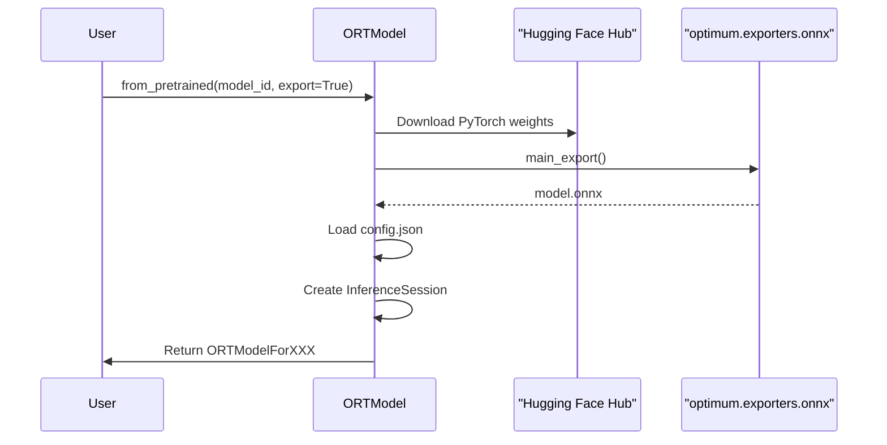

<!-- source: DeepWiki mcp.deepwiki.com · repo huggingface/optimum-onnx · page 3.1 ORTModel Classes Overview · fetched 2026-10-26 -->

# ORTModel Classes Overview

Relevant source files

The following files were used as context for generating this wiki page:

- [docs/source/_toctree.yml](docs/source/_toctree.yml)
- [docs/source/onnxruntime/overview.mdx](docs/source/onnxruntime/overview.mdx)
- [docs/source/onnxruntime/package_reference/modeling.mdx](docs/source/onnxruntime/package_reference/modeling.mdx)
- [docs/source/onnxruntime/usage_guides/models.mdx](docs/source/onnxruntime/usage_guides/models.mdx)
- [optimum/onnxruntime/base.py](optimum/onnxruntime/base.py)
- [optimum/onnxruntime/modeling.py](optimum/onnxruntime/modeling.py)
- [optimum/onnxruntime/modeling_ort.py](optimum/onnxruntime/modeling_ort.py)
- [tests/onnxruntime/test_modeling.py](tests/onnxruntime/test_modeling.py)

This page provides a comprehensive overview of the `ORTModel` class hierarchy and task-specific implementations in `optimum-onnx`. These classes provide the core runtime inference interface for ONNX models, bridging between ONNX Runtime execution and the Hugging Face transformers ecosystem.

## Purpose and Architecture

The `ORTModel` classes serve as the primary interface for loading and running ONNX models with ONNX Runtime. They provide a `transformers`-compatible API while leveraging ONNX Runtime's optimized execution capabilities [optimum/onnxruntime/modeling.py:14-15]().

### ORTModel Integration Flow

Sources: [optimum/onnxruntime/modeling.py:14-63](), [tests/onnxruntime/test_modeling.py:59-79]()

## Class Hierarchy

The `ORTModel` class hierarchy is organized around task-specific functionality, inheriting from a common base class `OptimizedModel` and using `ORTSessionMixin` for session management [optimum/onnxruntime/modeling.py:78-79]().

### Core Class Structure

Sources: [optimum/onnxruntime/modeling.py:78-79](), [tests/onnxruntime/test_modeling.py:62-77]()

## Model Categories

The `ORTModel` classes are organized into several categories based on their functionality and target tasks, matching the `transformers` `AutoModel` architecture.

### Text Processing Models

| Class | Task | Input | Output |
|-------|------|-------|---------|
| `ORTModelForSequenceClassification` | Text classification | `input_ids`, `attention_mask` | `SequenceClassifierOutput` |
| `ORTModelForTokenClassification` | Token-level classification | `input_ids`, `attention_mask` | `TokenClassifierOutput` |
| `ORTModelForQuestionAnswering` | Extractive QA | `input_ids`, `attention_mask` | `QuestionAnsweringModelOutput` |
| `ORTModelForMaskedLM` | Masked language modeling | `input_ids`, `attention_mask` | `MaskedLMOutput` |
| `ORTModelForMultipleChoice` | Multiple choice | `input_ids`, `attention_mask` | `MultipleChoiceModelOutput` |
| `ORTModelForFeatureExtraction` | Feature extraction | `input_ids`, `attention_mask` | `BaseModelOutput` |

### Audio and Vision Processing Models

| Class | Task | Input | Output |
|-------|------|-------|---------|
| `ORTModelForAudioClassification` | Audio classification | `input_values` | `SequenceClassifierOutput` |
| `ORTModelForImageClassification` | Image classification | `pixel_values` | `ImageClassifierOutput` |
| `ORTModelForSemanticSegmentation` | Semantic segmentation | `pixel_values` | `SemanticSegmenterOutput` |
| `ORTModelForAudioXVector` | Speaker embeddings | `input_values` | `XVectorOutput` |

Sources: [optimum/onnxruntime/modeling.py:31-63](), [optimum/onnxruntime/modeling.py:104-136]()

## Base ORTModel Class

The `ORTModel` class provides the foundational functionality shared across all task-specific implementations.

### Core Components

The base class manages several key components:

- **ONNX Runtime Session**: Managed via `ORTSessionMixin`, it holds the `InferenceSession` [optimum/onnxruntime/base.py:44-48]().
- **Configuration**: Uses `transformers.PretrainedConfig` for model metadata [docs/source/onnxruntime/package_reference/modeling.mdx:19-22]().
- **On-the-fly Export**: Supports `export=True` in `from_pretrained` to convert models using `main_export` [docs/source/onnxruntime/usage_guides/models.mdx:116-127]().

### Model Loading Workflow

The `from_pretrained` method can load from the Hugging Face Hub, a local directory, or export a PyTorch model to ONNX on-the-fly [tests/onnxruntime/test_modeling.py:103-132]().

Sources: [optimum/onnxruntime/modeling.py:76-78](), [tests/onnxruntime/test_modeling.py:103-115]()

## Task-Specific Model Features

### ORTModelForSequenceClassification
Runs text classification or regression models by attaching a sequence classification head over the transformer hidden states, returning a `SequenceClassifierOutput` [optimum/onnxruntime/modeling.py:44]().

### ORTModelForQuestionAnswering
Handles extractive question answering tasks, mapping token embeddings to start and end logit scores via `QuestionAnsweringModelOutput` [optimum/onnxruntime/modeling.py:42]().

### ORTModelForFeatureExtraction
Commonly used for Sentence Transformers and general dense vector generation, this class returns the hidden states or embeddings from the underlying ONNX model [docs/source/onnxruntime/usage_guides/models.mdx:65-74]().

### ORTModelForImageClassification
Executes computer vision models (including models supported by `timm` or `transformers`) taking `pixel_values` and producing `ImageClassifierOutput` [optimum/onnxruntime/modeling.py:38]().

### ORTModelForAudioClassification
Processes raw audio waveforms via `input_values` through an audio encoder and classification head, returning class probabilities in a `SequenceClassifierOutput` format [optimum/onnxruntime/modeling.py:34]().

### ORTModelForCustomTasks
This class is designed for models that do not fit standard `transformers` task heads or for users who want to run arbitrary ONNX models with a flexible `forward(**kwargs)` interface [optimum/onnxruntime/modeling.py:67]().

### Input Handling
Task-specific classes provide docstrings and argument validation for specific input types:
- **Text**: `input_ids`, `attention_mask`, `token_type_ids` [optimum/onnxruntime/modeling.py:104-122]().
- **Images**: `pixel_values` [optimum/onnxruntime/modeling.py:124-129]().
- **Audio**: `input_values` [optimum/onnxruntime/modeling.py:131-136]().

Sources: [optimum/onnxruntime/modeling.py:31-77](), [optimum/onnxruntime/modeling.py:104-136]()

## Device and Provider Management

`ORTModel` classes handle execution provider (EP) setup via `prepare_providers_and_provider_options` [optimum/onnxruntime/modeling.py:81]().

| Provider | Hardware | Use Case |
|----------|----------|----------|
| `CPUExecutionProvider` | CPU | Default fallback execution engine [optimum/onnxruntime/base.py:56-72](). |
| `CUDAExecutionProvider` | NVIDIA GPU | Standard GPU acceleration with IO Binding support [optimum/onnxruntime/base.py:56-72](). |

### Multi-Model Components
For complex tasks like Seq2Seq or Causal LM, `optimum-onnx` manages multiple ONNX files:
- `model.onnx`: Standard single-file model [optimum/onnxruntime/constants.py:15]().
- `encoder_model.onnx` / `decoder_model.onnx`: Split architectures [optimum/onnxruntime/constants.py:16-17]().
- `decoder_with_past_model.onnx`: Optimized decoder for auto-regressive generation [optimum/onnxruntime/constants.py:18]().
- `decoder_model_merged.onnx`: Combined decoder for both first-step and subsequent-step inference [optimum/onnxruntime/constants.py:19]().

Sources: [optimum/onnxruntime/constants.py:15-25](), [optimum/onnxruntime/base.py:44-85]()

---

