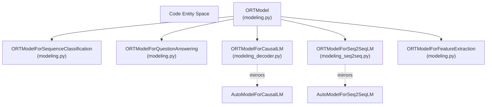
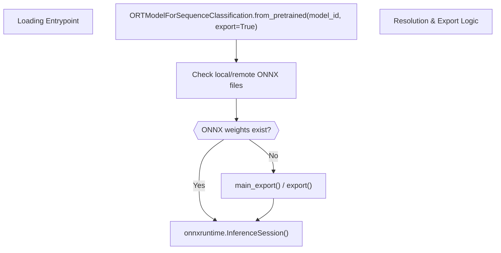
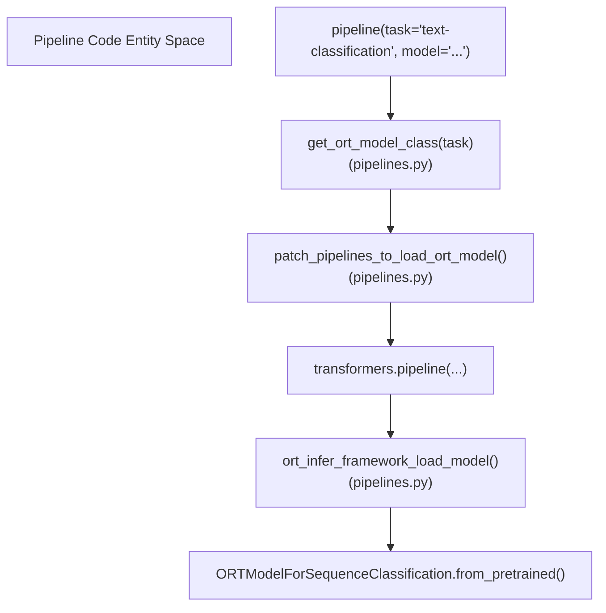

<!-- source: DeepWiki mcp.deepwiki.com · repo huggingface/optimum-onnx · page 3.2 Loading and Using Models · fetched 2026-10-26 -->

# Loading and Using Models

<details>
<summary>Relevant source files</summary>

The following files were used as context for generating this wiki page:

- [docs/source/onnxruntime/package_reference/modeling_diffusion.mdx](docs/source/onnxruntime/package_reference/modeling_diffusion.mdx)
- [docs/source/onnxruntime/package_reference/pipelines.mdx](docs/source/onnxruntime/package_reference/pipelines.mdx)
- [docs/source/onnxruntime/usage_guides/amdgpu.mdx](docs/source/onnxruntime/usage_guides/amdgpu.mdx)
- [docs/source/onnxruntime/usage_guides/gpu.mdx](docs/source/onnxruntime/usage_guides/gpu.mdx)
- [docs/source/onnxruntime/usage_guides/pipelines.mdx](docs/source/onnxruntime/usage_guides/pipelines.mdx)
- [optimum/exporters/onnx/__init__.py](optimum/exporters/onnx/__init__.py)
- [optimum/onnxruntime/__init__.py](optimum/onnxruntime/__init__.py)
- [optimum/onnxruntime/optimization.py](optimum/onnxruntime/optimization.py)
- [optimum/onnxruntime/pipelines.py](optimum/onnxruntime/pipelines.py)
- [optimum/onnxruntime/quantization.py](optimum/onnxruntime/quantization.py)
- [optimum/onnxruntime/utils.py](optimum/onnxruntime/utils.py)

</details>


This page covers the core mechanisms for loading ONNX models using the `ORTModel` family of classes within `optimum-onnx`, managing hardware execution providers, configuring I/O binding for performance, and integrating seamlessly with Hugging Face `transformers` pipelines.

---

## 1. ORTModel Class Architecture & Hierarchy

The `optimum.onnxruntime` subsystem provides task-specific model wrappers inheriting from the base `ORTModel` class. These classes mimic the standard Hugging Face `PreTrainedModel` APIs while orchestrating underlying ONNX Runtime `InferenceSession` instances.

The model classes are organized by task and architecture, registered in `optimum/onnxruntime/__init__.py` [optimum/onnxruntime/__init__.py:47-71]() and implemented across modules like `optimum/onnxruntime/modeling.py`, `optimum/onnxruntime/modeling_decoder.py`, and `optimum/onnxruntime/modeling_seq2seq.py`.



Sources: [optimum/onnxruntime/__init__.py:47-76]()

---

## 2. Loading Models with `from_pretrained` and `export=True`

Models are instantiated using the classmethod `from_pretrained()`, which supports loading pre-exported ONNX checkpoints from local directories or the Hugging Face Hub, as well as on-the-fly exporting via the `export=True` flag.

### Hub vs. Local Loading & Export Flow

When `export=True` is provided, `optimum-onnx` invokes the exporter backend (`optimum.exporters.onnx`) to convert PyTorch weights into ONNX Intermediate Representation (IR) before building the `onnxruntime.InferenceSession`.



Sources: [optimum/onnxruntime/utils.py:148-182](), [optimum/onnxruntime/pipelines.py:116-135]()

---

## 3. Hardware Acceleration and Execution Providers

ONNX Runtime delegates computation to hardware accelerators through Execution Providers (EP). When loading an `ORTModel`, you can specify the target provider using the `provider` argument.

### Execution Providers & Device Mapping

Utility functions in `optimum/onnxruntime/utils.py` handle device string parsing and provider resolution:
- `get_provider_for_device(device)` [optimum/onnxruntime/utils.py:157-164]() maps a `torch.device` to an ORT provider string (e.g., `CUDAExecutionProvider`, `ROCMExecutionProvider`, `CPUExecutionProvider`).
- `parse_device(device)` [optimum/onnxruntime/utils.py:166-182]() extracts device indexes and provider options (such as `device_id`) for multi-GPU execution.

```python
from optimum.onnxruntime import ORTModelForSequenceClassification

# Load model onto CUDA GPU
model = ORTModelForSequenceClassification.from_pretrained(
    "distilbert-base-uncased-finetuned-sst-2-english",
    export=True,
    provider="CUDAExecutionProvider"
)
```

### I/O Binding

To minimize host-to-device and device-to-host memory copying overhead during GPU inference, `optimum-onnx` supports ONNX Runtime **IO Binding** (`use_io_binding=True`), which pre-allocates tensor buffers on the GPU device.

Sources: [optimum/onnxruntime/utils.py:148-182](), [docs/source/onnxruntime/usage_guides/gpu.mdx:1-128]()

---

## 4. Model Saving and Preprocessor Management

Once loaded or exported, models can be persisted to disk along with their associated tokenizers, feature extractors, or image processors using `save_pretrained()`.

```python
# Save model weights, configuration, and preprocessor files locally
model.save_pretrained("./optimized-bert")
```

The saving mechanism integrates helper functions like `maybe_save_preprocessors` [optimum/onnxruntime/optimization.py:39-39]() to ensure that downstream inference pipelines can initialize tokenizer and processor instances without missing configuration files.

Sources: [optimum/onnxruntime/optimization.py:38-40](), [optimum/onnxruntime/quantization.py:39-40]()

---

## 5. Integration with Transformers Pipelines

Optimum provides a drop-in replacement for the Hugging Face `transformers.pipeline` function [optimum/onnxruntime/pipelines.py:156-175](), enabling ONNX Runtime inference within standard pipeline workflows.

### Pipeline Data Flow and Wrapper Architecture



### Supported Task Mappings

The dictionary `ORT_TASKS_MAPPING` [optimum/onnxruntime/pipelines.py:63-81]() maps Hugging Face pipeline tasks to their corresponding `ORTModel` implementations:

| Pipeline Task | Associated `ORTModel` Class |
| :--- | :--- |
| `text-classification` | `ORTModelForSequenceClassification` [optimum/onnxruntime/pipelines.py:75-75]() |
| `question-answering` | `ORTModelForQuestionAnswering` [optimum/onnxruntime/pipelines.py:72-72]() |
| `text-generation` | `ORTModelForCausalLM` [optimum/onnxruntime/pipelines.py:76-76]() |
| `summarization` / `translation` | `ORTModelForSeq2SeqLM` [optimum/onnxruntime/pipelines.py:73-74]() |
| `automatic-speech-recognition` | `ORTModelForCTC`, `ORTModelForSpeechSeq2Seq` [optimum/onnxruntime/pipelines.py:65-65]() |

Sources: [optimum/onnxruntime/pipelines.py:63-175]()

---

