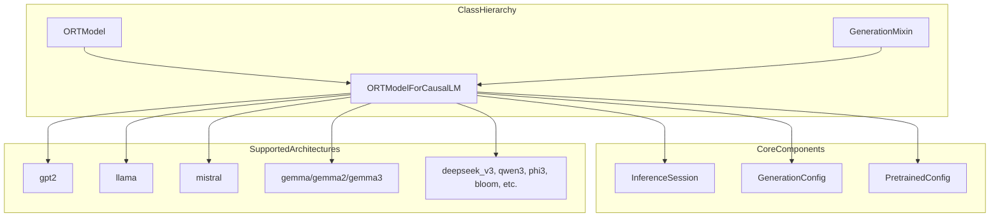
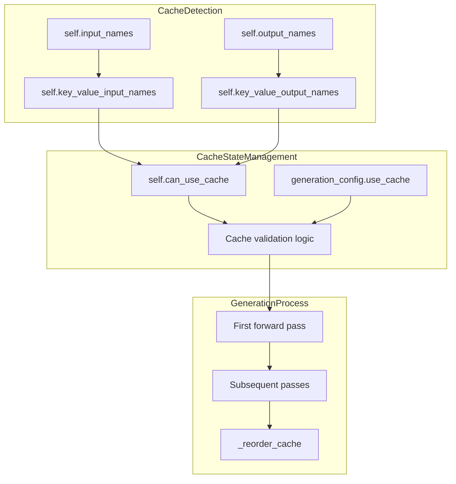
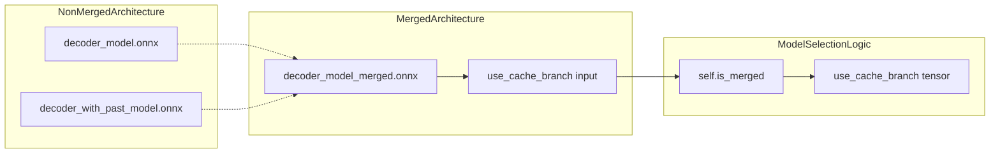
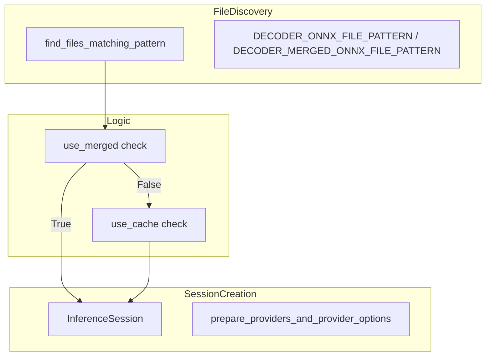
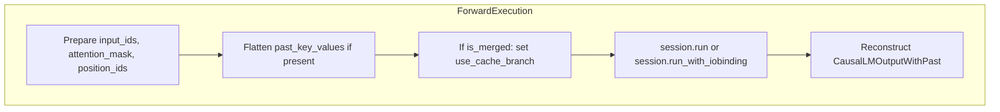

<!-- source: DeepWiki mcp.deepwiki.com · repo huggingface/optimum-onnx · page 3.3 Text Generation Models · fetched 2026-10-26 -->

# Text Generation Models

<details>
<summary>Relevant source files</summary>

The following files were used as context for generating this wiki page:

- [optimum/onnxruntime/modeling_decoder.py](optimum/onnxruntime/modeling_decoder.py)
- [tests/onnxruntime/test_decoder.py](tests/onnxruntime/test_decoder.py)

</details>


This page covers the ONNX Runtime implementation for causal language models used in text generation tasks. Text generation models are autoregressive language models that generate text one token at a time, conditioning on previously generated tokens. This includes decoder-only transformer architectures such as GPT-2, LLaMA, Mistral, Gemma, Phi, and legacy models like Bloom and GPT BigCode.

For information about sequence-to-sequence models, see [ORTModel Classes Overview](#3.1). For diffusion-based text-to-image generation, see [Diffusion Pipelines](#3.4). For model loading and configuration basics, see [Loading and Using Models](#3.2).

## ORTModelForCausalLM Overview

The `ORTModelForCausalLM` class provides ONNX Runtime inference for causal language models. It extends the base `ORTModel` class and mixes in `GenerationMixin` to support text generation capabilities across a wide range of transformer architectures.



Sources: [optimum/onnxruntime/modeling_decoder.py:123-126](), [tests/onnxruntime/test_decoder.py:80-150]()

## Key Features and Capabilities

### Past Key Values Caching

The most critical performance optimization for text generation is past key values (PKV) caching. This allows the model to reuse previously computed attention keys and values, avoiding redundant computation during autoregressive generation.



The caching mechanism is initialized during model construction and validated against the ONNX model's input/output signatures:

| Property | Purpose | Location |
|----------|---------|----------|
| `can_use_cache` | Indicates if model supports caching | [optimum/onnxruntime/modeling_decoder.py:144]() |
| `key_value_input_names` | Names of cache input tensors | [optimum/onnxruntime/modeling_decoder.py:142]() |
| `key_value_output_names` | Names of cache output tensors | [optimum/onnxruntime/modeling_decoder.py:143]() |
| `is_merged` | Detects if the model is a merged ONNX graph | [optimum/onnxruntime/modeling_decoder.py:145]() |

Sources: [optimum/onnxruntime/modeling_decoder.py:142-146](), [optimum/onnxruntime/modeling_decoder.py:433-484]()

### Merged vs Non-Merged Models

ONNX models can be exported in two variants:
- **Non-merged**: Separate models for initial forward pass (`decoder_model.onnx`) and subsequent passes with cache (`decoder_with_past_model.onnx`).
- **Merged**: Single model (`decoder_model_merged.onnx`) with a `use_cache_branch` input that controls execution path.



Sources: [optimum/onnxruntime/modeling_decoder.py:145](), [optimum/onnxruntime/modeling_decoder.py:536-543](), [optimum/onnxruntime/modeling_decoder.py:755-763]()

### Architecture-Specific Optimizations and Legacy Handling

Different model architectures require specific handling for attention mechanisms and position IDs. `ORTModelForCausalLM` checks if the model type requires position IDs and emits warnings if legacy models are loaded without them [optimum/onnxruntime/modeling_decoder.py:149-155]().

Sources: [optimum/onnxruntime/modeling_decoder.py:149-155](), [tests/onnxruntime/test_decoder.py:80-150]()

## Model Loading and Initialization

### Loading Process

The `from_pretrained` method orchestrates the discovery of ONNX files and session creation.



Sources: [optimum/onnxruntime/modeling_decoder.py:514-570](), [optimum/onnxruntime/modeling_decoder.py:612-656]()

### Position IDs Handling

Modern transformer models require `position_ids` for accurate generation, especially when using KV caching. `ORTModelForCausalLM` checks if the model type is in `MODEL_TYPES_REQUIRING_POSITION_IDS` and warns if they are missing from the ONNX graph.

Sources: [optimum/onnxruntime/modeling_decoder.py:149-155](), [optimum/exporters/onnx/utils.py:31]()

## Text Generation Process

### Forward Pass Implementation

The `forward` method maps PyTorch tensors to ONNX Runtime inputs, manages the `use_cache_branch` for merged models, and reshapes outputs into `CausalLMOutputWithPast`.



Sources: [optimum/onnxruntime/modeling_decoder.py:264-390]()

### IO Binding for Performance

IO Binding is an optimization allowing ONNX Runtime to read/write directly from/to GPU memory, avoiding CPU-GPU copy overhead.
- **Initialization**: `use_io_binding` is set during `__init__` [optimum/onnxruntime/modeling_decoder.py:136]().
- **Runtime**: In `forward`, if enabled, `_prepare_io_binding` pre-allocates and binds tensors.

Sources: [optimum/onnxruntime/modeling_decoder.py:136](), [optimum/onnxruntime/modeling_decoder.py:354-374]()

### Generation Integration

The model integrates with Transformers' generation framework through `GenerationMixin`. Key methods include:
- `prepare_inputs_for_generation`: Prepares inputs for each step of autoregressive generation.
- `_reorder_cache`: Reorders KV cache tensors for beam search support.

Sources: [optimum/onnxruntime/modeling_decoder.py:392-431](), [optimum/onnxruntime/modeling_decoder.py:433-484]()

## Architecture Specifics: Bloom and GPT BigCode

Legacy architectures or those with non-standard attention require special handling:
- **Bloom**: Uses specific tensor formats for KV cache in older exports, transformed for compatibility [optimum/onnxruntime/modeling_decoder.py:207-237]().
- **GPT BigCode**: Uses Multi-Query Attention where keys and values are shared across heads, resulting in distinct tensor ranks.

Sources: [optimum/onnxruntime/modeling_decoder.py:207-237](), [optimum/onnxruntime/modeling_decoder.py:448-465]()

## Usage Example

```python
from optimum.onnxruntime import ORTModelForCausalLM
from transformers import AutoTokenizer

model_id = "gpt2"
tokenizer = AutoTokenizer.from_pretrained(model_id)
model = ORTModelForCausalLM.from_pretrained(model_id, export=True)

inputs = tokenizer("The capital of France is", return_tensors="pt")
gen_tokens = model.generate(**inputs, max_new_tokens=10)
print(tokenizer.batch_decode(gen_tokens))
```

Sources: [optimum/onnxruntime/modeling_decoder.py:89-119]()

---

