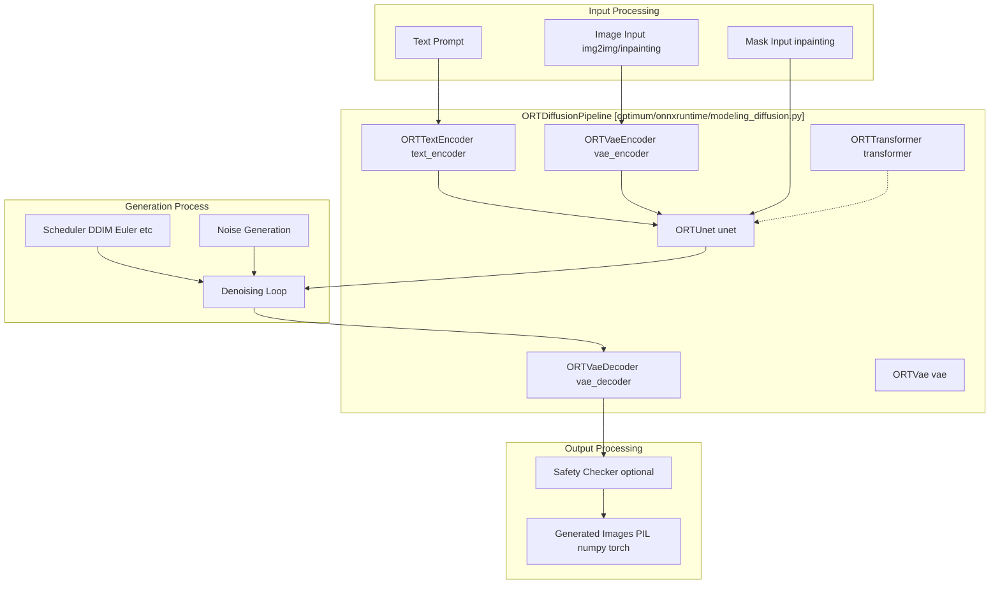
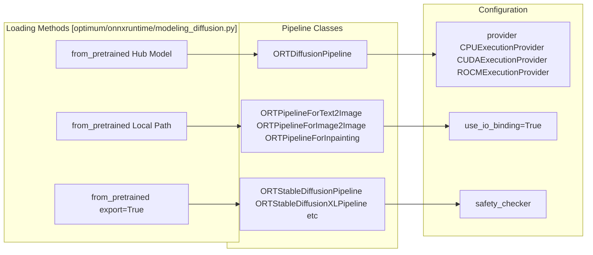
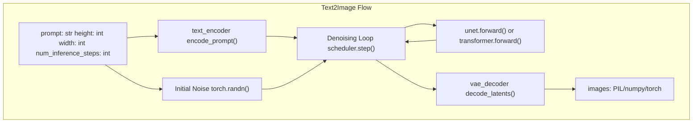
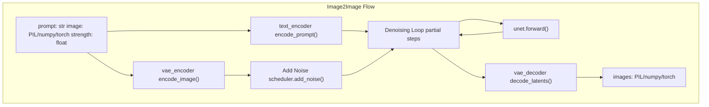
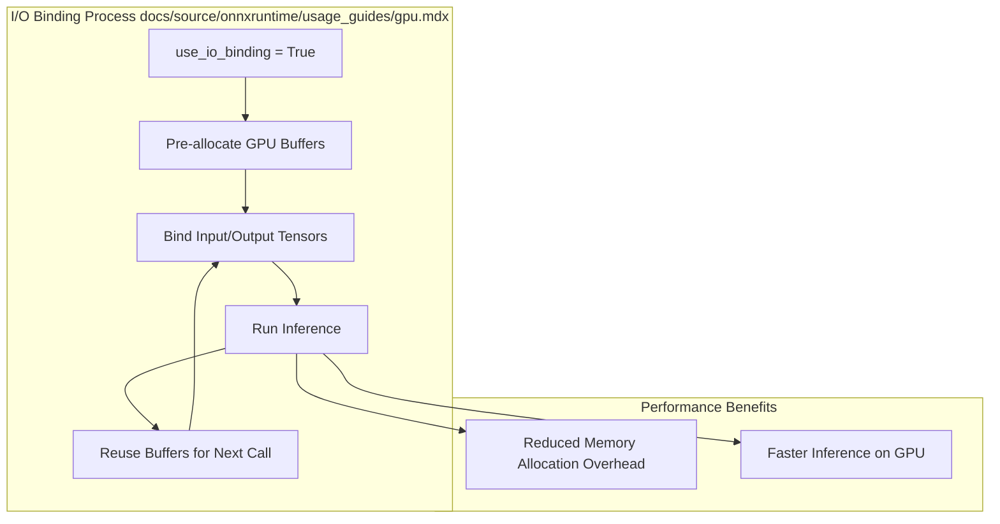

<!-- source: DeepWiki mcp.deepwiki.com · repo huggingface/optimum-onnx · page 3.4 Diffusion Pipelines · fetched 2026-10-26 -->

# Diffusion Pipelines

Relevant source files

The following files were used as context for generating this wiki page:

- [docs/source/onnxruntime/package_reference/modeling_diffusion.mdx](docs/source/onnxruntime/package_reference/modeling_diffusion.mdx)
- [docs/source/onnxruntime/package_reference/pipelines.mdx](docs/source/onnxruntime/package_reference/pipelines.mdx)
- [docs/source/onnxruntime/usage_guides/amdgpu.mdx](docs/source/onnxruntime/usage_guides/amdgpu.mdx)
- [docs/source/onnxruntime/usage_guides/gpu.mdx](docs/source/onnxruntime/usage_guides/gpu.mdx)
- [docs/source/onnxruntime/usage_guides/pipelines.mdx](docs/source/onnxruntime/usage_guides/pipelines.mdx)
- [optimum/exporters/onnx/input_generators.py](optimum/exporters/onnx/input_generators.py)
- [optimum/onnxruntime/modeling_diffusion.py](optimum/onnxruntime/modeling_diffusion.py)
- [tests/onnxruntime/test_diffusion.py](tests/onnxruntime/test_diffusion.py)

This document covers ONNX Runtime-optimized diffusion pipelines for image generation tasks. These pipelines provide accelerated inference for popular diffusion models like Stable Diffusion, Stable Diffusion XL, and Flux using ONNX Runtime execution providers.

For general ONNX model loading and inference, see [ORTModel Classes Overview](#3.1). For exporting diffusion models to ONNX format, see [ONNX Model Export](#2).

## Pipeline Architecture

The diffusion pipeline system consists of multiple ONNX-optimized components that work together to perform image generation. The base class `ORTDiffusionPipeline` manages these components, which are wrapped in specialized ORT model classes like `ORTUnet`, `ORTTransformer`, and `ORTVaeDecoder`.

Sources: [optimum/onnxruntime/modeling_diffusion.py:92-166](), [tests/onnxruntime/test_diffusion.py:127-133]()

## Supported Model Architectures

The system supports multiple diffusion model architectures, each with specific pipeline implementations derived from `ORTDiffusionPipeline`.

| Architecture | Pipeline Classes | Tasks Supported |
|--------------|------------------|-----------------|
| `stable-diffusion` | `ORTStableDiffusionPipeline` `ORTStableDiffusionImg2ImgPipeline` `ORTStableDiffusionInpaintPipeline` | Text2Image, Image2Image, Inpainting |
| `stable-diffusion-xl` | `ORTStableDiffusionXLPipeline` `ORTStableDiffusionXLImg2ImgPipeline` `ORTStableDiffusionXLInpaintPipeline` | Text2Image, Image2Image, Inpainting |
| `stable-diffusion-3` | `ORTStableDiffusion3Pipeline` `ORTStableDiffusion3Img2ImgPipeline` `ORTStableDiffusion3InpaintPipeline` | Text2Image, Image2Image, Inpainting |
| `latent-consistency` | `ORTLatentConsistencyModelPipeline` `ORTLatentConsistencyModelImg2ImgPipeline` | Text2Image, Image2Image |
| `flux` | `ORTFluxPipeline` | Text2Image |

Sources: [optimum/onnxruntime/modeling_diffusion.py:29-41](), [tests/onnxruntime/test_diffusion.py:50-55]()

## Loading and Using Pipelines

### Basic Pipeline Loading

Pipelines can be loaded from the Hugging Face Hub, a local path, or exported on-the-fly from PyTorch weights.

Sources: [optimum/onnxruntime/modeling_diffusion.py:218-258](), [tests/onnxruntime/test_diffusion.py:136-150]()

### Execution Providers

The pipelines support multiple execution providers for different hardware configurations. The `provider` argument in `from_pretrained` determines the backend.

| Provider | Usage | Requirements |
|----------|-------|--------------|
| `CPUExecutionProvider` | CPU inference | Always available |
| `CUDAExecutionProvider` | NVIDIA GPU | CUDA-capable GPU |
| `ROCMExecutionProvider` | AMD GPU | ROCm-capable GPU |
| `TensorrtExecutionProvider` | NVIDIA GPU with TensorRT | TensorRT installation |

Sources: [docs/source/onnxruntime/usage_guides/gpu.mdx:16-47](), [docs/source/onnxruntime/usage_guides/amdgpu.mdx:57-76](), [tests/onnxruntime/test_diffusion.py:71-80]()

## Pipeline Types

### Text-to-Image Pipelines

Text-to-image pipelines generate images from text prompts using the `ORTPipelineForText2Image` class. This involves encoding the prompt, initializing noise, and running the denoising loop.

Sources: [optimum/onnxruntime/modeling_diffusion.py:144-166](), [tests/onnxruntime/test_diffusion.py:86-93]()

### Image-to-Image Pipelines

Image-to-image pipelines modify existing images based on text prompts using the `ORTPipelineForImage2Image` class. This process requires the `vae_encoder` to map the input image to the latent space.

Sources: [optimum/onnxruntime/modeling_diffusion.py:161-166](), [tests/onnxruntime/test_diffusion.py:96-119]()

## Advanced Features

### I/O Binding Optimization

I/O binding provides memory optimization by reusing GPU memory buffers across inference calls, significantly reducing data copying overhead between CPU and GPU.

Sources: [docs/source/onnxruntime/usage_guides/gpu.mdx:127-133](), [optimum/onnxruntime/modeling_diffusion.py:139-142]()

### Component Handling and Scheduler Integration

Diffusion pipelines manage several sub-components initialized via `ORTDiffusionPipeline` as `ORTSessionMixin` objects [optimum/onnxruntime/modeling_diffusion.py:61-166]():
* **UNet/Transformer**: The main denoising backbone wrapped by `ORTUnet` or `ORTTransformer`.
* **VAE Encoder/Decoder**: For translating between pixel space and latent space via `ORTVaeEncoder` and `ORTVaeDecoder`.
* **Text Encoder(s)**: For processing text prompts (`ORTTextEncoder`), supporting multiple encoders for SDXL, SD3, and Flux pipelines.
* **Scheduler**: A `diffusers.SchedulerMixin` instance that controls the iterative denoising steps and noise scheduling [optimum/onnxruntime/modeling_diffusion.py:48-49]().

Sources: [optimum/onnxruntime/modeling_diffusion.py:48-166]()

### Model Export Integration

Diffusion models can be exported to ONNX format using the `main_export` utility. The pipeline identifies required subfolders (e.g., `unet`, `vae_decoder`, `text_encoder`) and exports each component into the specified directory.

Sources: [optimum/onnxruntime/modeling_diffusion.py:60-72]()

---

