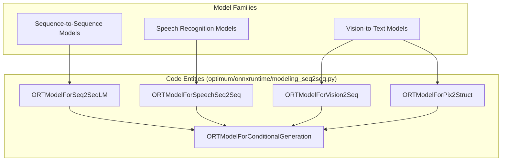
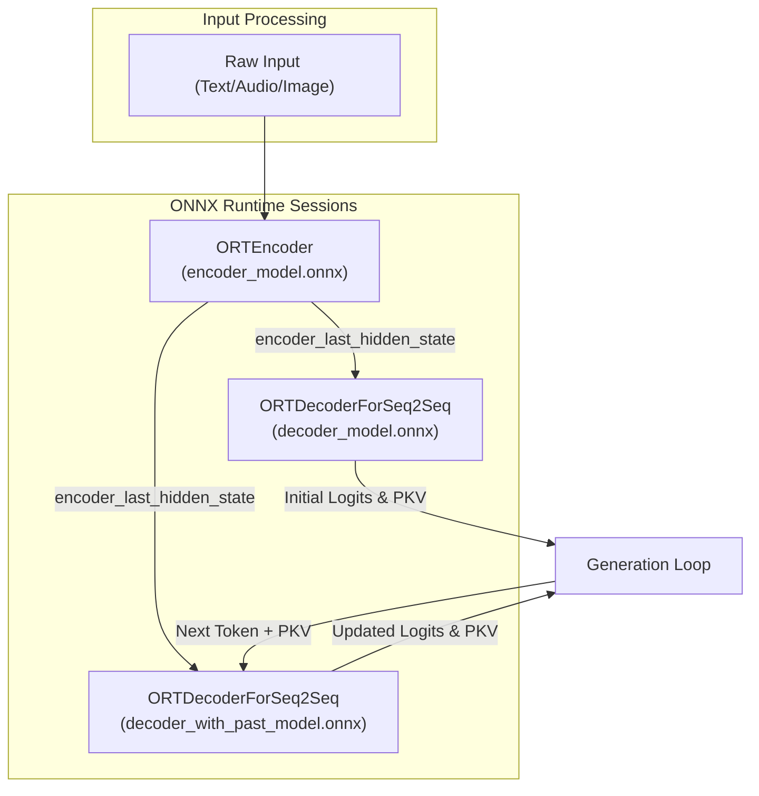
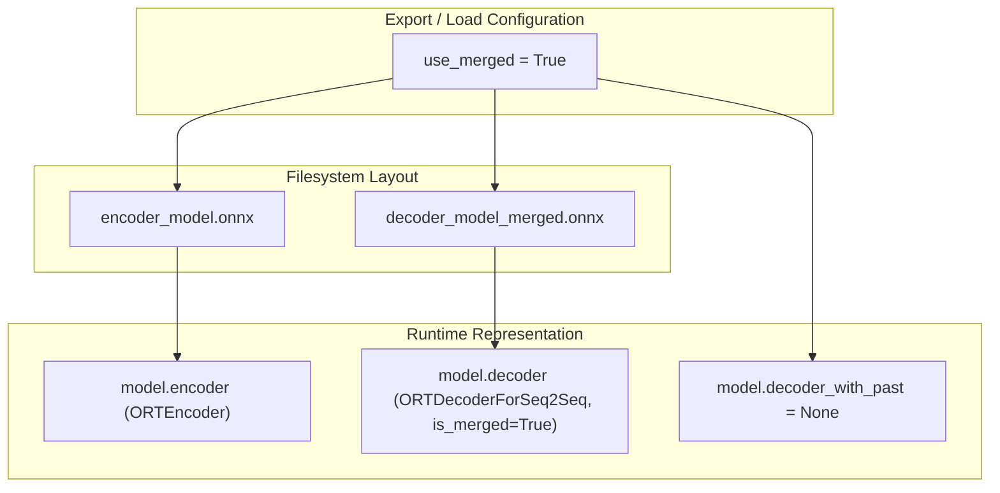
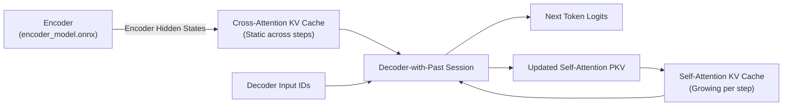

<!-- source: DeepWiki mcp.deepwiki.com · repo huggingface/optimum-onnx · page 3.5 Encoder-Decoder and Speech Models · fetched 2026-10-26 -->

# Encoder-Decoder and Speech Models

Relevant source files

The following files were used as context for generating this wiki page:

- [optimum/onnxruntime/base.py](optimum/onnxruntime/base.py)
- [optimum/onnxruntime/modeling_seq2seq.py](optimum/onnxruntime/modeling_seq2seq.py)
- [pyproject.toml](pyproject.toml)
- [tests/onnxruntime/test_seq2seq.py](tests/onnxruntime/test_seq2seq.py)

This section documents `ORTModelForConditionalGeneration` and its specialized subclasses for sequence-to-sequence, speech recognition, and vision-to-text tasks within `optimum-onnx`. It details the multi-session architecture (encoder, decoder, and decoder-with-past), merged decoder configurations, and cross-attention caching mechanisms implemented in `optimum/onnxruntime/modeling_seq2seq.py` [optimum/onnxruntime/modeling_seq2seq.py:1-1594]().

---

## 3.5.1 `ORTModelForConditionalGeneration` and Subclasses

`ORTModelForConditionalGeneration` acts as the base container class for architectures that require both an encoder (or feature extractor) and an autoregressive decoder. It inherits from Hugging Face's `GenerationMixin` and provides the core logic for loading, saving, and executing multi-file ONNX models using ONNX Runtime.

The repository provides several task-specific subclasses corresponding to Transformers auto-classes:

| Subclass Name | Underlying Transformers Class | Typical Model Architectures | Primary Input Modality |
| :--- | :--- | :--- | :--- |
| `ORTModelForSeq2SeqLM` | `AutoModelForSeq2SeqLM` [optimum/onnxruntime/modeling_seq2seq.py:27]() | T5, BART, Marian, MBart | Text (`input_ids`) |
| `ORTModelForSpeechSeq2Seq` | `AutoModelForSpeechSeq2Seq` [optimum/onnxruntime/modeling_seq2seq.py:28]() | Whisper, Speech2Text | Speech (`input_features`) |
| `ORTModelForVision2Seq` | `AutoModelForVision2Seq` [optimum/onnxruntime/modeling_seq2seq.py:38]() | ViT-GPT2, TrOCR | Vision (`pixel_values`) |
| `ORTModelForPix2Struct` | `Pix2StructForConditionalGeneration` [optimum/onnxruntime/modeling_seq2seq.py:31]() | Pix2Struct | Vision (`flattened_patches`) |
| `ORTModelForWhisper` | `WhisperForConditionalGeneration` [optimum/onnxruntime/modeling_seq2seq.py:32]() | Whisper | Speech (`input_features`) |
| `ORTModelForMoonshine` | `MoonshineForConditionalGeneration` [optimum/onnxruntime/modeling_seq2seq.py:69]() | Moonshine | Speech (`input_values`) |

### Natural Language Space to Code Entity Space

Sources: `optimum/onnxruntime/modeling_seq2seq.py:25-72`

---

## 3.5.2 Session Layout: Encoder, Decoder, and Decoder-with-Past

Unlike causal language models which rely on a single ONNX file (or a single pair of merged files), encoder-decoder models typically partition the computational graph into separate ONNX sessions:

1. **Encoder Session (`ORTEncoder`)**: Processes the input sequence (tokens, mel-spectrogram features, or pixel patches) once to produce encoder hidden states (`encoder_last_hidden_state`).
2. **Decoder Session (`ORTDecoderForSeq2Seq`)**: Runs autoregressively without past key-values during the initial token generation step (`decoder_model.onnx`).
3. **Decoder-with-Past Session (`ORTDecoderForSeq2Seq`)**: Runs autoregressively for all subsequent steps, consuming and updating cached key-values (`decoder_with_past_model.onnx`) to avoid recomputing attention states for previous tokens.

During initialization in `ORTSeq2SeqTestMixin` and model loading routines, these sessions are verified and wrapped into distinct attributes (`model.encoder`, `model.decoder`, and `model.decoder_with_past`) [tests/onnxruntime/test_seq2seq.py:107-116]().

Sources: `optimum/onnxruntime/modeling_seq2seq.py:100-145`, `tests/onnxruntime/test_seq2seq.py:107-132`

---

## 3.5.3 Merged Decoders

To reduce memory overhead and simplify deployment file structures, Optimum supports **merged decoders** via the `use_merged=True` configuration flag. 

When a model is exported or loaded with merged decoders:
* `decoder_model.onnx` and `decoder_with_past_model.onnx` are combined into a single `decoder_model_merged.onnx` file [optimum/onnxruntime/modeling_seq2seq.py:50]().
* The model uses conditional inputs (such as sequence length flags or optional past key-value tensors) within a single ONNX execution session.
* `model.decoder_with_past` is set to `None`, and `model.decoder.is_merged` evaluates to `True` [tests/onnxruntime/test_seq2seq.py:111-128]().

Sources: `optimum/onnxruntime/modeling_seq2seq.py:48-60`, `tests/onnxruntime/test_seq2seq.py:111-132`

---

## 3.5.4 Cross-Attention Caching and KV Cache Management

In encoder-decoder architectures, attention blocks compute self-attention over the decoder sequence and **cross-attention** over the encoder's hidden states (`encoder_hidden_states`). 

### Key-Value Cache Data Flow
* **Self-Attention KV Cache**: Stores keys and values for previous decoder tokens, growing by 1 token step per generation iteration.
* **Cross-Attention KV Cache**: Because the encoder hidden states remain invariant throughout generation, cross-attention keys and values derived from `encoder_hidden_states` can be computed once during the encoder pass and reused across every decoder step.

During model tests, legacy transformers cache objects are converted and validated against expected output tolerances [tests/onnxruntime/test_seq2seq.py:133-165]().

Sources: `optimum/onnxruntime/modeling_seq2seq.py:132-145`, `tests/onnxruntime/test_seq2seq.py:133-165`

---

