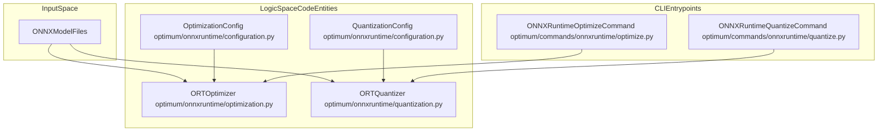
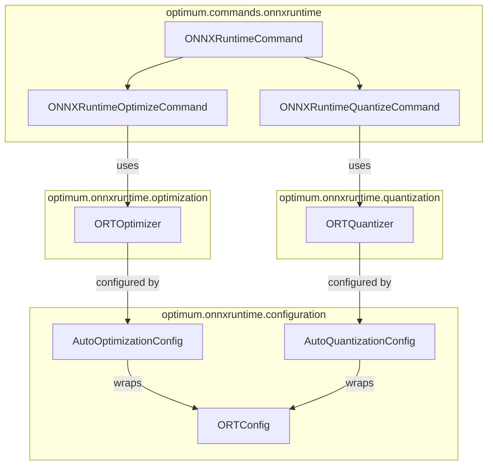

<!-- source: DeepWiki mcp.deepwiki.com · repo huggingface/optimum-onnx · page 4 Model Optimization and Quantization · fetched 2026-10-26 -->

# Model Optimization and Quantization

Relevant source files

The following files were used as context for generating this wiki page:

- [optimum/commands/onnxruntime/base.py](optimum/commands/onnxruntime/base.py)
- [optimum/commands/onnxruntime/optimize.py](optimum/commands/onnxruntime/optimize.py)
- [optimum/commands/onnxruntime/quantize.py](optimum/commands/onnxruntime/quantize.py)
- [optimum/onnxruntime/configuration.py](optimum/onnxruntime/configuration.py)
- [optimum/onnxruntime/optimization.py](optimum/onnxruntime/optimization.py)
- [optimum/onnxruntime/quantization.py](optimum/onnxruntime/quantization.py)
- [optimum/onnxruntime/utils.py](optimum/onnxruntime/utils.py)

This document covers the optimization and quantization subsystems in `optimum-onnx`, which provide tools to improve ONNX model inference performance through graph optimizations and precision reduction techniques. These systems operate on exported ONNX models to reduce inference latency and memory footprint.

As a PARENT page, this document provides a high-level overview of the optimization and quantization subsystems. For granular technical details, implementation specifics, and advanced usage, refer to the following child pages:
- [ORTOptimizer](#4.1) — Detailed guide on programmatic graph optimizations, optimization levels, and configuration classes.
- [Model Quantization](#4.2) — Deep dive into static and dynamic quantization, calibration datasets, and preprocessor passes.
- [Optimization Command Line Tools](#4.3) — Comprehensive usage guide for the `optimum-cli onnxruntime` optimization and quantization subcommands.
- [Optimization and Quantization Examples](#4.4) — Walkthroughs of runnable scripts under `examples/onnxruntime/` for various tasks and trainer utilities.

Sources: [optimum/onnxruntime/optimization.py:49-52](), [optimum/onnxruntime/quantization.py:85-88](), [optimum/commands/onnxruntime/base.py:23-39]()

## System Overview

The optimization and quantization system consists of two primary subsystems: `ORTOptimizer` for graph-level optimizations and `ORTQuantizer` for precision reduction. Both subsystems are driven by configuration containers such as `OptimizationConfig`, `QuantizationConfig`, and `ORTConfig`.

**Architecture and Command Mapping**

Sources: [optimum/onnxruntime/optimization.py:49-126](), [optimum/onnxruntime/quantization.py:85-158](), [optimum/commands/onnxruntime/base.py:23-39](), [optimum/onnxruntime/configuration.py:32-33]()

## ORTOptimizer System

The `ORTOptimizer` class handles graph-level optimizations that improve model throughput and lower latency without altering model precision [optimum/onnxruntime/optimization.py:49-52](). It leverages ONNX Runtime's transformer optimizer to execute operator fusion (such as Multi-Head Attention fusion), constant folding, and layout adjustments [optimum/onnxruntime/optimization.py:28-29]().

### Optimization Levels
Predefined optimization tiers are exposed through `AutoOptimizationConfig`:

| Level | Helper Method | Description |
|-------|---------------|-------------|
| **O1** | `AutoOptimizationConfig.O1()` | Basic general optimizations (constant folding, redundant node removal). |
| **O2** | `AutoOptimizationConfig.O2()` | Basic and extended optimizations, plus transformer-specific fusions. |
| **O3** | `AutoOptimizationConfig.O3()` | Same as `O2` with Gelu activation approximation enabled. |
| **O4** | `AutoOptimizationConfig.O4()` | Same as `O3` with mixed precision capabilities (requires GPU support). |

For detailed implementation guidelines, graph-level transformations, and code examples, see [ORTOptimizer](#4.1).

Sources: [optimum/onnxruntime/optimization.py:128-152](), [optimum/onnxruntime/configuration.py:330-410]()

## ORTQuantizer System

The `ORTQuantizer` class manages weight and activation quantization (typically reducing models to INT8) to shrink model artifacts and accelerate inference speed [optimum/onnxruntime/quantization.py:85-88](). It supports **Dynamic Quantization** (weights quantized statically, activations dynamically at runtime) and **Static Quantization** (requires calibration datasets via `CalibrationConfig`) [optimum/onnxruntime/configuration.py:52-120]().

### Quantization Configurations
`AutoQuantizationConfig` provides architecture-specific presets [optimum/onnxruntime/configuration.py:530-531]():
- **ARM64**: Optimized for mobile and server ARM architectures [optimum/onnxruntime/configuration.py:541-558]().
- **AVX2 / AVX512 / AVX512_VNNI**: Tailored instruction-set quantization for x86 CPUs [optimum/onnxruntime/configuration.py:575-626]().
- **TensorRT**: Quantization profiles compatible with NVIDIA TensorRT runtimes [optimum/onnxruntime/configuration.py:680-705]().

For deeper coverage of static calibration readers, preprocessor passes, and quantization formats, see [Model Quantization](#4.2).

Sources: [optimum/onnxruntime/quantization.py:159-175](), [optimum/onnxruntime/configuration.py:414-705]()

## Optimization Command Line Tools

The `optimum-cli` interface provides streamlined commands for optimizing and quantizing ONNX artifacts directly from the terminal without writing custom wrapper scripts.

- **Optimization CLI**: The `optimum-cli onnxruntime optimize` subcommand applies optimization levels (`-O1` through `-O4`) or custom `ORTConfig` files to local ONNX directories [optimum/commands/onnxruntime/optimize.py:28-70]().
- **Quantization CLI**: The `optimum-cli onnxruntime quantize` subcommand accepts architecture flags (`--avx2`, `--arm64`, etc.) or a configuration file to quantize models via `ORTQuantizer` [optimum/commands/onnxruntime/quantize.py:28-67]().

For concrete command examples, argument flags, and invocation workflows, see [Optimization Command Line Tools](#4.3).

Sources: [optimum/commands/onnxruntime/base.py:23-39](), [optimum/commands/onnxruntime/optimize.py:73-103](), [optimum/commands/onnxruntime/quantize.py:68-111]()

## Optimization and Quantization Examples

The repository supplies runnable reference scripts located under `examples/onnxruntime/` covering diverse modalities and tasks such as question answering, sequence classification, text generation, and multiple choice [4.4]. These examples demonstrate end-to-end pipelines incorporating training/evaluation helpers (`trainer_qa`, `utils_qa`).

For detailed walk-throughs of these reference scripts and expected operational workflows, see [Optimization and Quantization Examples](#4.4).

Sources: [optimum/onnxruntime/optimization.py:128-152](), [optimum/onnxruntime/quantization.py:159-175]()

## Configuration Persistence

Both optimization and quantization workflows utilize the `ORTConfig` container to serialize parameters [optimum/onnxruntime/configuration.py:726-735](). When models are processed, the configuration is saved as `ort_config.json` alongside the model files [optimum/onnxruntime/optimization.py:39](), [optimum/onnxruntime/quantization.py:39]().

This persistence ensures that:
1. Optimization and quantization audit trails remain attached to model checkpoints.
2. `ORTModel` subclasses automatically inspect `ort_config.json` during `.from_pretrained()` to configure appropriate session options and execution providers.

Sources: [optimum/onnxruntime/configuration.py:726-750](), [optimum/onnxruntime/optimization.py:148-152]()

---

