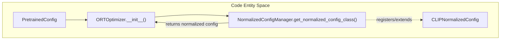
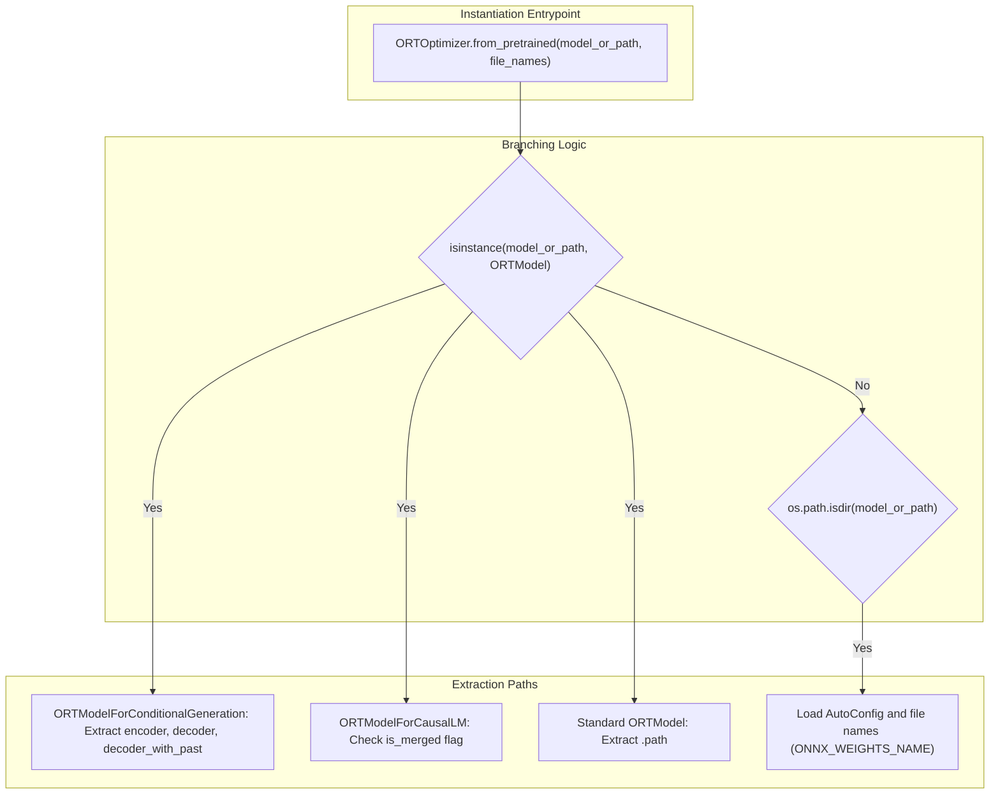
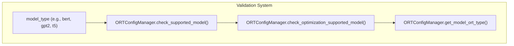

<!-- source: DeepWiki mcp.deepwiki.com · repo huggingface/optimum-onnx · page 4.1 ORTOptimizer · fetched 2026-10-26 -->

# ORTOptimizer

<details>
<summary>Relevant source files</summary>

The following files were used as context for generating this wiki page:

- [docs/source/onnxruntime/package_reference/optimization.mdx](docs/source/onnxruntime/package_reference/optimization.mdx)
- [docs/source/onnxruntime/usage_guides/optimization.mdx](docs/source/onnxruntime/usage_guides/optimization.mdx)
- [optimum/onnxruntime/optimization.py](optimum/onnxruntime/optimization.py)
- [optimum/onnxruntime/quantization.py](optimum/onnxruntime/quantization.py)
- [optimum/onnxruntime/utils.py](optimum/onnxruntime/utils.py)

</details>


The `ORTOptimizer` class handles model optimization for ONNX models using ONNX Runtime's optimization engine [optimum/onnxruntime/optimization.py:14](). It applies graph-level transformations to improve inference performance through node fusion, constant folding, operator elimination, and transformer-specific fusions.

This page provides a comprehensive technical guide to `ORTOptimizer`, its configuration classes, model type support, constraints, and programmatic usage patterns.

---

## 1. Core Architecture and Implementation

The `ORTOptimizer` class is defined in `optimum/onnxruntime/optimization.py` and acts as a Hugging Face-compatible wrapper around the ONNX Runtime transformers optimization tool `optimize_model` [optimum/onnxruntime/optimization.py:29](). 

When initialized, `ORTOptimizer` inspects the model configuration, extends the `NormalizedConfigManager` with model-specific normalization classes (such as `CLIPNormalizedConfig`), and retrieves the appropriate normalized configuration for graph transformations [optimum/onnxruntime/optimization.py:52-78]().


Sources: [optimum/onnxruntime/optimization.py:52-78](), [optimum/onnxruntime/optimization.py:70-73]()

---

## 2. Instantiation Patterns (`from_pretrained`)

The `ORTOptimizer` can be instantiated via `ORTOptimizer.from_pretrained()` using either an existing `ORTModel` instance or a local directory containing ONNX model files [optimum/onnxruntime/optimization.py:80-126]().


Sources: [optimum/onnxruntime/optimization.py:80-126]()

### Handling Constraints during Instantiation
When loading from an `ORTModelForConditionalGeneration`, the optimizer extracts paths for both the encoder, decoder, and optional decoder-with-past models [optimum/onnxruntime/optimization.py:99-106](). If an `ORTModelForCausalLM` has merged its with/without past models (`is_merged == True`), instantiation raises a `NotImplementedError`, requiring re-export with `use_merged=False` [optimum/onnxruntime/optimization.py:107-111]().

Sources: [optimum/onnxruntime/optimization.py:97-114]()

---

## 3. Optimization Configuration System

Optimization behavior is defined using configuration classes located in `optimum/onnxruntime/configuration.py`. These allow users to configure graph optimization levels and specific transformer fusions.

| Configuration Class | Code Symbol / Reference | Purpose |
| :--- | :--- | :--- |
| `OptimizationConfig` | `optimum.onnxruntime.OptimizationConfig` | Fine-grained programmatic control over optimization levels, fusion flags, and precision settings. |
| `AutoOptimizationConfig` | `optimum.onnxruntime.AutoOptimizationConfig` | Preset factory providing predefined optimization profiles (`O1`, `O2`, `O3`, `O4`). |
| `ORTConfig` | `optimum.onnxruntime.ORTConfig` | Encapsulates optimization configuration alongside model metadata for serialization. |

### Optimization Levels
* **Level 0**: Disables all optimizations.
* **Level 1**: Basic optimizations (constant folding, redundant node eliminations).
* **Level 2**: Extended graph optimizations (node fusions, attention fusions).
* **Level 99**: Data layout optimizations.

`AutoOptimizationConfig` maps these to simpler operational profiles:
* **O1**: Basic general optimizations.
* **O2**: Basic and extended general optimizations, plus transformers-specific fusions.
* **O3**: Same as `O2` with GELU approximation enabled.
* **O4**: Same as `O3` with mixed precision (`fp16`, GPU-only, requires `CUDAExecutionProvider`).

Sources: [docs/source/onnxruntime/usage_guides/optimization.mdx:63-93]()

---

## 4. Model Support and Validation

Model support is governed by `ORTConfigManager`, which maps Hugging Face model types to their corresponding ONNX Runtime optimization profiles [optimum/onnxruntime/utils.py:55-105]().


Sources: [optimum/onnxruntime/utils.py:107-141]()

### Supported Model Types for Optimization
ONNX Runtime supports graph optimization for the following model types:
* `bart`, `bert`, `gpt2`, `tnlr`, `t5`, `unet`, `vae`, `clip`, `vit`, `swin`, `swinv2` [optimum/onnxruntime/utils.py:124-136]().

If an unsupported model type is passed to `ORTConfigManager.check_optimization_supported_model()`, a `NotImplementedError` is raised [optimum/onnxruntime/utils.py:137-141]().

Sources: [optimum/onnxruntime/utils.py:122-141]()

---

## 5. Optimization Process Workflow

The optimization workflow is executed by calling the `optimize()` method on an `ORTOptimizer` instance [optimum/onnxruntime/optimization.py:128-147]().

```mermaid
sequenceDiagram
    participant User
    participant Optimizer as "ORTOptimizer"
    participant Engine as "onnxruntime.transformers.optimizer.optimize_model"
    participant FileSystem as "File System (save_dir)"

    User->>Optimizer: optimize(save_dir, optimization_config)
    Optimizer->>Engine: Call optimize_model() with config parameters
    Note over Engine: Performs node fusions, constant folding, and operator eliminations
    Engine--->Optimizer: Return optimized ONNX model graph
    Optimizer->>FileSystem: Save optimized model file (.onnx)
    Optimizer->>FileSystem: Save ort_config.json metadata
```
Sources: [optimum/onnxruntime/optimization.py:128-147]()

---

## 6. Programmatic Example

Below is a complete programmatic walkthrough demonstrating how to load a model, initialize `ORTOptimizer`, configure an `AutoOptimizationConfig`, and execute the optimization [docs/source/onnxruntime/usage_guides/optimization.mdx:114-132]().

```python
from optimum.onnxruntime import (
    AutoOptimizationConfig,
    ORTOptimizer,
    ORTModelForSequenceClassification,
)

model_id = "distilbert-base-uncased-finetuned-sst-2-english"
save_dir = "distilbert_optimized"

# 1. Load a PyTorch model and export it to the ONNX format
model = ORTModelForSequenceClassification.from_pretrained(model_id, export=True)

# 2. Create the optimizer from the ORTModel
optimizer = ORTOptimizer.from_pretrained(model)

# 3. Define the optimization strategy using AutoOptimizationConfig
optimization_config = AutoOptimizationConfig.O2()

# 4. Optimize the model and save to disk
optimizer.optimize(save_dir=save_dir, optimization_config=optimization_config)
```
Sources: [docs/source/onnxruntime/usage_guides/optimization.mdx:114-132]()

---

