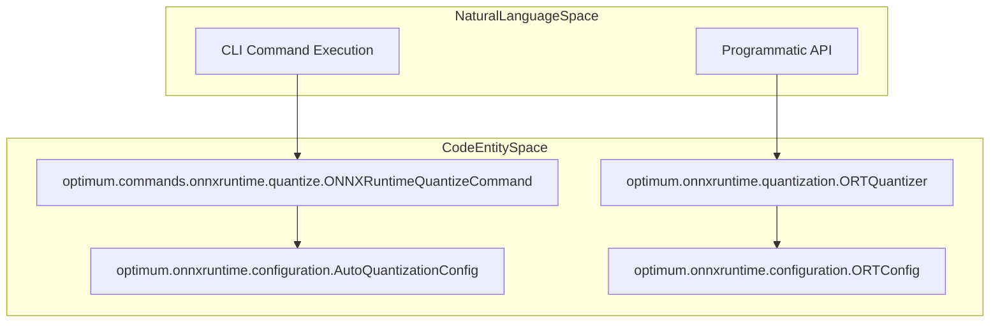
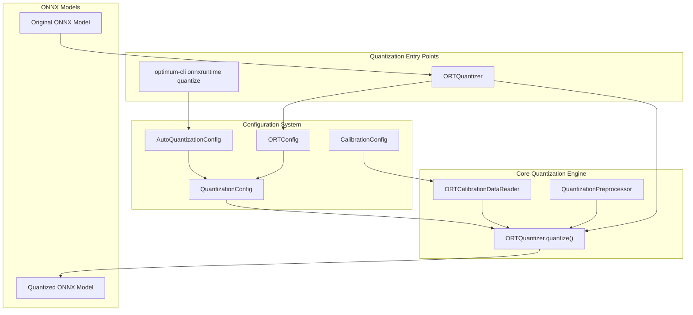
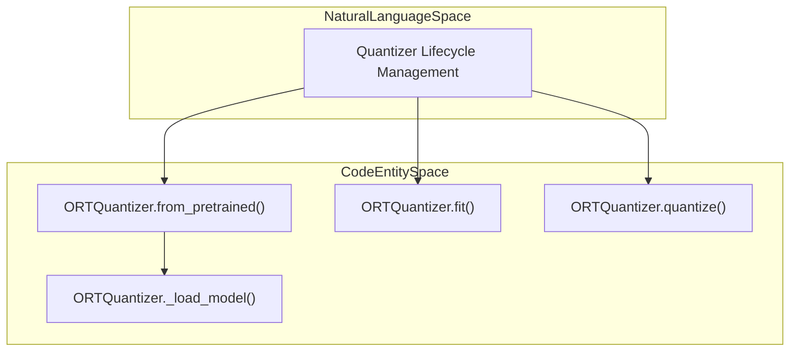
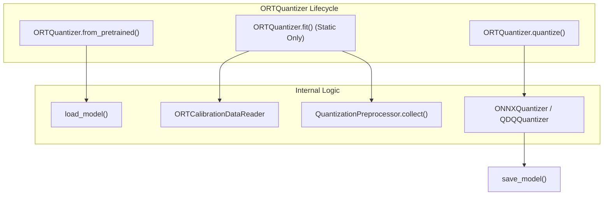
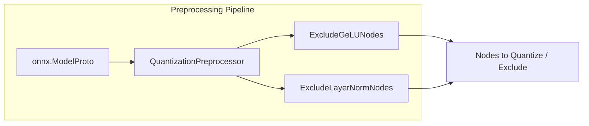

<!-- source: DeepWiki mcp.deepwiki.com · repo huggingface/optimum-onnx · page 4.2 Model Quantization · fetched 2026-10-26 -->

# Model Quantization

Relevant source files

The following files were used as context for generating this wiki page:

- [docs/source/onnxruntime/package_reference/quantization.mdx](docs/source/onnxruntime/package_reference/quantization.mdx)
- [docs/source/onnxruntime/usage_guides/quantization.mdx](docs/source/onnxruntime/usage_guides/quantization.mdx)
- [optimum/commands/onnxruntime/base.py](optimum/commands/onnxruntime/base.py)
- [optimum/commands/onnxruntime/optimize.py](optimum/commands/onnxruntime/optimize.py)
- [optimum/commands/onnxruntime/quantize.py](optimum/commands/onnxruntime/quantize.py)
- [optimum/onnxruntime/configuration.py](optimum/onnxruntime/configuration.py)
- [tests/onnxruntime/test_quantization.py](tests/onnxruntime/test_quantization.py)

This document covers model quantization in `optimum-onnx`, focusing on reducing model precision to improve inference performance and reduce memory usage. Quantization converts model weights and activations from higher precision formats (like FP32) to lower precision formats (like INT8) while maintaining model accuracy.

For information about model optimization techniques beyond quantization, see [ORTOptimizer](#4.1). For command-line usage of quantization tools, see [Optimization Command Line Tools](#4.3).

Sources: [optimum/onnxruntime/quantization.py:1-416](), [optimum/onnxruntime/configuration.py:51-157]()

## Quantization System Overview

The quantization system in `optimum-onnx` provides both programmatic and command-line interfaces for reducing ONNX model precision. The system supports dynamic and static quantization across multiple hardware architectures.

*Figure 1: Bridging natural language quantization workflows to code entities.*

Sources: [optimum/commands/onnxruntime/quantize.py:68-111](), [optimum/onnxruntime/configuration.py:33-157]()

## ORTQuantizer Class Architecture

The `ORTQuantizer` class is the primary interface for quantization. It handles model loading, calibration, and the orchestration of the ONNX Runtime quantization tools.

### Key Methods and Data Flow
- `from_pretrained()`: Instantiates a quantizer from a local directory or an `ORTModel` instance [tests/onnxruntime/test_quantization.py:65-80]().
- `fit()`: Performs the calibration step for static quantization, calculating activation ranges using a representative dataset [docs/source/onnxruntime/usage_guides/quantization.mdx:158-164]().
- `quantize()`: Executes the final quantization transformation, applying settings from a `QuantizationConfig` [tests/onnxruntime/test_quantization.py:111-112]().

*Figure 2: Lifecycle operations mapped to ORTQuantizer methods.*

Sources: [tests/onnxruntime/test_quantization.py:65-112](), [optimum/commands/onnxruntime/quantize.py:84-111]()

## Static vs Dynamic Quantization

The choice between static and dynamic quantization impacts both the preparation workflow and the final inference performance.

| Feature | Dynamic Quantization | Static Quantization |
| :--- | :--- | :--- |
| **Activation Scaling** | Computed at runtime | Pre-computed during calibration |
| **Data Requirement** | No dataset needed | Requires a calibration dataset |
| **Overhead** | Higher runtime overhead | Lower runtime overhead |
| **Use Case** | LSTMs, Transformers (general) | CNNs, high-throughput requirements |

### Calibration with ORTCalibrationDataReader
For static quantization, calibration datasets are processed to observe activation distributions using configurations generated by `AutoCalibrationConfig` [optimum/onnxruntime/configuration.py:121-157]().

Sources: [optimum/onnxruntime/configuration.py:52-118](), [tests/onnxruntime/test_quantization.py:96-105]()

## Preprocessors and Passes

Before quantization, the model often requires graph transformations to ensure compatibility or optimal results. This is handled by preprocessor components and various pass implementations.

- **Passes**: Specific transformations prevent quantization of sensitive operations that might degrade accuracy.
- **Collection**: Walks the ONNX graph and determines which nodes should be quantized or excluded based on registered passes.

Sources: [optimum/onnxruntime/configuration.py:46-49](), [tests/onnxruntime/test_quantization.py:118-123]()

## Configuration System

Quantization behavior is defined through a hierarchy of configuration classes:

1.  **QuantizationConfig**: Defines core parameters such as `is_static`, `format` (QDQ or QOperator), and `per_channel` quantization [tests/onnxruntime/test_quantization.py:96-105]().
2.  **CalibrationConfig**: Defines how calibration is performed (e.g., `minmax`, `entropy`, or `percentile` methods) [optimum/onnxruntime/configuration.py:52-93]().
3.  **AutoQuantizationConfig**: Provides factory methods for architecture-specific presets (e.g., `arm64`, `avx512_vnni`) [optimum/commands/onnxruntime/quantize.py:90-96]().

### Architecture Presets
| Method | Target Architecture | Key Settings |
| :--- | :--- | :--- |
| `arm64()` | ARM-based CPUs | U8S8 quantization [optimum/commands/onnxruntime/quantize.py:90](). |
| `avx512_vnni()` | Intel Cascade Lake+ | S8S8 quantization with VNNI [optimum/commands/onnxruntime/quantize.py:96](). |
| `tensorrt()` | NVIDIA GPUs | Static QDQ format [optimum/commands/onnxruntime/quantize.py:100-102](). |

Sources: [optimum/onnxruntime/configuration.py:52-157](), [optimum/commands/onnxruntime/quantize.py:68-111]()

## Implementation Details: The Quantization Process

When `ORTQuantizer.quantize()` is called, the following steps occur:
1.  **Model Loading**: The model is loaded via file iterators or `ORTQuantizer.from_pretrained()` [optimum/commands/onnxruntime/quantize.py:84-87]().
2.  **Configuration Resolution**: `QuantizationConfig` or `ORTConfig` is retrieved [optimum/commands/onnxruntime/quantize.py:104-106]().
3.  **Execution**: Each underlying ONNX model file is quantized using `q.quantize()` [optimum/commands/onnxruntime/quantize.py:108-111]().

Sources: [optimum/commands/onnxruntime/quantize.py:68-111](), [tests/onnxruntime/test_quantization.py:82-124]()

---

