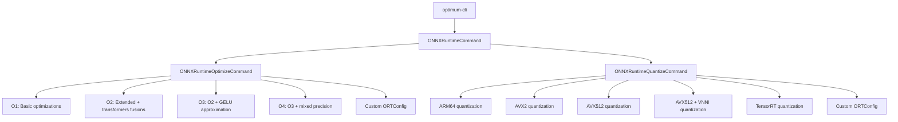
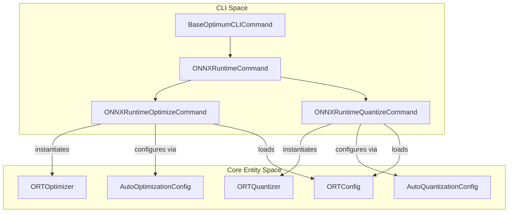
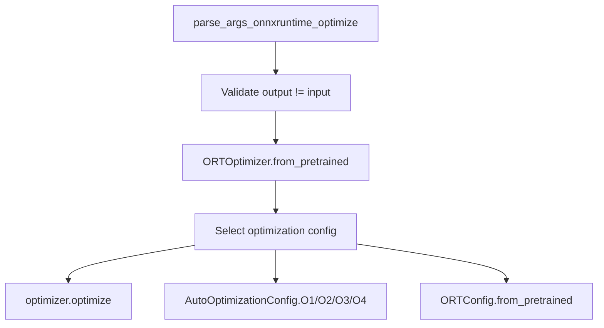
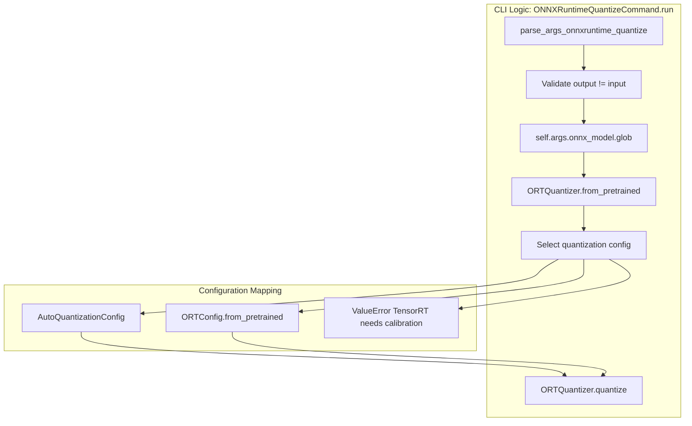
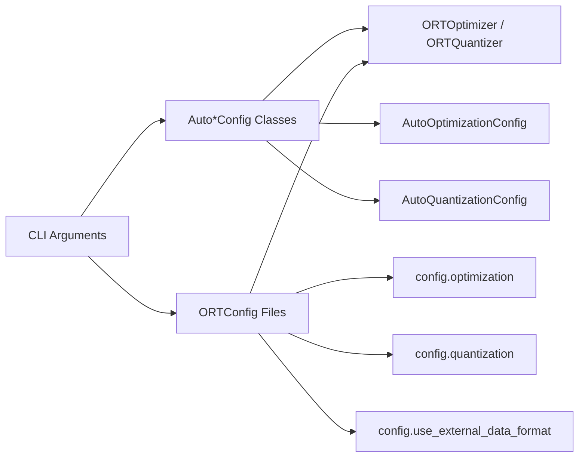

<!-- source: DeepWiki mcp.deepwiki.com · repo huggingface/optimum-onnx · page 4.3 Optimization Command Line Tools · fetched 2026-10-26 -->

# Optimization Command Line Tools

<details>
<summary>Relevant source files</summary>

The following files were used as context for generating this wiki page:

- [optimum/commands/onnxruntime/base.py](optimum/commands/onnxruntime/base.py)
- [optimum/commands/onnxruntime/optimize.py](optimum/commands/onnxruntime/optimize.py)
- [optimum/commands/onnxruntime/quantize.py](optimum/commands/onnxruntime/quantize.py)
- [optimum/commands/register/register_onnxruntime.py](optimum/commands/register/register_onnxruntime.py)
- [optimum/onnxruntime/configuration.py](optimum/onnxruntime/configuration.py)

</details>


## Purpose and Scope

This page documents the command-line interface (CLI) tools for optimizing and quantizing ONNX models using ONNX Runtime. These tools provide a convenient way to apply optimization and quantization techniques to ONNX models without writing Python code.

For information about the underlying optimization classes and concepts, see [ORTOptimizer](#4.1). For detailed information about quantization techniques and configuration, see [Model Quantization](#4.2).

Sources: [optimum/commands/onnxruntime/base.py:23-39](), [optimum/commands/onnxruntime/optimize.py:73-103](), [optimum/commands/onnxruntime/quantize.py:68-111]()

## CLI Command Structure

The optimization and quantization CLI tools are accessed through the `optimum-cli onnxruntime` command, which provides two main subcommands: `optimize` and `quantize`.

### Command Hierarchy



Sources: [optimum/commands/onnxruntime/base.py:23-39](), [optimum/commands/onnxruntime/optimize.py:44-70](), [optimum/commands/onnxruntime/quantize.py:51-64]()

### Implementation Architecture

The CLI commands bridge the high-level user interface to the core `ORTOptimizer` and `ORTQuantizer` engines.



Sources: [optimum/commands/onnxruntime/base.py:23-39](), [optimum/commands/onnxruntime/optimize.py:73-103](), [optimum/commands/onnxruntime/quantize.py:68-111]()

## Optimization Command

The `optimum-cli onnxruntime optimize` command applies graph optimizations to ONNX models to improve inference performance.

### Command Syntax

```bash
optimum-cli onnxruntime optimize --onnx_model <path> --output <path> [optimization_level]
```

### Required Arguments

| Argument | Type | Description |
|----------|------|-------------|
| `--onnx_model` | Path | Path to the repository where the ONNX models to optimize are located |
| `-o`, `--output` | Path | Path to the directory where to store generated ONNX model |

Sources: [optimum/commands/onnxruntime/optimize.py:28-43]()

### Optimization Levels

The command supports four predefined optimization levels, specified as mutually exclusive arguments:

| Level | Description |
|-------|-------------|
| `-O1` | Basic general optimizations |
| `-O2` | Basic and extended general optimizations, transformers-specific fusions |
| `-O3` | Same as O2 with GELU approximation |
| `-O4` | Same as O3 with mixed precision |
| `-c`, `--config` | Path to custom `ORTConfig` file |

Sources: [optimum/commands/onnxruntime/optimize.py:44-71]()

### Implementation Details

The `ONNXRuntimeOptimizeCommand` class handles the optimization process:



Sources: [optimum/commands/onnxruntime/optimize.py:73-103](), [optimum/commands/onnxruntime/optimize.py:28-70]()

### Usage Examples

**Basic optimization (O2 level):**
```bash
optimum-cli onnxruntime optimize --onnx_model ./model --output ./optimized_model -O2
```

**Advanced optimization with mixed precision:**
```bash
optimum-cli onnxruntime optimize --onnx_model ./model --output ./optimized_model -O4
```

**Custom configuration:**
```bash
optimum-cli onnxruntime optimize --onnx_model ./model --output ./optimized_model -c ./custom_config.json
```

Sources: [optimum/commands/onnxruntime/optimize.py:90-103]()

## Quantization Command

The `optimum-cli onnxruntime quantize` command applies quantization to reduce model size and improve inference speed.

### Command Syntax

```bash
optimum-cli onnxruntime quantize --onnx_model <path> --output <path> [quantization_target]
```

### Required Arguments

| Argument | Type | Description |
|----------|------|-------------|
| `--onnx_model` | Path | Path to the repository where the ONNX models to quantize are located |
| `-o`, `--output` | Path | Path to the directory where to store generated ONNX model |

Sources: [optimum/commands/onnxruntime/quantize.py:28-43]()

### Optional Arguments

| Argument | Description |
|----------|-------------|
| `--per_channel` | Compute quantization parameters on a per-channel basis |

Sources: [optimum/commands/onnxruntime/quantize.py:44-49]()

### Quantization Targets

The command supports several predefined quantization configurations for different hardware targets:

| Target | Description |
|--------|-------------|
| `--arm64` | Quantization for ARM64 architecture |
| `--avx2` | Quantization with AVX-2 instructions |
| `--avx512` | Quantization with AVX-512 instructions |
| `--avx512_vnni` | Quantization with AVX-512 and VNNI instructions |
| `--tensorrt` | Quantization for NVIDIA TensorRT (requires static quantization) |
| `-c`, `--config` | Path to custom `ORTConfig` file |

Sources: [optimum/commands/onnxruntime/quantize.py:51-65]()

### Implementation Process

The CLI iterates through all `.onnx` files in the provided directory and applies the selected configuration using `ORTQuantizer`.



Sources: [optimum/commands/onnxruntime/quantize.py:73-111](), [optimum/commands/onnxruntime/quantize.py:28-64]()

### Usage Examples

**ARM64 quantization:**
```bash
optimum-cli onnxruntime quantize --onnx_model ./model --output ./quantized_model --arm64
```

**AVX-512 with per-channel quantization:**
```bash
optimum-cli onnxruntime quantize --onnx_model ./model --output ./quantized_model --avx512 --per_channel
```

Sources: [optimum/commands/onnxruntime/quantize.py:89-111]()

## Error Handling and Validation

Both commands implement several validation checks to ensure safe model processing.

### Common Validations

1. **Output Directory Validation**: Both commands ensure the output directory is different from the input directory to prevent overwriting original models [optimum/commands/onnxruntime/optimize.py:82-83](), [optimum/commands/onnxruntime/quantize.py:77-78]().
2. **Mutually Exclusive Options**: The optimization levels (O1-O4) and quantization targets are mutually exclusive to prevent conflicting configurations [optimum/commands/onnxruntime/optimize.py:44-70](), [optimum/commands/onnxruntime/quantize.py:51-65]().
3. **TensorRT Limitation**: The quantization command explicitly prevents TensorRT quantization through CLI, as it requires static quantization and calibration which is not supported via CLI [optimum/commands/onnxruntime/quantize.py:99-102]().

Sources: [optimum/commands/onnxruntime/optimize.py:82-83](), [optimum/commands/onnxruntime/quantize.py:77-102]()

### Error Messages

| Condition | Error Message |
|-----------|---------------|
| Same input/output paths | `"The output directory must be different than the directory hosting the ONNX model."` |
| TensorRT quantization | `"TensorRT quantization relies on static quantization that requires calibration, which is currently not supported through optimum-cli."` |

Sources: [optimum/commands/onnxruntime/optimize.py:82-83](), [optimum/commands/onnxruntime/quantize.py:77-102]()

## Configuration Integration

The CLI acts as a wrapper around the `AutoConfig` classes and `ORTConfig`.

### Configuration Flow



Sources: [optimum/commands/onnxruntime/optimize.py:79-103](), [optimum/commands/onnxruntime/quantize.py:74-111]()

---

