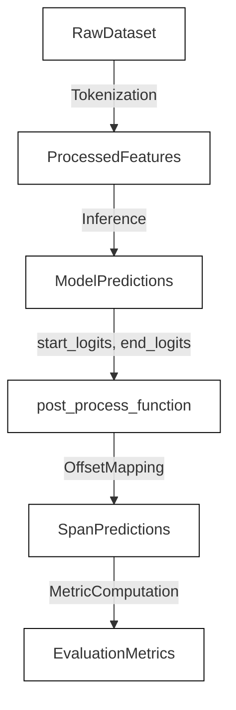
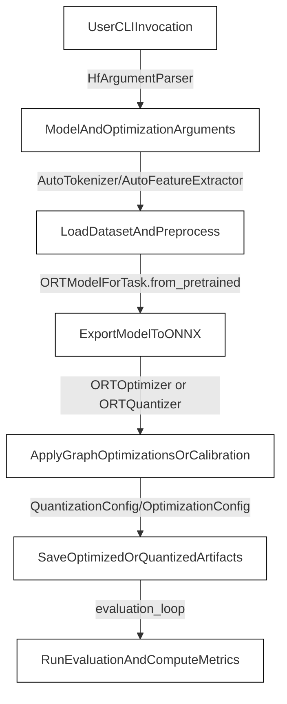

<!-- source: DeepWiki mcp.deepwiki.com · repo huggingface/optimum-onnx · page 4.4 Optimization and Quantization Examples · fetched 2026-10-26 -->

# Optimization and Quantization Examples

<details>
<summary>Relevant source files</summary>

The following files were used as context for generating this wiki page:

- [examples/onnxruntime/optimization/multiple-choice/run_swag.py](examples/onnxruntime/optimization/multiple-choice/run_swag.py)
- [examples/onnxruntime/optimization/question-answering/run_qa.py](examples/onnxruntime/optimization/question-answering/run_qa.py)
- [examples/onnxruntime/optimization/question-answering/trainer_qa.py](examples/onnxruntime/optimization/question-answering/trainer_qa.py)
- [examples/onnxruntime/optimization/question-answering/utils_qa.py](examples/onnxruntime/optimization/question-answering/utils_qa.py)
- [examples/onnxruntime/optimization/text-classification/run_glue.py](examples/onnxruntime/optimization/text-classification/run_glue.py)
- [examples/onnxruntime/optimization/token-classification/run_ner.py](examples/onnxruntime/optimization/token-classification/run_ner.py)
- [examples/onnxruntime/quantization/image-classification/run_image_classification.py](examples/onnxruntime/quantization/image-classification/run_image_classification.py)
- [examples/onnxruntime/quantization/multiple-choice/run_swag.py](examples/onnxruntime/quantization/multiple-choice/run_swag.py)
- [examples/onnxruntime/quantization/question-answering/run_qa.py](examples/onnxruntime/quantization/question-answering/run_qa.py)
- [examples/onnxruntime/quantization/question-answering/trainer_qa.py](examples/onnxruntime/quantization/question-answering/trainer_qa.py)
- [examples/onnxruntime/quantization/question-answering/utils_qa.py](examples/onnxruntime/quantization/question-answering/utils_qa.py)
- [examples/onnxruntime/quantization/text-classification/run_glue.py](examples/onnxruntime/quantization/text-classification/run_glue.py)
- [examples/onnxruntime/quantization/token-classification/run_ner.py](examples/onnxruntime/quantization/token-classification/run_ner.py)

</details>


This page covers the runnable scripts located under `examples/onnxruntime/` in the `optimum-onnx` repository [examples/onnxruntime/quantization/question-answering/run_qa.py:1](). These scripts serve as end-to-end references demonstrating how to apply model graph optimization via `ORTOptimizer` [examples/onnxruntime/optimization/question-answering/run_qa.py:36]() and quantization via `ORTQuantizer` [examples/onnxruntime/quantization/question-answering/run_qa.py:37]() across various Hugging Face tasks including Question Answering, Text Classification (GLUE) [examples/onnxruntime/quantization/text-classification/run_glue.py:16](), Token Classification (NER) [examples/onnxruntime/quantization/token-classification/run_ner.py:15](), Image Classification [examples/onnxruntime/quantization/image-classification/run_image_classification.py:16](), and Multiple Choice [examples/onnxruntime/optimization/multiple-choice/run_swag.py:15]().

---

## 4.4.1 Script Organization and Task Layout

The `examples/onnxruntime/` directory is partitioned into two primary operational subdirectories: `optimization/` and `quantization/`. Each subdirectory contains task-specific directories that follow standard Hugging Face `Trainer`-based paradigms while integrating Optimum ONNX specific configuration classes (`OptimizationConfig`, `QuantizationConfig`, `AutoCalibrationConfig`) [examples/onnxruntime/quantization/question-answering/run_qa.py:38](), [examples/onnxruntime/optimization/question-answering/run_qa.py:37]().

```
examples/onnxruntime/
├── optimization/
│   ├── multiple-choice/run_swag.py
│   ├── question-answering/run_qa.py
│   ├── text-classification/run_glue.py
│   └── token-classification/run_ner.py
└── quantization/
    ├── image-classification/run_image_classification.py
    ├── question-answering/run_qa.py, trainer_qa.py, utils_qa.py
    ├── text-classification/run_glue.py
    └── token-classification/run_ner.py
```

Arguments are decoupled using `HfArgumentParser` into discrete dataclasses: `ModelArguments`, `DataTrainingArguments`, and `OptimizationArguments` (or `OnnxExportArguments`), ensuring a clean separation of concerns between model loading, dataset tokenization, and ONNX Runtime post-processing [examples/onnxruntime/quantization/question-answering/run_qa.py:60](), [examples/onnxruntime/optimization/multiple-choice/run_swag.py:123]().

Sources:
- `examples/onnxruntime/quantization/question-answering/run_qa.py:1-90`
- `examples/onnxruntime/optimization/multiple-choice/run_swag.py:48-163`

---

## 4.4.2 Question Answering Workflow Helpers

Question answering optimization and quantization scripts require custom post-processing to align raw start/end logits with character offsets in source documents. The quantization and optimization pipelines for QA rely on `QuestionAnsweringTrainer` and `postprocess_qa_predictions`.

### `QuestionAnsweringTrainer`
Defined in `examples/onnxruntime/quantization/question-answering/trainer_qa.py` [examples/onnxruntime/quantization/question-answering/trainer_qa.py:22](), this custom subclass of the transformers `Trainer` overrides evaluation and prediction loops to interleave custom post-processing before metric computation:

```python
class QuestionAnsweringTrainer(Trainer):
    def __init__(self, *args, eval_examples=None, post_process_function=None, **kwargs):
        super().__init__(*args, **kwargs)
        self.eval_examples = eval_examples
        self.post_process_function = post_process_function
```
[examples/onnxruntime/quantization/question-answering/trainer_qa.py:22-26]()

During evaluation (`evaluate()`), the trainer executes the evaluation loop without default metrics, retrieves raw model outputs (`output.predictions`), passes them through `self.post_process_function`, and calculates evaluation metrics on the reconstructed span predictions [examples/onnxruntime/quantization/question-answering/trainer_qa.py:28-63]().

### `postprocess_qa_predictions`
Located in `examples/onnxruntime/quantization/question-answering/utils_qa.py` [examples/onnxruntime/quantization/question-answering/utils_qa.py:30](), this function maps `start_logits` and `end_logits` back to string substrings within the original context:

```python
def postprocess_qa_predictions(
    examples,
    features,
    predictions: tuple[np.ndarray, np.ndarray],
    version_2_with_negative: bool = False,
    n_best_size: int = 20,
    max_answer_length: int = 30,
    null_score_diff_threshold: float = 0.0,
    output_dir: str | None = None,
    prefix: str | None = None,
    log_level: int | None = logging.WARNING,
):
```
[examples/onnxruntime/quantization/question-answering/utils_qa.py:30-41]()

It validates prediction shapes, builds example-to-feature mapping indices, loops over features to evaluate top-$N$ candidate start and end loggers via `np.argsort()`, accounts for offset mappings and token maximum contexts, and handles SQuAD v2 negative answer thresholds [examples/onnxruntime/quantization/question-answering/utils_qa.py:74-137]().


*Figure 1: Question Answering Data Flow to Code Entities.*

Sources:
- `examples/onnxruntime/quantization/question-answering/trainer_qa.py:22-96`
- `examples/onnxruntime/quantization/question-answering/utils_qa.py:30-137`

---

## 4.4.3 Classification and Token Tasks Integration

The remaining scripts under `examples/onnxruntime/` adapt standard Hugging Face tasks to ONNX optimization and quantization workflows:

1. **Text Classification (`run_glue.py`)**: Supports GLUE benchmark tasks (CoLA, SST-2, MRPC, MNLI, etc.) using `ORTModelForSequenceClassification` and `ORTOptimizer` or `ORTQuantizer` [examples/onnxruntime/quantization/text-classification/run_glue.py:44](), [examples/onnxruntime/optimization/text-classification/run_glue.py:43]().
2. **Token Classification (`run_ner.py`)**: Handles Named Entity Recognition (NER) and Part-of-Speech tagging via `ORTModelForTokenClassification` [examples/onnxruntime/quantization/token-classification/run_ner.py:40](), [examples/onnxruntime/optimization/token-classification/run_ner.py:37]().
3. **Image Classification (`run_image_classification.py`)**: Implements image feature extraction and classification workflows utilizing `ORTModelForImageClassification` [examples/onnxruntime/quantization/image-classification/run_image_classification.py:41]() and `torchvision` transforms [examples/onnxruntime/quantization/image-classification/run_image_classification.py:35]().
4. **Multiple Choice (`run_swag.py`)**: Evaluates multiple-choice datasets (e.g., SWAG) using `ORTModelForMultipleChoice` [examples/onnxruntime/optimization/multiple-choice/run_swag.py:36]().

### Common Optimization Arguments Structure
All optimization scripts expose an `OptimizationArguments` dataclass governing graph transformation levels and execution providers:
- `optimization_level`: Controls ONNX Runtime graph optimization depth (`0` = disabled, `1` = basic, `2` = extended/fusions, `99` = all including layout optimizations) [examples/onnxruntime/optimization/multiple-choice/run_swag.py:126]().
- `optimize_for_gpu`: Boolean flag determining whether to apply hardware-specific GPU fusions [examples/onnxruntime/optimization/multiple-choice/run_swag.py:137]().
- `execution_provider`: Target provider string (e.g., `CPUExecutionProvider`, `CUDAExecutionProvider`) [examples/onnxruntime/optimization/multiple-choice/run_swag.py:144]().

Sources:
- `examples/onnxruntime/quantization/text-classification/run_glue.py:1-60`
- `examples/onnxruntime/quantization/token-classification/run_ner.py:1-50`
- `examples/onnxruntime/quantization/image-classification/run_image_classification.py:1-50`
- `examples/onnxruntime/optimization/multiple-choice/run_swag.py:123-149`

---

## 4.4.4 Expected Execution Workflow

The end-to-end user workflow across all optimization and quantization example scripts follows a structured lifecycle from model loading and export to post-processing calibration and quantized artifact emission.


*Figure 2: Execution workflow bridging user command line parameters to ONNX model optimization and quantization entities.*

### Workflow Steps Breakdown
1. **Argument Parsing**: `HfArgumentParser` parses CLI flags into `ModelArguments`, `DataTrainingArguments`, and `OptimizationArguments` [examples/onnxruntime/quantization/question-answering/run_qa.py:60]().
2. **Model & Tokenizer Initialization**: Instantiates tokenizers/feature extractors and loads base PyTorch models or directly wraps them via `ORTModelFor*` classes with `export=True`.
3. **Graph Optimization (`ORTOptimizer`)**: Passes an `OptimizationConfig` to fuse operators (e.g., LayerNorm, GeLU) and strip initializer constants.
4. **Calibration & Quantization (`ORTQuantizer`)**: For static quantization, an `AutoCalibrationConfig` consumes calibration data loaders to compute activation ranges, followed by `ORTQuantizer.quantize()` utilizing `QuantizationConfig`.
5. **Evaluation**: Executes `evaluation_loop` or custom trainers (such as `QuestionAnsweringTrainer`) to report post-optimization accuracy metrics [examples/onnxruntime/quantization/question-answering/trainer_qa.py:22]().

Sources:
- `examples/onnxruntime/quantization/question-answering/run_qa.py:37-48`
- `examples/onnxruntime/optimization/multiple-choice/run_swag.py:36-39`

---

