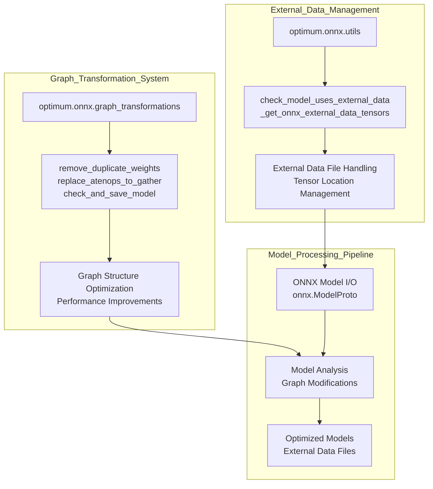
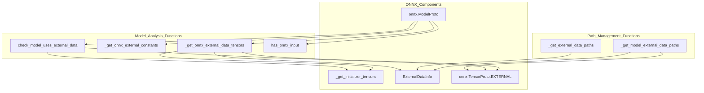
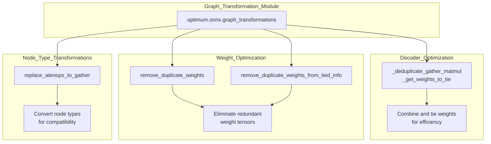

<!-- source: DeepWiki mcp.deepwiki.com · repo huggingface/optimum-onnx · page 5 Advanced Topics · fetched 2026-10-26 -->

# Advanced Topics

Relevant source files

The following files were used as context for generating this wiki page:

- [optimum/onnx/graph_transformations.py](optimum/onnx/graph_transformations.py)
- [optimum/onnx/utils.py](optimum/onnx/utils.py)
- [optimum/onnx/version.py](optimum/onnx/version.py)

This document covers advanced usage patterns and internal system details for the `optimum-onnx` library. These topics are intended for users who need to understand the lower-level mechanisms that power model export, optimization, and inference, or who are contributing to the library.

The advanced topics include external data handling for large ONNX models, graph transformation systems used during export and optimization, and preprocessing passes applied before quantization and optimization.

## Advanced System Architecture Overview

The `optimum-onnx` library includes several sophisticated subsystems that operate behind the scenes to enable efficient model conversion and execution. These systems handle the complexities of large model files, graph-level optimizations, and preprocessing operations.

Sources: [optimum/onnx/utils.py:1-96](), [optimum/onnx/graph_transformations.py:1-185]()

## External Data Handling

Large ONNX models (typically those exceeding the 2GB Protobuf limit) must store tensor data in separate external files. The `optimum-onnx` library provides utilities to detect, manage, and save these models correctly.

### External Data Detection and Path Management

The external data handling system centers around several key functions that analyze ONNX models and manage associated data files. For instance, `check_model_uses_external_data` [optimum/onnx/utils.py:80-87]() determines if a model is split across multiple files by inspecting its initializers.

Sources: [optimum/onnx/utils.py:22-96]()

### Core External Data Functions

| Function | Purpose | Key Operations |
|----------|---------|----------------|
| `check_model_uses_external_data` | Determines if model has external data | Loads model with `load_external_data=False`, checks initializer tensors [optimum/onnx/utils.py:80-87]() |
| `_get_onnx_external_data_tensors` | Extracts external tensor file paths | Uses `ExternalDataInfo` to get tensor locations [optimum/onnx/utils.py:35-41]() |
| `_get_external_data_paths` | Manages file copying for external data | Handles both single and multiple external data files [optimum/onnx/utils.py:44-64]() |
| `check_and_save_model` | Saves large models correctly | Checks `MAXIMUM_PROTOBUF` limit and uses `save_as_external_data=True` if needed [optimum/onnx/graph_transformations.py:132-182]() |

For details, see [External Data Handling](#5.1).

Sources: [optimum/onnx/utils.py:22-96](), [optimum/onnx/graph_transformations.py:132-182]()

## Graph Transformations

The graph transformation system provides powerful capabilities for optimizing ONNX model graphs at the structural level. These transformations are applied during export and optimization to improve model performance and compatibility.

### Available Graph Transformations

The transformation system exposes several key operations through the `optimum.onnx.graph_transformations` module:

Sources: [optimum/onnx/graph_transformations.py:46-129]()

### Transformation Categories

| Category | Transformations | Purpose |
|----------|----------------|---------|
| **Weight Management** | `remove_duplicate_weights` | Finds identical weights and redirects duplicate initializers to a single unique tensor [optimum/onnx/graph_transformations.py:46-67]() |
| **Tied Weight Optimization** | `remove_duplicate_weights_from_tied_info` | Ties potentially duplicate ONNX initializers from PyTorch tied parameters [optimum/onnx/graph_transformations.py:70-100]() |
| **Node Compatibility** | `replace_atenops_to_gather` | Replaces broken `ATenOp` or `ATen` nodes with standard `Gather` nodes for better runtime compatibility [optimum/onnx/graph_transformations.py:103-129]() |

For details, see [Graph Transformations](#5.2).

Sources: [optimum/onnx/graph_transformations.py:46-129]()

## Preprocessors and Passes

Before a model is quantized or optimized, it often requires structural adjustments to maximize the effectiveness of the chosen optimization strategy. This is handled by the `QuantizationPreprocessor` and a series of preprocessing passes.

- **Excluders**: Identify nodes that should not be quantized to maintain accuracy.
- **Passes**: Specific transformations like `fully_connected`, `gelu`, or `layernorm` passes that fuse patterns into single operations recognizable by ONNX Runtime.

For details, see [Preprocessors and Passes](#5.3).

Sources: [optimum/onnx/graph_transformations.py:1-185]()

## Integration with Core Systems

The advanced systems integrate deeply with the main `optimum-onnx` components:

- **Export Pipeline**: `check_and_save_model` [optimum/onnx/graph_transformations.py:132-182]() is used to ensure models exceeding 2GB are saved with external data automatically.
- **Runtime Models**: External data handling [optimum/onnx/utils.py:80-87]() enables loading of large models in the `ORTModel` classes.

Sources: [optimum/onnx/utils.py:80-87](), [optimum/onnx/graph_transformations.py:132-182]()

---

