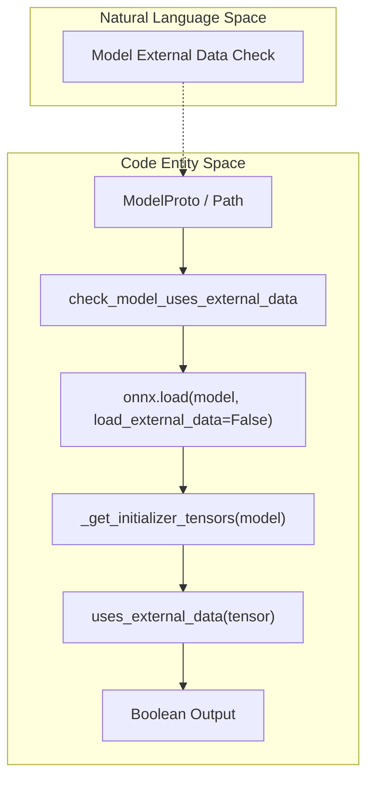
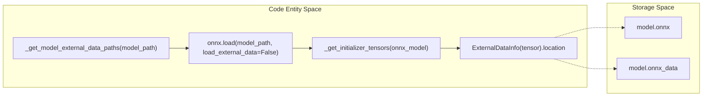

<!-- source: DeepWiki mcp.deepwiki.com · repo huggingface/optimum-onnx · page 5.1 External Data Handling · fetched 2026-10-26 -->

# External Data Handling

Relevant source files

The following files were used as context for generating this wiki page:

- [optimum/exporters/onnx/__main__.py](optimum/exporters/onnx/__main__.py)
- [optimum/exporters/onnx/convert.py](optimum/exporters/onnx/convert.py)
- [optimum/onnx/graph_transformations.py](optimum/onnx/graph_transformations.py)
- [optimum/onnx/utils.py](optimum/onnx/utils.py)
- [tests/exporters/onnx/test_export.py](tests/exporters/onnx/test_export.py)

This page details how `optimum-onnx` handles and manages ONNX models that serialize large tensor weights into external files. This subsystem is designed to bypass protocol buffer limitations and optimize file I/O for large transformer models.

## The 2GB Protobuf Limit

ONNX models are serialized using Google Protocol Buffers (`protobuf`), which enforce a hard limit of 2GB for a single serialized message. Modern pre-trained language and vision models frequently exceed this size due to massive parameter counts. To accommodate models larger than 2GB, the ONNX specification allows weights (initializers) to be stored in separate binary files, while the `.onnx` file retains only the computational graph topology and metadata.

Sources: [optimum/onnx/graph_transformations.py:132-145]()

## External Data Detection and Analysis

The library implements lightweight utilities in `optimum/onnx/utils.py` to inspect and detect external data usage without loading heavy weight tensors into memory.

### Model-Level Detection
The function `check_model_uses_external_data` inspects model initializers with `load_external_data=False` to determine if external data files are required [optimum/onnx/utils.py:80-87]().

Title: "External Data Detection Flow"

**Detection Logic Flow**
Sources: [optimum/onnx/utils.py:80-87]()

### Granular Tensor Analysis
Additional helper functions extract specific paths and external references:

| Function | Code Entity | Purpose |
| :--- | :--- | :--- |
| `_get_onnx_external_data_tensors` | `[optimum/onnx/utils.py:35-41]()` | Retrieves paths of external data tensors from model initializers. |
| `_get_onnx_external_constants` | `[optimum/onnx/utils.py:22-32]()` | Extracts external constants stored in graph attributes. |
| `_get_model_external_data_paths` | `[optimum/onnx/utils.py:67-77]()` | Resolves all absolute external file paths associated with a model path. |

Sources: [optimum/onnx/utils.py:22-77]()

## Management during Export and Saving

When saving or exporting models, `check_and_save_model` handles the serialization logic based on model size and environment flags [optimum/onnx/graph_transformations.py:132-182]().

### `save_as_external_data` Logic
Before saving, `check_and_save_model` evaluates whether the model exceeds `onnx.checker.MAXIMUM_PROTOBUF` via `model.ByteSize()` [optimum/onnx/graph_transformations.py:138](). If the size exceeds the limit or external data files already exist, `onnx.save` is invoked with `save_as_external_data=True` [optimum/onnx/graph_transformations.py:170-179]().

### `FORCE_ONNX_EXTERNAL_DATA` Environment Variable
Users can force external data serialization regardless of model size by setting the environment variable `FORCE_ONNX_EXTERNAL_DATA=1` [optimum/onnx/graph_transformations.py:168](). When enabled, `check_and_save_model` routes through the external saving branch [optimum/onnx/graph_transformations.py:170-179]().

Sources: [optimum/onnx/graph_transformations.py:132-182]()

## Loading Models with External Data

When loading models that utilize external weights, the runtime relies on file proximity to resolve paths.

### External Data Resolution Flow
The utility functions `_get_model_external_data_paths` and `_get_external_data_paths` locate associated `.data` files adjacent to the primary `.onnx` file [optimum/onnx/utils.py:44-77]().

Title: "Code-to-Storage Mapping for External Data"

**Storage and Code Entity Mapping**
Sources: [optimum/onnx/utils.py:44-77]()

Sources: [optimum/onnx/utils.py:44-77]()

---

