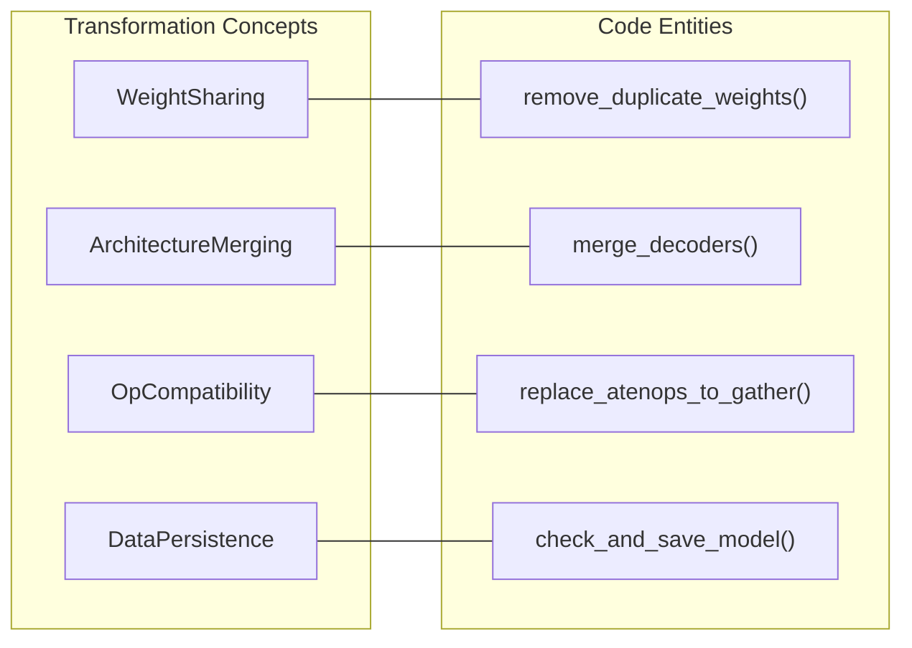
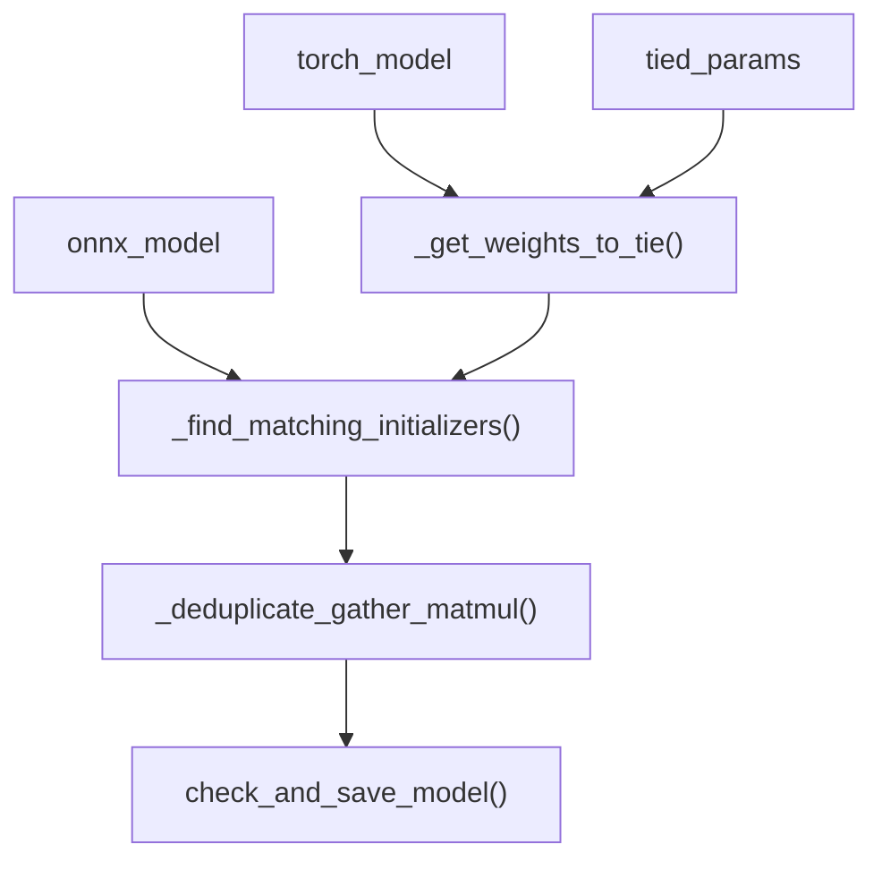
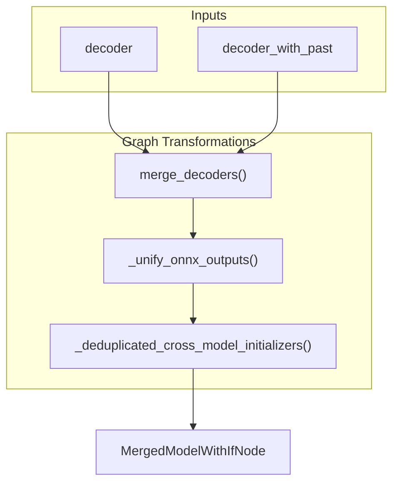

<!-- source: DeepWiki mcp.deepwiki.com · repo huggingface/optimum-onnx · page 5.2 Graph Transformations · fetched 2026-10-26 -->

# Graph Transformations

Relevant source files

The following files were used as context for generating this wiki page:

- [optimum/onnx/graph_transformations.py](optimum/onnx/graph_transformations.py)
- [optimum/onnx/transformations_utils.py](optimum/onnx/transformations_utils.py)
- [optimum/onnx/utils.py](optimum/onnx/utils.py)
- [tests/onnx/test_onnx_graph_transformations.py](tests/onnx/test_onnx_graph_transformations.py)

Graph transformations are post-processing operations applied to ONNX models after export to optimize their structure, reduce memory usage, and ensure compatibility. These transformations operate directly on the ONNX graph representation to perform tasks like weight deduplication, node replacement, and model merging.

## Overview

Graph transformations serve as the final optimization stage in the ONNX export pipeline, applied after PyTorch models are converted to ONNX format but before the models are saved and validated. These transformations modify the ONNX graph structure to improve performance and reduce model size.

### System Flow: Natural Language to Code Entities
The following diagram maps high-level transformation concepts to the specific functions implemented in `optimum/onnx/graph_transformations.py`.

**Sources:** [optimum/onnx/graph_transformations.py:1-45](), [optimum/onnx/graph_transformations.py:46-67](), [optimum/onnx/graph_transformations.py:103-129](), [optimum/onnx/graph_transformations.py:132-181]()

## Weight Deduplication

Weight deduplication reduces model size by identifying and removing duplicate initializers (weights) in the ONNX graph. The system provides two approaches: automatic duplicate detection and tied parameter-based deduplication.

### Automatic Duplicate Detection
The `remove_duplicate_weights` function scans the model for identical weight tensors and creates a name-sharing mapping to eliminate redundancy. It uses SHA-512 hashing to compare tensor data efficiently [optimum/onnx/transformations_utils.py:49-51]().

| Function | Purpose | Logic |
|----------|---------|-------|
| `remove_duplicate_weights()` | Entry point for deduplication | Calls utilities to find and replace [optimum/onnx/graph_transformations.py:46-67]() |
| `_find_duplicate_initializers()` | Identifies duplicate tensors | Hashes tensor data and maps to names [optimum/onnx/transformations_utils.py:33-55]() |
| `_create_name_sharing_dict()` | Maps duplicates to shared names | Handles naming collisions across models [optimum/onnx/transformations_utils.py:58-96]() |

**Sources:** [optimum/onnx/graph_transformations.py:46-67](), [optimum/onnx/transformations_utils.py:33-96]()

### Tied Parameter Deduplication
The `remove_duplicate_weights_from_tied_info` function uses PyTorch model information (`tied_params`) to perform weight sharing based on the original model's architecture [optimum/onnx/graph_transformations.py:70-100]().

**Sources:** [optimum/onnx/graph_transformations.py:70-100](), [optimum/onnx/transformations_utils.py:33-96]()

## Model Merging

The `merge_decoders` function creates a unified ONNX model that combines separate decoder (no past) and decoder-with-past models using conditional logic. This is critical for optimized text generation where the first token and subsequent tokens use different graph branches.

### Merging Logic and Data Flow
The merged model uses an `If` operator that branches based on a `use_cache_branch` boolean input.

**Sources:** [optimum/onnx/graph_transformations.py:192-308](), [optimum/onnx/transformations_utils.py:134-210]()

## Node and Data Type Optimization

### ATenOp Replacement
The `replace_atenops_to_gather` function fixes broken `ATenOp` or `ATen` nodes (often appearing in experimental exports) by converting them back to standard ONNX `Gather` nodes [optimum/onnx/graph_transformations.py:103-129]().

### Slice Input Casting
The `cast_slice_nodes_inputs_to_int32` function converts `int64` inputs to `int32` for `Slice` nodes. This is often necessary for compatibility with specific execution providers that have limited support for `int64` in indexing operations [optimum/onnx/graph_transformations.py:311-344]().

**Sources:** [optimum/onnx/graph_transformations.py:103-129](), [optimum/onnx/graph_transformations.py:311-344]()

## Model Validation and Persistence

The `check_and_save_model` function manages the transition from a `ModelProto` in memory to a file on disk, handling the 2GB Protobuf limit and external data requirements.

### Large Model Handling
If a model exceeds `onnx.checker.MAXIMUM_PROTOBUF` (2GB), the function skips pre-save validation and performs validation on the saved file path instead [optimum/onnx/graph_transformations.py:138-146]().

| Variable / Logic | Behavior |
|------------------|----------|
| `FORCE_ONNX_EXTERNAL_DATA` | Environment variable to force external data storage [optimum/onnx/graph_transformations.py:168]() |
| `save_as_external_data=True` | Triggered if model is >2GB or forced via env [optimum/onnx/graph_transformations.py:171-174]() |
| `onnx.checker.check_model()` | Called both pre-save (if small) and post-save [optimum/onnx/graph_transformations.py:149, 184]() |

**Sources:** [optimum/onnx/graph_transformations.py:132-191](), [optimum/onnx/utils.py:80-87]()

## Testing and Verification

The transformation pipeline is validated through dedicated test suites located under `tests/onnx/`. These tests ensure functional correctness, numerical parity, and graph validity after transformations are applied.

### Weight Sharing and Merging Tests
- `WeightSharingTestCase`: Verifies that `remove_duplicate_weights` maintains output accuracy across models like Albert while reducing graph size [tests/onnx/test_onnx_graph_transformations.py:38-67]().
- `OnnxMergingTestCase`: Tests `merge_decoders` on architectures such as T5, BART, and Whisper [tests/onnx/test_onnx_graph_transformations.py:69-91]().
- `OnnxToInt32Test`: Validates `cast_slice_nodes_inputs_to_int32` for GPT-2 models running under ONNX Runtime [tests/onnx/test_onnx_graph_transformations.py:93-123]().

**Sources:** [tests/onnx/test_onnx_graph_transformations.py:1-123]()

---

