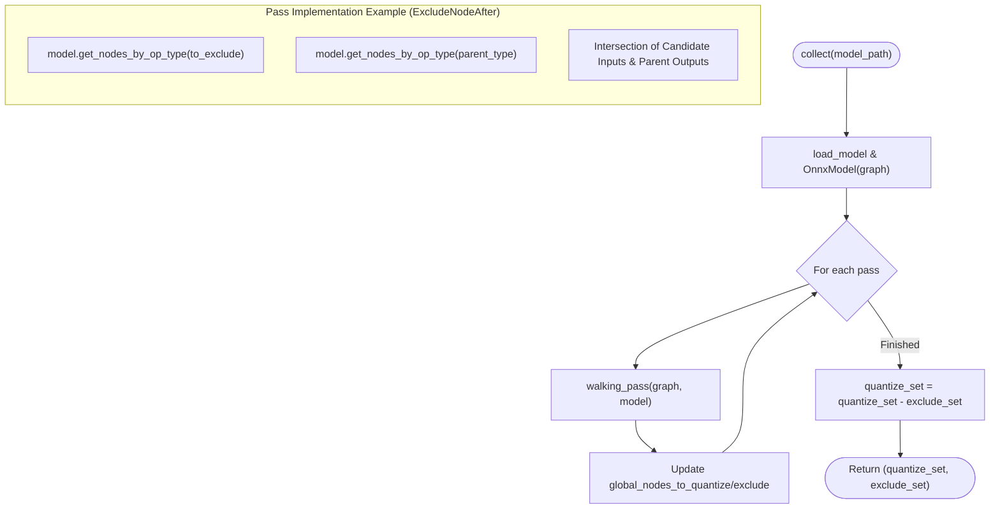

<!-- source: DeepWiki mcp.deepwiki.com · repo huggingface/optimum-onnx · page 5.3 Preprocessors and Passes · fetched 2026-10-26 -->

# Preprocessors and Passes

<details>
<summary>Relevant source files</summary>

The following files were used as context for generating this wiki page:

- [optimum/onnx/__init__.py](optimum/onnx/__init__.py)
- [optimum/onnxruntime/preprocessors/__init__.py](optimum/onnxruntime/preprocessors/__init__.py)
- [optimum/onnxruntime/preprocessors/passes/__init__.py](optimum/onnxruntime/preprocessors/passes/__init__.py)
- [optimum/onnxruntime/preprocessors/passes/excluders.py](optimum/onnxruntime/preprocessors/passes/excluders.py)
- [optimum/onnxruntime/preprocessors/passes/fully_connected.py](optimum/onnxruntime/preprocessors/passes/fully_connected.py)
- [optimum/onnxruntime/preprocessors/passes/gelu.py](optimum/onnxruntime/preprocessors/passes/gelu.py)
- [optimum/onnxruntime/preprocessors/passes/layernorm.py](optimum/onnxruntime/preprocessors/passes/layernorm.py)
- [optimum/onnxruntime/preprocessors/quantization.py](optimum/onnxruntime/preprocessors/quantization.py)

</details>


This section covers the preprocessing system that prepares ONNX models for quantization and optimization by applying targeted transformations and exclusions. The preprocessor system allows fine-grained control over which nodes and operations are included or excluded during the quantization process.

## Purpose and Architecture

The preprocessor system provides a modular framework for analyzing ONNX models and determining which nodes should be processed during quantization. It consists of two main components: `PreprocessorPass` objects that define specific selection/exclusion rules, and the `QuantizationPreprocessor` that orchestrates the application of these passes.

### Preprocessor System Architecture

```mermaid
graph TD
    subgraph "optimum.onnxruntime.preprocessors.quantization"
        QP["QuantizationPreprocessor"]
        PP_Base["PreprocessorPass (ABC)"]
    end
    
    subgraph "optimum.onnxruntime.preprocessors.passes"
        EGN["ExcludeGeLUNodes"]
        ELN["ExcludeLayerNormNodes"]
        ENA["ExcludeNodeAfter"]
        ENF["ExcludeNodeFollowedBy"]
        IFC["IncludeFullyConnectedNodes"]
    end
    
    subgraph "Data Flow"
        ModelProto["onnx.ModelProto"]
        OnnxModel["onnxruntime.transformers.onnx_model.OnnxModel"]
    end
    
    QP -- "executes" --> PP_Base
    PP_Base <|-- EGN
    PP_Base <|-- ELN
    PP_Base <|-- ENA
    PP_Base <|-- ENF
    PP_Base <|-- IFC
    
    QP -- "loads" --> ModelProto
    ModelProto -- "wrapped by" --> OnnxModel
    PP_Base -- "analyzes" --> OnnxModel
```

Sources: [optimum/onnxruntime/preprocessors/quantization.py:29-38](), [optimum/onnxruntime/preprocessors/passes/__init__.py:16-18]()

## Core Preprocessor Components

### PreprocessorPass
The `PreprocessorPass` is an abstract base class defined in `optimum.onnxruntime.preprocessors.quantization`. Every pass must implement the `__call__` method, which takes an ONNX `ModelProto` and an `OnnxModel` (from the ONNX Runtime transformer utilities) as arguments.

The `__call__` method returns a tuple of two sets: `(nodes_to_quantize, nodes_to_exclude)`.
*   **nodes_to_quantize**: A set of node names that should explicitly be targeted for quantization.
*   **nodes_to_exclude**: A set of node names that must be skipped during quantization.

Sources: [optimum/onnxruntime/preprocessors/quantization.py:29-35]()

### QuantizationPreprocessor
The `QuantizationPreprocessor` manages a list of registered passes. Its primary method is `collect()`, which:
1.  Loads the model from a path or bytes [optimum/onnxruntime/preprocessors/quantization.py:53]().
2.  Iterates through all registered `_passes` [optimum/onnxruntime/preprocessors/quantization.py:56]().
3.  Aggregates node names into `global_nodes_to_quantize` and `global_nodes_to_exclude` [optimum/onnxruntime/preprocessors/quantization.py:60-63]().
4.  Ensures consistency by removing excluded nodes from the quantization set: `global_nodes_to_quantize - global_nodes_to_exclude` [optimum/onnxruntime/preprocessors/quantization.py:66]().

Sources: [optimum/onnxruntime/preprocessors/quantization.py:38-68]()

## Available Preprocessor Passes

The preprocessor system includes several built-in passes for common exclusion and inclusion patterns:

| Pass Class | Purpose | Logic |
|------------|---------|-------|
| `ExcludeGeLUNodes` | Excludes GeLU subgraphs | Matches pattern: `Mul` -> `Mul`, `Add`, `Erf`, `Div` [optimum/onnxruntime/preprocessors/passes/gelu.py:28]() |
| `ExcludeLayerNormNodes` | Excludes LayerNorm subgraphs | Matches 8-node pattern starting from `Add` [optimum/onnxruntime/preprocessors/passes/layernorm.py:28-31]() |
| `ExcludeNodeAfter` | Excludes nodes based on parent type | Matches `operator_type_to_exclude` that consumes output of `parent_operator_type` [optimum/onnxruntime/preprocessors/passes/excluders.py:50-74]() |
| `ExcludeNodeFollowedBy` | Excludes nodes based on child type | Matches `operator_type_to_exclude` whose output is consumed by `following_operator_type` [optimum/onnxruntime/preprocessors/passes/excluders.py:21-46]() |
| `IncludeFullyConnectedNodes` | Explicitly targets FC layers | Matches `Add` nodes preceded by `MatMul` [optimum/onnxruntime/preprocessors/passes/fully_connected.py:27-28]() |

Sources: [optimum/onnxruntime/preprocessors/passes/gelu.py:21-35](), [optimum/onnxruntime/preprocessors/passes/layernorm.py:21-39](), [optimum/onnxruntime/preprocessors/passes/excluders.py:21-74](), [optimum/onnxruntime/preprocessors/passes/fully_connected.py:21-33]()

### Pattern Matching and Graph Walking

Passes utilize the `onnxruntime.transformers.onnx_model.OnnxModel` utility to perform graph traversal. For example, `IncludeFullyConnectedNodes` uses `match_parent_path` to identify Linear/Dense layers:

```python
for add_node in model.get_nodes_by_op_type("Add"):
    fc_components = model.match_parent_path(add_node, ["MatMul"], [1])
```

Sources: [optimum/onnxruntime/preprocessors/passes/fully_connected.py:27-28](), [optimum/onnxruntime/preprocessors/passes/gelu.py:28]()

## Integration with Quantization

The preprocessor system integrates with the quantization workflow by generating the lists required by the `ORTQuantizer`. 

### Preprocessing Logic Flow



Sources: [optimum/onnxruntime/preprocessors/quantization.py:51-68](), [optimum/onnxruntime/preprocessors/passes/excluders.py:56-72]()

## Usage Example

To use the system, passes are registered with the `QuantizationPreprocessor` before calling `collect`:

```python
from optimum.onnxruntime.preprocessors import QuantizationPreprocessor
from optimum.onnxruntime.preprocessors.passes import ExcludeLayerNormNodes, ExcludeGeLUNodes

preprocessor = QuantizationPreprocessor()
preprocessor.register_pass(ExcludeLayerNormNodes())
preprocessor.register_pass(ExcludeGeLUNodes())

nodes_to_quantize, nodes_to_exclude = preprocessor.collect("model.onnx")
```

Sources: [optimum/onnxruntime/preprocessors/quantization.py:47-49](), [optimum/onnxruntime/preprocessors/passes/__init__.py:17-18]()

---

