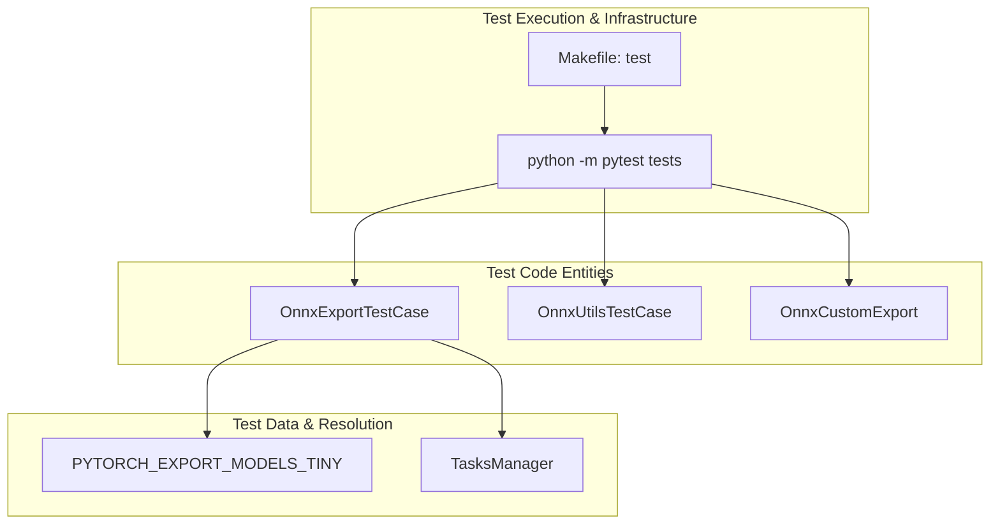
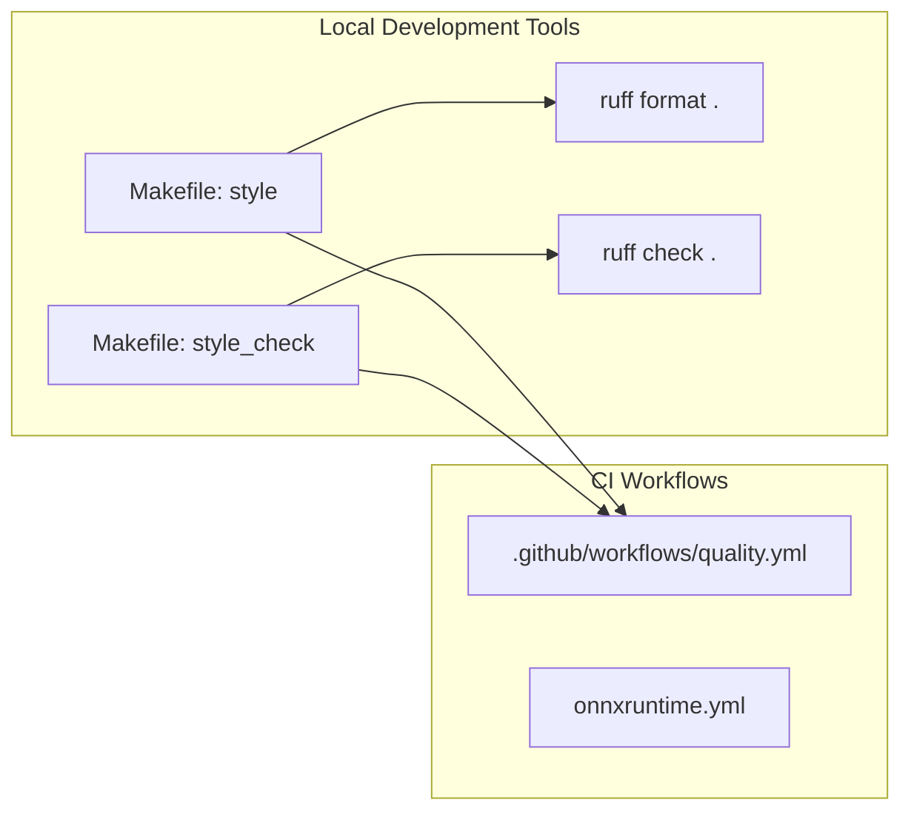
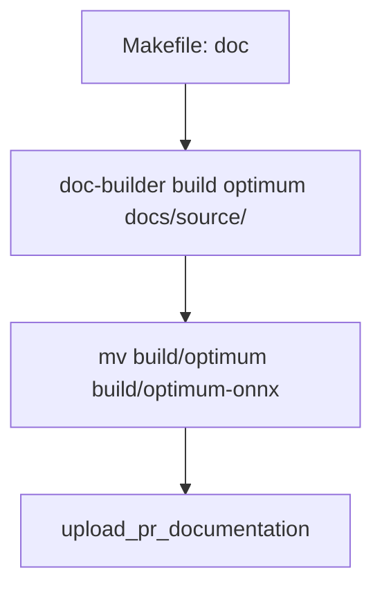

<!-- source: DeepWiki mcp.deepwiki.com · repo huggingface/optimum-onnx · page 6 Testing and Development · fetched 2026-10-26 -->

# Testing and Development

Relevant source files

The following files were used as context for generating this wiki page:

- [.gitignore](.gitignore)
- [LICENSE](LICENSE)
- [Makefile](Makefile)
- [docs/source/onnx/usage_guides/contribute.mdx](docs/source/onnx/usage_guides/contribute.mdx)

This page provides an overview of the testing infrastructure, code quality tools, continuous integration pipelines, and documentation build systems used in the `optimum-onnx` repository. For detailed instructions on setting up and running specific components, please refer to the respective child pages.

## Testing Architecture Overview

The testing framework validates the core features of `optimum-onnx`, including model export, runtime inference, and optimization passes. Tests are organized into integration suites, utility checks, and model-specific validations using lightweight test fixtures.

For complete details on the testing infrastructure, including `ORTModelTestMixin`, `MODEL_NAMES` registry, tiny-random models, `PYTORCH_EXPORT_MODELS_TINY`, `TemporaryHubRepo`, and version-gated architecture tests, see [Testing Framework](#6.1).

Sources: [Makefile:31-34]()

## Code Quality and CI/CD

Code style and formatting are strictly enforced in the repository using `ruff`. Local checks and formatting can be executed via the project `Makefile`, while automated workflows handle continuous integration across different environments and configurations.

For details on the development tools, code formatting rules, and GitHub Actions workflows (such as `onnxruntime`, exporters, CLI, GPU, slow, offline, onnx, dependabot, and style bot enforcement), see [Code Quality and CI/CD](#6.2).

Sources: [Makefile:20-30]()

## Documentation Build System

The documentation for `optimum-onnx` is built using `doc-builder` and automatically deployed via dedicated GitHub Actions workflows. The build pipeline handles directory structures carefully to support the base `optimum` extension architecture.

For information on how documentation is built and deployed, the structure of `docs/source`, `toctree` configurations, and the `build_documentation.yml` and `build_pr_documentation.yml` workflows, see [Documentation Build System](#6.3).

Sources: [Makefile:48-62]()

## Release and Distribution

The project uses standard Python packaging tools defined in the `Makefile` to automate the creation of source and wheel distributions and their upload to PyPI [Makefile:35-46]().

| Target | Command | Purpose |
| :--- | :--- | :--- |
| `build_dist_install_tools` | `pip install build twine` | Prepares environment for packaging [Makefile:36-38]() |
| `build_dist` | `python -m build` | Generates `dist/` and `build/` artifacts [Makefile:40-43]() |
| `pypi_upload` | `python -m twine upload` | Uploads the built distribution to PyPI [Makefile:45-46]() |

Sources: [Makefile:35-46]()

---

