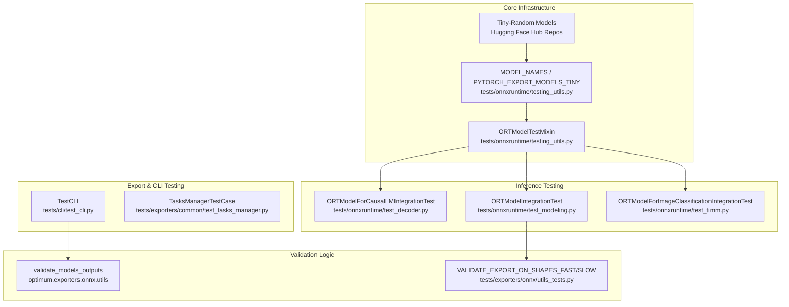
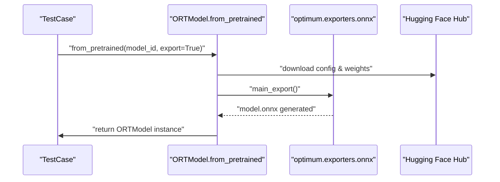

<!-- source: DeepWiki mcp.deepwiki.com · repo huggingface/optimum-onnx · page 6.1 Testing Framework · fetched 2026-10-26 -->

# Testing Framework

<details>
<summary>Relevant source files</summary>

The following files were used as context for generating this wiki page:

- [tests/exporters/onnx/utils_tests.py](tests/exporters/onnx/utils_tests.py)
- [tests/onnx/test_onnx_export_custom_module.py](tests/onnx/test_onnx_export_custom_module.py)
- [tests/onnxruntime/test_timm.py](tests/onnxruntime/test_timm.py)
- [tests/onnxruntime/testing_utils.py](tests/onnxruntime/testing_utils.py)

</details>


This document describes the comprehensive testing infrastructure used to validate ONNX export functionality, model inference, and CLI operations in the `optimum-onnx` repository. The testing framework ensures that all supported models can be correctly exported to ONNX format and that the resulting models produce accurate outputs across different platforms and configurations.

## Test Architecture Overview

The testing framework is organized into several test suites that cover different aspects of the ONNX export and runtime pipeline. It relies heavily on `unittest` and `pytest`, using specialized mixins and registries to handle the diversity of supported model architectures.

### System Architecture and Code Entities

The following diagram bridges the natural language concepts of the testing framework with the specific classes and functions in the codebase:



Sources: [tests/onnxruntime/testing_utils.py:31-130](), [tests/exporters/onnx/utils_tests.py:16-30](), [tests/onnxruntime/test_timm.py:9-15]()

## Key Testing Components

### ORTModelTestMixin
The `ORTModelTestMixin` class (utilized across integration tests such as `ORTModelForImageClassificationIntegrationTest` in [tests/onnxruntime/test_timm.py:15]()) provides standardized setup and utility methods for testing `ORTModel` classes. It handles common tasks such as numerical validation tolerances (`ATOL`, `RTOL`) and comparing ONNX outputs against native PyTorch or library-specific models.

Sources: [tests/onnxruntime/test_timm.py:9-49]()

### MODEL_NAMES Registry and Tiny-Random Models
To avoid downloading large production models during CI, the framework maintains the `MODEL_NAMES` dictionary in [tests/onnxruntime/testing_utils.py:31-125]() and `PYTORCH_EXPORT_MODELS_TINY` in [tests/exporters/onnx/utils_tests.py:38-141](). These registries map model architecture keys to "tiny-random" versions hosted on the Hugging Face Hub (e.g., `hf-internal-testing/tiny-random-BertModel`, `optimum-internal-testing/tiny-random-llama`). These models share the architecture of full-sized counterparts but feature minimal layers and hidden dimensions.

| Architecture | Tiny-Random Model ID | Source |
| :--- | :--- | :--- |
| `bert` | `hf-internal-testing/tiny-random-BertModel` | [tests/onnxruntime/testing_utils.py:36]() |
| `llama` | `optimum-internal-testing/tiny-random-llama` | [tests/onnxruntime/testing_utils.py:94]() |
| `gpt2` | `hf-internal-testing/tiny-random-GPT2LMHeadModel` | [tests/onnxruntime/testing_utils.py:74]() |

Sources: [tests/onnxruntime/testing_utils.py:31-125](), [tests/exporters/onnx/utils_tests.py:38-141]()

### Version-Gated Architecture Tests
Because `optimum-onnx` supports a wide range of model architectures, many of which require specific versions of the `transformers` library, the test suites use version gating via `is_transformers_version`. This ensures that tests for newer architectures (like `Gemma3` or `DeepSeek-V3`) are only executed when the environment meets minimum version requirements.

```python
if is_transformers_version(">=", str(Gemma3OnnxConfig.MIN_TRANSFORMERS_VERSION)):
    SUPPORTED_ARCHITECTURES.extend(["gemma3", "gemma3_text"])
```

Sources: [tests/onnxruntime/testing_utils.py:26-27]()

## Export Test Fixtures and Operational Modes

### Export-on-the-Fly Testing
Many tests validate the `export=True` flag in `from_pretrained`. This triggers the internal export pipeline during loading, allowing the framework to test the conversion process and the resulting inference session in a single flow.



Sources: [tests/onnxruntime/test_timm.py:20-22]()

### CLI and Subprocess Testing
The test suite validates the `optimum-cli` entry point by executing commands via subprocess wrappers (e.g., `optimum-cli export onnx` and `optimum-cli onnxruntime quantize`), ensuring command-line argument parsing and execution paths function correctly.

Sources: [tests/exporters/onnx/utils_tests.py:16-30]()

### TemporaryHubRepo
For testing Hub-related features (such as uploading exported models or checking repository configurations), the framework uses Hugging Face Hub client utilities like `create_repo` and `delete_repo` to provision temporary remote repositories. This ensures tests can validate the full "Export -> Upload -> Download" cycle without polluting persistent Hub storage.

Sources: [tests/onnxruntime/testing_utils.py:23]()

## Validation Logic

### Shape and Numerical Validation
The framework uses predefined shape dictionaries (`VALIDATE_EXPORT_ON_SHAPES_FAST` and `VALIDATE_EXPORT_ON_SHAPES_SLOW`) to stress-test ONNX models across various dimensions.

```python
VALIDATE_EXPORT_ON_SHAPES_FAST = {
    "batch_size": [4],
    "sequence_length": [19],
    "num_choices": [4],
}
```

*   **Fast Validation**: Uses single static shapes (e.g., `batch_size: 4`, `sequence_length: 19`) for quick CI validation.
*   **Slow Validation**: Iterates through multiple combinations (e.g., `batch_size: [1, 3, 5]`, `sequence_length: [8, 33, 96, 154]`) to ensure dynamic axes and symbolic shapes operate correctly.

Sources: [tests/exporters/onnx/utils_tests.py:16-30]()

### Summary of Test Suites

| Test File | Primary Focus | Key Classes / Utilities |
| :--- | :--- | :--- |
| `tests/onnxruntime/test_timm.py` | Image classification and integration with `timm` | `ORTModelForImageClassificationIntegrationTest`, `ORTModelTestMixin` [tests/onnxruntime/test_timm.py:15-16]() |
| `tests/exporters/onnx/utils_tests.py` | Export fixtures and test shapes | `PYTORCH_EXPORT_MODELS_TINY`, `VALIDATE_EXPORT_ON_SHAPES_FAST` [tests/exporters/onnx/utils_tests.py:26-38]() |
| `tests/onnxruntime/testing_utils.py` | Model registry and Hub utilities | `MODEL_NAMES`, `TemporaryHubRepo` [tests/onnxruntime/testing_utils.py:23-31]() |
| `tests/onnx/test_onnx_export_custom_module.py` | Custom module export handling (e.g., StableDropout) | `StableDropoutTestCase` [tests/onnx/test_onnx_export_custom_module.py:23-24]() |

Sources: [tests/onnxruntime/test_timm.py:15-16](), [tests/exporters/onnx/utils_tests.py:26-38](), [tests/onnxruntime/testing_utils.py:23-31](), [tests/onnx/test_onnx_export_custom_module.py:23-24]()

---

