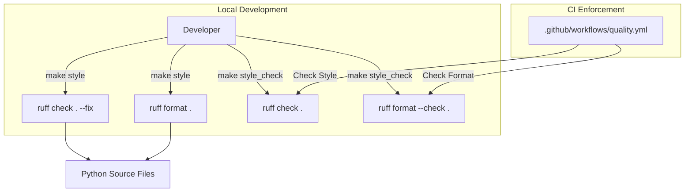
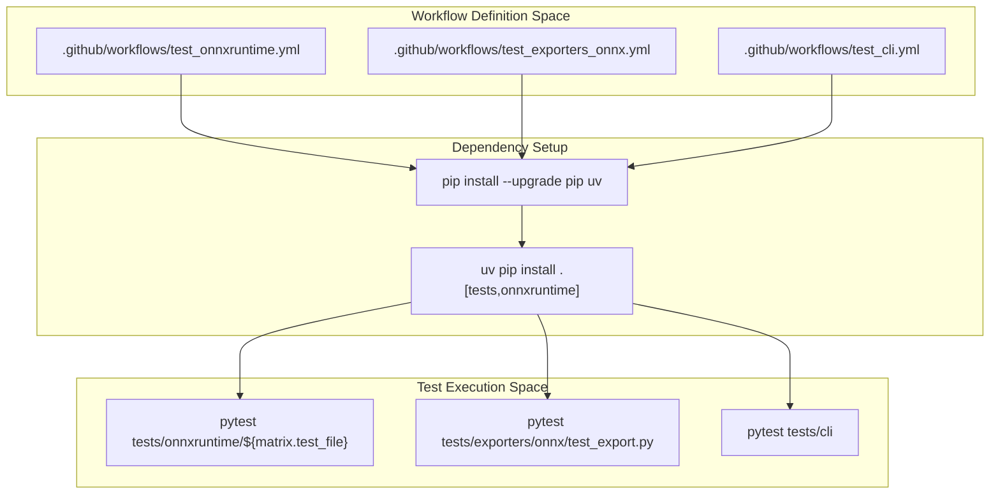

<!-- source: DeepWiki mcp.deepwiki.com · repo huggingface/optimum-onnx · page 6.2 Code Quality and CI/CD · fetched 2026-10-26 -->

# Code Quality and CI/CD

Relevant source files

The following files were used as context for generating this wiki page:

- [.github/dependabot.yml](.github/dependabot.yml)
- [.github/workflows/quality.yml](.github/workflows/quality.yml)
- [.github/workflows/style_bot.yml](.github/workflows/style_bot.yml)
- [.github/workflows/test_cli.yml](.github/workflows/test_cli.yml)
- [.github/workflows/test_exporters_common.yml](.github/workflows/test_exporters_common.yml)
- [.github/workflows/test_exporters_onnx.yml](.github/workflows/test_exporters_onnx.yml)
- [.github/workflows/test_exporters_onnx_cli.yml](.github/workflows/test_exporters_onnx_cli.yml)
- [.github/workflows/test_offline.yml](.github/workflows/test_offline.yml)
- [.github/workflows/test_onnx.yml](.github/workflows/test_onnx.yml)
- [.github/workflows/test_onnxruntime.yml](.github/workflows/test_onnxruntime.yml)
- [.github/workflows/test_onnxruntime_gpu.yml](.github/workflows/test_onnxruntime_gpu.yml)
- [.github/workflows/test_onnxruntime_slow.yml](.github/workflows/test_onnxruntime_slow.yml)
- [.github/workflows/upload_pr_documentation.yml](.github/workflows/upload_pr_documentation.yml)
- [Makefile](Makefile)
- [docs/source/index.mdx](docs/source/index.mdx)
- [docs/source/onnx/package_reference/configuration.mdx](docs/source/onnx/package_reference/configuration.mdx)

This document covers the development tools, code formatting standards, and continuous integration setup used in the `optimum-onnx` repository. It explains how code quality is maintained through automated checks, testing workflows, and style enforcement.

## Code Quality Tools and Standards

The repository uses modern Python tooling to maintain consistent code quality. The primary tool for code formatting and linting is **ruff**, which provides high-performance Python linting and formatting.

### Ruff Configuration

The repository uses `ruff` for both code formatting and linting via two main operations:

- **Formatting**: Ensures consistent code style across the entire codebase.
- **Linting**: Catches common Python issues, style violations, and potential bugs.

Title: Local Quality Checks and Formatting Flow

Sources: [.github/workflows/quality.yml:34-40]()

### Development Workflow Commands

The development process relies on standard targets for running quality checks and formatting locally:

| Command | Purpose | Underlying Commands |
|---------|---------|---------------------|
| `style_check` | Validate code format and style without making changes | `ruff format --check .` and `ruff check .` |
| `style` | Auto-format code and fix fixable linting issues | `ruff format .` and `ruff check . --fix --exit-zero` |

Sources: [.github/workflows/quality.yml:34-40]()

## CI/CD Pipeline Architecture

The continuous integration pipeline consists of multiple GitHub Actions workflows targeting specific components: ONNX Runtime inference, common exporters, ONNX exporters, CLI, offline usage, raw ONNX, and specialized hardware (GPU).

### Workflow Suite

The CI setup is modularized to allow for parallel execution and targeted testing across multiple matrix configurations:

| Workflow File | Scope | Triggers |
|---------------|-------|----------|
| `.github/workflows/quality.yml` | Linting and formatting checks via ruff | `push`, `pull_request` |
| `.github/workflows/test_onnxruntime.yml` | ORT inference logic, modeling, optimization, and quantization | `push`, `pull_request` (Matrix: Python 3.11, Transformers versions) |
| `.github/workflows/test_exporters_common.yml` | Common exporter utility tests | `push`, `pull_request` |
| `.github/workflows/test_exporters_onnx.yml` | ONNX export logic and configurations | `push`, `pull_request` |
| `.github/workflows/test_exporters_onnx_cli.yml` | `optimum-cli export onnx` integration tests | `push`, `pull_request` |
| `.github/workflows/test_cli.yml` | General CLI subcommands across platforms | `push`, `pull_request` (Matrix: ubuntu-24.04, macos-latest, windows-latest) |
| `.github/workflows/test_onnx.yml` | Raw ONNX verification tests | `push`, `pull_request` |
| `.github/workflows/test_offline.yml` | Air-gapped/offline export and loading validation | `push`, `pull_request` |
| `.github/workflows/test_onnxruntime_gpu.yml` | CUDA and TensorRT Execution Providers | `schedule`, `workflow_dispatch`, `label: gpu`, `label: onnxruntime-gpu` |
| `.github/workflows/test_onnxruntime_slow.yml` | Slow/comprehensive integration tests | `schedule`, `workflow_dispatch`, `label: slow`, `label: onnxruntime-slow` |
| `.github/workflows/style_bot.yml` | Automated styling PR bot action | `issue_comment` (created) |

Sources: [.github/workflows/quality.yml:1-10](), [.github/workflows/test_onnxruntime.yml:1-40](), [.github/workflows/test_exporters_common.yml:1-10](), [.github/workflows/test_exporters_onnx.yml:1-10](), [.github/workflows/test_exporters_onnx_cli.yml:1-10](), [.github/workflows/test_cli.yml:1-10](), [.github/workflows/test_offline.yml:1-10](), [.github/workflows/test_onnx.yml:1-10](), [.github/workflows/test_onnxruntime_slow.yml:1-15](), [.github/workflows/test_onnxruntime_gpu.yml:1-15](), [.github/workflows/style_bot.yml:1-6]()

### Testing Strategy and Environment

The repository utilizes `uv` for ultra-fast dependency resolution and installation inside GitHub Actions runners.

Title: CI Test Execution Environment and Matrix Flow

Sources: [.github/workflows/test_onnxruntime.yml:45-82](), [.github/workflows/test_exporters_onnx.yml:41-48](), [.github/workflows/test_cli.yml:41-49]()

### Specialized Workflows

#### GPU Testing
The `.github/workflows/test_onnxruntime_gpu.yml` workflow runs on an `aws-g6-4xlarge-plus` runner group using a NVIDIA TensorRT container (`nvcr.io/nvidia/tensorrt:24.12-py3`). It executes pytest with CUDA and TensorRT execution provider filters (`cuda_ep_test` or `trt_ep_test`).

Sources: [.github/workflows/test_onnxruntime_gpu.yml:29-53]()

#### Offline Testing
The `.github/workflows/test_offline.yml` workflow ensures that the library functions correctly in air-gapped environments without external network access. It downloads tiny random test models into a temporary home directory (`HF_HOME=/tmp/`), runs `optimum-cli export onnx` with `HF_HUB_OFFLINE=1`, and executes offline model loading assertions.

Sources: [.github/workflows/test_offline.yml:43-54]()

#### Style Bot
The `.github/workflows/style_bot.yml` workflow integrates with `huggingface_hub`'s style bot action (`huggingface/huggingface_hub/.github/workflows/style-bot-action.yml`). It responds to issue comments requesting formatting, applying quality checks using `[quality]` dependencies.

Sources: [.github/workflows/style_bot.yml:1-19]()

## Release and Documentation Automation

### Documentation Deployment
Documentation builds are handled via dedicated workflows. PR documentation previews are generated and subsequently uploaded using `.github/workflows/upload_pr_documentation.yml`, which triggers upon completion of the build workflow using `huggingface/doc-builder` integration.

Sources: [.github/workflows/upload_pr_documentation.yml:1-16]()

---

