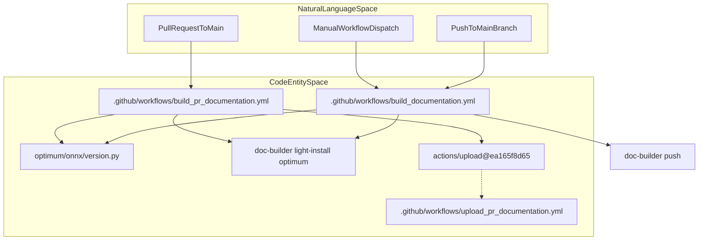
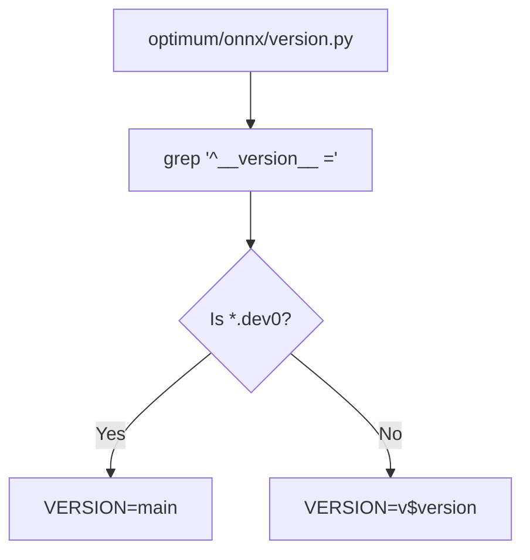
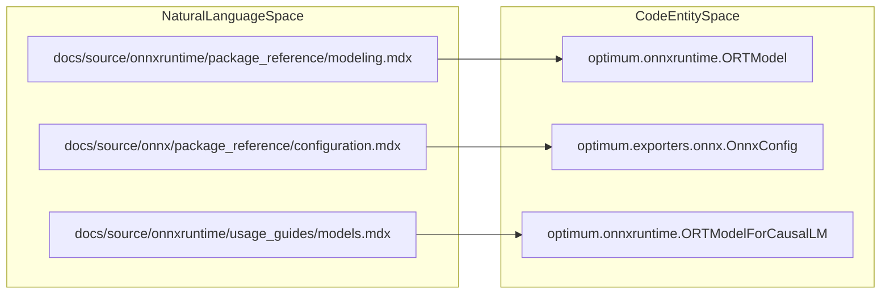

<!-- source: DeepWiki mcp.deepwiki.com · repo huggingface/optimum-onnx · page 6.3 Documentation Build System · fetched 2026-10-26 -->

# Documentation Build System

Relevant source files

The following files were used as context for generating this wiki page:

- [.github/workflows/build_documentation.yml](.github/workflows/build_documentation.yml)
- [.github/workflows/build_pr_documentation.yml](.github/workflows/build_pr_documentation.yml)
- [.github/workflows/style_bot.yml](.github/workflows/style_bot.yml)
- [.github/workflows/upload_pr_documentation.yml](.github/workflows/upload_pr_documentation.yml)
- [docs/source/_toctree.yml](docs/source/_toctree.yml)
- [docs/source/index.mdx](docs/source/index.mdx)
- [docs/source/onnx/package_reference/configuration.mdx](docs/source/onnx/package_reference/configuration.mdx)
- [docs/source/onnxruntime/overview.mdx](docs/source/onnxruntime/overview.mdx)
- [docs/source/onnxruntime/package_reference/modeling.mdx](docs/source/onnxruntime/package_reference/modeling.mdx)
- [docs/source/onnxruntime/usage_guides/models.mdx](docs/source/onnxruntime/usage_guides/models.mdx)
- [optimum/onnxruntime/modeling.py](optimum/onnxruntime/modeling.py)

## Purpose and Scope

The documentation build system automates the generation and deployment of documentation for the `optimum-onnx` repository. This system uses GitHub Actions workflows to build documentation from source files (primarily Markdown and MDX) and deploy them to Hugging Face's documentation hosting infrastructure. The system handles both main branch documentation updates and preview builds for pull requests.

Sources: [.github/workflows/build_documentation.yml:1-10](), [.github/workflows/build_pr_documentation.yml:1-7]()

## System Architecture

The documentation build system consists of three primary GitHub Actions workflows that orchestrate the documentation generation, artifact management, and deployment process, linking natural language triggers to specific workflow files and python scripts:

Sources: [.github/workflows/build_documentation.yml:1-69](), [.github/workflows/build_pr_documentation.yml:1-55](), [.github/workflows/upload_pr_documentation.yml:1-16](), [optimum/onnx/version.py:1-1]()

## Main Branch Documentation Workflow

The `build_documentation.yml` workflow handles official documentation updates for production deployments.

### Trigger Conditions
The workflow is triggered by pushes to the `main` branch, branches matching `doc-builder*`, release branches `v*-release`, or manual `workflow_dispatch` [.github/workflows/build_documentation.yml:3-9]().

### Version Resolution Process
The workflow extracts the version string from the source code via `optimum/onnx/version.py` to determine the documentation landing page version:

Sources: [.github/workflows/build_documentation.yml:37-46]()

### Build and Deployment Steps
1.  **Environment Setup**: Uses `ubuntu-24.04` and Python 3.11 [.github/workflows/build_documentation.yml:17,34]().
2.  **Installation**: Installs `uv`, `doc-builder`, and the package in editable mode without dependencies [.github/workflows/build_documentation.yml:52-54]().
3.  **Generation**: Executes `make doc` with the specified `BUILD_DIR` and `VERSION` [.github/workflows/build_documentation.yml:58-60]().
4.  **Push**: Uses `doc-builder push` to send the built docs to the `hf-doc-build/doc-build` repository using the `HF_DOC_BUILD_PUSH` secret [.github/workflows/build_documentation.yml:63-69]().

Sources: [.github/workflows/build_documentation.yml:17-69]()

## Pull Request Documentation Workflow

The PR documentation system generates preview documentation for contributors to review before merging.

### Build Phase (`build_pr_documentation.yml`)
This workflow runs on every pull request to `main` [.github/workflows/build_pr_documentation.yml:4-6](). It mirrors the environment of the main workflow but instead of pushing to the production repo, it uploads the build as a GitHub Actions artifact named `doc-build-artifact` [.github/workflows/build_pr_documentation.yml:50-55]().

Key metadata files are included in the artifact:
- `onnx-doc-build/commit_sha`: Stores the HEAD SHA of the pull request [.github/workflows/build_pr_documentation.yml:49]()
- `onnx-doc-build/pr_number`: Stores the pull request ID [.github/workflows/build_pr_documentation.yml:50]()

### Upload Phase (`upload_pr_documentation.yml`)
Once the build workflow completes, the `Upload PR Documentation` workflow is triggered via the `workflow_run` event [.github/workflows/upload_pr_documentation.yml:4-7](). It uses a reusable workflow from `huggingface/doc-builder` (`upload_pr_documentation.yml`) to post the documentation preview link as a comment on the pull request [.github/workflows/upload_pr_documentation.yml:10-16]().

Sources: [.github/workflows/build_pr_documentation.yml:1-55](), [.github/workflows/upload_pr_documentation.yml:1-16]()

## Documentation Structure and Configuration

The documentation source is located in `docs/source/` and follows a structured hierarchy defined in the Table of Contents file.

### Toctree Configuration
The `docs/source/_toctree.yml` file defines the navigation structure. It organizes content into logical blocks:
1.  **Top-level**: Index, Installation, Quickstart [docs/source/_toctree.yml:2-7]()
2.  **ONNX Runtime**: Covers usage guides (pipelines, models, optimization, quantization), conceptual guides, and package references [docs/source/_toctree.yml:8-49]()
3.  **ONNX Export**: Covers the export process and configuration references [docs/source/_toctree.yml:50-66]()

### MDX and Autodoc
The system uses MDX for rich content and the `[[autodoc]]` directive to pull docstrings directly from the Python source code. For example:
- `ORTModel` documentation is pulled from `onnxruntime.ORTModel` [docs/source/onnxruntime/package_reference/modeling.mdx:21]()
- `OnnxConfig` documentation is pulled from `exporters.onnx.OnnxConfig` [docs/source/onnx/package_reference/configuration.mdx:35]()

### Source/Code Association

| Documentation Page | Primary Code Entity | Role |
|--------------------|---------------------|------|
| `onnxruntime/package_reference/modeling.mdx` | `ORTModel` | Base class for ONNX Runtime inference [docs/source/onnxruntime/package_reference/modeling.mdx:21]() |
| `onnx/package_reference/configuration.mdx` | `OnnxConfig` | Base class for export configs [docs/source/onnx/package_reference/configuration.mdx:35]() |
| `onnxruntime/usage_guides/models.mdx` | `ORTModelForCausalLM` | Causal language model implementation [docs/source/onnxruntime/usage_guides/models.mdx:17]() |

Sources: [docs/source/_toctree.yml:1-68](), [docs/source/onnxruntime/package_reference/modeling.mdx:19-21](), [docs/source/onnx/package_reference/configuration.mdx:33-35](), [docs/source/onnxruntime/usage_guides/models.mdx:15-18]()

## Code Quality Integration

Documentation code snippets and syntax formatting are supported by the `Style Bot` workflow (`style_bot.yml`), which can be triggered by issue comments to enforce style and quality standards using `huggingface_hub` style-bot actions [.github/workflows/style_bot.yml:1-13](). It uses the `[quality]` dependency extra to ensure documentation code snippets and formatting remain consistent [.github/workflows/style_bot.yml:15]().

Sources: [.github/workflows/style_bot.yml:1-19]()

---

