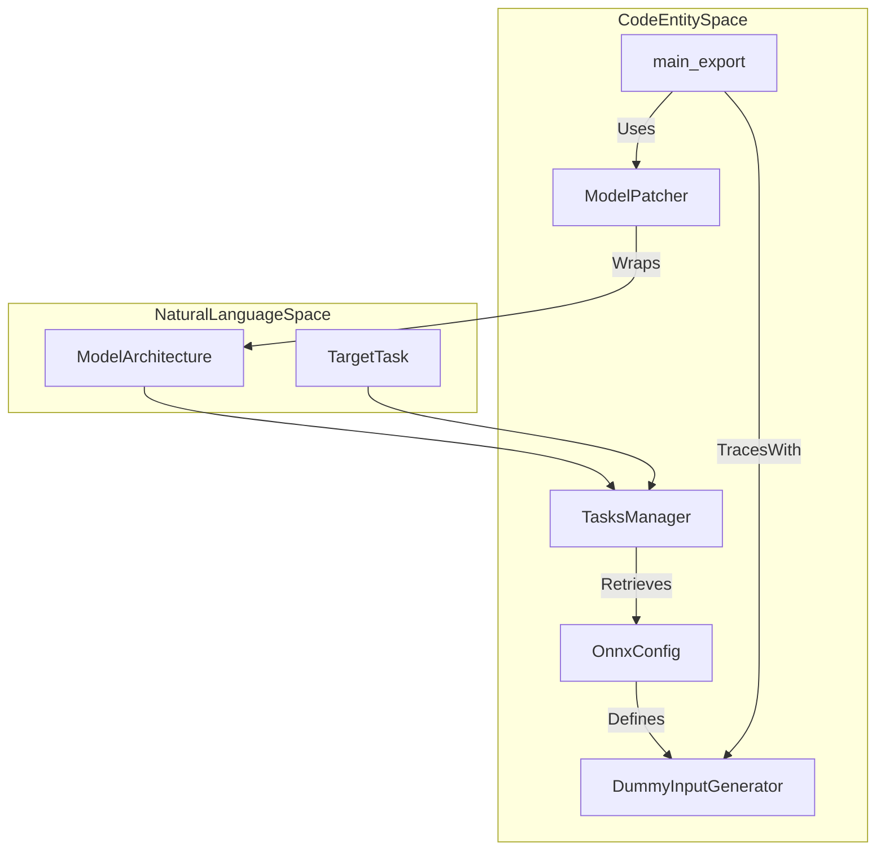
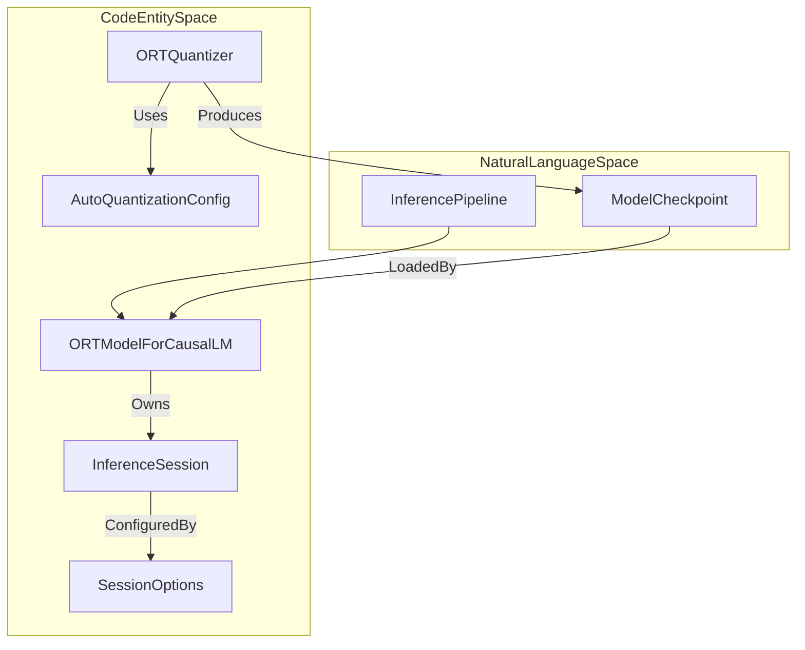

<!-- source: DeepWiki mcp.deepwiki.com · repo huggingface/optimum-onnx · page 7 Glossary · fetched 2026-10-26 -->

# Glossary

Relevant source files

The following files were used as context for generating this wiki page:

- [docs/source/onnxruntime/concept_guides/onnx.mdx](docs/source/onnxruntime/concept_guides/onnx.mdx)
- [optimum/exporters/onnx/constants.py](optimum/exporters/onnx/constants.py)
- [optimum/onnxruntime/constants.py](optimum/onnxruntime/constants.py)
- [optimum/onnxruntime/dummy_objects.py](optimum/onnxruntime/dummy_objects.py)

This glossary provides definitions for codebase-specific terms, jargon, and abbreviations used throughout the `optimum-onnx` repository. It serves as a technical reference for onboarding engineers to understand the implementation details and data flow of the ONNX export, inference, and optimization systems.

## Core Concepts

### ONNX (Open Neural Network Exchange)
An open standard format for machine learning models that allows interoperability between different frameworks by defining a common computational graph of operators.
Sources: [docs/source/onnxruntime/concept_guides/onnx.mdx:1-3]()

### ORT (ONNX Runtime)
The primary high-performance inference engine used to execute ONNX models, providing graph optimizations and hardware execution provider integration.
Sources: [docs/source/onnxruntime/concept_guides/onnx.mdx:13-13]()

### Execution Provider (EP)
Hardware-specific abstraction layers (e.g., `CPUExecutionProvider`, `CUDAExecutionProvider`) that enable ONNX Runtime to execute models on various hardware backends.
Sources: [docs/source/onnxruntime/concept_guides/onnx.mdx:13-13]()

### Tasks
Specific model architectures and head configurations (e.g., `text-generation`, `sequence-classification`) mapped via the `TasksManager` registry.
Sources: [docs/source/onnxruntime/concept_guides/onnx.mdx:1-3]()

Sources: [docs/source/onnxruntime/concept_guides/onnx.mdx:1-13]()

---

## Export & Configuration

### OnnxConfig
The base class for defining model-specific ONNX export configurations, specifying required inputs, outputs, and dynamic axes.
Sources: [docs/source/onnxruntime/concept_guides/onnx.mdx:1-3]()

### Dynamic Axes
Tensor dimensions that can vary at runtime (such as `batch_size` or `sequence_length`), configured within ONNX input and output mappings.
Sources: [docs/source/onnxruntime/concept_guides/onnx.mdx:1-3]()

### Model Patching
The process of temporarily overriding PyTorch module methods or unsupported operators with ONNX-export-compatible equivalents during tracing.
Sources: [optimum/exporters/onnx/constants.py:23-40]()

### Dummy Input Generator
Utility classes responsible for instantiating representative sample tensors to trace PyTorch models during the export phase.
Sources: [optimum/exporters/onnx/constants.py:15-40]()

### Natural Language Space to Export Code Space
The following diagram maps high-level export concepts to the internal classes that implement them.

**Diagram: Export System Architecture**

Sources: [optimum/exporters/onnx/constants.py:15-40](), [docs/source/onnxruntime/concept_guides/onnx.mdx:1-3]()

Sources: [docs/source/onnxruntime/concept_guides/onnx.mdx:1-3](), [optimum/exporters/onnx/constants.py:15-40]()

---

## Inference & Optimization

### IO Binding
An ONNX Runtime optimization technique that pre-allocates device memory for inputs and outputs, eliminating redundant host-to-device memory transfers.
Sources: [optimum/onnxruntime/constants.py:15-25]()

### KV Cache (Key-Value Cache)
Precomputed historical hidden states used in generative causal language models to avoid recalculating attention keys and values for prior tokens.
Sources: [optimum/onnxruntime/constants.py:18-20]()

### Merged Decoders
A performance optimization pattern where decoder graphs without past state and with past state are consolidated into a single `.onnx` file using conditional control flow.
Sources: [optimum/onnxruntime/constants.py:19-24]()

### Calibration
The execution of representative input data through a model to gather tensor activation ranges required for static quantization.
Sources: [optimum/exporters/onnx/constants.py:15-16]()

### Natural Language Space to Inference Code Space
The following diagram maps inference concepts to the specific classes and files responsible for execution.

**Diagram: Inference and Session Management**

Sources: [optimum/onnxruntime/constants.py:15-25](), [optimum/exporters/onnx/constants.py:15-16]()

Sources: [optimum/onnxruntime/constants.py:15-25](), [optimum/exporters/onnx/constants.py:15-16]()

---

## Implementation Details and Constants

| Term | Definition | Code Pointer |
| :--- | :--- | :--- |
| **External Data Limit** | The 2 GB protobuf file size threshold beyond which model weights must be stored as external binary files. | [optimum/exporters/onnx/constants.py:15-16]() |
| **Merged Decoder File Pattern** | Standard filename constant (`decoder_model_merged.onnx`) representing consolidated decoder graphs. | [optimum/onnxruntime/constants.py:19-24]() |
| **Unpickable Architectures** | List of model architectures (`UNPICKABLE_ARCHS`) that require special handling or cannot be serialized directly via standard pickling passes. | [optimum/exporters/onnx/constants.py:23-34]() |
| **SDPA Unsupported Archs** | Model architectures where Scaled Dot-Product Attention export paths are restricted (`SDPA_ARCHS_ONNX_EXPORT_NOT_SUPPORTED`). | [optimum/exporters/onnx/constants.py:36-40]() |
| **Dummy Diffusion Pipelines** | Dynamic fallback objects (`ORTDiffusionPipeline`, `ORTStableDiffusionPipeline`) raised when optional backend dependencies like `diffusers` are missing. | [optimum/onnxruntime/dummy_objects.py:20-193]() |

Sources: [optimum/onnxruntime/constants.py:15-25](), [optimum/onnxruntime/dummy_objects.py:20-193](), [optimum/exporters/onnx/constants.py:15-40]()