# Page: Overview

# Overview

<details>
<summary>Relevant source files</summary>

The following files were used as context for generating this wiki page:

- [README.md](README.md)
- [docs/source/installation.mdx](docs/source/installation.mdx)
- [docs/source/onnx/overview.mdx](docs/source/onnx/overview.mdx)
- [examples/gemma3.py](examples/gemma3.py)
- [optimum/onnxruntime/modeling_seq2seq.py](optimum/onnxruntime/modeling_seq2seq.py)
- [pyproject.toml](pyproject.toml)
- [tests/onnxruntime/test_seq2seq.py](tests/onnxruntime/test_seq2seq.py)

</details>


This document provides an overview of the `optimum-onnx` repository, which serves as a bridge between Hugging Face libraries and ONNX / ONNX Runtime for optimized model inference. The repository enables users to export Hugging Face models to the ONNX format and run them with enhanced performance using ONNX Runtime.

For specific installation procedures, see [Installation and Setup](#1.1). For a quick introduction to model usage, see [Quick Start Guide](#1.2).

## Repository Purpose and Scope

Optimum ONNX bridges the gap between the Hugging Face ecosystem and ONNX Runtime by providing:

- **Model Export**: Convert Transformers, Diffusers, Timm, and Sentence Transformers models to ONNX format.
- **Optimized Inference**: Run ONNX models using specialized `ORTModel` classes with an ONNX Runtime backend.
- **Performance Optimization**: Apply graph optimizations and quantization to reduce model size and improve inference speed.
- **Seamless Integration**: Drop-in replacements for standard Transformers models with minimal code changes, including support for `transformers.pipeline`.

The repository supports a vast range of architectures, from Large Language Models like Llama and Gemma to Vision and Audio models.

Sources: [README.md:3-59](), [docs/source/onnx/overview.mdx:13-146](), [optimum/onnxruntime/pipelines.py:156-177]()

## High-Level System Architecture

The following diagram illustrates how the export, runtime, and optimization systems interact with the Hugging Face and ONNX ecosystems.

**System Architecture Diagram**
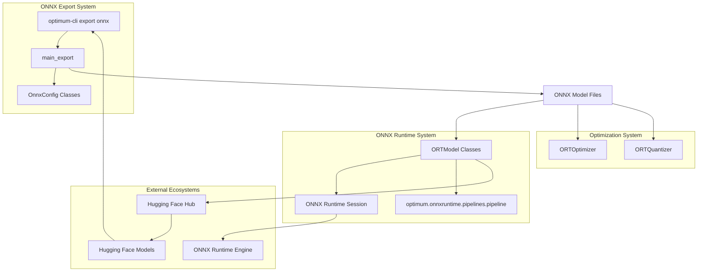
Sources: [README.md:28-58](), [optimum/onnxruntime/__init__.py:24-76](), [optimum/exporters/onnx/__init__.py:22-34]()

## Operational Modes

Optimum ONNX primarily operates in two modes: Command Line Interface (CLI) and Programmatic API.

### 1. Command Line Interface (CLI)
The `optimum-cli` provides a straightforward way to export models without writing Python code. It handles task detection and library-specific configurations automatically.

```bash
optimum-cli export onnx --model meta-llama/Llama-3.2-1B onnx_llama/
```
Sources: [README.md:32-34]()

### 2. Programmatic API
The Python API allows for dynamic model loading and inference. It uses task-specific classes like `ORTModelForCausalLM` or `ORTModelForSequenceClassification` that inherit from the base `ORTModel`.

**Code Entity Association Diagram**
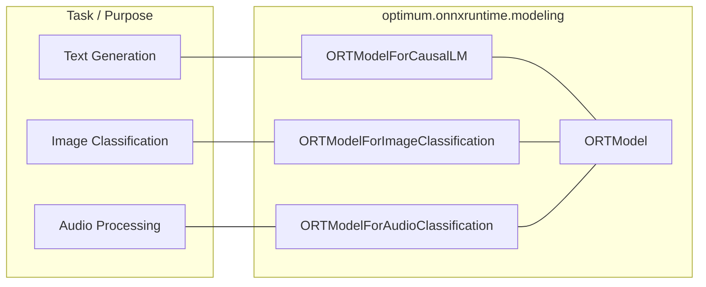
Sources: [optimum/onnxruntime/__init__.py:47-71](), [optimum/onnxruntime/modeling.py:48-48]()

## Core Components

| Component | Key Code Entities | Purpose |
|-----------|-------------------|---------|
| **Export** | `main_export`, `OnnxConfig` | Handles the conversion from PyTorch/Timm/Diffusers to ONNX. |
| **Inference** | `ORTModel`, `pipeline` | Wraps ONNX Runtime sessions to provide a Transformers-compatible API. |
| **Optimization** | `ORTOptimizer`, `OptimizationConfig` | Performs graph-level fusions and hardware-specific optimizations. |
| **Quantization** | `ORTQuantizer`, `QuantizationConfig` | Reduces model precision (e.g., to INT8) for faster execution. |

Sources: [optimum/onnxruntime/__init__.py:24-76](), [optimum/exporters/onnx/__init__.py:22-34]()

## Installation and Dependencies

The package requires `onnxruntime` (for CPU) or `onnxruntime-gpu` (for CUDA/GPU acceleration). Users should avoid installing both simultaneously to prevent conflicts.

```bash
# For CPU
pip install "optimum-onnx[onnxruntime]"

# For GPU
pip install "optimum-onnx[onnxruntime-gpu]"
```

For detailed environment requirements and source installation, see [Installation and Setup](#1.1).

Sources: [README.md:12-26](), [docs/source/installation.mdx:16-27]()

## Quick Start Example

A common pattern for using Optimum ONNX is the `from_pretrained` method with the `export=True` flag, which exports and loads the model in a single step.

```python
from optimum.onnxruntime import ORTModelForCausalLM
from transformers import AutoTokenizer

model_id = "google/gemma-3-270m-it"
# Export and load
model = ORTModelForCausalLM.from_pretrained(model_id, export=True)
```

For a complete walkthrough, see [Quick Start Guide](#1.2).

Sources: [examples/gemma3.py:10-15](), [README.md:48-51]()

---

# Page: Installation and Setup

# Installation and Setup

<details>
<summary>Relevant source files</summary>

The following files were used as context for generating this wiki page:

- [README.md](README.md)
- [docs/source/installation.mdx](docs/source/installation.mdx)
- [docs/source/onnxruntime/package_reference/modeling_diffusion.mdx](docs/source/onnxruntime/package_reference/modeling_diffusion.mdx)
- [docs/source/onnxruntime/package_reference/pipelines.mdx](docs/source/onnxruntime/package_reference/pipelines.mdx)
- [docs/source/onnxruntime/usage_guides/amdgpu.mdx](docs/source/onnxruntime/usage_guides/amdgpu.mdx)
- [docs/source/onnxruntime/usage_guides/gpu.mdx](docs/source/onnxruntime/usage_guides/gpu.mdx)
- [docs/source/onnxruntime/usage_guides/pipelines.mdx](docs/source/onnxruntime/usage_guides/pipelines.mdx)
- [examples/gemma3.py](examples/gemma3.py)
- [optimum/onnxruntime/modeling_seq2seq.py](optimum/onnxruntime/modeling_seq2seq.py)
- [pyproject.toml](pyproject.toml)
- [tests/onnxruntime/test_seq2seq.py](tests/onnxruntime/test_seq2seq.py)

</details>


This document covers the installation and setup process for `optimum-onnx`, including system requirements, dependency management, extras syntax, environment requirements, and configuration options for both CPU and GPU execution environments.

## System Requirements

`optimum-onnx` requires Python 3.9 or higher and supports multiple execution environments across different operating systems and hardware configurations.

### Python Version Support

The package explicitly supports Python versions 3.9 through 3.13 as configured in the project specification:

| Python Version | Support Status |
|----------------|----------------|
| 3.9            | ✅ Supported   |
| 3.10           | ✅ Supported   |
| 3.11           | ✅ Supported   |
| 3.12           | ✅ Supported   |
| 3.13           | ✅ Supported   |

### Hardware Requirements

- **CPU**: Standard x86_64, ARM, or equivalent CPU environments supporting ONNX Runtime.
- **GPU**: NVIDIA CUDA-compatible GPU or AMD Instinct GPU satisfying the corresponding execution provider requirements for ONNX Runtime.

Sources: [pyproject.toml:10-10](), [pyproject.toml:24-28](), [README.md:20-21]()

## Dependency Architecture

Understanding the dependency structure is essential for setting up correct export and inference pipelines. The core dependencies include `optimum`, `transformers`, `onnx`, and `onnxscript`. Optional extras manage backend execution providers (`onnxruntime`, `onnxruntime-gpu`), testing utilities, and code quality tools.

### Core and Optional Dependencies

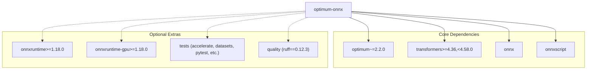

### The `onnxruntime` vs `onnxruntime-gpu` Conflict

A critical constraint in the installation architecture is the mutual exclusivity of `onnxruntime` and `onnxruntime-gpu`. Both packages write to the same namespace (`onnxruntime`), causing runtime symbol collisions or silent fallbacks to CPU execution if both are present. Users must uninstall the CPU package before installing the GPU package.

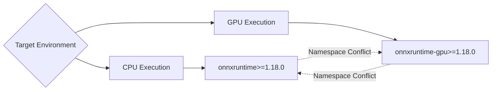

Sources: [pyproject.toml:31-36](), [pyproject.toml:42-43](), [README.md:26-26]()

## Installation Options

Installation commands vary based on whether you are targeting a CPU runtime, a GPU accelerator, or setting up a development environment.

### Basic CPU Installation

To install `optimum-onnx` along with standard CPU execution support via `onnxruntime`:

```bash
pip install "optimum-onnx[onnxruntime]"
```

### GPU-Accelerated Installation

For NVIDIA CUDA environments, ensure CUDA and cuDNN requirements are met, purge any existing CPU runtime, and install the GPU extra:

```bash
pip uninstall onnxruntime
pip install "optimum-onnx[onnxruntime-gpu]"
```

### Source and Development Installation

To install directly from the development repository or set up full testing and linting packages:

```bash
python -m pip install git+https://github.com/huggingface/optimum-onnx.git
pip install "optimum-onnx[onnxruntime,tests,quality]"
```

Sources: [README.md:17-18](), [README.md:23-26](), [docs/source/installation.mdx:22-27](), [pyproject.toml:44-62]()

## Installation Process Flow

The installation workflow resolves package trees from PyPI and configures runtime bindings for execution entry points.

### Installation Sequence

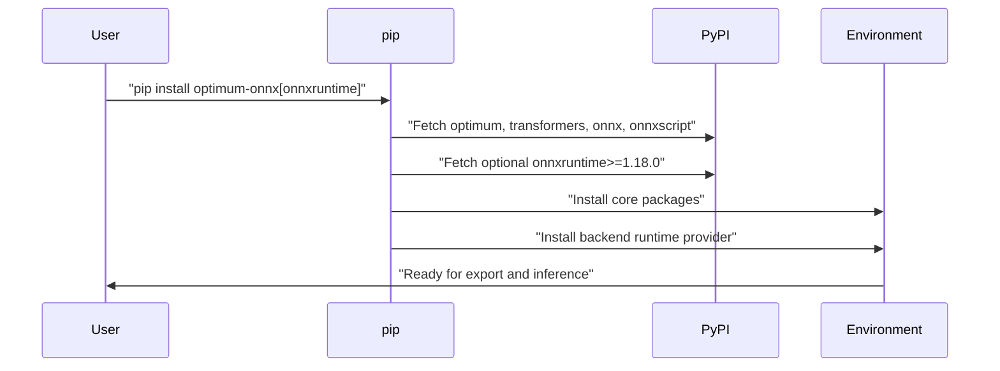

### Code Entity Mapping

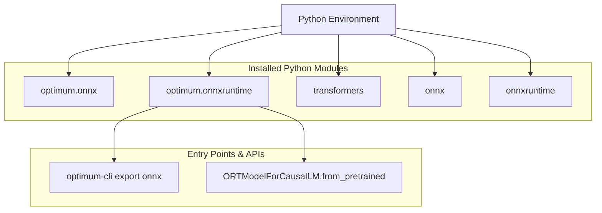

Sources: [pyproject.toml:67-68](), [README.md:33-33](), [examples/gemma3.py:10-15]()

## Installation Verification

### Command Line Verification

Verify that the CLI exporter tool is correctly registered in your PATH:

```bash
optimum-cli --help
optimum-cli export onnx --help
```

### Programmatic Verification

Run a quick script to verify that `onnxruntime` loads correctly and that `optimum-onnx` can export and instantiate models such as `google/gemma-3-270m-it`:

```python
import onnxruntime as ort
from optimum.onnxruntime import ORTModelForCausalLM
from transformers import AutoTokenizer

providers = ort.get_available_providers()
print(f"Available execution providers: {providers}")

model_id = "google/gemma-3-270m-it"
tokenizer = AutoTokenizer.from_pretrained(model_id)
model = ORTModelForCausalLM.from_pretrained(model_id, export=True)
print("✅ Optimum-ONNX successfully initialized and loaded model graph.")
```

Sources: [README.md:33-34](), [examples/gemma3.py:8-15]()

## Configuration and Environment Setup

### Execution Provider Mapping

ONNX Runtime relies on Execution Providers (EPs) to dispatch operations to hardware accelerators.

| Execution Provider | Target Hardware | Requirements |
|--------------------|-----------------|--------------|
| `CPUExecutionProvider` | CPU | None (Default) |
| `CUDAExecutionProvider` | NVIDIA GPU | CUDA toolkit, cuDNN |
| `TensorrtExecutionProvider` | NVIDIA TensorRT | TensorRT, CUDA toolkit |
| `ROCmExecutionProvider` | AMD Instinct GPU | ROCm 6.0+ |

### Test Suite Execution

The repository uses `pytest` custom markers defined in `pyproject.toml` to partition test suites by hardware and feature flags:

```bash
# Run CUDA EP tests
pytest -m "cuda_ep_test"

# Run quantization validation tests
pytest -m "quantization"
```

Sources: [pyproject.toml:131-139](), [docs/source/onnxruntime/usage_guides/gpu.mdx:33-40]()

## Troubleshooting Common Issues

### Package Conflicts Between Runtimes
- **Symptom**: `onnxruntime` methods failing with unexpected attribute errors or executing on CPU despite specifying GPU provider.
- **Solution**: Run `pip uninstall onnxruntime` and reinstall `optimum-onnx[onnxruntime-gpu]` [README.md:26-26]().

### Version Constraints with Transformers
- **Symptom**: Import errors during model export or missing attributes on tokenizer/config classes.
- **Solution**: Ensure `transformers` falls within the supported range `>=4.36,<4.58.0` [pyproject.toml:33-33]().

### Large Model External Data Limit
- **Symptom**: `ValueError: Protocol message ModelProto exceeds maximum size of 2GB` when exporting large models.
- **Solution**: Ensure sufficient local storage is available for auxiliary external weight files (`.data`) generated during protobuf serialization [docs/source/installation.mdx:22-27]().

Sources: [README.md:26-26](), [pyproject.toml:33-33](), [docs/source/installation.mdx:22-27]()

---

# Page: Quick Start Guide

# Quick Start Guide

<details>
<summary>Relevant source files</summary>

The following files were used as context for generating this wiki page:

- [README.md](README.md)
- [docs/source/installation.mdx](docs/source/installation.mdx)
- [docs/source/onnxruntime/quickstart.mdx](docs/source/onnxruntime/quickstart.mdx)
- [docs/source/quickstart.mdx](docs/source/quickstart.mdx)
- [examples/gemma3.py](examples/gemma3.py)

</details>


This guide provides a minimal working example to export a Hugging Face model to ONNX format and run inference using ONNX Runtime. The process involves two main steps: exporting your PyTorch model to ONNX, then loading and running the ONNX model for optimized inference.

For detailed export configuration options, see [Export Configuration System](#2.2). For comprehensive inference features and optimization, see [ONNX Runtime Inference](#3) and [Model Optimization and Quantization](#4).

Sources: [docs/source/quickstart.mdx:13-18](), [README.md:39-42]()

## Basic Export Workflow

The export process converts Hugging Face models to ONNX format using the command-line interface or the programmatic API. The system automatically detects model architecture and applies appropriate configurations.

### Export Command Structure

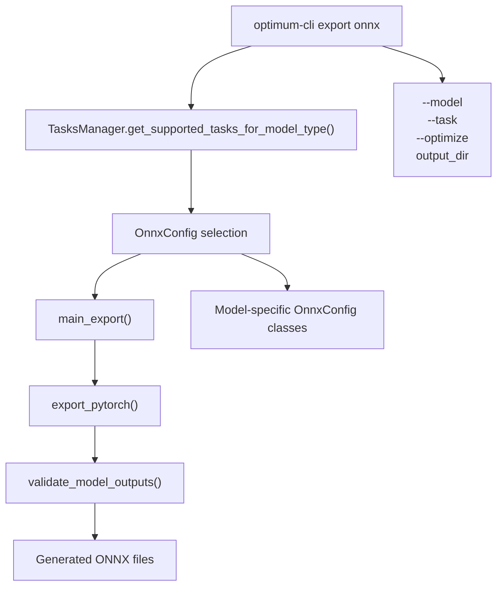

Sources: [README.md:32-34](), [docs/source/quickstart.mdx:17-25]()

### Export Examples

**Basic model export via CLI:**
```bash
optimum-cli export onnx --model meta-llama/Llama-3.2-1B --output_dir llama_onnx/
```

**Export with optimization:**
```bash
optimum-cli export onnx --model meta-llama/Llama-3.2-1B --optimize O2 onnx_llama/
```

Sources: [README.md:33](), [docs/source/quickstart.mdx:24-25]()

## Basic Inference Workflow

After export, use `ORTModel` classes as drop-in replacements for Hugging Face `AutoModel` classes. The API remains nearly identical while providing ONNX Runtime acceleration.

### Inference Class Mapping

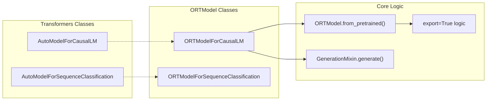

Sources: [README.md:44-56](), [docs/source/quickstart.mdx:30-41]()

### Programmatic Export and Inference (Gemma 3 Example)

You can load a PyTorch checkpoint and convert it to ONNX on-the-fly by setting `export=True` in the `from_pretrained` method [examples/gemma3.py:15](). This is the fastest way to get started with new models like Gemma 3 [examples/gemma3.py:1-25]().

```python
from transformers import AutoTokenizer
from optimum.onnxruntime import ORTModelForCausalLM

model_id = "google/gemma-3-270m-it"
tokenizer = AutoTokenizer.from_pretrained(model_id)

# Load PyTorch checkpoint and export to ONNX on-the-fly
model = ORTModelForCausalLM.from_pretrained(model_id, export=True)

# Inference using the standard Transformers API
conversation = [{"role": "user", "content": "Hello! How are you?"}]
prompt = tokenizer.apply_chat_template(conversation, tokenize=False, add_generation_prompt=True)
inputs = tokenizer(prompt, return_tensors="pt")

outputs = model.generate(**inputs, max_new_tokens=50)
print(tokenizer.decode(outputs[0], skip_special_tokens=True))
```

Sources: [examples/gemma3.py:8-25]()

## Complete CLI to Inference Workflow

### Step 1: Export Model

```bash
optimum-cli export onnx --model meta-llama/Llama-3.2-1B --output_dir llama_onnx/
```

Sources: [docs/source/quickstart.mdx:24-25]()

### Step 2: Load and Run Inference

```python
from transformers import AutoTokenizer, pipeline
from optimum.onnxruntime import ORTModelForCausalLM

# Load tokenizer and ONNX model from the local directory
tokenizer = AutoTokenizer.from_pretrained("llama_onnx")
model = ORTModelForCausalLM.from_pretrained("llama_onnx")

# Use with transformers pipeline
pipe = pipeline("text-generation", model=model, tokenizer=tokenizer)
result = pipe("He never went out without a book under his arm")
```

Sources: [README.md:44-56](), [docs/source/quickstart.mdx:32-41]()

## End-to-End Data Flow

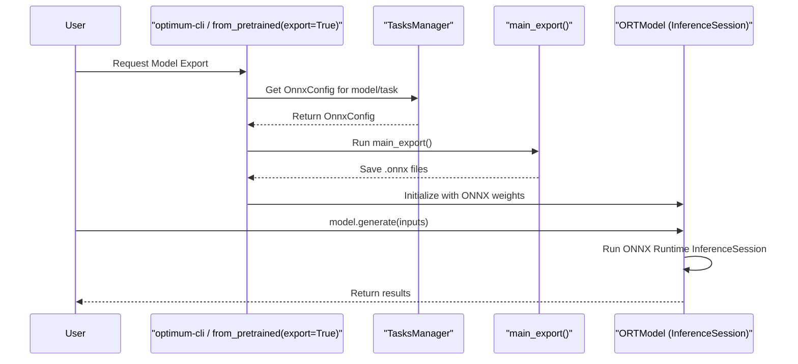

Sources: [README.md:33-55](), [docs/source/quickstart.mdx:13-31]()

## Common Export Tasks

| Model Type | Task | CLI Command |
|------------|------|-------------|
| GPT/Llama/Gemma | Text Generation | `optimum-cli export onnx --model ID --task text-generation-with-past out/` |
| BERT/RoBERTa | Sequence Classification | `optimum-cli export onnx --model ID --task text-classification out/` |
| ViT | Image Classification | `optimum-cli export onnx --model ID --task image-classification out/` |
| Whisper | Automatic Speech Recognition | `optimum-cli export onnx --model ID --task automatic-speech-recognition out/` |

Sources: [README.md:33](), [docs/source/quickstart.mdx:17-31]()

## Key CLI Options

| Option | Description | Example |
|--------|-------------|---------|
| `--model` | Model ID (Hub) or local path | `--model google/gemma-3-270m-it` |
| `--task` | Specific task to export for | `--task text-generation-with-past` |
| `--optimize` | Apply ORT graph optimizations (O1, O2, O3, O4) | `--optimize O2` |
| `--device` | Device to run the export on | `--device cuda` |

Sources: [README.md:33](), [docs/source/quickstart.mdx:24-25]()

## Next Steps

- **Installation**: Ensure you have the correct `onnxruntime` or `onnxruntime-gpu` package. See [Installation and Setup](#1.1).
- **Optimization**: Use `ORTOptimizer` to further speed up your models. See [ORTOptimizer](#4.1).
- **Quantization**: Reduce model size using `ORTQuantizer`. See [Model Quantization](#4.2).

Sources: [README.md:12-26](), [docs/source/installation.mdx:16-20]()

---

# Page: ONNX Model Export

# ONNX Model Export

<details>
<summary>Relevant source files</summary>

The following files were used as context for generating this wiki page:

- [docs/source/onnx/package_reference/export.mdx](docs/source/onnx/package_reference/export.mdx)
- [optimum/exporters/onnx/__main__.py](optimum/exporters/onnx/__main__.py)
- [optimum/exporters/onnx/convert.py](optimum/exporters/onnx/convert.py)
- [optimum/exporters/onnx/utils.py](optimum/exporters/onnx/utils.py)
- [tests/exporters/onnx/test_export.py](tests/exporters/onnx/test_export.py)

</details>


The ONNX Model Export system converts Hugging Face models from PyTorch to ONNX format, enabling optimized inference across different runtime environments. This system handles the conversion of Transformers, Diffusers, and other model types to ONNX while maintaining compatibility and correctness through validation and post-processing.

For information about using the export command line interface, see [Export Command Line Interface](#2.1). For details about the configuration classes and model-specific logic, see [Export Configuration System](#2.2) and [Model-Specific Export Configurations](#2.3). For advanced topics like model patching or the TorchDynamo path, see [Advanced Export Topics](#2.4).

## Export System Architecture

The export system consists of several interconnected components that bridge high-level model artifacts to underlying code entities like `main_export`, `onnx_export_from_model`, and `TasksManager`.

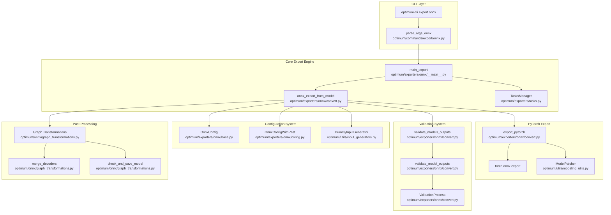

Sources: [optimum/commands/export/onnx.py:33-174](), [optimum/exporters/onnx/__main__.py:57-268](), [optimum/exporters/onnx/convert.py:465-836](), [optimum/onnx/graph_transformations.py:132-308]()

## Export Workflow and Pipeline

The export process follows a structured workflow mapping user inputs directly to concrete code routines across `TasksManager`, `export_pytorch`, and validation modules.

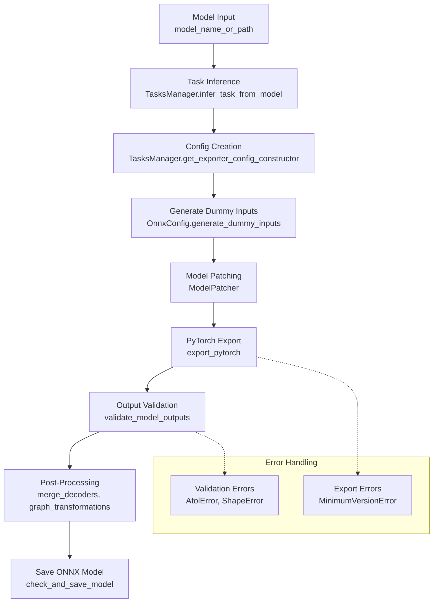

Sources: [optimum/exporters/onnx/__main__.py:57-268](), [optimum/exporters/onnx/convert.py:465-611](), [optimum/exporters/tasks.py:1753-1823](), [optimum/onnx/graph_transformations.py:183-308]()

## Core Export Functions

### Main Export Function

The `main_export` function in `optimum.exporters.onnx.__main__` serves as the primary entry point for ONNX export operations. It coordinates model loading, configuration, conversion, and validation.

| Function | Location | Purpose |
|----------|----------|---------|
| `main_export` | [optimum/exporters/onnx/__main__.py:57-268]() | High-level export orchestrator (Hub/Local) |
| `onnx_export_from_model` | [optimum/exporters/onnx/convert.py:726-836]() | Core export logic for loaded models |
| `export_pytorch` | [optimum/exporters/onnx/convert.py:465-611]() | Low-level PyTorch to ONNX conversion |
| `export_models` | [optimum/exporters/onnx/convert.py:839-952]() | Multi-model export handler (e.g. for Encoders/Decoders) |

The `export_pytorch` function handles low-level PyTorch to ONNX conversion using `torch.onnx.export`. It manages device placement, dynamic axes configuration via `OnnxConfig.inputs` and `OnnxConfig.outputs`, and external data handling.

Sources: [optimum/exporters/onnx/__main__.py:57-268](), [optimum/exporters/onnx/convert.py:465-952]()

### Task and Configuration Management

The export system automatically infers tasks and configurations using the `TasksManager` registry.

```python
# Task inference from model type
task = TasksManager.infer_task_from_model(model_name_or_path)

# Configuration retrieval
onnx_config_constructor = TasksManager.get_exporter_config_constructor(
    model_type=model_type,
    exporter="onnx",
    task=task
)
onnx_config = onnx_config_constructor(model.config)
```

Sources: [optimum/exporters/onnx/convert.py:726-836](), [optimum/exporters/tasks.py:1753-1823]()

## Model Validation System

The validation system ensures exported ONNX models produce outputs matching original PyTorch models within tolerance limits.

Validation is performed by `validate_models_outputs` [optimum/exporters/onnx/convert.py:90-170](). It can run in separate subprocesses via `ValidationProcess` [optimum/exporters/onnx/convert.py:417-462]() to avoid memory leaks from ONNX Runtime sessions.

### Validation Error Types

| Error Type | Class | Description |
|------------|-------|-------------|
| Shape Mismatch | `ShapeError` | Output tensor shapes do not match |
| Value Tolerance | `AtolError` | Values exceed absolute tolerance (`atol`) |
| Output Names | `OutputMatchError` | ONNX outputs do not match expected config |
| Dynamic Axes | `DynamicAxisNameError` | Unknown or mismatched dynamic axis names |

Sources: [optimum/exporters/onnx/convert.py:84-462](), [optimum/exporters/error_utils.py:20-51]()

## Graph Transformations and Post-Processing

After export, ONNX models undergo transformations to optimize them for runtime execution and reduce memory overhead.

### Key Transformations

The `merge_decoders` function [optimum/onnx/graph_transformations.py:183-308]() combines separate decoder models (with and without past key values) into a single ONNX file using an `If` node. 

The `remove_duplicate_weights` function [optimum/onnx/graph_transformations.py:46-67]() identifies identical model initializers and creates references to unique instances, minimizing footprint for shared weights.

Sources: [optimum/onnx/graph_transformations.py:46-344](), [optimum/exporters/onnx/convert.py:726-836]()

---

# Page: Export Command Line Interface

# Export Command Line Interface

<details>
<summary>Relevant source files</summary>

The following files were used as context for generating this wiki page:

- [docs/source/onnx/usage_guides/export_a_model.mdx](docs/source/onnx/usage_guides/export_a_model.mdx)
- [optimum/commands/export/onnx.py](optimum/commands/export/onnx.py)
- [optimum/commands/register/register_export.py](optimum/commands/register/register_export.py)
- [tests/cli/test_cli.py](tests/cli/test_cli.py)

</details>


## Purpose and Scope

This document provides detailed technical documentation for the `optimum-cli export onnx` command line interface. It covers argument parsing, task inference, library detection, model loading, preprocessor management, and execution data flows used when converting Hugging Face models to ONNX via the Optimum CLI [optimum/commands/export/onnx.py:14-165]().

Sources: [optimum/commands/export/onnx.py:14-165]()

---

## CLI Command Structure and Entry Point

The ONNX export command is registered via `REGISTER_COMMANDS` [optimum/commands/register/register_export.py:19-21]() mapping `ONNXExportCommand` to the base export command. When invoked from the terminal, arguments are parsed by `parse_args_onnx()` [optimum/commands/export/onnx.py:33-165]() and handed off to the exporter backend.

```bash
optimum-cli export onnx --model MODEL_NAME_OR_PATH OUTPUT_DIR [OPTIONS]
```

### Basic Usage Flow Diagram

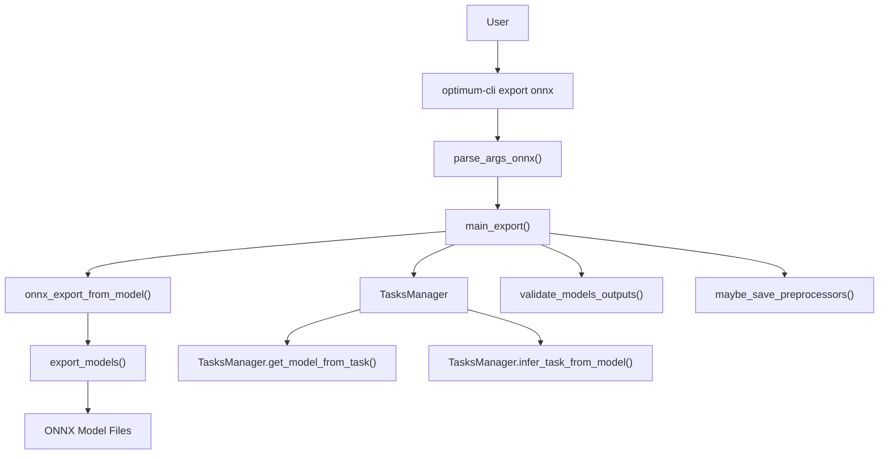

Sources: [optimum/commands/export/onnx.py:33-165](), [optimum/commands/register/register_export.py:19-21]()

---

## Command Line Arguments Reference

The CLI parameters are organized into required inputs, model configuration flags, precision controls, and input shape overrides.

### Required Arguments

| Argument | Type | Description | Code Reference |
|----------|------|-------------|----------------|
| `--model` / `-m` | `str` | Model ID on Hugging Face Hub or local path | [optimum/commands/export/onnx.py:35-37]() |
| `output` | `Path` | Target directory for generated ONNX artifacts | [optimum/commands/export/onnx.py:38-40]() |

### Optional Configuration Arguments

| Argument | Default | Description | Code Reference |
|----------|---------|-------------|----------------|
| `--task` | `"auto"` | Task identifier (supports `-with-past` suffix) | [optimum/commands/export/onnx.py:47-55]() |
| `--library-name` | `None` | Target library (`transformers`, `diffusers`, etc.) | [optimum/commands/export/onnx.py:141-147]() |
| `--framework` | `"pt"` | Framework backend (PyTorch `pt`) | [optimum/commands/export/onnx.py:111-117]() |
| `--opset` | `None` | ONNX opset version | [optimum/commands/export/onnx.py:56-61]() |
| `--device` | `"cpu"` | Device used for export computation | [optimum/commands/export/onnx.py:62-67]() |
| `--dtype` | `None` | Precision (`fp32`, `fp16`, `bf16`) | [optimum/commands/export/onnx.py:68-74]() |
| `--optimize` | `None` | ORT optimization level (`O1`, `O2`, `O3`, `O4`) | [optimum/commands/export/onnx.py:75-87]() |
| `--monolith` | `False` | Export as a single monolithic ONNX file | [optimum/commands/export/onnx.py:88-96]() |
| `--no-post-process` | `False` | Disable post-processing / model merging | [optimum/commands/export/onnx.py:97-104]() |
| `--variant` | `"default"` | Model variant selector | [optimum/commands/export/onnx.py:105-110]() |
| `--atol` | `None` | Absolute tolerance for validation checks | [optimum/commands/export/onnx.py:118-123]() |
| `--trust-remote-code` | `False` | Allow execution of remote custom modeling code | [optimum/commands/export/onnx.py:127-131]() |
| `--slim` | `False` | Enable `onnxslim` graph optimization | [optimum/commands/export/onnx.py:161-165]() |

Sources: [optimum/commands/export/onnx.py:33-165]()

---

## Internal Architecture & Data Flow

The translation layer bridges command-line strings into complex Python model loading calls using `TasksManager`.

### Code Entity Interaction Diagram

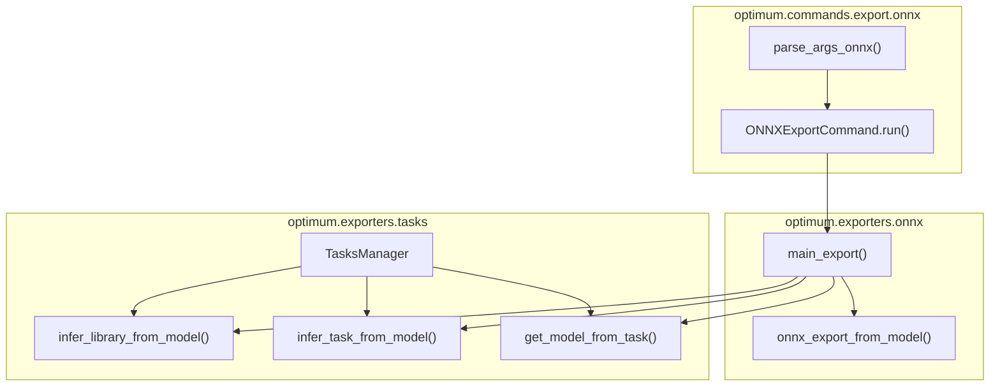

Sources: [optimum/commands/export/onnx.py:33-165](), [optimum/commands/register/register_export.py:15-21]()

---

## Preprocessor Management and Dummy Inputs

During export, dummy inputs are generated according to specified modalities (text, vision, audio) to trace the model graph. Preprocessors (such as tokenizers or feature extractors) associated with the model are automatically saved alongside the generated ONNX files into the output directory.

Input shape parameters handled by `parse_args_onnx()` configure the dimensions of these dummy inputs:
- Text: `--batch_size`, `--sequence_length`, `--num_choices` [docs/source/onnx/usage_guides/export_a_model.mdx:76-79]()
- Vision: `--width`, `--height`, `--num_channels` [docs/source/onnx/usage_guides/export_a_model.mdx:77-78]()
- Audio: `--feature_size`, `--nb_max_frames`, `--audio_sequence_length` [docs/source/onnx/usage_guides/export_a_model.mdx:78-79]()

Sources: [optimum/commands/export/onnx.py:33-165](), [docs/source/onnx/usage_guides/export_a_model.mdx:76-79]()

---

## Practical Usage Patterns

### Standard Text Encoder Export
```bash
optimum-cli export onnx --model hf-internal-testing/tiny-random-bert encoder_output/
```

### Decoder Export with KV Cache
For autoregressive generation models, appending `-with-past` to the task instructs the exporter to include past key-value states in the graph structure:
```bash
optimum-cli export onnx --model hf-internal-testing/tiny-random-gpt2 --task text-generation-with-past decoder_output/
```

### GPU-Accelerated Export with Precision and Optimization
```bash
optimum-cli export onnx --model hf-internal-testing/tiny-random-opt --device cuda --dtype fp16 --optimize O4 opt_output/
```

Sources: [tests/cli/test_cli.py:40-114](), [docs/source/onnx/usage_guides/export_a_model.mdx:13-114]()

---

# Page: Export Configuration System

# Export Configuration System

<details>
<summary>Relevant source files</summary>

The following files were used as context for generating this wiki page:

- [optimum/exporters/onnx/base.py](optimum/exporters/onnx/base.py)
- [optimum/exporters/onnx/config.py](optimum/exporters/onnx/config.py)
- [optimum/exporters/onnx/input_generators.py](optimum/exporters/onnx/input_generators.py)
- [optimum/onnxruntime/modeling_diffusion.py](optimum/onnxruntime/modeling_diffusion.py)
- [tests/exporters/common/test_tasks_manager.py](tests/exporters/common/test_tasks_manager.py)
- [tests/exporters/onnx/test_export_cli.py](tests/exporters/onnx/test_export_cli.py)
- [tests/onnxruntime/test_diffusion.py](tests/onnxruntime/test_diffusion.py)
- [tests/onnxruntime/test_optimization.py](tests/onnxruntime/test_optimization.py)

</details>


This page details the ONNX export configuration system in `optimum-onnx`, which defines how different model architectures should be converted to ONNX format. The configuration system specifies model inputs, outputs, dynamic axes, and export-specific behaviors for each supported model type and task combination.

## Configuration Class Hierarchy

The export configuration system is built around a class hierarchy that provides increasingly specialized functionality for different model types. The base classes handle core logic like dynamic axis definition and model patching.

### Base Configuration Classes

The foundation consists of abstract base classes that define common interfaces for the export pipeline:

| Class | Description |
| :--- | :--- |
| `OnnxConfig` [optimum/exporters/onnx/base.py:92-100]() | Base abstract class for all ONNX export configurations. Defines default opset (18) and task-to-output mappings. |
| `OnnxConfigWithPast` [optimum/exporters/onnx/base.py]() | Specialized for decoder models requiring Key-Value (KV) cache support. |
| `OnnxSeq2SeqConfigWithPast` [optimum/exporters/onnx/config.py:23-25]() | Extends KV cache support to encoder-decoder architectures (e.g., T5, BART). |

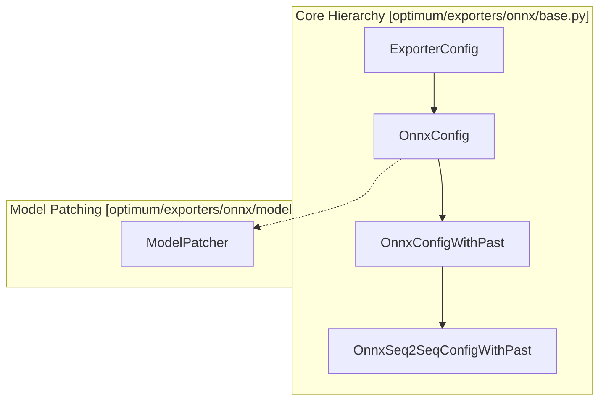

Sources: [optimum/exporters/onnx/base.py:92-100](), [optimum/exporters/onnx/config.py:23-25]()

### Specialized Configuration Classes

The system provides intermediate classes in `optimum/exporters/onnx/config.py` that group logic for common modalities:

*   **`TextEncoderOnnxConfig`**: Handles encoder-based text architectures like BERT. [optimum/exporters/onnx/config.py:47-50]()
*   **`TextDecoderOnnxConfig`**: Handles decoder-based text architectures (GPT-like) and manages the merging of decoders with and without past key values. [optimum/exporters/onnx/config.py:53-59]()
*   **`TextDecoderWithPositionIdsOnnxConfig`**: Specifically for models (like GPT2, Llama) that require explicit `position_ids` during export to avoid internal generation issues. [optimum/exporters/onnx/config.py:144-156]()
*   **`TextSeq2SeqOnnxConfig`**: Manages complex encoder-decoder interactions. [optimum/exporters/onnx/config.py:157-164]()

Sources: [optimum/exporters/onnx/config.py:47-164]()

## Configuration Registration System

The `TasksManager` acts as a central registry. Model configurations are associated with model types and tasks using a registration mechanism.

### Registration Mechanism

The `TasksManager` maintains a mapping between model types (e.g., `"bert"`, `"llama"`) and their `OnnxConfig` constructors [tests/exporters/common/test_tasks_manager.py:30-41](). This allows the CLI and programmatic APIs to automatically select the correct configuration based on the model's metadata.

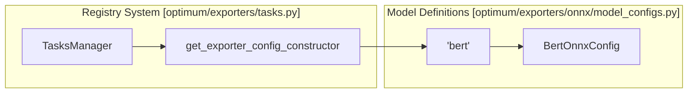

Sources: [tests/exporters/common/test_tasks_manager.py:26-41](), [tests/exporters/onnx/test_export_cli.py:49-51]()

## Input and Output Configuration

The core responsibility of configuration classes is defining the dynamic axes for model inputs and outputs.

### Dynamic Axes and Input Definitions

Each configuration class defines an `inputs` property (returning a `dict[str, dict[int, str]]`) and an `outputs` property. These dictionaries map dimension indices to descriptive names (e.g., `"batch_size"`, `"sequence_length"`), which ONNX Runtime uses to handle variable-sized tensors [optimum/exporters/onnx/config.py:81-91]().

Example of input definition for a decoder with past key values:
```python
@property
def inputs(self) -> dict[str, dict[int, str]]:
    if self.use_past_in_inputs:
        common_inputs = {"input_ids": {0: "batch_size", 1: "sequence_length"}}
        common_inputs["attention_mask"] = {0: "batch_size", 1: "past_sequence_length + sequence_length"}
        self.add_past_key_values(common_inputs, direction="inputs")
    # ...
```

Sources: [optimum/exporters/onnx/config.py:81-91](), [optimum/exporters/onnx/base.py:99-140]()

### Task-Specific Common Outputs

The `OnnxConfig` class maintains a `_TASK_TO_COMMON_OUTPUTS` map that provides standard output names and dynamic axes for various tasks:

| Task | Output Name | Dynamic Axes |
| :--- | :--- | :--- |
| `text-classification` | `logits` | `{0: "batch_size"}` |
| `token-classification` | `logits` | `{0: "batch_size", 1: "sequence_length"}` |
| `question-answering` | `start_logits`, `end_logits` | `{0: "batch_size", 1: "sequence_length"}` |
| `image-classification` | `logits` | `{0: "batch_size"}` |

Sources: [optimum/exporters/onnx/base.py:99-140]()

## Dummy Input Generation

To export a model via tracing (e.g., `torch.onnx.export`), sample inputs are required. `OnnxConfig` uses `DummyInputGenerator` classes to produce these.

### Generator Classes and Custom Generators

Configurations specify their required generators in `DUMMY_INPUT_GENERATOR_CLASSES`. Common generators include `DummyTextInputGenerator`, `DummyVisionInputGenerator`, `DummyAudioInputGenerator`, and `DummyPastKeyValuesGenerator` [optimum/exporters/onnx/config.py:27-37]().

Specialized architectures implement custom dummy input generators, such as `GPTBigCodeDummyPastKeyValuesGenerator` [optimum/exporters/onnx/input_generators.py:25-72](), `DummyMoonshineAudioInputGenerator` [optimum/exporters/onnx/input_generators.py:75-95](), and `DummySanaTransforemerTextInputGenerator` [optimum/exporters/onnx/input_generators.py:97-110]().

Sources: [optimum/exporters/onnx/config.py:27-37](), [optimum/exporters/onnx/input_generators.py:25-110]()

## Model Post-Processing and Merging

For architectures like Causal LM (Decoders), the export often produces two files: one for the first forward pass (no cache) and one for subsequent steps (using past key values). 

The `TextDecoderOnnxConfig` includes a `post_process_exported_models` method that calls `optimum.onnx.merge_decoders` [optimum/exporters/onnx/config.py:104-124](). This utility merges the two ONNX graphs into a single file with a control-flow branch (using an `if` node), simplifying deployment.

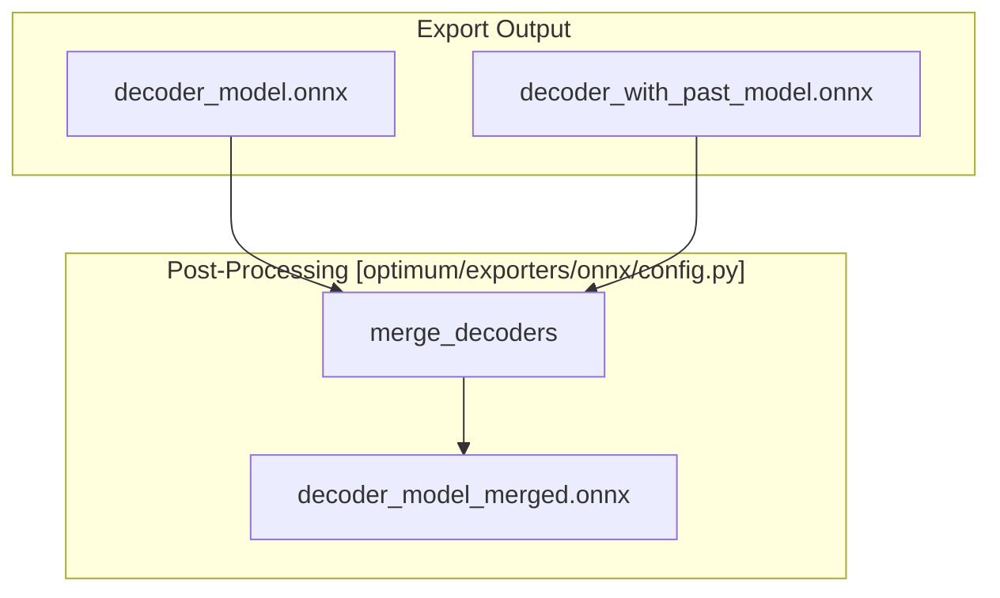

Sources: [optimum/exporters/onnx/config.py:104-141](), [optimum/exporters/onnx/constants.py:38]()

## Special Handling: Position IDs

Many modern transformer architectures (Llama, Mistral, Falcon, etc.) require explicit `position_ids` to be passed during export. This prevents the model from generating static position indices that would break during variable-length inference.

The `TextDecoderWithPositionIdsOnnxConfig` ensures the configuration adds `position_ids` to the dynamic axes for tasks like text generation [optimum/exporters/onnx/config.py:144-154]().

Sources: [optimum/exporters/onnx/config.py:144-154]()

---

# Page: Model-Specific Export Configurations

# Model-Specific Export Configurations

<details>
<summary>Relevant source files</summary>

The following files were used as context for generating this wiki page:

- [optimum/exporters/onnx/constants.py](optimum/exporters/onnx/constants.py)
- [optimum/exporters/onnx/model_configs.py](optimum/exporters/onnx/model_configs.py)

</details>


This page details the specific ONNX configurations and model architectures supported by `optimum-onnx`. It covers text encoders, decoders, seq2seq, vision, audio, and diffusion models, along with KV cache management, model patching, and task registration mechanisms.

## Configuration Hierarchy and Registration System

The configuration system relies on a rich hierarchy of base configuration classes defined in `optimum/exporters/onnx/config.py` and `optimum/exporters/onnx/base.py`, paired with concrete subclasses in `optimum/exporters/onnx/model_configs.py`. The `TasksManager` and its decorator `@register_tasks_manager_onnx` register these configurations against specific Hugging Face model types and downstream tasks [optimum/exporters/onnx/model_configs.py:121-147]().

### Diagram: Natural Language Space to Code Entity Space (Registration and Base Configs)

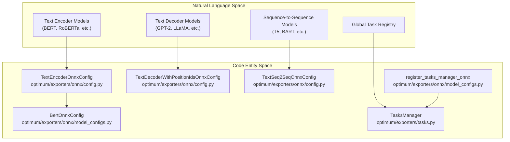

Sources: [optimum/exporters/onnx/config.py:51-288](), [optimum/exporters/onnx/model_configs.py:121-164]()

## Text Encoders and Sequence Classification

Text encoders process input sequences and return contextualized representations or task-specific predictions. Classes such as `BertOnnxConfig` inherit from `TextEncoderOnnxConfig` [optimum/exporters/onnx/model_configs.py:150-151]().

### Implementation Details
- Input tensors include `input_ids`, `attention_mask`, and `token_type_ids` [optimum/exporters/onnx/model_configs.py:159-163]().
- Supports common text tasks such as `feature-extraction`, `fill-mask`, `multiple-choice`, `question-answering`, `text-classification`, and `token-classification` [optimum/exporters/onnx/model_configs.py:122-129]().
- Dynamic axes manage variable batch sizes and sequence lengths [optimum/exporters/onnx/model_configs.py:155-158]().

Sources: [optimum/exporters/onnx/model_configs.py:122-164]()

## Text Decoders and KV Cache Handling

Autoregressive text decoders (e.g., GPT-2, LLaMA, Mistral, Falcon) manage past key-values (KV cache) to accelerate token generation.

### Diagram: Natural Language Space to Code Entity Space (Decoders and KV Caching)

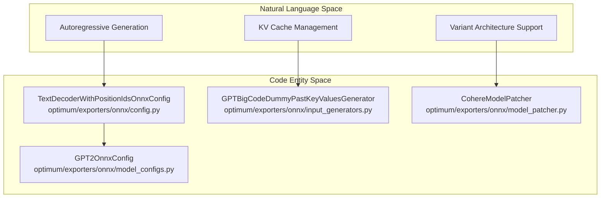

Sources: [optimum/exporters/onnx/config.py:133-150](), [optimum/exporters/onnx/input_generators.py:25-72](), [optimum/exporters/onnx/model_patcher.py:44-51]()

## Seq2Seq, Vision, Audio, and Diffusion Configurations

Encoder-decoder models (`TextSeq2SeqOnnxConfig`), vision models (`VisionOnnxConfig`), audio models (`AudioOnnxConfig`), and diffusion pipelines require specialized input generators and configuration parameters [optimum/exporters/onnx/config.py:25-35]().

### Task and Configuration Matrix

| Model Category | Base Configuration Class | Example Model Classes | Key Dummy Input Generators / Patchers |
|----------------|--------------------------|-----------------------|---------------------------------------|
| Text Encoder | `TextEncoderOnnxConfig` | `BertOnnxConfig`, `AlbertOnnxConfig` | `DummyTextInputGenerator` [optimum/exporters/onnx/model_configs.py:150-193]() |
| Text Decoder | `TextDecoderWithPositionIdsOnnxConfig` | `GPT2OnnxConfig` [optimum/exporters/onnx/model_configs.py:371]() | `DummyPastKeyValuesGenerator` |
| Seq2Seq | `TextSeq2SeqOnnxConfig` | `T5OnnxConfig` [optimum/exporters/onnx/model_configs.py:650]() | `T5DummySeq2SeqPastKeyValuesGenerator` [optimum/exporters/onnx/model_configs.py:648]() |
| Vision | `VisionOnnxConfig` | `ViTOnnxConfig` [optimum/exporters/onnx/model_configs.py:887]() | `DummyVisionInputGenerator`, `VitPoseModelPatcher` [optimum/exporters/onnx/model_patcher.py:56]() |
| Audio | `AudioOnnxConfig`, `AudioToTextOnnxConfig` | Whisper, Moonshine | `DummyMoonshineAudioInputGenerator`, `MoonshineModelPatcher` [optimum/exporters/onnx/model_configs.py:37-49]() |
| Diffusion | Component Sessions (UNet, VAE) | Stable Diffusion, Flux | `DummyFluxTransformerTextInputGenerator`, `FluxTransformerModelPatcher` [optimum/exporters/onnx/model_configs.py:38-45]() |

Sources: [optimum/exporters/onnx/config.py:25-35](), [optimum/exporters/onnx/model_configs.py:36-57]()

---

# Page: Advanced Export Topics

# Advanced Export Topics

<details>
<summary>Relevant source files</summary>

The following files were used as context for generating this wiki page:

- [optimum/exporters/onnx/_debug_tool.py](optimum/exporters/onnx/_debug_tool.py)
- [optimum/exporters/onnx/_traceable_cache.py](optimum/exporters/onnx/_traceable_cache.py)
- [optimum/exporters/onnx/_traceable_decorator.py](optimum/exporters/onnx/_traceable_decorator.py)
- [optimum/exporters/onnx/model_patcher.py](optimum/exporters/onnx/model_patcher.py)
- [optimum/exporters/onnx/model_patcher_dynamo.py](optimum/exporters/onnx/model_patcher_dynamo.py)

</details>


This document covers advanced ONNX export techniques including model patching, custom configurations, the TorchDynamo export path, traceable cache and decorator utilities, and troubleshooting complex export scenarios within `optimum-onnx`.

## Model Patching System Overview

The ONNX export process frequently requires runtime modifications to model behavior to ensure compatibility with ONNX's static graph representation and limitations in PyTorch's export mechanisms. The model patching system in `optimum-onnx` provides a robust framework for applying temporary modifications during export while preserving the original model state.

### Why Model Patching is Necessary

ONNX export faces several fundamental challenges:
- **Dynamic Operations**: PyTorch models often use dynamic operations (like `unfold` or `repeat_interleave`) that cannot be directly represented in ONNX's static graph format without specific workarounds [optimum/exporters/onnx/model_patcher.py:129-204]().
- **Runtime-Specific Behavior**: Certain operations behave differently during inference versus training, requiring export-time adjustments.
- **Version Compatibility**: Different versions of `transformers` introduce breaking changes (e.g., masking logic or cache classes) that need version-specific patches [optimum/exporters/onnx/model_patcher.py:32-59]().
- **Operator Support**: Some PyTorch operations lack direct ONNX equivalents and require custom symbolic implementations [optimum/exporters/onnx/model_patcher.py:72-154]().

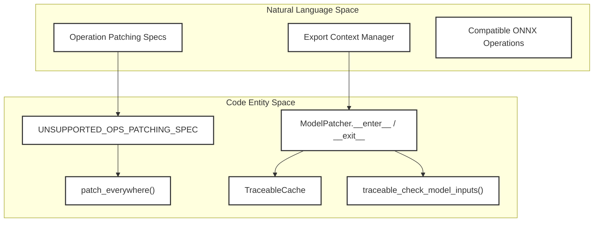
Sources: [optimum/exporters/onnx/model_patcher.py:32-154](), [optimum/exporters/onnx/model_patcher.py:284-346]()

## Core Patching Architecture

### PatchingSpec and ModelPatcher

The `ModelPatcher` context manager orchestrates the application and teardown of patches [optimum/exporters/onnx/model_patcher.py:284-346](). It leverages `UNSUPPORTED_OPS_PATCHING_SPEC` to swap out unsupported PyTorch functions with ONNX-friendly alternatives.

| Method / Class | Purpose | Key Functionality |
|----------------|---------|-------------------|
| `ModelPatcher` | Context Manager | Manages entry and exit states, applying and reverting monkey-patches [optimum/exporters/onnx/model_patcher.py:284-346]() |
| `patch_everywhere()` | Utility function | Replaces attributes across modules dynamically [optimum/exporters/onnx/model_patcher.py:157-166]() |
| `UNSUPPORTED_OPS_PATCHING_SPEC` | Dictionary/Spec | Maps unsupported tensor methods to compatible implementations [optimum/exporters/onnx/model_patcher.py:129-204]() |

Sources: [optimum/exporters/onnx/model_patcher.py:129-204](), [optimum/exporters/onnx/model_patcher.py:284-346]()

### Traceable Utilities

To ensure compatibility across various `transformers` versions, `optimum-onnx` implements specialized traceable decorators and cache structures:

- **`TraceableCache`**: A base class for caches that removes `nn.Module` inheritance, avoiding graph-breaking tracing issues in `transformers` versions `4.44` through `4.50` [optimum/exporters/onnx/_traceable_cache.py:26-107]().
- **`traceable_check_model_inputs`**: A decorator fixing input validation issues during ONNX tracing, preventing double-passing of positional arguments like `use_cache` [optimum/exporters/onnx/_traceable_decorator.py:32-154]().

Sources: [optimum/exporters/onnx/_traceable_cache.py:26-107](), [optimum/exporters/onnx/_traceable_decorator.py:32-154]()

## TorchDynamo Export Path and Specialized Patchers

The repository supports the modern `torch.export` (Dynamo) path alongside traditional tracing. Specialized patchers handle architecture-specific quirks under Dynamo.

### ViTForImageClassificationPatcher

For vision models, subclasses like `ViTForImageClassificationPatcher` override forward passes (e.g., in `ViTPatchEmbeddings`) to remove internal `torch._check` assertions that fail under dynamic shape tracing [optimum/exporters/onnx/model_patcher_dynamo.py:20-59]().

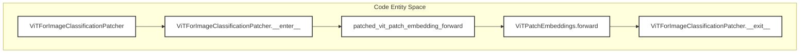
Sources: [optimum/exporters/onnx/model_patcher_dynamo.py:47-59]()

## Troubleshooting Export Issues

When model exports fail due to tracing or shape validation errors, `optimum-onnx` provides diagnostic tooling.

### Debugging Shape Validation

The `debug_torch_export_export` utility helps pinpoint the exact line or operation causing dynamic shape validation errors by wrapping `torch.export.export` with diagnostic patches (`onnx_diagnostic`) [optimum/exporters/onnx/_debug_tool.py:16-35]().

Sources: [optimum/exporters/onnx/_debug_tool.py:16-35]()

---

# Page: ONNX Runtime Inference

# ONNX Runtime Inference

<details>
<summary>Relevant source files</summary>

The following files were used as context for generating this wiki page:

- [docs/source/_toctree.yml](docs/source/_toctree.yml)
- [docs/source/onnxruntime/overview.mdx](docs/source/onnxruntime/overview.mdx)
- [docs/source/onnxruntime/package_reference/modeling.mdx](docs/source/onnxruntime/package_reference/modeling.mdx)
- [docs/source/onnxruntime/usage_guides/models.mdx](docs/source/onnxruntime/usage_guides/models.mdx)
- [optimum/exporters/onnx/__init__.py](optimum/exporters/onnx/__init__.py)
- [optimum/onnxruntime/__init__.py](optimum/onnxruntime/__init__.py)
- [optimum/onnxruntime/base.py](optimum/onnxruntime/base.py)
- [optimum/onnxruntime/modeling.py](optimum/onnxruntime/modeling.py)
- [optimum/onnxruntime/pipelines.py](optimum/onnxruntime/pipelines.py)

</details>


This document covers the ONNX Runtime inference system in `optimum-onnx`, which provides optimized execution of ONNX models through the `ORTModel` class hierarchy. This system enables loading pre-exported ONNX models and running inference with ONNX Runtime's execution providers for accelerated performance on CPU, GPU, and specialized hardware.

For information about exporting models to ONNX format, see [ONNX Model Export](#2). For model optimization and quantization, see [Model Optimization and Quantization](#4).

## ORTModel System Overview

The ONNX Runtime inference system is built around the `ORTModel` base class, the `ORTSessionMixin` utility, and various task-specific subclasses that provide optimized inference for different machine learning tasks. Each model class wraps ONNX Runtime sessions and provides a Transformers-compatible API.

### ORTModel Class Hierarchy

The following diagram maps the high-level task abstractions to the specific code entities defined in `optimum/onnxruntime/modeling.py`, `optimum/onnxruntime/modeling_seq2seq.py`, and `optimum/onnxruntime/modeling_decoder.py`.

```mermaid
graph TD
    subgraph "Base Infrastructure"
        ORTModel["ORTModel<br/>[optimum/onnxruntime/modeling.py]"]
        ORTSessionMixin["ORTSessionMixin<br/>[optimum/onnxruntime/base.py]"]
    end

    subgraph "Natural Language Processing"
        ORTModel --> ORTModelForSequenceClassification["ORTModelForSequenceClassification"]
        ORTModel --> ORTModelForQuestionAnswering["ORTModelForQuestionAnswering"]
        ORTModel --> ORTModelForFeatureExtraction["ORTModelForFeatureExtraction"]
        ORTModel --> ORTModelForCausalLM["ORTModelForCausalLM<br/>[optimum/onnxruntime/modeling_decoder.py]"]
        ORTModel --> ORTModelForSeq2SeqLM["ORTModelForSeq2SeqLM<br/>[optimum/onnxruntime/modeling_seq2seq.py]"]
    end
    
    subgraph "Computer Vision"
        ORTModel --> ORTModelForImageClassification["ORTModelForImageClassification"]
        ORTModel --> ORTModelForSemanticSegmentation["ORTModelForSemanticSegmentation"]
    end
    
    subgraph "Audio & Multimodal"
        ORTModel --> ORTModelForAudioClassification["ORTModelForAudioClassification"]
        ORTModel --> ORTModelForSpeechSeq2Seq["ORTModelForSpeechSeq2Seq"]
        ORTModel --> ORTModelForVision2Seq["ORTModelForVision2Seq"]
    end

    subgraph "Custom"
        ORTModel --> ORTModelForCustomTasks["ORTModelForCustomTasks"]
    end

    ORTSessionMixin -.-> ORTModel
```

**Sources:** [optimum/onnxruntime/__init__.py:47-71](), [optimum/onnxruntime/modeling.py:78-80](), [optimum/onnxruntime/base.py:44-48]()

For a comprehensive breakdown of task-specific classes and their roles, see [ORTModel Classes Overview](#3.1).

---

## Loading and Using Models

Models are loaded via `from_pretrained` or integrated directly into Hugging Face `pipeline` wrappers using `optimum.onnxruntime.pipeline`. When an ONNX checkpoint is not pre-existing, passing `export=True` triggers on-the-fly conversion.

```mermaid
graph LR
    User["User Code"] --> Pipeline["optimum.onnxruntime.pipeline()"]
    Pipeline --> TaskMapping["ORT_TASKS_MAPPING<br/>[optimum/onnxruntime/pipelines.py]"]
    TaskMapping --> ModelClass["ORTModelForXXX.from_pretrained()"]
    ModelClass --> ORTSession["onnxruntime.InferenceSession"]
```

**Sources:** [optimum/onnxruntime/pipelines.py:63-81](), [optimum/onnxruntime/pipelines.py:156-175]()

For detailed instructions on configuration, saving, execution providers, and IO binding integration, see [Loading and Using Models](#3.2).

---

## Text Generation Models

For causal language models like LLaMA and GPT variants, `ORTModelForCausalLM` inherits from Transformers `GenerationMixin` to support standard token generation loops. These architectures leverage Key-Value (KV) caching and merged decoder sessions to optimize autoregressive execution.

For detailed coverage on caching strategies, position IDs, and legacy architectures like Bloom and GPT BigCode, see [Text Generation Models](#3.3).

**Sources:** [optimum/onnxruntime/modeling_decoder.py](), [optimum/onnxruntime/__init__.py:36-42]()

---

## Diffusion Pipelines

Image generation workflows are managed through dedicated diffusion pipeline classes such as `ORTStableDiffusionPipeline`. These classes coordinate multiple underlying ONNX Runtime sessions for text encoders, UNet/Diffusion models, and VAE components alongside schedulers.

For details on component session handling and scheduler integration, see [Diffusion Pipelines](#3.4).

**Sources:** [optimum/onnxruntime/__init__.py:106-128](), [docs/source/onnxruntime/usage_guides/models.mdx:44-60]()

---

## Encoder-Decoder and Speech Models

Sequence-to-sequence, speech recognition, and vision-to-text models rely on `ORTModelForConditionalGeneration` and its specialized subclasses (e.g., `ORTModelForSeq2SeqLM`, `ORTModelForSpeechSeq2Seq`, `ORTModelForVision2Seq`, and `ORTModelForPix2Struct`). These multi-component models manage encoder sessions, decoder sessions, and decoder-with-past sessions with cross-attention caching.

For architectural layouts and session management details, see [Encoder-Decoder and Speech Models](#3.5).

**Sources:** [optimum/onnxruntime/__init__.py:65-70](), [optimum/onnxruntime/modeling_seq2seq.py]()

---

## IO Binding and Performance

The `ORTSessionMixin` manages lower-level interactions with ONNX Runtime sessions. A key optimization feature is **IO Binding**, which binds PyTorch or NumPy tensors directly to device memory buffers (such as CUDA memory), preventing unnecessary host-device copies during inference.

| Feature | Description | Code Entity |
| :--- | :--- | :--- |
| **IO Binding** | Direct device-to-device buffer transfer | `self._io_binding` [optimum/onnxruntime/base.py:75]() |
| **Execution Provider** | Hardware backend (CUDA, CPU, etc.) | `self.providers` [optimum/onnxruntime/base.py:105]() |
| **Device Management** | Moving sessions between hardware devices | `self.to(device)` [optimum/onnxruntime/base.py:159]() |

**Sources:** [optimum/onnxruntime/base.py:44-158](), [optimum/onnxruntime/modeling.py:81]()

---

# Page: ORTModel Classes Overview

# ORTModel Classes Overview

<details>
<summary>Relevant source files</summary>

The following files were used as context for generating this wiki page:

- [docs/source/_toctree.yml](docs/source/_toctree.yml)
- [docs/source/onnxruntime/overview.mdx](docs/source/onnxruntime/overview.mdx)
- [docs/source/onnxruntime/package_reference/modeling.mdx](docs/source/onnxruntime/package_reference/modeling.mdx)
- [docs/source/onnxruntime/usage_guides/models.mdx](docs/source/onnxruntime/usage_guides/models.mdx)
- [optimum/onnxruntime/base.py](optimum/onnxruntime/base.py)
- [optimum/onnxruntime/modeling.py](optimum/onnxruntime/modeling.py)
- [optimum/onnxruntime/modeling_ort.py](optimum/onnxruntime/modeling_ort.py)
- [tests/onnxruntime/test_modeling.py](tests/onnxruntime/test_modeling.py)

</details>


This page provides a comprehensive overview of the `ORTModel` class hierarchy and task-specific implementations in `optimum-onnx`. These classes provide the core runtime inference interface for ONNX models, bridging between ONNX Runtime execution and the Hugging Face transformers ecosystem.

## Purpose and Architecture

The `ORTModel` classes serve as the primary interface for loading and running ONNX models with ONNX Runtime. They provide a `transformers`-compatible API while leveraging ONNX Runtime's optimized execution capabilities [optimum/onnxruntime/modeling.py:14-15]().

### ORTModel Integration Flow

```mermaid
flowchart TD
    HFHub["Hugging Face Hub<br/>ONNX Models"] --> ORTLoad["ORTModel.from_pretrained()"]
    LocalPath["Local ONNX Files"] --> ORTLoad
    
    ORTLoad --> ORTModel["ORTModel Base Class<br/>optimum.onnxruntime.modeling.ORTModel"]
    ORTModel --> TaskModels["Task-Specific Models<br/>ORTModelForXXX"]
    
    TaskModels --> ONNXSession["onnxruntime.InferenceSession<br/>Core execution engine"]
    ONNXSession --> Providers["Execution Providers<br/>CPU, CUDA, TensorRT"]
    
    TaskModels --> HFPipelines["optimum.onnxruntime.pipeline()<br/>High-level interface"]
    TaskModels --> DirectInference["Direct model inference<br/>model(inputs)"]
    
    ONNXSession --> ModelOutput["Model outputs<br/>SequenceClassifierOutput, etc."]
    HFPipelines --> TaskOutput["Task-specific outputs<br/>predictions, generations"]
```

Sources: [optimum/onnxruntime/modeling.py:14-63](), [tests/onnxruntime/test_modeling.py:59-79]()

## Class Hierarchy

The `ORTModel` class hierarchy is organized around task-specific functionality, inheriting from a common base class `OptimizedModel` and using `ORTSessionMixin` for session management [optimum/onnxruntime/modeling.py:78-79]().

### Core Class Structure

```mermaid
classDiagram
    class ORTSessionMixin {
        +model: InferenceSession
        +providers: List[str]
        +provider_options: Dict
    }

    class ORTModel {
        +config: PretrainedConfig
        +device: torch.device
        +from_pretrained()
        +save_pretrained()
        +to(device)
    }
    
    class ORTModelForSequenceClassification {
        +forward(input_ids, attention_mask, ...)
    }
    
    class ORTModelForQuestionAnswering {
        +forward(input_ids, attention_mask, ...)
    }

    class ORTModelForCustomTasks {
        +forward(**kwargs)
    }
    
    ORTSessionMixin <|-- ORTModel
    ORTModel <|-- ORTModelForSequenceClassification
    ORTModel <|-- ORTModelForQuestionAnswering
    ORTModel <|-- ORTModelForFeatureExtraction
    ORTModel <|-- ORTModelForImageClassification
    ORTModel <|-- ORTModelForAudioClassification
    ORTModel <|-- ORTModelForCustomTasks
```

Sources: [optimum/onnxruntime/modeling.py:78-79](), [tests/onnxruntime/test_modeling.py:62-77]()

## Model Categories

The `ORTModel` classes are organized into several categories based on their functionality and target tasks, matching the `transformers` `AutoModel` architecture.

### Text Processing Models

| Class | Task | Input | Output |
|-------|------|-------|---------|
| `ORTModelForSequenceClassification` | Text classification | `input_ids`, `attention_mask` | `SequenceClassifierOutput` |
| `ORTModelForTokenClassification` | Token-level classification | `input_ids`, `attention_mask` | `TokenClassifierOutput` |
| `ORTModelForQuestionAnswering` | Extractive QA | `input_ids`, `attention_mask` | `QuestionAnsweringModelOutput` |
| `ORTModelForMaskedLM` | Masked language modeling | `input_ids`, `attention_mask` | `MaskedLMOutput` |
| `ORTModelForMultipleChoice` | Multiple choice | `input_ids`, `attention_mask` | `MultipleChoiceModelOutput` |
| `ORTModelForFeatureExtraction` | Feature extraction | `input_ids`, `attention_mask` | `BaseModelOutput` |

### Audio and Vision Processing Models

| Class | Task | Input | Output |
|-------|------|-------|---------|
| `ORTModelForAudioClassification` | Audio classification | `input_values` | `SequenceClassifierOutput` |
| `ORTModelForImageClassification` | Image classification | `pixel_values` | `ImageClassifierOutput` |
| `ORTModelForSemanticSegmentation` | Semantic segmentation | `pixel_values` | `SemanticSegmenterOutput` |
| `ORTModelForAudioXVector` | Speaker embeddings | `input_values` | `XVectorOutput` |

Sources: [optimum/onnxruntime/modeling.py:31-63](), [optimum/onnxruntime/modeling.py:104-136]()

## Base ORTModel Class

The `ORTModel` class provides the foundational functionality shared across all task-specific implementations.

### Core Components

The base class manages several key components:

- **ONNX Runtime Session**: Managed via `ORTSessionMixin`, it holds the `InferenceSession` [optimum/onnxruntime/base.py:44-48]().
- **Configuration**: Uses `transformers.PretrainedConfig` for model metadata [docs/source/onnxruntime/package_reference/modeling.mdx:19-22]().
- **On-the-fly Export**: Supports `export=True` in `from_pretrained` to convert models using `main_export` [docs/source/onnxruntime/usage_guides/models.mdx:116-127]().

### Model Loading Workflow

The `from_pretrained` method can load from the Hugging Face Hub, a local directory, or export a PyTorch model to ONNX on-the-fly [tests/onnxruntime/test_modeling.py:103-132]().

```mermaid
sequenceDiagram
    participant User
    participant ORTModel
    participant HFHub as "Hugging Face Hub"
    participant Exporter as "optimum.exporters.onnx"
    
    User->>ORTModel: from_pretrained(model_id, export=True)
    ORTModel->>HFHub: Download PyTorch weights
    ORTModel->>Exporter: main_export()
    Exporter-->>ORTModel: model.onnx
    ORTModel->>ORTModel: Load config.json
    ORTModel->>ORTModel: Create InferenceSession
    ORTModel->>User: Return ORTModelForXXX
```

Sources: [optimum/onnxruntime/modeling.py:76-78](), [tests/onnxruntime/test_modeling.py:103-115]()

## Task-Specific Model Features

### ORTModelForSequenceClassification
Runs text classification or regression models by attaching a sequence classification head over the transformer hidden states, returning a `SequenceClassifierOutput` [optimum/onnxruntime/modeling.py:44]().

### ORTModelForQuestionAnswering
Handles extractive question answering tasks, mapping token embeddings to start and end logit scores via `QuestionAnsweringModelOutput` [optimum/onnxruntime/modeling.py:42]().

### ORTModelForFeatureExtraction
Commonly used for Sentence Transformers and general dense vector generation, this class returns the hidden states or embeddings from the underlying ONNX model [docs/source/onnxruntime/usage_guides/models.mdx:65-74]().

### ORTModelForImageClassification
Executes computer vision models (including models supported by `timm` or `transformers`) taking `pixel_values` and producing `ImageClassifierOutput` [optimum/onnxruntime/modeling.py:38]().

### ORTModelForAudioClassification
Processes raw audio waveforms via `input_values` through an audio encoder and classification head, returning class probabilities in a `SequenceClassifierOutput` format [optimum/onnxruntime/modeling.py:34]().

### ORTModelForCustomTasks
This class is designed for models that do not fit standard `transformers` task heads or for users who want to run arbitrary ONNX models with a flexible `forward(**kwargs)` interface [optimum/onnxruntime/modeling.py:67]().

### Input Handling
Task-specific classes provide docstrings and argument validation for specific input types:
- **Text**: `input_ids`, `attention_mask`, `token_type_ids` [optimum/onnxruntime/modeling.py:104-122]().
- **Images**: `pixel_values` [optimum/onnxruntime/modeling.py:124-129]().
- **Audio**: `input_values` [optimum/onnxruntime/modeling.py:131-136]().

Sources: [optimum/onnxruntime/modeling.py:31-77](), [optimum/onnxruntime/modeling.py:104-136]()

## Device and Provider Management

`ORTModel` classes handle execution provider (EP) setup via `prepare_providers_and_provider_options` [optimum/onnxruntime/modeling.py:81]().

| Provider | Hardware | Use Case |
|----------|----------|----------|
| `CPUExecutionProvider` | CPU | Default fallback execution engine [optimum/onnxruntime/base.py:56-72](). |
| `CUDAExecutionProvider` | NVIDIA GPU | Standard GPU acceleration with IO Binding support [optimum/onnxruntime/base.py:56-72](). |

### Multi-Model Components
For complex tasks like Seq2Seq or Causal LM, `optimum-onnx` manages multiple ONNX files:
- `model.onnx`: Standard single-file model [optimum/onnxruntime/constants.py:15]().
- `encoder_model.onnx` / `decoder_model.onnx`: Split architectures [optimum/onnxruntime/constants.py:16-17]().
- `decoder_with_past_model.onnx`: Optimized decoder for auto-regressive generation [optimum/onnxruntime/constants.py:18]().
- `decoder_model_merged.onnx`: Combined decoder for both first-step and subsequent-step inference [optimum/onnxruntime/constants.py:19]().

Sources: [optimum/onnxruntime/constants.py:15-25](), [optimum/onnxruntime/base.py:44-85]()

---

# Page: Loading and Using Models

# Loading and Using Models

<details>
<summary>Relevant source files</summary>

The following files were used as context for generating this wiki page:

- [docs/source/onnxruntime/package_reference/modeling_diffusion.mdx](docs/source/onnxruntime/package_reference/modeling_diffusion.mdx)
- [docs/source/onnxruntime/package_reference/pipelines.mdx](docs/source/onnxruntime/package_reference/pipelines.mdx)
- [docs/source/onnxruntime/usage_guides/amdgpu.mdx](docs/source/onnxruntime/usage_guides/amdgpu.mdx)
- [docs/source/onnxruntime/usage_guides/gpu.mdx](docs/source/onnxruntime/usage_guides/gpu.mdx)
- [docs/source/onnxruntime/usage_guides/pipelines.mdx](docs/source/onnxruntime/usage_guides/pipelines.mdx)
- [optimum/exporters/onnx/__init__.py](optimum/exporters/onnx/__init__.py)
- [optimum/onnxruntime/__init__.py](optimum/onnxruntime/__init__.py)
- [optimum/onnxruntime/optimization.py](optimum/onnxruntime/optimization.py)
- [optimum/onnxruntime/pipelines.py](optimum/onnxruntime/pipelines.py)
- [optimum/onnxruntime/quantization.py](optimum/onnxruntime/quantization.py)
- [optimum/onnxruntime/utils.py](optimum/onnxruntime/utils.py)

</details>


This page covers the core mechanisms for loading ONNX models using the `ORTModel` family of classes within `optimum-onnx`, managing hardware execution providers, configuring I/O binding for performance, and integrating seamlessly with Hugging Face `transformers` pipelines.

---

## 1. ORTModel Class Architecture & Hierarchy

The `optimum.onnxruntime` subsystem provides task-specific model wrappers inheriting from the base `ORTModel` class. These classes mimic the standard Hugging Face `PreTrainedModel` APIs while orchestrating underlying ONNX Runtime `InferenceSession` instances.

The model classes are organized by task and architecture, registered in `optimum/onnxruntime/__init__.py` [optimum/onnxruntime/__init__.py:47-71]() and implemented across modules like `optimum/onnxruntime/modeling.py`, `optimum/onnxruntime/modeling_decoder.py`, and `optimum/onnxruntime/modeling_seq2seq.py`.

```mermaid
graph TD
    subcol["Code Entity Space"]
    classA["ORTModel<br/>(modeling.py)"]
    classB["ORTModelForSequenceClassification<br/>(modeling.py)"]
    classC["ORTModelForQuestionAnswering<br/>(modeling.py)"]
    classD["ORTModelForCausalLM<br/>(modeling_decoder.py)"]
    classE["ORTModelForSeq2SeqLM<br/>(modeling_seq2seq.py)"]
    classF["ORTModelForFeatureExtraction<br/>(modeling.py)"]

    classA --> classB
    classA --> classC
    classA --> classD
    classA --> classE
    classA --> classF

    classD -.->|"mirrors"| trC["AutoModelForCausalLM"]
    classE -.->|"mirrors"| trE["AutoModelForSeq2SeqLM"]
```

Sources: [optimum/onnxruntime/__init__.py:47-76]()

---

## 2. Loading Models with `from_pretrained` and `export=True`

Models are instantiated using the classmethod `from_pretrained()`, which supports loading pre-exported ONNX checkpoints from local directories or the Hugging Face Hub, as well as on-the-fly exporting via the `export=True` flag.

### Hub vs. Local Loading & Export Flow

When `export=True` is provided, `optimum-onnx` invokes the exporter backend (`optimum.exporters.onnx`) to convert PyTorch weights into ONNX Intermediate Representation (IR) before building the `onnxruntime.InferenceSession`.

```mermaid
graph TD
    subGraph1["Loading Entrypoint"]
    Call["ORTModelForSequenceClassification.from_pretrained(model_id, export=True)"]

    subGraph2["Resolution & Export Logic"]
    CheckFiles["Check local/remote ONNX files"]
    HasFiles{{"ONNX weights exist?"}}
    ExportModel["main_export() / export()"]
    CreateSession["onnxruntime.InferenceSession()"]

    Call --> CheckFiles
    CheckFiles --> HasFiles
    HasFiles -->|No| ExportModel
    HasFiles -->|Yes| CreateSession
    ExportModel --> CreateSession
```

Sources: [optimum/onnxruntime/utils.py:148-182](), [optimum/onnxruntime/pipelines.py:116-135]()

---

## 3. Hardware Acceleration and Execution Providers

ONNX Runtime delegates computation to hardware accelerators through Execution Providers (EP). When loading an `ORTModel`, you can specify the target provider using the `provider` argument.

### Execution Providers & Device Mapping

Utility functions in `optimum/onnxruntime/utils.py` handle device string parsing and provider resolution:
- `get_provider_for_device(device)` [optimum/onnxruntime/utils.py:157-164]() maps a `torch.device` to an ORT provider string (e.g., `CUDAExecutionProvider`, `ROCMExecutionProvider`, `CPUExecutionProvider`).
- `parse_device(device)` [optimum/onnxruntime/utils.py:166-182]() extracts device indexes and provider options (such as `device_id`) for multi-GPU execution.

```python
from optimum.onnxruntime import ORTModelForSequenceClassification

# Load model onto CUDA GPU
model = ORTModelForSequenceClassification.from_pretrained(
    "distilbert-base-uncased-finetuned-sst-2-english",
    export=True,
    provider="CUDAExecutionProvider"
)
```

### I/O Binding

To minimize host-to-device and device-to-host memory copying overhead during GPU inference, `optimum-onnx` supports ONNX Runtime **IO Binding** (`use_io_binding=True`), which pre-allocates tensor buffers on the GPU device.

Sources: [optimum/onnxruntime/utils.py:148-182](), [docs/source/onnxruntime/usage_guides/gpu.mdx:1-128]()

---

## 4. Model Saving and Preprocessor Management

Once loaded or exported, models can be persisted to disk along with their associated tokenizers, feature extractors, or image processors using `save_pretrained()`.

```python
# Save model weights, configuration, and preprocessor files locally
model.save_pretrained("./optimized-bert")
```

The saving mechanism integrates helper functions like `maybe_save_preprocessors` [optimum/onnxruntime/optimization.py:39-39]() to ensure that downstream inference pipelines can initialize tokenizer and processor instances without missing configuration files.

Sources: [optimum/onnxruntime/optimization.py:38-40](), [optimum/onnxruntime/quantization.py:39-40]()

---

## 5. Integration with Transformers Pipelines

Optimum provides a drop-in replacement for the Hugging Face `transformers.pipeline` function [optimum/onnxruntime/pipelines.py:156-175](), enabling ONNX Runtime inference within standard pipeline workflows.

### Pipeline Data Flow and Wrapper Architecture

```mermaid
graph TD
    subgraphCode["Pipeline Code Entity Space"]
    UserCall["pipeline(task='text-classification', model='...')"]
    GetClass["get_ort_model_class(task)<br/>(pipelines.py)"]
    Patch["patch_pipelines_to_load_ort_model()<br/>(pipelines.py)"]
    InferLoad["ort_infer_framework_load_model()<br/>(pipelines.py)"]
    LoadORT["ORTModelForSequenceClassification.from_pretrained()"]
    TransPipe["transformers.pipeline(...)"]

    UserCall --> GetClass
    GetClass --> Patch
    Patch --> TransPipe
    TransPipe --> InferLoad
    InferLoad --> LoadORT
```

### Supported Task Mappings

The dictionary `ORT_TASKS_MAPPING` [optimum/onnxruntime/pipelines.py:63-81]() maps Hugging Face pipeline tasks to their corresponding `ORTModel` implementations:

| Pipeline Task | Associated `ORTModel` Class |
| :--- | :--- |
| `text-classification` | `ORTModelForSequenceClassification` [optimum/onnxruntime/pipelines.py:75-75]() |
| `question-answering` | `ORTModelForQuestionAnswering` [optimum/onnxruntime/pipelines.py:72-72]() |
| `text-generation` | `ORTModelForCausalLM` [optimum/onnxruntime/pipelines.py:76-76]() |
| `summarization` / `translation` | `ORTModelForSeq2SeqLM` [optimum/onnxruntime/pipelines.py:73-74]() |
| `automatic-speech-recognition` | `ORTModelForCTC`, `ORTModelForSpeechSeq2Seq` [optimum/onnxruntime/pipelines.py:65-65]() |

Sources: [optimum/onnxruntime/pipelines.py:63-175]()

---

# Page: Text Generation Models

# Text Generation Models

<details>
<summary>Relevant source files</summary>

The following files were used as context for generating this wiki page:

- [optimum/onnxruntime/modeling_decoder.py](optimum/onnxruntime/modeling_decoder.py)
- [tests/onnxruntime/test_decoder.py](tests/onnxruntime/test_decoder.py)

</details>


This page covers the ONNX Runtime implementation for causal language models used in text generation tasks. Text generation models are autoregressive language models that generate text one token at a time, conditioning on previously generated tokens. This includes decoder-only transformer architectures such as GPT-2, LLaMA, Mistral, Gemma, Phi, and legacy models like Bloom and GPT BigCode.

For information about sequence-to-sequence models, see [ORTModel Classes Overview](#3.1). For diffusion-based text-to-image generation, see [Diffusion Pipelines](#3.4). For model loading and configuration basics, see [Loading and Using Models](#3.2).

## ORTModelForCausalLM Overview

The `ORTModelForCausalLM` class provides ONNX Runtime inference for causal language models. It extends the base `ORTModel` class and mixes in `GenerationMixin` to support text generation capabilities across a wide range of transformer architectures.

```mermaid
graph TD
    subgraph "ClassHierarchy"
        ORTModel["ORTModel"]
        GenerationMixin["GenerationMixin"]
        ORTModelForCausalLM["ORTModelForCausalLM"]
    end
    
    subgraph "CoreComponents"
        InferenceSession["InferenceSession"]
        GenerationConfig["GenerationConfig"]
        PretrainedConfig["PretrainedConfig"]
    end
    
    subgraph "SupportedArchitectures"
        GPT2["gpt2"]
        LLaMA["llama"]
        Mistral["mistral"]
        Gemma["gemma/gemma2/gemma3"]
        Others["deepseek_v3, qwen3, phi3, bloom, etc."]
    end
    
    ORTModel --> ORTModelForCausalLM
    GenerationMixin --> ORTModelForCausalLM
    
    ORTModelForCausalLM --> InferenceSession
    ORTModelForCausalLM --> GenerationConfig
    ORTModelForCausalLM --> PretrainedConfig
    
    ORTModelForCausalLM --> GPT2
    ORTModelForCausalLM --> LLaMA
    ORTModelForCausalLM --> Mistral
    ORTModelForCausalLM --> Gemma
    ORTModelForCausalLM --> Others
```

Sources: [optimum/onnxruntime/modeling_decoder.py:123-126](), [tests/onnxruntime/test_decoder.py:80-150]()

## Key Features and Capabilities

### Past Key Values Caching

The most critical performance optimization for text generation is past key values (PKV) caching. This allows the model to reuse previously computed attention keys and values, avoiding redundant computation during autoregressive generation.

```mermaid
graph TD
    subgraph "CacheDetection"
        InputNames["self.input_names"]
        OutputNames["self.output_names"]
        KeyValueInputs["self.key_value_input_names"]
        KeyValueOutputs["self.key_value_output_names"]
    end
    
    subgraph "CacheStateManagement"
        CanUseCache["self.can_use_cache"]
        UseCacheConfig["generation_config.use_cache"]
        CacheValidation["Cache validation logic"]
    end
    
    subgraph "GenerationProcess"
        FirstForward["First forward pass"]
        SubsequentForward["Subsequent passes"]
        CacheReorder["_reorder_cache"]
    end
    
    InputNames --> KeyValueInputs
    OutputNames --> KeyValueOutputs
    KeyValueInputs --> CanUseCache
    KeyValueOutputs --> CanUseCache
    
    CanUseCache --> CacheValidation
    UseCacheConfig --> CacheValidation
    CacheValidation --> FirstForward
    FirstForward --> SubsequentForward
    SubsequentForward --> CacheReorder
```

The caching mechanism is initialized during model construction and validated against the ONNX model's input/output signatures:

| Property | Purpose | Location |
|----------|---------|----------|
| `can_use_cache` | Indicates if model supports caching | [optimum/onnxruntime/modeling_decoder.py:144]() |
| `key_value_input_names` | Names of cache input tensors | [optimum/onnxruntime/modeling_decoder.py:142]() |
| `key_value_output_names` | Names of cache output tensors | [optimum/onnxruntime/modeling_decoder.py:143]() |
| `is_merged` | Detects if the model is a merged ONNX graph | [optimum/onnxruntime/modeling_decoder.py:145]() |

Sources: [optimum/onnxruntime/modeling_decoder.py:142-146](), [optimum/onnxruntime/modeling_decoder.py:433-484]()

### Merged vs Non-Merged Models

ONNX models can be exported in two variants:
- **Non-merged**: Separate models for initial forward pass (`decoder_model.onnx`) and subsequent passes with cache (`decoder_with_past_model.onnx`).
- **Merged**: Single model (`decoder_model_merged.onnx`) with a `use_cache_branch` input that controls execution path.

```mermaid
graph LR
    subgraph "NonMergedArchitecture"
        DecoderModel["decoder_model.onnx"]
        DecoderWithPast["decoder_with_past_model.onnx"]
    end
    
    subgraph "MergedArchitecture"
        MergedModel["decoder_model_merged.onnx"]
        CacheBranch["use_cache_branch input"]
    end
    
    subgraph "ModelSelectionLogic"
        IsMergedCheck["self.is_merged"]
        UseCacheBranch["use_cache_branch tensor"]
    end
    
    DecoderModel -.-> MergedModel
    DecoderWithPast -.-> MergedModel
    MergedModel --> CacheBranch
    CacheBranch --> IsMergedCheck
    IsMergedCheck --> UseCacheBranch
```

Sources: [optimum/onnxruntime/modeling_decoder.py:145](), [optimum/onnxruntime/modeling_decoder.py:536-543](), [optimum/onnxruntime/modeling_decoder.py:755-763]()

### Architecture-Specific Optimizations and Legacy Handling

Different model architectures require specific handling for attention mechanisms and position IDs. `ORTModelForCausalLM` checks if the model type requires position IDs and emits warnings if legacy models are loaded without them [optimum/onnxruntime/modeling_decoder.py:149-155]().

Sources: [optimum/onnxruntime/modeling_decoder.py:149-155](), [tests/onnxruntime/test_decoder.py:80-150]()

## Model Loading and Initialization

### Loading Process

The `from_pretrained` method orchestrates the discovery of ONNX files and session creation.

```mermaid
graph TD
    subgraph "FileDiscovery"
        FindFiles["find_files_matching_pattern"]
        FilePatterns["DECODER_ONNX_FILE_PATTERN / DECODER_MERGED_ONNX_FILE_PATTERN"]
    end
    
    subgraph "SessionCreation"
        LoadONNX["InferenceSession"]
        PrepareProviders["prepare_providers_and_provider_options"]
    end
    
    subgraph "Logic"
        UseCache["use_cache check"]
        UseMerged["use_merged check"]
    end
    
    FindFiles --> UseMerged
    UseMerged -->|True| LoadONNX
    UseMerged -->|False| UseCache
    UseCache --> LoadONNX
```

Sources: [optimum/onnxruntime/modeling_decoder.py:514-570](), [optimum/onnxruntime/modeling_decoder.py:612-656]()

### Position IDs Handling

Modern transformer models require `position_ids` for accurate generation, especially when using KV caching. `ORTModelForCausalLM` checks if the model type is in `MODEL_TYPES_REQUIRING_POSITION_IDS` and warns if they are missing from the ONNX graph.

Sources: [optimum/onnxruntime/modeling_decoder.py:149-155](), [optimum/exporters/onnx/utils.py:31]()

## Text Generation Process

### Forward Pass Implementation

The `forward` method maps PyTorch tensors to ONNX Runtime inputs, manages the `use_cache_branch` for merged models, and reshapes outputs into `CausalLMOutputWithPast`.

```mermaid
graph TD
    subgraph "ForwardExecution"
        PrepareInputs["Prepare input_ids, attention_mask, position_ids"]
        HandleCache["Flatten past_key_values if present"]
        MergedLogic["If is_merged: set use_cache_branch"]
        RunInference["session.run or session.run_with_iobinding"]
        FormatOutputs["Reconstruct CausalLMOutputWithPast"]
    end
    
    PrepareInputs --> HandleCache
    HandleCache --> MergedLogic
    MergedLogic --> RunInference
    RunInference --> FormatOutputs
```

Sources: [optimum/onnxruntime/modeling_decoder.py:264-390]()

### IO Binding for Performance

IO Binding is an optimization allowing ONNX Runtime to read/write directly from/to GPU memory, avoiding CPU-GPU copy overhead.
- **Initialization**: `use_io_binding` is set during `__init__` [optimum/onnxruntime/modeling_decoder.py:136]().
- **Runtime**: In `forward`, if enabled, `_prepare_io_binding` pre-allocates and binds tensors.

Sources: [optimum/onnxruntime/modeling_decoder.py:136](), [optimum/onnxruntime/modeling_decoder.py:354-374]()

### Generation Integration

The model integrates with Transformers' generation framework through `GenerationMixin`. Key methods include:
- `prepare_inputs_for_generation`: Prepares inputs for each step of autoregressive generation.
- `_reorder_cache`: Reorders KV cache tensors for beam search support.

Sources: [optimum/onnxruntime/modeling_decoder.py:392-431](), [optimum/onnxruntime/modeling_decoder.py:433-484]()

## Architecture Specifics: Bloom and GPT BigCode

Legacy architectures or those with non-standard attention require special handling:
- **Bloom**: Uses specific tensor formats for KV cache in older exports, transformed for compatibility [optimum/onnxruntime/modeling_decoder.py:207-237]().
- **GPT BigCode**: Uses Multi-Query Attention where keys and values are shared across heads, resulting in distinct tensor ranks.

Sources: [optimum/onnxruntime/modeling_decoder.py:207-237](), [optimum/onnxruntime/modeling_decoder.py:448-465]()

## Usage Example

```python
from optimum.onnxruntime import ORTModelForCausalLM
from transformers import AutoTokenizer

model_id = "gpt2"
tokenizer = AutoTokenizer.from_pretrained(model_id)
model = ORTModelForCausalLM.from_pretrained(model_id, export=True)

inputs = tokenizer("The capital of France is", return_tensors="pt")
gen_tokens = model.generate(**inputs, max_new_tokens=10)
print(tokenizer.batch_decode(gen_tokens))
```

Sources: [optimum/onnxruntime/modeling_decoder.py:89-119]()

---

# Page: Diffusion Pipelines

# Diffusion Pipelines

<details>
<summary>Relevant source files</summary>

The following files were used as context for generating this wiki page:

- [docs/source/onnxruntime/package_reference/modeling_diffusion.mdx](docs/source/onnxruntime/package_reference/modeling_diffusion.mdx)
- [docs/source/onnxruntime/package_reference/pipelines.mdx](docs/source/onnxruntime/package_reference/pipelines.mdx)
- [docs/source/onnxruntime/usage_guides/amdgpu.mdx](docs/source/onnxruntime/usage_guides/amdgpu.mdx)
- [docs/source/onnxruntime/usage_guides/gpu.mdx](docs/source/onnxruntime/usage_guides/gpu.mdx)
- [docs/source/onnxruntime/usage_guides/pipelines.mdx](docs/source/onnxruntime/usage_guides/pipelines.mdx)
- [optimum/exporters/onnx/input_generators.py](optimum/exporters/onnx/input_generators.py)
- [optimum/onnxruntime/modeling_diffusion.py](optimum/onnxruntime/modeling_diffusion.py)
- [tests/onnxruntime/test_diffusion.py](tests/onnxruntime/test_diffusion.py)

</details>


This document covers ONNX Runtime-optimized diffusion pipelines for image generation tasks. These pipelines provide accelerated inference for popular diffusion models like Stable Diffusion, Stable Diffusion XL, and Flux using ONNX Runtime execution providers.

For general ONNX model loading and inference, see [ORTModel Classes Overview](#3.1). For exporting diffusion models to ONNX format, see [ONNX Model Export](#2).

## Pipeline Architecture

The diffusion pipeline system consists of multiple ONNX-optimized components that work together to perform image generation. The base class `ORTDiffusionPipeline` manages these components, which are wrapped in specialized ORT model classes like `ORTUnet`, `ORTTransformer`, and `ORTVaeDecoder`.

```mermaid
graph TB
    subgraph "ORTDiffusionPipeline [optimum/onnxruntime/modeling_diffusion.py]"
        TextEncoder["ORTTextEncoder text_encoder"]
        UNet["ORTUnet unet"]
        VAEEncoder["ORTVaeEncoder vae_encoder"] 
        VAEDecoder["ORTVaeDecoder vae_decoder"]
        VAE["ORTVae vae"]
        Transformer["ORTTransformer transformer"]
    end
    
    subgraph "Input Processing"
        TextPrompt["Text Prompt"]
        ImageInput["Image Input img2img/inpainting"]
        MaskInput["Mask Input inpainting"]
    end
    
    subgraph "Generation Process"
        Scheduler["Scheduler DDIM Euler etc"]
        NoiseGen["Noise Generation"]
        Denoising["Denoising Loop"]
    end
    
    subgraph "Output Processing"
        ImageOutput["Generated Images PIL numpy torch"]
        SafetyCheck["Safety Checker optional"]
    end
    
    TextPrompt --> TextEncoder
    ImageInput --> VAEEncoder
    TextEncoder --> UNet
    VAEEncoder --> UNet
    UNet --> Denoising
    Scheduler --> Denoising
    NoiseGen --> Denoising
    Denoising --> VAEDecoder
    VAEDecoder --> SafetyCheck
    SafetyCheck --> ImageOutput
    
    MaskInput --> UNet
    Transformer -.-> UNet
```

Sources: [optimum/onnxruntime/modeling_diffusion.py:92-166](), [tests/onnxruntime/test_diffusion.py:127-133]()

## Supported Model Architectures

The system supports multiple diffusion model architectures, each with specific pipeline implementations derived from `ORTDiffusionPipeline`.

| Architecture | Pipeline Classes | Tasks Supported |
|--------------|------------------|-----------------|
| `stable-diffusion` | `ORTStableDiffusionPipeline`<br/>`ORTStableDiffusionImg2ImgPipeline`<br/>`ORTStableDiffusionInpaintPipeline` | Text2Image, Image2Image, Inpainting |
| `stable-diffusion-xl` | `ORTStableDiffusionXLPipeline`<br/>`ORTStableDiffusionXLImg2ImgPipeline`<br/>`ORTStableDiffusionXLInpaintPipeline` | Text2Image, Image2Image, Inpainting |
| `stable-diffusion-3` | `ORTStableDiffusion3Pipeline`<br/>`ORTStableDiffusion3Img2ImgPipeline`<br/>`ORTStableDiffusion3InpaintPipeline` | Text2Image, Image2Image, Inpainting |
| `latent-consistency` | `ORTLatentConsistencyModelPipeline`<br/>`ORTLatentConsistencyModelImg2ImgPipeline` | Text2Image, Image2Image |
| `flux` | `ORTFluxPipeline` | Text2Image |

Sources: [optimum/onnxruntime/modeling_diffusion.py:29-41](), [tests/onnxruntime/test_diffusion.py:50-55]()

## Loading and Using Pipelines

### Basic Pipeline Loading

Pipelines can be loaded from the Hugging Face Hub, a local path, or exported on-the-fly from PyTorch weights.

```mermaid
graph LR
    subgraph "Loading Methods [optimum/onnxruntime/modeling_diffusion.py]"
        Hub["from_pretrained Hub Model"]
        Local["from_pretrained Local Path"]
        Export["from_pretrained export=True"]
    end
    
    subgraph "Pipeline Classes"
        Generic["ORTDiffusionPipeline"]
        Task["ORTPipelineForText2Image ORTPipelineForImage2Image ORTPipelineForInpainting"]
        Specific["ORTStableDiffusionPipeline ORTStableDiffusionXLPipeline etc"]
    end
    
    subgraph "Configuration"
        Provider["provider CPUExecutionProvider CUDAExecutionProvider ROCMExecutionProvider"]
        IOBinding["use_io_binding=True"]
        SafetyChecker["safety_checker"]
    end
    
    Hub --> Generic
    Local --> Task  
    Export --> Specific
    Generic --> Provider
    Task --> IOBinding
    Specific --> SafetyChecker
```

Sources: [optimum/onnxruntime/modeling_diffusion.py:218-258](), [tests/onnxruntime/test_diffusion.py:136-150]()

### Execution Providers

The pipelines support multiple execution providers for different hardware configurations. The `provider` argument in `from_pretrained` determines the backend.

| Provider | Usage | Requirements |
|----------|-------|--------------|
| `CPUExecutionProvider` | CPU inference | Always available |
| `CUDAExecutionProvider` | NVIDIA GPU | CUDA-capable GPU |
| `ROCMExecutionProvider` | AMD GPU | ROCm-capable GPU |
| `TensorrtExecutionProvider` | NVIDIA GPU with TensorRT | TensorRT installation |

Sources: [docs/source/onnxruntime/usage_guides/gpu.mdx:16-47](), [docs/source/onnxruntime/usage_guides/amdgpu.mdx:57-76](), [tests/onnxruntime/test_diffusion.py:71-80]()

## Pipeline Types

### Text-to-Image Pipelines

Text-to-image pipelines generate images from text prompts using the `ORTPipelineForText2Image` class. This involves encoding the prompt, initializing noise, and running the denoising loop.

```mermaid
flowchart TD
    subgraph "Text2Image Flow"
        Input["prompt: str height: int width: int num_inference_steps: int"]
        TextEnc["text_encoder encode_prompt()"]
        NoiseInit["Initial Noise torch.randn()"]
        Loop["Denoising Loop scheduler.step()"]
        UNetCall["unet.forward() or transformer.forward()"]
        Decode["vae_decoder decode_latents()"]
        Output["images: PIL/numpy/torch"]
    end
    
    Input --> TextEnc
    Input --> NoiseInit
    TextEnc --> Loop
    NoiseInit --> Loop
    Loop --> UNetCall
    UNetCall --> Loop
    Loop --> Decode
    Decode --> Output
```

Sources: [optimum/onnxruntime/modeling_diffusion.py:144-166](), [tests/onnxruntime/test_diffusion.py:86-93]()

### Image-to-Image Pipelines

Image-to-image pipelines modify existing images based on text prompts using the `ORTPipelineForImage2Image` class. This process requires the `vae_encoder` to map the input image to the latent space.

```mermaid
flowchart TD
    subgraph "Image2Image Flow"
        Input["prompt: str image: PIL/numpy/torch strength: float"]
        ImageEnc["vae_encoder encode_image()"]
        TextEnc["text_encoder encode_prompt()"]
        NoiseAdd["Add Noise scheduler.add_noise()"]
        Loop["Denoising Loop partial steps"]
        UNetCall["unet.forward()"]
        Decode["vae_decoder decode_latents()"]
        Output["images: PIL/numpy/torch"]
    end
    
    Input --> ImageEnc
    Input --> TextEnc
    ImageEnc --> NoiseAdd
    TextEnc --> Loop
    NoiseAdd --> Loop
    Loop --> UNetCall
    UNetCall --> Loop
    Loop --> Decode
    Decode --> Output
```

Sources: [optimum/onnxruntime/modeling_diffusion.py:161-166](), [tests/onnxruntime/test_diffusion.py:96-119]()

## Advanced Features

### I/O Binding Optimization

I/O binding provides memory optimization by reusing GPU memory buffers across inference calls, significantly reducing data copying overhead between CPU and GPU.

```mermaid
graph TB
    subgraph "I/O Binding Process docs/source/onnxruntime/usage_guides/gpu.mdx"
        Setup["use_io_binding = True"]
        Allocate["Pre-allocate GPU Buffers"]
        Bind["Bind Input/Output Tensors"]
        Execute["Run Inference"]
        Reuse["Reuse Buffers for Next Call"]
    end
    
    Setup --> Allocate
    Allocate --> Bind
    Bind --> Execute
    Execute --> Reuse
    Reuse --> Bind
    
    subgraph "Performance Benefits"
        MemEff["Reduced Memory Allocation Overhead"]
        Faster["Faster Inference on GPU"]
    end
    
    Execute --> MemEff
    Execute --> Faster
```

Sources: [docs/source/onnxruntime/usage_guides/gpu.mdx:127-133](), [optimum/onnxruntime/modeling_diffusion.py:139-142]()

### Component Handling and Scheduler Integration

Diffusion pipelines manage several sub-components initialized via `ORTDiffusionPipeline` as `ORTSessionMixin` objects [optimum/onnxruntime/modeling_diffusion.py:61-166]():
* **UNet/Transformer**: The main denoising backbone wrapped by `ORTUnet` or `ORTTransformer`.
* **VAE Encoder/Decoder**: For translating between pixel space and latent space via `ORTVaeEncoder` and `ORTVaeDecoder`.
* **Text Encoder(s)**: For processing text prompts (`ORTTextEncoder`), supporting multiple encoders for SDXL, SD3, and Flux pipelines.
* **Scheduler**: A `diffusers.SchedulerMixin` instance that controls the iterative denoising steps and noise scheduling [optimum/onnxruntime/modeling_diffusion.py:48-49]().

Sources: [optimum/onnxruntime/modeling_diffusion.py:48-166]()

### Model Export Integration

Diffusion models can be exported to ONNX format using the `main_export` utility. The pipeline identifies required subfolders (e.g., `unet`, `vae_decoder`, `text_encoder`) and exports each component into the specified directory.

Sources: [optimum/onnxruntime/modeling_diffusion.py:60-72]()

---

# Page: Encoder-Decoder and Speech Models

# Encoder-Decoder and Speech Models

<details>
<summary>Relevant source files</summary>

The following files were used as context for generating this wiki page:

- [optimum/onnxruntime/base.py](optimum/onnxruntime/base.py)
- [optimum/onnxruntime/modeling_seq2seq.py](optimum/onnxruntime/modeling_seq2seq.py)
- [pyproject.toml](pyproject.toml)
- [tests/onnxruntime/test_seq2seq.py](tests/onnxruntime/test_seq2seq.py)

</details>


This section documents `ORTModelForConditionalGeneration` and its specialized subclasses for sequence-to-sequence, speech recognition, and vision-to-text tasks within `optimum-onnx`. It details the multi-session architecture (encoder, decoder, and decoder-with-past), merged decoder configurations, and cross-attention caching mechanisms implemented in `optimum/onnxruntime/modeling_seq2seq.py` [optimum/onnxruntime/modeling_seq2seq.py:1-1594]().

---

## 3.5.1 `ORTModelForConditionalGeneration` and Subclasses

`ORTModelForConditionalGeneration` acts as the base container class for architectures that require both an encoder (or feature extractor) and an autoregressive decoder. It inherits from Hugging Face's `GenerationMixin` and provides the core logic for loading, saving, and executing multi-file ONNX models using ONNX Runtime.

The repository provides several task-specific subclasses corresponding to Transformers auto-classes:

| Subclass Name | Underlying Transformers Class | Typical Model Architectures | Primary Input Modality |
| :--- | :--- | :--- | :--- |
| `ORTModelForSeq2SeqLM` | `AutoModelForSeq2SeqLM` [optimum/onnxruntime/modeling_seq2seq.py:27]() | T5, BART, Marian, MBart | Text (`input_ids`) |
| `ORTModelForSpeechSeq2Seq` | `AutoModelForSpeechSeq2Seq` [optimum/onnxruntime/modeling_seq2seq.py:28]() | Whisper, Speech2Text | Speech (`input_features`) |
| `ORTModelForVision2Seq` | `AutoModelForVision2Seq` [optimum/onnxruntime/modeling_seq2seq.py:38]() | ViT-GPT2, TrOCR | Vision (`pixel_values`) |
| `ORTModelForPix2Struct` | `Pix2StructForConditionalGeneration` [optimum/onnxruntime/modeling_seq2seq.py:31]() | Pix2Struct | Vision (`flattened_patches`) |
| `ORTModelForWhisper` | `WhisperForConditionalGeneration` [optimum/onnxruntime/modeling_seq2seq.py:32]() | Whisper | Speech (`input_features`) |
| `ORTModelForMoonshine` | `MoonshineForConditionalGeneration` [optimum/onnxruntime/modeling_seq2seq.py:69]() | Moonshine | Speech (`input_values`) |

### Natural Language Space to Code Entity Space

```mermaid
graph TD
    subgraph "Model Families"
        Seq2Seq["Sequence-to-Sequence Models"]
        Speech["Speech Recognition Models"]
        Vision["Vision-to-Text Models"]
    end

    subgraph "Code Entities (optimum/onnxruntime/modeling_seq2seq.py)"
        BaseClass["ORTModelForConditionalGeneration"]
        SubSeq["ORTModelForSeq2SeqLM"]
        SubSpeech["ORTModelForSpeechSeq2Seq"]
        SubVision["ORTModelForVision2Seq"]
        SubPix["ORTModelForPix2Struct"]
    end

    Seq2Seq --> SubSeq
    Speech --> SubSpeech
    Vision --> SubVision
    Vision --> SubPix
    SubSeq --> BaseClass
    SubSpeech --> BaseClass
    SubVision --> BaseClass
    SubPix --> BaseClass
```

Sources: `optimum/onnxruntime/modeling_seq2seq.py:25-72`

---

## 3.5.2 Session Layout: Encoder, Decoder, and Decoder-with-Past

Unlike causal language models which rely on a single ONNX file (or a single pair of merged files), encoder-decoder models typically partition the computational graph into separate ONNX sessions:

1. **Encoder Session (`ORTEncoder`)**: Processes the input sequence (tokens, mel-spectrogram features, or pixel patches) once to produce encoder hidden states (`encoder_last_hidden_state`).
2. **Decoder Session (`ORTDecoderForSeq2Seq`)**: Runs autoregressively without past key-values during the initial token generation step (`decoder_model.onnx`).
3. **Decoder-with-Past Session (`ORTDecoderForSeq2Seq`)**: Runs autoregressively for all subsequent steps, consuming and updating cached key-values (`decoder_with_past_model.onnx`) to avoid recomputing attention states for previous tokens.

```mermaid
graph TD
    subgraph "Input Processing"
        Input["Raw Input (Text/Audio/Image)"]
    end

    subgraph "ONNX Runtime Sessions"
        Enc["ORTEncoder<br/>(encoder_model.onnx)"]
        Dec["ORTDecoderForSeq2Seq<br/>(decoder_model.onnx)"]
        DecPast["ORTDecoderForSeq2Seq<br/>(decoder_with_past_model.onnx)"]
    end

    Input --> Enc
    Enc -->|"encoder_last_hidden_state"| Dec
    Enc -->|"encoder_last_hidden_state"| DecPast
    Dec -->|"Initial Logits & PKV"| GenLoop["Generation Loop"]
    GenLoop -->|"Next Token + PKV"| DecPast
    DecPast -->|"Updated Logits & PKV"| GenLoop
```

During initialization in `ORTSeq2SeqTestMixin` and model loading routines, these sessions are verified and wrapped into distinct attributes (`model.encoder`, `model.decoder`, and `model.decoder_with_past`) [tests/onnxruntime/test_seq2seq.py:107-116]().

Sources: `optimum/onnxruntime/modeling_seq2seq.py:100-145`, `tests/onnxruntime/test_seq2seq.py:107-132`

---

## 3.5.3 Merged Decoders

To reduce memory overhead and simplify deployment file structures, Optimum supports **merged decoders** via the `use_merged=True` configuration flag. 

When a model is exported or loaded with merged decoders:
* `decoder_model.onnx` and `decoder_with_past_model.onnx` are combined into a single `decoder_model_merged.onnx` file [optimum/onnxruntime/modeling_seq2seq.py:50]().
* The model uses conditional inputs (such as sequence length flags or optional past key-value tensors) within a single ONNX execution session.
* `model.decoder_with_past` is set to `None`, and `model.decoder.is_merged` evaluates to `True` [tests/onnxruntime/test_seq2seq.py:111-128]().

```mermaid
graph TD
    subgraph "Export / Load Configuration"
        Flag["use_merged = True"]
    end

    subgraph "Filesystem Layout"
        File1["encoder_model.onnx"]
        File2["decoder_model_merged.onnx"]
    end

    subgraph "Runtime Representation"
        Enc["model.encoder (ORTEncoder)"]
        Dec["model.decoder (ORTDecoderForSeq2Seq, is_merged=True)"]
        NoneObj["model.decoder_with_past = None"]
    end

    Flag --> File1
    Flag --> File2
    File1 --> Enc
    File2 --> Dec
    Flag --> NoneObj
```

Sources: `optimum/onnxruntime/modeling_seq2seq.py:48-60`, `tests/onnxruntime/test_seq2seq.py:111-132`

---

## 3.5.4 Cross-Attention Caching and KV Cache Management

In encoder-decoder architectures, attention blocks compute self-attention over the decoder sequence and **cross-attention** over the encoder's hidden states (`encoder_hidden_states`). 

### Key-Value Cache Data Flow
* **Self-Attention KV Cache**: Stores keys and values for previous decoder tokens, growing by 1 token step per generation iteration.
* **Cross-Attention KV Cache**: Because the encoder hidden states remain invariant throughout generation, cross-attention keys and values derived from `encoder_hidden_states` can be computed once during the encoder pass and reused across every decoder step.

During model tests, legacy transformers cache objects are converted and validated against expected output tolerances [tests/onnxruntime/test_seq2seq.py:133-165]().

```mermaid
graph LR
    Enc["Encoder<br/>(encoder_model.onnx)"] -->|Encoder Hidden States| CrossCache["Cross-Attention KV Cache<br/>(Static across steps)"]
    CrossCache --> DecPast["Decoder-with-Past Session"]
    
    SubSeq["Decoder Input IDs"] --> DecPast
    PrevPKV["Self-Attention KV Cache<br/>(Growing per step)"] --> DecPast
    DecPast --> NextToken["Next Token Logits"]
    DecPast --> UpdatedPKV["Updated Self-Attention PKV"]
    UpdatedPKV --> PrevPKV
```

Sources: `optimum/onnxruntime/modeling_seq2seq.py:132-145`, `tests/onnxruntime/test_seq2seq.py:133-165`

---

# Page: Model Optimization and Quantization

# Model Optimization and Quantization

<details>
<summary>Relevant source files</summary>

The following files were used as context for generating this wiki page:

- [optimum/commands/onnxruntime/base.py](optimum/commands/onnxruntime/base.py)
- [optimum/commands/onnxruntime/optimize.py](optimum/commands/onnxruntime/optimize.py)
- [optimum/commands/onnxruntime/quantize.py](optimum/commands/onnxruntime/quantize.py)
- [optimum/onnxruntime/configuration.py](optimum/onnxruntime/configuration.py)
- [optimum/onnxruntime/optimization.py](optimum/onnxruntime/optimization.py)
- [optimum/onnxruntime/quantization.py](optimum/onnxruntime/quantization.py)
- [optimum/onnxruntime/utils.py](optimum/onnxruntime/utils.py)

</details>


This document covers the optimization and quantization subsystems in `optimum-onnx`, which provide tools to improve ONNX model inference performance through graph optimizations and precision reduction techniques. These systems operate on exported ONNX models to reduce inference latency and memory footprint.

As a PARENT page, this document provides a high-level overview of the optimization and quantization subsystems. For granular technical details, implementation specifics, and advanced usage, refer to the following child pages:
- [ORTOptimizer](#4.1) — Detailed guide on programmatic graph optimizations, optimization levels, and configuration classes.
- [Model Quantization](#4.2) — Deep dive into static and dynamic quantization, calibration datasets, and preprocessor passes.
- [Optimization Command Line Tools](#4.3) — Comprehensive usage guide for the `optimum-cli onnxruntime` optimization and quantization subcommands.
- [Optimization and Quantization Examples](#4.4) — Walkthroughs of runnable scripts under `examples/onnxruntime/` for various tasks and trainer utilities.

Sources: [optimum/onnxruntime/optimization.py:49-52](), [optimum/onnxruntime/quantization.py:85-88](), [optimum/commands/onnxruntime/base.py:23-39]()

## System Overview

The optimization and quantization system consists of two primary subsystems: `ORTOptimizer` for graph-level optimizations and `ORTQuantizer` for precision reduction. Both subsystems are driven by configuration containers such as `OptimizationConfig`, `QuantizationConfig`, and `ORTConfig`.

```mermaid
graph TB
    subgraph "InputSpace"
        ONNXModel["ONNXModelFiles"]
    end
    
    subgraph "LogicSpaceCodeEntities"
        direction TB
        ORTOptimizerClass["ORTOptimizer optimum/onnxruntime/optimization.py"]
        ORTQuantizerClass["ORTQuantizer optimum/onnxruntime/quantization.py"]
        OptConfig["OptimizationConfig optimum/onnxruntime/configuration.py"]
        QuantConfig["QuantizationConfig optimum/onnxruntime/configuration.py"]
    end
    
    subgraph "CLIEntrypoints"
        OptCLI["ONNXRuntimeOptimizeCommand optimum/commands/onnxruntime/optimize.py"]
        QuantCLI["ONNXRuntimeQuantizeCommand optimum/commands/onnxruntime/quantize.py"]
    end
    
    ONNXModel --> ORTOptimizerClass
    ONNXModel --> ORTQuantizerClass
    OptConfig --> ORTOptimizerClass
    QuantConfig --> ORTQuantizerClass
    OptCLI --> ORTOptimizerClass
    QuantCLI --> ORTQuantizerClass
```

**Architecture and Command Mapping**

```mermaid
graph TD
    subgraph "optimum.commands.onnxruntime"
        BaseCmd["ONNXRuntimeCommand"]
        OptimizeCmd["ONNXRuntimeOptimizeCommand"]
        QuantizeCmd["ONNXRuntimeQuantizeCommand"]
    end
    
    subgraph "optimum.onnxruntime.optimization"
        ORTOptimizer_Class["ORTOptimizer"]
    end

    subgraph "optimum.onnxruntime.quantization"
        ORTQuantizer_Class["ORTQuantizer"]
    end
    
    subgraph "optimum.onnxruntime.configuration"
        AutoOpt["AutoOptimizationConfig"]
        AutoQuant["AutoQuantizationConfig"]
        ORTConfig["ORTConfig"]
    end
    
    BaseCmd --> OptimizeCmd
    BaseCmd --> QuantizeCmd
    OptimizeCmd -- "uses" --> ORTOptimizer_Class
    QuantizeCmd -- "uses" --> ORTQuantizer_Class
    ORTOptimizer_Class -- "configured by" --> AutoOpt
    ORTQuantizer_Class -- "configured by" --> AutoQuant
    AutoOpt -- "wraps" --> ORTConfig
    AutoQuant -- "wraps" --> ORTConfig
```

Sources: [optimum/onnxruntime/optimization.py:49-126](), [optimum/onnxruntime/quantization.py:85-158](), [optimum/commands/onnxruntime/base.py:23-39](), [optimum/onnxruntime/configuration.py:32-33]()

## ORTOptimizer System

The `ORTOptimizer` class handles graph-level optimizations that improve model throughput and lower latency without altering model precision [optimum/onnxruntime/optimization.py:49-52](). It leverages ONNX Runtime's transformer optimizer to execute operator fusion (such as Multi-Head Attention fusion), constant folding, and layout adjustments [optimum/onnxruntime/optimization.py:28-29]().

### Optimization Levels
Predefined optimization tiers are exposed through `AutoOptimizationConfig`:

| Level | Helper Method | Description |
|-------|---------------|-------------|
| **O1** | `AutoOptimizationConfig.O1()` | Basic general optimizations (constant folding, redundant node removal). |
| **O2** | `AutoOptimizationConfig.O2()` | Basic and extended optimizations, plus transformer-specific fusions. |
| **O3** | `AutoOptimizationConfig.O3()` | Same as `O2` with Gelu activation approximation enabled. |
| **O4** | `AutoOptimizationConfig.O4()` | Same as `O3` with mixed precision capabilities (requires GPU support). |

For detailed implementation guidelines, graph-level transformations, and code examples, see [ORTOptimizer](#4.1).

Sources: [optimum/onnxruntime/optimization.py:128-152](), [optimum/onnxruntime/configuration.py:330-410]()

## ORTQuantizer System

The `ORTQuantizer` class manages weight and activation quantization (typically reducing models to INT8) to shrink model artifacts and accelerate inference speed [optimum/onnxruntime/quantization.py:85-88](). It supports **Dynamic Quantization** (weights quantized statically, activations dynamically at runtime) and **Static Quantization** (requires calibration datasets via `CalibrationConfig`) [optimum/onnxruntime/configuration.py:52-120]().

### Quantization Configurations
`AutoQuantizationConfig` provides architecture-specific presets [optimum/onnxruntime/configuration.py:530-531]():
- **ARM64**: Optimized for mobile and server ARM architectures [optimum/onnxruntime/configuration.py:541-558]().
- **AVX2 / AVX512 / AVX512_VNNI**: Tailored instruction-set quantization for x86 CPUs [optimum/onnxruntime/configuration.py:575-626]().
- **TensorRT**: Quantization profiles compatible with NVIDIA TensorRT runtimes [optimum/onnxruntime/configuration.py:680-705]().

For deeper coverage of static calibration readers, preprocessor passes, and quantization formats, see [Model Quantization](#4.2).

Sources: [optimum/onnxruntime/quantization.py:159-175](), [optimum/onnxruntime/configuration.py:414-705]()

## Optimization Command Line Tools

The `optimum-cli` interface provides streamlined commands for optimizing and quantizing ONNX artifacts directly from the terminal without writing custom wrapper scripts.

- **Optimization CLI**: The `optimum-cli onnxruntime optimize` subcommand applies optimization levels (`-O1` through `-O4`) or custom `ORTConfig` files to local ONNX directories [optimum/commands/onnxruntime/optimize.py:28-70]().
- **Quantization CLI**: The `optimum-cli onnxruntime quantize` subcommand accepts architecture flags (`--avx2`, `--arm64`, etc.) or a configuration file to quantize models via `ORTQuantizer` [optimum/commands/onnxruntime/quantize.py:28-67]().

For concrete command examples, argument flags, and invocation workflows, see [Optimization Command Line Tools](#4.3).

Sources: [optimum/commands/onnxruntime/base.py:23-39](), [optimum/commands/onnxruntime/optimize.py:73-103](), [optimum/commands/onnxruntime/quantize.py:68-111]()

## Optimization and Quantization Examples

The repository supplies runnable reference scripts located under `examples/onnxruntime/` covering diverse modalities and tasks such as question answering, sequence classification, text generation, and multiple choice [4.4]. These examples demonstrate end-to-end pipelines incorporating training/evaluation helpers (`trainer_qa`, `utils_qa`).

For detailed walk-throughs of these reference scripts and expected operational workflows, see [Optimization and Quantization Examples](#4.4).

Sources: [optimum/onnxruntime/optimization.py:128-152](), [optimum/onnxruntime/quantization.py:159-175]()

## Configuration Persistence

Both optimization and quantization workflows utilize the `ORTConfig` container to serialize parameters [optimum/onnxruntime/configuration.py:726-735](). When models are processed, the configuration is saved as `ort_config.json` alongside the model files [optimum/onnxruntime/optimization.py:39](), [optimum/onnxruntime/quantization.py:39]().

This persistence ensures that:
1. Optimization and quantization audit trails remain attached to model checkpoints.
2. `ORTModel` subclasses automatically inspect `ort_config.json` during `.from_pretrained()` to configure appropriate session options and execution providers.

Sources: [optimum/onnxruntime/configuration.py:726-750](), [optimum/onnxruntime/optimization.py:148-152]()

---

# Page: ORTOptimizer

# ORTOptimizer

<details>
<summary>Relevant source files</summary>

The following files were used as context for generating this wiki page:

- [docs/source/onnxruntime/package_reference/optimization.mdx](docs/source/onnxruntime/package_reference/optimization.mdx)
- [docs/source/onnxruntime/usage_guides/optimization.mdx](docs/source/onnxruntime/usage_guides/optimization.mdx)
- [optimum/onnxruntime/optimization.py](optimum/onnxruntime/optimization.py)
- [optimum/onnxruntime/quantization.py](optimum/onnxruntime/quantization.py)
- [optimum/onnxruntime/utils.py](optimum/onnxruntime/utils.py)

</details>


The `ORTOptimizer` class handles model optimization for ONNX models using ONNX Runtime's optimization engine [optimum/onnxruntime/optimization.py:14](). It applies graph-level transformations to improve inference performance through node fusion, constant folding, operator elimination, and transformer-specific fusions.

This page provides a comprehensive technical guide to `ORTOptimizer`, its configuration classes, model type support, constraints, and programmatic usage patterns.

---

## 1. Core Architecture and Implementation

The `ORTOptimizer` class is defined in `optimum/onnxruntime/optimization.py` and acts as a Hugging Face-compatible wrapper around the ONNX Runtime transformers optimization tool `optimize_model` [optimum/onnxruntime/optimization.py:29](). 

When initialized, `ORTOptimizer` inspects the model configuration, extends the `NormalizedConfigManager` with model-specific normalization classes (such as `CLIPNormalizedConfig`), and retrieves the appropriate normalized configuration for graph transformations [optimum/onnxruntime/optimization.py:52-78]().

```mermaid
graph TD
    subgraph "Code Entity Space"
        Init["ORTOptimizer.__init__()"]
        NormMgr["NormalizedConfigManager.get_normalized_config_class()"]
        CLIPConf["CLIPNormalizedConfig"]
        ModelConfig["PretrainedConfig"]
    end
    
    ModelConfig --> Init
    Init --> NormMgr
    NormMgr -.->|"registers/extends"| CLIPConf
    NormMgr -->|"returns normalized config"| Init
```
Sources: [optimum/onnxruntime/optimization.py:52-78](), [optimum/onnxruntime/optimization.py:70-73]()

---

## 2. Instantiation Patterns (`from_pretrained`)

The `ORTOptimizer` can be instantiated via `ORTOptimizer.from_pretrained()` using either an existing `ORTModel` instance or a local directory containing ONNX model files [optimum/onnxruntime/optimization.py:80-126]().

```mermaid
graph TD
    subgraph "Instantiation Entrypoint"
        FP["ORTOptimizer.from_pretrained(model_or_path, file_names)"]
    end
    
    subgraph "Branching Logic"
        IsORTModel{"isinstance(model_or_path, ORTModel)"}
        IsDir{"os.path.isdir(model_or_path)"}
    end
    
    subgraph "Extraction Paths"
        Seq2Seq["ORTModelForConditionalGeneration: Extract encoder, decoder, decoder_with_past"]
        CausalLM["ORTModelForCausalLM: Check is_merged flag"]
        StandardModel["Standard ORTModel: Extract .path"]
        DirLoad["Load AutoConfig and file names (ONNX_WEIGHTS_NAME)"]
    end
    
    FP --> IsORTModel
    IsORTModel -->|Yes| Seq2Seq
    IsORTModel -->|Yes| CausalLM
    IsORTModel -->|Yes| StandardModel
    IsORTModel -->|No| IsDir
    IsDir -->|Yes| DirLoad
```
Sources: [optimum/onnxruntime/optimization.py:80-126]()

### Handling Constraints during Instantiation
When loading from an `ORTModelForConditionalGeneration`, the optimizer extracts paths for both the encoder, decoder, and optional decoder-with-past models [optimum/onnxruntime/optimization.py:99-106](). If an `ORTModelForCausalLM` has merged its with/without past models (`is_merged == True`), instantiation raises a `NotImplementedError`, requiring re-export with `use_merged=False` [optimum/onnxruntime/optimization.py:107-111]().

Sources: [optimum/onnxruntime/optimization.py:97-114]()

---

## 3. Optimization Configuration System

Optimization behavior is defined using configuration classes located in `optimum/onnxruntime/configuration.py`. These allow users to configure graph optimization levels and specific transformer fusions.

| Configuration Class | Code Symbol / Reference | Purpose |
| :--- | :--- | :--- |
| `OptimizationConfig` | `optimum.onnxruntime.OptimizationConfig` | Fine-grained programmatic control over optimization levels, fusion flags, and precision settings. |
| `AutoOptimizationConfig` | `optimum.onnxruntime.AutoOptimizationConfig` | Preset factory providing predefined optimization profiles (`O1`, `O2`, `O3`, `O4`). |
| `ORTConfig` | `optimum.onnxruntime.ORTConfig` | Encapsulates optimization configuration alongside model metadata for serialization. |

### Optimization Levels
* **Level 0**: Disables all optimizations.
* **Level 1**: Basic optimizations (constant folding, redundant node eliminations).
* **Level 2**: Extended graph optimizations (node fusions, attention fusions).
* **Level 99**: Data layout optimizations.

`AutoOptimizationConfig` maps these to simpler operational profiles:
* **O1**: Basic general optimizations.
* **O2**: Basic and extended general optimizations, plus transformers-specific fusions.
* **O3**: Same as `O2` with GELU approximation enabled.
* **O4**: Same as `O3` with mixed precision (`fp16`, GPU-only, requires `CUDAExecutionProvider`).

Sources: [docs/source/onnxruntime/usage_guides/optimization.mdx:63-93]()

---

## 4. Model Support and Validation

Model support is governed by `ORTConfigManager`, which maps Hugging Face model types to their corresponding ONNX Runtime optimization profiles [optimum/onnxruntime/utils.py:55-105]().

```mermaid
graph TD
    subgraph "Validation System"
        ModelType["model_type (e.g., bert, gpt2, t5)"]
        CheckSupported["ORTConfigManager.check_supported_model()"]
        CheckOptSupported["ORTConfigManager.check_optimization_supported_model()"]
        GetORTType["ORTConfigManager.get_model_ort_type()"]
    end
    
    ModelType --> CheckSupported
    CheckSupported --> CheckOptSupported
    CheckOptSupported --> GetORTType
```
Sources: [optimum/onnxruntime/utils.py:107-141]()

### Supported Model Types for Optimization
ONNX Runtime supports graph optimization for the following model types:
* `bart`, `bert`, `gpt2`, `tnlr`, `t5`, `unet`, `vae`, `clip`, `vit`, `swin`, `swinv2` [optimum/onnxruntime/utils.py:124-136]().

If an unsupported model type is passed to `ORTConfigManager.check_optimization_supported_model()`, a `NotImplementedError` is raised [optimum/onnxruntime/utils.py:137-141]().

Sources: [optimum/onnxruntime/utils.py:122-141]()

---

## 5. Optimization Process Workflow

The optimization workflow is executed by calling the `optimize()` method on an `ORTOptimizer` instance [optimum/onnxruntime/optimization.py:128-147]().

```mermaid
sequenceDiagram
    participant User
    participant Optimizer as "ORTOptimizer"
    participant Engine as "onnxruntime.transformers.optimizer.optimize_model"
    participant FileSystem as "File System (save_dir)"

    User->>Optimizer: optimize(save_dir, optimization_config)
    Optimizer->>Engine: Call optimize_model() with config parameters
    Note over Engine: Performs node fusions, constant folding, and operator eliminations
    Engine--->Optimizer: Return optimized ONNX model graph
    Optimizer->>FileSystem: Save optimized model file (.onnx)
    Optimizer->>FileSystem: Save ort_config.json metadata
```
Sources: [optimum/onnxruntime/optimization.py:128-147]()

---

## 6. Programmatic Example

Below is a complete programmatic walkthrough demonstrating how to load a model, initialize `ORTOptimizer`, configure an `AutoOptimizationConfig`, and execute the optimization [docs/source/onnxruntime/usage_guides/optimization.mdx:114-132]().

```python
from optimum.onnxruntime import (
    AutoOptimizationConfig,
    ORTOptimizer,
    ORTModelForSequenceClassification,
)

model_id = "distilbert-base-uncased-finetuned-sst-2-english"
save_dir = "distilbert_optimized"

# 1. Load a PyTorch model and export it to the ONNX format
model = ORTModelForSequenceClassification.from_pretrained(model_id, export=True)

# 2. Create the optimizer from the ORTModel
optimizer = ORTOptimizer.from_pretrained(model)

# 3. Define the optimization strategy using AutoOptimizationConfig
optimization_config = AutoOptimizationConfig.O2()

# 4. Optimize the model and save to disk
optimizer.optimize(save_dir=save_dir, optimization_config=optimization_config)
```
Sources: [docs/source/onnxruntime/usage_guides/optimization.mdx:114-132]()

---

# Page: Model Quantization

# Model Quantization

<details>
<summary>Relevant source files</summary>

The following files were used as context for generating this wiki page:

- [docs/source/onnxruntime/package_reference/quantization.mdx](docs/source/onnxruntime/package_reference/quantization.mdx)
- [docs/source/onnxruntime/usage_guides/quantization.mdx](docs/source/onnxruntime/usage_guides/quantization.mdx)
- [optimum/commands/onnxruntime/base.py](optimum/commands/onnxruntime/base.py)
- [optimum/commands/onnxruntime/optimize.py](optimum/commands/onnxruntime/optimize.py)
- [optimum/commands/onnxruntime/quantize.py](optimum/commands/onnxruntime/quantize.py)
- [optimum/onnxruntime/configuration.py](optimum/onnxruntime/configuration.py)
- [tests/onnxruntime/test_quantization.py](tests/onnxruntime/test_quantization.py)

</details>


This document covers model quantization in `optimum-onnx`, focusing on reducing model precision to improve inference performance and reduce memory usage. Quantization converts model weights and activations from higher precision formats (like FP32) to lower precision formats (like INT8) while maintaining model accuracy.

For information about model optimization techniques beyond quantization, see [ORTOptimizer](#4.1). For command-line usage of quantization tools, see [Optimization Command Line Tools](#4.3).

Sources: [optimum/onnxruntime/quantization.py:1-416](), [optimum/onnxruntime/configuration.py:51-157]()

## Quantization System Overview

The quantization system in `optimum-onnx` provides both programmatic and command-line interfaces for reducing ONNX model precision. The system supports dynamic and static quantization across multiple hardware architectures.

```mermaid
graph TD
    subgraph "NaturalLanguageSpace"
    CLI["CLI Command Execution"]
    API["Programmatic API"]
    end

    subgraph "CodeEntitySpace"
    ONNXRuntimeQuantizeCommand["optimum.commands.onnxruntime.quantize.ONNXRuntimeQuantizeCommand"]
    ORTQuantizer["optimum.onnxruntime.quantization.ORTQuantizer"]
    AutoQuantConfig["optimum.onnxruntime.configuration.AutoQuantizationConfig"]
    ORTConfig["optimum.onnxruntime.configuration.ORTConfig"]
    end

    CLI --> ONNXRuntimeQuantizeCommand
    API --> ORTQuantizer
    ONNXRuntimeQuantizeCommand --> AutoQuantConfig
    ORTQuantizer --> ORTConfig
```
*Figure 1: Bridging natural language quantization workflows to code entities.*

```mermaid
graph TD
    subgraph "Quantization Entry Points"
        CLI["optimum-cli onnxruntime quantize"]
        API["ORTQuantizer"]
    end
    
    subgraph "Configuration System"
        AutoQuantConfig["AutoQuantizationConfig"]
        ORTConfig["ORTConfig"]
        QConfig["QuantizationConfig"]
        CalibConfig["CalibrationConfig"]
    end
    
    subgraph "Core Quantization Engine"
        Quantizer["ORTQuantizer.quantize()"]
        Calibrator["ORTCalibrationDataReader"]
        Preprocessor["QuantizationPreprocessor"]
    end
    
    subgraph "ONNX Models"
        InputModel["Original ONNX Model"]
        QuantizedModel["Quantized ONNX Model"]
    end
    
    CLI --> AutoQuantConfig
    API --> ORTConfig
    AutoQuantConfig --> QConfig
    ORTConfig --> QConfig
    
    InputModel --> API
    API --> Quantizer
    QConfig --> Quantizer
    CalibConfig --> Calibrator
    Calibrator --> Quantizer
    Preprocessor --> Quantizer
    Quantizer --> QuantizedModel
```

Sources: [optimum/commands/onnxruntime/quantize.py:68-111](), [optimum/onnxruntime/configuration.py:33-157]()

## ORTQuantizer Class Architecture

The `ORTQuantizer` class is the primary interface for quantization. It handles model loading, calibration, and the orchestration of the ONNX Runtime quantization tools.

### Key Methods and Data Flow
- `from_pretrained()`: Instantiates a quantizer from a local directory or an `ORTModel` instance [tests/onnxruntime/test_quantization.py:65-80]().
- `fit()`: Performs the calibration step for static quantization, calculating activation ranges using a representative dataset [docs/source/onnxruntime/usage_guides/quantization.mdx:158-164]().
- `quantize()`: Executes the final quantization transformation, applying settings from a `QuantizationConfig` [tests/onnxruntime/test_quantization.py:111-112]().

```mermaid
graph TD
    subgraph "NaturalLanguageSpace"
    Lifecycle["Quantizer Lifecycle Management"]
    end

    subgraph "CodeEntitySpace"
    Init["ORTQuantizer.from_pretrained()"]
    Fit["ORTQuantizer.fit()"]
    Quantize["ORTQuantizer.quantize()"]
    LoadModel["ORTQuantizer._load_model()"]
    end

    Lifecycle --> Init
    Init --> LoadModel
    Lifecycle --> Fit
    Lifecycle --> Quantize
```
*Figure 2: Lifecycle operations mapped to ORTQuantizer methods.*

```mermaid
graph TD
    subgraph "ORTQuantizer Lifecycle"
        Init["ORTQuantizer.from_pretrained()"]
        Fit["ORTQuantizer.fit() (Static Only)"]
        Quantize["ORTQuantizer.quantize()"]
    end

    subgraph "Internal Logic"
        Load["load_model()"]
        GetCalib["ORTCalibrationDataReader"]
        GetNodes["QuantizationPreprocessor.collect()"]
        Apply["ONNXQuantizer / QDQQuantizer"]
    end

    Init --> Load
    Fit --> GetCalib
    Fit --> GetNodes
    Quantize --> Apply
    Apply --> Save["save_model()"]
```

Sources: [tests/onnxruntime/test_quantization.py:65-112](), [optimum/commands/onnxruntime/quantize.py:84-111]()

## Static vs Dynamic Quantization

The choice between static and dynamic quantization impacts both the preparation workflow and the final inference performance.

| Feature | Dynamic Quantization | Static Quantization |
| :--- | :--- | :--- |
| **Activation Scaling** | Computed at runtime | Pre-computed during calibration |
| **Data Requirement** | No dataset needed | Requires a calibration dataset |
| **Overhead** | Higher runtime overhead | Lower runtime overhead |
| **Use Case** | LSTMs, Transformers (general) | CNNs, high-throughput requirements |

### Calibration with ORTCalibrationDataReader
For static quantization, calibration datasets are processed to observe activation distributions using configurations generated by `AutoCalibrationConfig` [optimum/onnxruntime/configuration.py:121-157]().

Sources: [optimum/onnxruntime/configuration.py:52-118](), [tests/onnxruntime/test_quantization.py:96-105]()

## Preprocessors and Passes

Before quantization, the model often requires graph transformations to ensure compatibility or optimal results. This is handled by preprocessor components and various pass implementations.

- **Passes**: Specific transformations prevent quantization of sensitive operations that might degrade accuracy.
- **Collection**: Walks the ONNX graph and determines which nodes should be quantized or excluded based on registered passes.

```mermaid
graph LR
    subgraph "Preprocessing Pipeline"
        ModelProto["onnx.ModelProto"]
        QP["QuantizationPreprocessor"]
        Pass1["ExcludeGeLUNodes"]
        Pass2["ExcludeLayerNormNodes"]
    end

    ModelProto --> QP
    QP --> Pass1
    QP --> Pass2
    Pass1 --> Nodes["Nodes to Quantize / Exclude"]
    Pass2 --> Nodes
```

Sources: [optimum/onnxruntime/configuration.py:46-49](), [tests/onnxruntime/test_quantization.py:118-123]()

## Configuration System

Quantization behavior is defined through a hierarchy of configuration classes:

1.  **QuantizationConfig**: Defines core parameters such as `is_static`, `format` (QDQ or QOperator), and `per_channel` quantization [tests/onnxruntime/test_quantization.py:96-105]().
2.  **CalibrationConfig**: Defines how calibration is performed (e.g., `minmax`, `entropy`, or `percentile` methods) [optimum/onnxruntime/configuration.py:52-93]().
3.  **AutoQuantizationConfig**: Provides factory methods for architecture-specific presets (e.g., `arm64`, `avx512_vnni`) [optimum/commands/onnxruntime/quantize.py:90-96]().

### Architecture Presets
| Method | Target Architecture | Key Settings |
| :--- | :--- | :--- |
| `arm64()` | ARM-based CPUs | U8S8 quantization [optimum/commands/onnxruntime/quantize.py:90](). |
| `avx512_vnni()` | Intel Cascade Lake+ | S8S8 quantization with VNNI [optimum/commands/onnxruntime/quantize.py:96](). |
| `tensorrt()` | NVIDIA GPUs | Static QDQ format [optimum/commands/onnxruntime/quantize.py:100-102](). |

Sources: [optimum/onnxruntime/configuration.py:52-157](), [optimum/commands/onnxruntime/quantize.py:68-111]()

## Implementation Details: The Quantization Process

When `ORTQuantizer.quantize()` is called, the following steps occur:
1.  **Model Loading**: The model is loaded via file iterators or `ORTQuantizer.from_pretrained()` [optimum/commands/onnxruntime/quantize.py:84-87]().
2.  **Configuration Resolution**: `QuantizationConfig` or `ORTConfig` is retrieved [optimum/commands/onnxruntime/quantize.py:104-106]().
3.  **Execution**: Each underlying ONNX model file is quantized using `q.quantize()` [optimum/commands/onnxruntime/quantize.py:108-111]().

Sources: [optimum/commands/onnxruntime/quantize.py:68-111](), [tests/onnxruntime/test_quantization.py:82-124]()

---

# Page: Optimization Command Line Tools

# Optimization Command Line Tools

<details>
<summary>Relevant source files</summary>

The following files were used as context for generating this wiki page:

- [optimum/commands/onnxruntime/base.py](optimum/commands/onnxruntime/base.py)
- [optimum/commands/onnxruntime/optimize.py](optimum/commands/onnxruntime/optimize.py)
- [optimum/commands/onnxruntime/quantize.py](optimum/commands/onnxruntime/quantize.py)
- [optimum/commands/register/register_onnxruntime.py](optimum/commands/register/register_onnxruntime.py)
- [optimum/onnxruntime/configuration.py](optimum/onnxruntime/configuration.py)

</details>


## Purpose and Scope

This page documents the command-line interface (CLI) tools for optimizing and quantizing ONNX models using ONNX Runtime. These tools provide a convenient way to apply optimization and quantization techniques to ONNX models without writing Python code.

For information about the underlying optimization classes and concepts, see [ORTOptimizer](#4.1). For detailed information about quantization techniques and configuration, see [Model Quantization](#4.2).

Sources: [optimum/commands/onnxruntime/base.py:23-39](), [optimum/commands/onnxruntime/optimize.py:73-103](), [optimum/commands/onnxruntime/quantize.py:68-111]()

## CLI Command Structure

The optimization and quantization CLI tools are accessed through the `optimum-cli onnxruntime` command, which provides two main subcommands: `optimize` and `quantize`.

### Command Hierarchy

```mermaid
graph TD
    OptimumCLI["optimum-cli"]
    ONNXRuntimeCmd["ONNXRuntimeCommand"]
    OptimizeCmd["ONNXRuntimeOptimizeCommand"]
    QuantizeCmd["ONNXRuntimeQuantizeCommand"]
    
    OptimumCLI --> ONNXRuntimeCmd
    ONNXRuntimeCmd --> OptimizeCmd
    ONNXRuntimeCmd --> QuantizeCmd
    
    OptimizeCmd --> O1["O1: Basic optimizations"]
    OptimizeCmd --> O2["O2: Extended + transformers fusions"]
    OptimizeCmd --> O3["O3: O2 + GELU approximation"]
    OptimizeCmd --> O4["O4: O3 + mixed precision"]
    OptimizeCmd --> CustomConfig["Custom ORTConfig"]
    
    QuantizeCmd --> ARM64["ARM64 quantization"]
    QuantizeCmd --> AVX2["AVX2 quantization"]
    QuantizeCmd --> AVX512["AVX512 quantization"]
    QuantizeCmd --> AVX512VNNI["AVX512 + VNNI quantization"]
    QuantizeCmd --> TensorRT["TensorRT quantization"]
    QuantizeCmd --> CustomQuantConfig["Custom ORTConfig"]
```

Sources: [optimum/commands/onnxruntime/base.py:23-39](), [optimum/commands/onnxruntime/optimize.py:44-70](), [optimum/commands/onnxruntime/quantize.py:51-64]()

### Implementation Architecture

The CLI commands bridge the high-level user interface to the core `ORTOptimizer` and `ORTQuantizer` engines.

```mermaid
graph TB
    subgraph "CLI Space"
        BaseOptimumCLICommand["BaseOptimumCLICommand"]
        ONNXRuntimeCommand["ONNXRuntimeCommand"]
        ONNXRuntimeOptimizeCommand["ONNXRuntimeOptimizeCommand"]
        ONNXRuntimeQuantizeCommand["ONNXRuntimeQuantizeCommand"]
    end
    
    subgraph "Core Entity Space"
        ORTOptimizer["ORTOptimizer"]
        ORTQuantizer["ORTQuantizer"]
        AutoOptimizationConfig["AutoOptimizationConfig"]
        AutoQuantizationConfig["AutoQuantizationConfig"]
        ORTConfig["ORTConfig"]
    end
    
    BaseOptimumCLICommand --> ONNXRuntimeCommand
    ONNXRuntimeCommand --> ONNXRuntimeOptimizeCommand
    ONNXRuntimeCommand --> ONNXRuntimeQuantizeCommand
    
    ONNXRuntimeOptimizeCommand -- "instantiates" --> ORTOptimizer
    ONNXRuntimeOptimizeCommand -- "configures via" --> AutoOptimizationConfig
    ONNXRuntimeOptimizeCommand -- "loads" --> ORTConfig
    
    ONNXRuntimeQuantizeCommand -- "instantiates" --> ORTQuantizer
    ONNXRuntimeQuantizeCommand -- "configures via" --> AutoQuantizationConfig
    ONNXRuntimeQuantizeCommand -- "loads" --> ORTConfig
```

Sources: [optimum/commands/onnxruntime/base.py:23-39](), [optimum/commands/onnxruntime/optimize.py:73-103](), [optimum/commands/onnxruntime/quantize.py:68-111]()

## Optimization Command

The `optimum-cli onnxruntime optimize` command applies graph optimizations to ONNX models to improve inference performance.

### Command Syntax

```bash
optimum-cli onnxruntime optimize --onnx_model <path> --output <path> [optimization_level]
```

### Required Arguments

| Argument | Type | Description |
|----------|------|-------------|
| `--onnx_model` | Path | Path to the repository where the ONNX models to optimize are located |
| `-o`, `--output` | Path | Path to the directory where to store generated ONNX model |

Sources: [optimum/commands/onnxruntime/optimize.py:28-43]()

### Optimization Levels

The command supports four predefined optimization levels, specified as mutually exclusive arguments:

| Level | Description |
|-------|-------------|
| `-O1` | Basic general optimizations |
| `-O2` | Basic and extended general optimizations, transformers-specific fusions |
| `-O3` | Same as O2 with GELU approximation |
| `-O4` | Same as O3 with mixed precision |
| `-c`, `--config` | Path to custom `ORTConfig` file |

Sources: [optimum/commands/onnxruntime/optimize.py:44-71]()

### Implementation Details

The `ONNXRuntimeOptimizeCommand` class handles the optimization process:

```mermaid
graph TB
    ParseArgs["parse_args_onnxruntime_optimize"]
    ValidateArgs["Validate output != input"]
    LoadOptimizer["ORTOptimizer.from_pretrained"]
    ConfigSelection["Select optimization config"]
    RunOptimization["optimizer.optimize"]
    
    ParseArgs --> ValidateArgs
    ValidateArgs --> LoadOptimizer
    LoadOptimizer --> ConfigSelection
    ConfigSelection --> RunOptimization
    
    AutoOptimizationConfig["AutoOptimizationConfig.O1/O2/O3/O4"]
    ORTConfigLoad["ORTConfig.from_pretrained"]
    
    ConfigSelection --> AutoOptimizationConfig
    ConfigSelection --> ORTConfigLoad
```

Sources: [optimum/commands/onnxruntime/optimize.py:73-103](), [optimum/commands/onnxruntime/optimize.py:28-70]()

### Usage Examples

**Basic optimization (O2 level):**
```bash
optimum-cli onnxruntime optimize --onnx_model ./model --output ./optimized_model -O2
```

**Advanced optimization with mixed precision:**
```bash
optimum-cli onnxruntime optimize --onnx_model ./model --output ./optimized_model -O4
```

**Custom configuration:**
```bash
optimum-cli onnxruntime optimize --onnx_model ./model --output ./optimized_model -c ./custom_config.json
```

Sources: [optimum/commands/onnxruntime/optimize.py:90-103]()

## Quantization Command

The `optimum-cli onnxruntime quantize` command applies quantization to reduce model size and improve inference speed.

### Command Syntax

```bash
optimum-cli onnxruntime quantize --onnx_model <path> --output <path> [quantization_target]
```

### Required Arguments

| Argument | Type | Description |
|----------|------|-------------|
| `--onnx_model` | Path | Path to the repository where the ONNX models to quantize are located |
| `-o`, `--output` | Path | Path to the directory where to store generated ONNX model |

Sources: [optimum/commands/onnxruntime/quantize.py:28-43]()

### Optional Arguments

| Argument | Description |
|----------|-------------|
| `--per_channel` | Compute quantization parameters on a per-channel basis |

Sources: [optimum/commands/onnxruntime/quantize.py:44-49]()

### Quantization Targets

The command supports several predefined quantization configurations for different hardware targets:

| Target | Description |
|--------|-------------|
| `--arm64` | Quantization for ARM64 architecture |
| `--avx2` | Quantization with AVX-2 instructions |
| `--avx512` | Quantization with AVX-512 instructions |
| `--avx512_vnni` | Quantization with AVX-512 and VNNI instructions |
| `--tensorrt` | Quantization for NVIDIA TensorRT (requires static quantization) |
| `-c`, `--config` | Path to custom `ORTConfig` file |

Sources: [optimum/commands/onnxruntime/quantize.py:51-65]()

### Implementation Process

The CLI iterates through all `.onnx` files in the provided directory and applies the selected configuration using `ORTQuantizer`.

```mermaid
graph TB
    subgraph "CLI Logic: ONNXRuntimeQuantizeCommand.run"
        ParseArgs["parse_args_onnxruntime_quantize"]
        ValidateArgs["Validate output != input"]
        GlobModels["self.args.onnx_model.glob"]
        CreateQuantizers["ORTQuantizer.from_pretrained"]
        ConfigSelection["Select quantization config"]
        ApplyQuantization["ORTQuantizer.quantize"]
    end
    
    subgraph "Configuration Mapping"
        AutoQuantConfig["AutoQuantizationConfig"]
        ORTConfigLoad["ORTConfig.from_pretrained"]
        TensorRTError["ValueError TensorRT needs calibration"]
    end
    
    ParseArgs --> ValidateArgs
    ValidateArgs --> GlobModels
    GlobModels --> CreateQuantizers
    CreateQuantizers --> ConfigSelection
    ConfigSelection --> AutoQuantConfig
    ConfigSelection --> ORTConfigLoad
    ConfigSelection --> TensorRTError
    AutoQuantConfig --> ApplyQuantization
    ORTConfigLoad --> ApplyQuantization
```

Sources: [optimum/commands/onnxruntime/quantize.py:73-111](), [optimum/commands/onnxruntime/quantize.py:28-64]()

### Usage Examples

**ARM64 quantization:**
```bash
optimum-cli onnxruntime quantize --onnx_model ./model --output ./quantized_model --arm64
```

**AVX-512 with per-channel quantization:**
```bash
optimum-cli onnxruntime quantize --onnx_model ./model --output ./quantized_model --avx512 --per_channel
```

Sources: [optimum/commands/onnxruntime/quantize.py:89-111]()

## Error Handling and Validation

Both commands implement several validation checks to ensure safe model processing.

### Common Validations

1. **Output Directory Validation**: Both commands ensure the output directory is different from the input directory to prevent overwriting original models [optimum/commands/onnxruntime/optimize.py:82-83](), [optimum/commands/onnxruntime/quantize.py:77-78]().
2. **Mutually Exclusive Options**: The optimization levels (O1-O4) and quantization targets are mutually exclusive to prevent conflicting configurations [optimum/commands/onnxruntime/optimize.py:44-70](), [optimum/commands/onnxruntime/quantize.py:51-65]().
3. **TensorRT Limitation**: The quantization command explicitly prevents TensorRT quantization through CLI, as it requires static quantization and calibration which is not supported via CLI [optimum/commands/onnxruntime/quantize.py:99-102]().

Sources: [optimum/commands/onnxruntime/optimize.py:82-83](), [optimum/commands/onnxruntime/quantize.py:77-102]()

### Error Messages

| Condition | Error Message |
|-----------|---------------|
| Same input/output paths | `"The output directory must be different than the directory hosting the ONNX model."` |
| TensorRT quantization | `"TensorRT quantization relies on static quantization that requires calibration, which is currently not supported through optimum-cli."` |

Sources: [optimum/commands/onnxruntime/optimize.py:82-83](), [optimum/commands/onnxruntime/quantize.py:77-102]()

## Configuration Integration

The CLI acts as a wrapper around the `AutoConfig` classes and `ORTConfig`.

### Configuration Flow

```mermaid
graph LR
    CLIArgs["CLI Arguments"]
    AutoConfigs["Auto*Config Classes"]
    ORTConfig["ORTConfig Files"]
    CoreClasses["ORTOptimizer / ORTQuantizer"]
    
    CLIArgs --> AutoConfigs
    CLIArgs --> ORTConfig
    AutoConfigs --> CoreClasses
    ORTConfig --> CoreClasses
    
    AutoConfigs --> OptConfig["AutoOptimizationConfig"]
    AutoConfigs --> QuantConfig["AutoQuantizationConfig"]
    
    ORTConfig --> CustomOptConfig["config.optimization"]
    ORTConfig --> CustomQuantConfig["config.quantization"]
    ORTConfig --> ExternalData["config.use_external_data_format"]
```

Sources: [optimum/commands/onnxruntime/optimize.py:79-103](), [optimum/commands/onnxruntime/quantize.py:74-111]()

---

# Page: Optimization and Quantization Examples

# Optimization and Quantization Examples

<details>
<summary>Relevant source files</summary>

The following files were used as context for generating this wiki page:

- [examples/onnxruntime/optimization/multiple-choice/run_swag.py](examples/onnxruntime/optimization/multiple-choice/run_swag.py)
- [examples/onnxruntime/optimization/question-answering/run_qa.py](examples/onnxruntime/optimization/question-answering/run_qa.py)
- [examples/onnxruntime/optimization/question-answering/trainer_qa.py](examples/onnxruntime/optimization/question-answering/trainer_qa.py)
- [examples/onnxruntime/optimization/question-answering/utils_qa.py](examples/onnxruntime/optimization/question-answering/utils_qa.py)
- [examples/onnxruntime/optimization/text-classification/run_glue.py](examples/onnxruntime/optimization/text-classification/run_glue.py)
- [examples/onnxruntime/optimization/token-classification/run_ner.py](examples/onnxruntime/optimization/token-classification/run_ner.py)
- [examples/onnxruntime/quantization/image-classification/run_image_classification.py](examples/onnxruntime/quantization/image-classification/run_image_classification.py)
- [examples/onnxruntime/quantization/multiple-choice/run_swag.py](examples/onnxruntime/quantization/multiple-choice/run_swag.py)
- [examples/onnxruntime/quantization/question-answering/run_qa.py](examples/onnxruntime/quantization/question-answering/run_qa.py)
- [examples/onnxruntime/quantization/question-answering/trainer_qa.py](examples/onnxruntime/quantization/question-answering/trainer_qa.py)
- [examples/onnxruntime/quantization/question-answering/utils_qa.py](examples/onnxruntime/quantization/question-answering/utils_qa.py)
- [examples/onnxruntime/quantization/text-classification/run_glue.py](examples/onnxruntime/quantization/text-classification/run_glue.py)
- [examples/onnxruntime/quantization/token-classification/run_ner.py](examples/onnxruntime/quantization/token-classification/run_ner.py)

</details>


This page covers the runnable scripts located under `examples/onnxruntime/` in the `optimum-onnx` repository [examples/onnxruntime/quantization/question-answering/run_qa.py:1](). These scripts serve as end-to-end references demonstrating how to apply model graph optimization via `ORTOptimizer` [examples/onnxruntime/optimization/question-answering/run_qa.py:36]() and quantization via `ORTQuantizer` [examples/onnxruntime/quantization/question-answering/run_qa.py:37]() across various Hugging Face tasks including Question Answering, Text Classification (GLUE) [examples/onnxruntime/quantization/text-classification/run_glue.py:16](), Token Classification (NER) [examples/onnxruntime/quantization/token-classification/run_ner.py:15](), Image Classification [examples/onnxruntime/quantization/image-classification/run_image_classification.py:16](), and Multiple Choice [examples/onnxruntime/optimization/multiple-choice/run_swag.py:15]().

---

## 4.4.1 Script Organization and Task Layout

The `examples/onnxruntime/` directory is partitioned into two primary operational subdirectories: `optimization/` and `quantization/`. Each subdirectory contains task-specific directories that follow standard Hugging Face `Trainer`-based paradigms while integrating Optimum ONNX specific configuration classes (`OptimizationConfig`, `QuantizationConfig`, `AutoCalibrationConfig`) [examples/onnxruntime/quantization/question-answering/run_qa.py:38](), [examples/onnxruntime/optimization/question-answering/run_qa.py:37]().

```
examples/onnxruntime/
├── optimization/
│   ├── multiple-choice/run_swag.py
│   ├── question-answering/run_qa.py
│   ├── text-classification/run_glue.py
│   └── token-classification/run_ner.py
└── quantization/
    ├── image-classification/run_image_classification.py
    ├── question-answering/run_qa.py, trainer_qa.py, utils_qa.py
    ├── text-classification/run_glue.py
    └── token-classification/run_ner.py
```

Arguments are decoupled using `HfArgumentParser` into discrete dataclasses: `ModelArguments`, `DataTrainingArguments`, and `OptimizationArguments` (or `OnnxExportArguments`), ensuring a clean separation of concerns between model loading, dataset tokenization, and ONNX Runtime post-processing [examples/onnxruntime/quantization/question-answering/run_qa.py:60](), [examples/onnxruntime/optimization/multiple-choice/run_swag.py:123]().

Sources:
- `examples/onnxruntime/quantization/question-answering/run_qa.py:1-90`
- `examples/onnxruntime/optimization/multiple-choice/run_swag.py:48-163`

---

## 4.4.2 Question Answering Workflow Helpers

Question answering optimization and quantization scripts require custom post-processing to align raw start/end logits with character offsets in source documents. The quantization and optimization pipelines for QA rely on `QuestionAnsweringTrainer` and `postprocess_qa_predictions`.

### `QuestionAnsweringTrainer`
Defined in `examples/onnxruntime/quantization/question-answering/trainer_qa.py` [examples/onnxruntime/quantization/question-answering/trainer_qa.py:22](), this custom subclass of the transformers `Trainer` overrides evaluation and prediction loops to interleave custom post-processing before metric computation:

```python
class QuestionAnsweringTrainer(Trainer):
    def __init__(self, *args, eval_examples=None, post_process_function=None, **kwargs):
        super().__init__(*args, **kwargs)
        self.eval_examples = eval_examples
        self.post_process_function = post_process_function
```
[examples/onnxruntime/quantization/question-answering/trainer_qa.py:22-26]()

During evaluation (`evaluate()`), the trainer executes the evaluation loop without default metrics, retrieves raw model outputs (`output.predictions`), passes them through `self.post_process_function`, and calculates evaluation metrics on the reconstructed span predictions [examples/onnxruntime/quantization/question-answering/trainer_qa.py:28-63]().

### `postprocess_qa_predictions`
Located in `examples/onnxruntime/quantization/question-answering/utils_qa.py` [examples/onnxruntime/quantization/question-answering/utils_qa.py:30](), this function maps `start_logits` and `end_logits` back to string substrings within the original context:

```python
def postprocess_qa_predictions(
    examples,
    features,
    predictions: tuple[np.ndarray, np.ndarray],
    version_2_with_negative: bool = False,
    n_best_size: int = 20,
    max_answer_length: int = 30,
    null_score_diff_threshold: float = 0.0,
    output_dir: str | None = None,
    prefix: str | None = None,
    log_level: int | None = logging.WARNING,
):
```
[examples/onnxruntime/quantization/question-answering/utils_qa.py:30-41]()

It validates prediction shapes, builds example-to-feature mapping indices, loops over features to evaluate top-$N$ candidate start and end loggers via `np.argsort()`, accounts for offset mappings and token maximum contexts, and handles SQuAD v2 negative answer thresholds [examples/onnxruntime/quantization/question-answering/utils_qa.py:74-137]().

```mermaid
graph TD
    A["RawDataset"] -->|Tokenization| B["ProcessedFeatures"]
    B -->|Inference| C["ModelPredictions"]
    C -->|start_logits, end_logits| D["post_process_function"]
    D -->|OffsetMapping| E["SpanPredictions"]
    E -->|MetricComputation| F["EvaluationMetrics"]

    classDef default fill:#fff,stroke:#000,stroke-width:1px;
```
*Figure 1: Question Answering Data Flow to Code Entities.*

Sources:
- `examples/onnxruntime/quantization/question-answering/trainer_qa.py:22-96`
- `examples/onnxruntime/quantization/question-answering/utils_qa.py:30-137`

---

## 4.4.3 Classification and Token Tasks Integration

The remaining scripts under `examples/onnxruntime/` adapt standard Hugging Face tasks to ONNX optimization and quantization workflows:

1. **Text Classification (`run_glue.py`)**: Supports GLUE benchmark tasks (CoLA, SST-2, MRPC, MNLI, etc.) using `ORTModelForSequenceClassification` and `ORTOptimizer` or `ORTQuantizer` [examples/onnxruntime/quantization/text-classification/run_glue.py:44](), [examples/onnxruntime/optimization/text-classification/run_glue.py:43]().
2. **Token Classification (`run_ner.py`)**: Handles Named Entity Recognition (NER) and Part-of-Speech tagging via `ORTModelForTokenClassification` [examples/onnxruntime/quantization/token-classification/run_ner.py:40](), [examples/onnxruntime/optimization/token-classification/run_ner.py:37]().
3. **Image Classification (`run_image_classification.py`)**: Implements image feature extraction and classification workflows utilizing `ORTModelForImageClassification` [examples/onnxruntime/quantization/image-classification/run_image_classification.py:41]() and `torchvision` transforms [examples/onnxruntime/quantization/image-classification/run_image_classification.py:35]().
4. **Multiple Choice (`run_swag.py`)**: Evaluates multiple-choice datasets (e.g., SWAG) using `ORTModelForMultipleChoice` [examples/onnxruntime/optimization/multiple-choice/run_swag.py:36]().

### Common Optimization Arguments Structure
All optimization scripts expose an `OptimizationArguments` dataclass governing graph transformation levels and execution providers:
- `optimization_level`: Controls ONNX Runtime graph optimization depth (`0` = disabled, `1` = basic, `2` = extended/fusions, `99` = all including layout optimizations) [examples/onnxruntime/optimization/multiple-choice/run_swag.py:126]().
- `optimize_for_gpu`: Boolean flag determining whether to apply hardware-specific GPU fusions [examples/onnxruntime/optimization/multiple-choice/run_swag.py:137]().
- `execution_provider`: Target provider string (e.g., `CPUExecutionProvider`, `CUDAExecutionProvider`) [examples/onnxruntime/optimization/multiple-choice/run_swag.py:144]().

Sources:
- `examples/onnxruntime/quantization/text-classification/run_glue.py:1-60`
- `examples/onnxruntime/quantization/token-classification/run_ner.py:1-50`
- `examples/onnxruntime/quantization/image-classification/run_image_classification.py:1-50`
- `examples/onnxruntime/optimization/multiple-choice/run_swag.py:123-149`

---

## 4.4.4 Expected Execution Workflow

The end-to-end user workflow across all optimization and quantization example scripts follows a structured lifecycle from model loading and export to post-processing calibration and quantized artifact emission.

```mermaid
graph TD
    Start["UserCLIInvocation"] -->|HfArgumentParser| Args["ModelAndOptimizationArguments"]
    Args -->|AutoTokenizer/AutoFeatureExtractor| Data["LoadDatasetAndPreprocess"]
    Data -->|ORTModelForTask.from_pretrained| ModelExport["ExportModelToONNX"]
    ModelExport -->|ORTOptimizer or ORTQuantizer| Engine["ApplyGraphOptimizationsOrCalibration"]
    Engine -->|QuantizationConfig/OptimizationConfig| Output["SaveOptimizedOrQuantizedArtifacts"]
    Output -->|evaluation_loop| Eval["RunEvaluationAndComputeMetrics"]

    classDef default fill:#fff,stroke:#000,stroke-width:1px;
```
*Figure 2: Execution workflow bridging user command line parameters to ONNX model optimization and quantization entities.*

### Workflow Steps Breakdown
1. **Argument Parsing**: `HfArgumentParser` parses CLI flags into `ModelArguments`, `DataTrainingArguments`, and `OptimizationArguments` [examples/onnxruntime/quantization/question-answering/run_qa.py:60]().
2. **Model & Tokenizer Initialization**: Instantiates tokenizers/feature extractors and loads base PyTorch models or directly wraps them via `ORTModelFor*` classes with `export=True`.
3. **Graph Optimization (`ORTOptimizer`)**: Passes an `OptimizationConfig` to fuse operators (e.g., LayerNorm, GeLU) and strip initializer constants.
4. **Calibration & Quantization (`ORTQuantizer`)**: For static quantization, an `AutoCalibrationConfig` consumes calibration data loaders to compute activation ranges, followed by `ORTQuantizer.quantize()` utilizing `QuantizationConfig`.
5. **Evaluation**: Executes `evaluation_loop` or custom trainers (such as `QuestionAnsweringTrainer`) to report post-optimization accuracy metrics [examples/onnxruntime/quantization/question-answering/trainer_qa.py:22]().

Sources:
- `examples/onnxruntime/quantization/question-answering/run_qa.py:37-48`
- `examples/onnxruntime/optimization/multiple-choice/run_swag.py:36-39`

---

# Page: Advanced Topics

# Advanced Topics

<details>
<summary>Relevant source files</summary>

The following files were used as context for generating this wiki page:

- [optimum/onnx/graph_transformations.py](optimum/onnx/graph_transformations.py)
- [optimum/onnx/utils.py](optimum/onnx/utils.py)
- [optimum/onnx/version.py](optimum/onnx/version.py)

</details>


This document covers advanced usage patterns and internal system details for the `optimum-onnx` library. These topics are intended for users who need to understand the lower-level mechanisms that power model export, optimization, and inference, or who are contributing to the library.

The advanced topics include external data handling for large ONNX models, graph transformation systems used during export and optimization, and preprocessing passes applied before quantization and optimization.

## Advanced System Architecture Overview

The `optimum-onnx` library includes several sophisticated subsystems that operate behind the scenes to enable efficient model conversion and execution. These systems handle the complexities of large model files, graph-level optimizations, and preprocessing operations.

```mermaid
graph TB
    subgraph "External_Data_Management"
        ExtUtils["optimum.onnx.utils"]
        ExtFuncs["check_model_uses_external_data<br/>_get_onnx_external_data_tensors"]
        ExtHandling["External Data File Handling<br/>Tensor Location Management"]
    end
    
    subgraph "Graph_Transformation_System"
        GraphModule["optimum.onnx.graph_transformations"]
        GraphOps["remove_duplicate_weights<br/>replace_atenops_to_gather<br/>check_and_save_model"]
        GraphOptim["Graph Structure Optimization<br/>Performance Improvements"]
    end
    
    subgraph "Model_Processing_Pipeline"
        ModelIO["ONNX Model I/O<br/>onnx.ModelProto"]
        Processing["Model Analysis<br/>Graph Modifications"]
        Output["Optimized Models<br/>External Data Files"]
    end
    
    ExtUtils --> ExtFuncs
    ExtFuncs --> ExtHandling
    ExtHandling --> ModelIO
    
    GraphModule --> GraphOps
    GraphOps --> GraphOptim
    GraphOptim --> Processing
    
    ModelIO --> Processing
    Processing --> Output
```

Sources: [optimum/onnx/utils.py:1-96](), [optimum/onnx/graph_transformations.py:1-185]()

## External Data Handling

Large ONNX models (typically those exceeding the 2GB Protobuf limit) must store tensor data in separate external files. The `optimum-onnx` library provides utilities to detect, manage, and save these models correctly.

### External Data Detection and Path Management

The external data handling system centers around several key functions that analyze ONNX models and manage associated data files. For instance, `check_model_uses_external_data` [optimum/onnx/utils.py:80-87]() determines if a model is split across multiple files by inspecting its initializers.

```mermaid
graph TB
    subgraph "Model_Analysis_Functions"
        CheckExternal["check_model_uses_external_data"]
        GetConstants["_get_onnx_external_constants"]
        GetTensors["_get_onnx_external_data_tensors"]
        HasInput["has_onnx_input"]
    end
    
    subgraph "Path_Management_Functions"
        GetPaths["_get_external_data_paths"]
        GetModelPaths["_get_model_external_data_paths"]
    end
    
    subgraph "ONNX_Components"
        ModelProto["onnx.ModelProto"]
        Initializers["_get_initializer_tensors"]
        ExternalInfo["ExternalDataInfo"]
        TensorProto["onnx.TensorProto.EXTERNAL"]
    end
    
    ModelProto --> CheckExternal
    ModelProto --> GetConstants
    ModelProto --> GetTensors
    ModelProto --> HasInput
    
    CheckExternal --> Initializers
    GetTensors --> Initializers
    GetTensors --> ExternalInfo
    
    GetPaths --> ExternalInfo
    GetModelPaths --> ExternalInfo
    GetModelPaths --> TensorProto
    
    CheckExternal --> TensorProto
    GetTensors --> TensorProto
```

Sources: [optimum/onnx/utils.py:22-96]()

### Core External Data Functions

| Function | Purpose | Key Operations |
|----------|---------|----------------|
| `check_model_uses_external_data` | Determines if model has external data | Loads model with `load_external_data=False`, checks initializer tensors [optimum/onnx/utils.py:80-87]() |
| `_get_onnx_external_data_tensors` | Extracts external tensor file paths | Uses `ExternalDataInfo` to get tensor locations [optimum/onnx/utils.py:35-41]() |
| `_get_external_data_paths` | Manages file copying for external data | Handles both single and multiple external data files [optimum/onnx/utils.py:44-64]() |
| `check_and_save_model` | Saves large models correctly | Checks `MAXIMUM_PROTOBUF` limit and uses `save_as_external_data=True` if needed [optimum/onnx/graph_transformations.py:132-182]() |

For details, see [External Data Handling](#5.1).

Sources: [optimum/onnx/utils.py:22-96](), [optimum/onnx/graph_transformations.py:132-182]()

## Graph Transformations

The graph transformation system provides powerful capabilities for optimizing ONNX model graphs at the structural level. These transformations are applied during export and optimization to improve model performance and compatibility.

### Available Graph Transformations

The transformation system exposes several key operations through the `optimum.onnx.graph_transformations` module:

```mermaid
graph TB
    subgraph "Graph_Transformation_Module"
        GraphModule["optimum.onnx.graph_transformations"]
    end
    
    subgraph "Decoder_Optimization"
        MergeDecoders["_deduplicate_gather_matmul<br/>_get_weights_to_tie"]
        DecoderMerging["Combine and tie weights<br/>for efficiency"]
    end
    
    subgraph "Weight_Optimization"
        RemoveDuplicates["remove_duplicate_weights"]
        RemoveFromTied["remove_duplicate_weights_from_tied_info"]
        WeightDedup["Eliminate redundant<br/>weight tensors"]
    end
    
    subgraph "Node_Type_Transformations"
        ReplaceAten["replace_atenops_to_gather"]
        NodeOptim["Convert node types<br/>for compatibility"]
    end
    
    GraphModule --> MergeDecoders
    GraphModule --> RemoveDuplicates
    GraphModule --> RemoveFromTied
    GraphModule --> ReplaceAten
    
    MergeDecoders --> DecoderMerging
    RemoveDuplicates --> WeightDedup
    RemoveFromTied --> WeightDedup
    ReplaceAten --> NodeOptim
```

Sources: [optimum/onnx/graph_transformations.py:46-129]()

### Transformation Categories

| Category | Transformations | Purpose |
|----------|----------------|---------|
| **Weight Management** | `remove_duplicate_weights` | Finds identical weights and redirects duplicate initializers to a single unique tensor [optimum/onnx/graph_transformations.py:46-67]() |
| **Tied Weight Optimization** | `remove_duplicate_weights_from_tied_info` | Ties potentially duplicate ONNX initializers from PyTorch tied parameters [optimum/onnx/graph_transformations.py:70-100]() |
| **Node Compatibility** | `replace_atenops_to_gather` | Replaces broken `ATenOp` or `ATen` nodes with standard `Gather` nodes for better runtime compatibility [optimum/onnx/graph_transformations.py:103-129]() |

For details, see [Graph Transformations](#5.2).

Sources: [optimum/onnx/graph_transformations.py:46-129]()

## Preprocessors and Passes

Before a model is quantized or optimized, it often requires structural adjustments to maximize the effectiveness of the chosen optimization strategy. This is handled by the `QuantizationPreprocessor` and a series of preprocessing passes.

- **Excluders**: Identify nodes that should not be quantized to maintain accuracy.
- **Passes**: Specific transformations like `fully_connected`, `gelu`, or `layernorm` passes that fuse patterns into single operations recognizable by ONNX Runtime.

For details, see [Preprocessors and Passes](#5.3).

Sources: [optimum/onnx/graph_transformations.py:1-185]()

## Integration with Core Systems

The advanced systems integrate deeply with the main `optimum-onnx` components:

- **Export Pipeline**: `check_and_save_model` [optimum/onnx/graph_transformations.py:132-182]() is used to ensure models exceeding 2GB are saved with external data automatically.
- **Runtime Models**: External data handling [optimum/onnx/utils.py:80-87]() enables loading of large models in the `ORTModel` classes.

Sources: [optimum/onnx/utils.py:80-87](), [optimum/onnx/graph_transformations.py:132-182]()

---

# Page: External Data Handling

# External Data Handling

<details>
<summary>Relevant source files</summary>

The following files were used as context for generating this wiki page:

- [optimum/exporters/onnx/__main__.py](optimum/exporters/onnx/__main__.py)
- [optimum/exporters/onnx/convert.py](optimum/exporters/onnx/convert.py)
- [optimum/onnx/graph_transformations.py](optimum/onnx/graph_transformations.py)
- [optimum/onnx/utils.py](optimum/onnx/utils.py)
- [tests/exporters/onnx/test_export.py](tests/exporters/onnx/test_export.py)

</details>


This page details how `optimum-onnx` handles and manages ONNX models that serialize large tensor weights into external files. This subsystem is designed to bypass protocol buffer limitations and optimize file I/O for large transformer models.

## The 2GB Protobuf Limit

ONNX models are serialized using Google Protocol Buffers (`protobuf`), which enforce a hard limit of 2GB for a single serialized message. Modern pre-trained language and vision models frequently exceed this size due to massive parameter counts. To accommodate models larger than 2GB, the ONNX specification allows weights (initializers) to be stored in separate binary files, while the `.onnx` file retains only the computational graph topology and metadata.

Sources: [optimum/onnx/graph_transformations.py:132-145]()

## External Data Detection and Analysis

The library implements lightweight utilities in `optimum/onnx/utils.py` to inspect and detect external data usage without loading heavy weight tensors into memory.

### Model-Level Detection
The function `check_model_uses_external_data` inspects model initializers with `load_external_data=False` to determine if external data files are required [optimum/onnx/utils.py:80-87]().

Title: "External Data Detection Flow"
```mermaid
flowchart TD
    subgraph "Natural Language Space"
        ModelInspect["Model External Data Check"]
    end
    subgraph "Code Entity Space"
        Input["ModelProto / Path"] --> CheckFn["check_model_uses_external_data"]
        CheckFn --> Load["onnx.load(model, load_external_data=False)"]
        Load --> GetInit["_get_initializer_tensors(model)"]
        GetInit --> Eval["uses_external_data(tensor)"]
        Eval --> Result["Boolean Output"]
    end

    ModelInspect -.-> Input
```
**Detection Logic Flow**
Sources: [optimum/onnx/utils.py:80-87]()

### Granular Tensor Analysis
Additional helper functions extract specific paths and external references:

| Function | Code Entity | Purpose |
| :--- | :--- | :--- |
| `_get_onnx_external_data_tensors` | `[optimum/onnx/utils.py:35-41]()` | Retrieves paths of external data tensors from model initializers. |
| `_get_onnx_external_constants` | `[optimum/onnx/utils.py:22-32]()` | Extracts external constants stored in graph attributes. |
| `_get_model_external_data_paths` | `[optimum/onnx/utils.py:67-77]()` | Resolves all absolute external file paths associated with a model path. |

Sources: [optimum/onnx/utils.py:22-77]()

## Management during Export and Saving

When saving or exporting models, `check_and_save_model` handles the serialization logic based on model size and environment flags [optimum/onnx/graph_transformations.py:132-182]().

### `save_as_external_data` Logic
Before saving, `check_and_save_model` evaluates whether the model exceeds `onnx.checker.MAXIMUM_PROTOBUF` via `model.ByteSize()` [optimum/onnx/graph_transformations.py:138](). If the size exceeds the limit or external data files already exist, `onnx.save` is invoked with `save_as_external_data=True` [optimum/onnx/graph_transformations.py:170-179]().

### `FORCE_ONNX_EXTERNAL_DATA` Environment Variable
Users can force external data serialization regardless of model size by setting the environment variable `FORCE_ONNX_EXTERNAL_DATA=1` [optimum/onnx/graph_transformations.py:168](). When enabled, `check_and_save_model` routes through the external saving branch [optimum/onnx/graph_transformations.py:170-179]().

Sources: [optimum/onnx/graph_transformations.py:132-182]()

## Loading Models with External Data

When loading models that utilize external weights, the runtime relies on file proximity to resolve paths.

### External Data Resolution Flow
The utility functions `_get_model_external_data_paths` and `_get_external_data_paths` locate associated `.data` files adjacent to the primary `.onnx` file [optimum/onnx/utils.py:44-77]().

Title: "Code-to-Storage Mapping for External Data"
```mermaid
graph LR
    subgraph "Storage Space"
        ONNX["model.onnx"]
        DATA["model.onnx_data"]
    end

    subgraph "Code Entity Space"
        LoadFn["_get_model_external_data_paths(model_path)"] --> OnnxLoad["onnx.load(model_path, load_external_data=False)"]
        OnnxLoad --> GetInit["_get_initializer_tensors(onnx_model)"]
        GetInit --> ExtInfo["ExternalDataInfo(tensor).location"]
        ExtInfo -.-> ONNX
        ExtInfo -.-> DATA
    end
```
**Storage and Code Entity Mapping**
Sources: [optimum/onnx/utils.py:44-77]()

Sources: [optimum/onnx/utils.py:44-77]()

---

# Page: Graph Transformations

# Graph Transformations

<details>
<summary>Relevant source files</summary>

The following files were used as context for generating this wiki page:

- [optimum/onnx/graph_transformations.py](optimum/onnx/graph_transformations.py)
- [optimum/onnx/transformations_utils.py](optimum/onnx/transformations_utils.py)
- [optimum/onnx/utils.py](optimum/onnx/utils.py)
- [tests/onnx/test_onnx_graph_transformations.py](tests/onnx/test_onnx_graph_transformations.py)

</details>


Graph transformations are post-processing operations applied to ONNX models after export to optimize their structure, reduce memory usage, and ensure compatibility. These transformations operate directly on the ONNX graph representation to perform tasks like weight deduplication, node replacement, and model merging.

## Overview

Graph transformations serve as the final optimization stage in the ONNX export pipeline, applied after PyTorch models are converted to ONNX format but before the models are saved and validated. These transformations modify the ONNX graph structure to improve performance and reduce model size.

### System Flow: Natural Language to Code Entities
The following diagram maps high-level transformation concepts to the specific functions implemented in `optimum/onnx/graph_transformations.py`.

```mermaid
graph LR
    subgraph "Transformation Concepts"
    T1["WeightSharing"]
    T2["ArchitectureMerging"]
    T3["OpCompatibility"]
    T4["DataPersistence"]
    end

    subgraph "Code Entities"
    F1["remove_duplicate_weights()"]
    F2["merge_decoders()"]
    F3["replace_atenops_to_gather()"]
    F4["check_and_save_model()"]
    end

    T1 --- F1
    T2 --- F2
    T3 --- F3
    T4 --- F4
```

**Sources:** [optimum/onnx/graph_transformations.py:1-45](), [optimum/onnx/graph_transformations.py:46-67](), [optimum/onnx/graph_transformations.py:103-129](), [optimum/onnx/graph_transformations.py:132-181]()

## Weight Deduplication

Weight deduplication reduces model size by identifying and removing duplicate initializers (weights) in the ONNX graph. The system provides two approaches: automatic duplicate detection and tied parameter-based deduplication.

### Automatic Duplicate Detection
The `remove_duplicate_weights` function scans the model for identical weight tensors and creates a name-sharing mapping to eliminate redundancy. It uses SHA-512 hashing to compare tensor data efficiently [optimum/onnx/transformations_utils.py:49-51]().

| Function | Purpose | Logic |
|----------|---------|-------|
| `remove_duplicate_weights()` | Entry point for deduplication | Calls utilities to find and replace [optimum/onnx/graph_transformations.py:46-67]() |
| `_find_duplicate_initializers()` | Identifies duplicate tensors | Hashes tensor data and maps to names [optimum/onnx/transformations_utils.py:33-55]() |
| `_create_name_sharing_dict()` | Maps duplicates to shared names | Handles naming collisions across models [optimum/onnx/transformations_utils.py:58-96]() |

**Sources:** [optimum/onnx/graph_transformations.py:46-67](), [optimum/onnx/transformations_utils.py:33-96]()

### Tied Parameter Deduplication
The `remove_duplicate_weights_from_tied_info` function uses PyTorch model information (`tied_params`) to perform weight sharing based on the original model's architecture [optimum/onnx/graph_transformations.py:70-100]().

```mermaid
graph TD
    A["onnx_model"] --> E["_find_matching_initializers()"]
    B["torch_model"] --> C["_get_weights_to_tie()"]
    D["tied_params"] --> C
    C --> E
    E --> F["_deduplicate_gather_matmul()"]
    F --> G["check_and_save_model()"]
```

**Sources:** [optimum/onnx/graph_transformations.py:70-100](), [optimum/onnx/transformations_utils.py:33-96]()

## Model Merging

The `merge_decoders` function creates a unified ONNX model that combines separate decoder (no past) and decoder-with-past models using conditional logic. This is critical for optimized text generation where the first token and subsequent tokens use different graph branches.

### Merging Logic and Data Flow
The merged model uses an `If` operator that branches based on a `use_cache_branch` boolean input.

```mermaid
graph TD
    subgraph "Inputs"
    M1["decoder"]
    M2["decoder_with_past"]
    end

    subgraph "Graph Transformations"
    F1["merge_decoders()"]
    F2["_unify_onnx_outputs()"]
    F3["_deduplicated_cross_model_initializers()"]
    end

    M1 & M2 --> F1
    F1 --> F2
    F2 --> F3
    F3 --> OUT["MergedModelWithIfNode"]
```

**Sources:** [optimum/onnx/graph_transformations.py:192-308](), [optimum/onnx/transformations_utils.py:134-210]()

## Node and Data Type Optimization

### ATenOp Replacement
The `replace_atenops_to_gather` function fixes broken `ATenOp` or `ATen` nodes (often appearing in experimental exports) by converting them back to standard ONNX `Gather` nodes [optimum/onnx/graph_transformations.py:103-129]().

### Slice Input Casting
The `cast_slice_nodes_inputs_to_int32` function converts `int64` inputs to `int32` for `Slice` nodes. This is often necessary for compatibility with specific execution providers that have limited support for `int64` in indexing operations [optimum/onnx/graph_transformations.py:311-344]().

**Sources:** [optimum/onnx/graph_transformations.py:103-129](), [optimum/onnx/graph_transformations.py:311-344]()

## Model Validation and Persistence

The `check_and_save_model` function manages the transition from a `ModelProto` in memory to a file on disk, handling the 2GB Protobuf limit and external data requirements.

### Large Model Handling
If a model exceeds `onnx.checker.MAXIMUM_PROTOBUF` (2GB), the function skips pre-save validation and performs validation on the saved file path instead [optimum/onnx/graph_transformations.py:138-146]().

| Variable / Logic | Behavior |
|------------------|----------|
| `FORCE_ONNX_EXTERNAL_DATA` | Environment variable to force external data storage [optimum/onnx/graph_transformations.py:168]() |
| `save_as_external_data=True` | Triggered if model is >2GB or forced via env [optimum/onnx/graph_transformations.py:171-174]() |
| `onnx.checker.check_model()` | Called both pre-save (if small) and post-save [optimum/onnx/graph_transformations.py:149, 184]() |

**Sources:** [optimum/onnx/graph_transformations.py:132-191](), [optimum/onnx/utils.py:80-87]()

## Testing and Verification

The transformation pipeline is validated through dedicated test suites located under `tests/onnx/`. These tests ensure functional correctness, numerical parity, and graph validity after transformations are applied.

### Weight Sharing and Merging Tests
- `WeightSharingTestCase`: Verifies that `remove_duplicate_weights` maintains output accuracy across models like Albert while reducing graph size [tests/onnx/test_onnx_graph_transformations.py:38-67]().
- `OnnxMergingTestCase`: Tests `merge_decoders` on architectures such as T5, BART, and Whisper [tests/onnx/test_onnx_graph_transformations.py:69-91]().
- `OnnxToInt32Test`: Validates `cast_slice_nodes_inputs_to_int32` for GPT-2 models running under ONNX Runtime [tests/onnx/test_onnx_graph_transformations.py:93-123]().

**Sources:** [tests/onnx/test_onnx_graph_transformations.py:1-123]()

---

# Page: Preprocessors and Passes

# Preprocessors and Passes

<details>
<summary>Relevant source files</summary>

The following files were used as context for generating this wiki page:

- [optimum/onnx/__init__.py](optimum/onnx/__init__.py)
- [optimum/onnxruntime/preprocessors/__init__.py](optimum/onnxruntime/preprocessors/__init__.py)
- [optimum/onnxruntime/preprocessors/passes/__init__.py](optimum/onnxruntime/preprocessors/passes/__init__.py)
- [optimum/onnxruntime/preprocessors/passes/excluders.py](optimum/onnxruntime/preprocessors/passes/excluders.py)
- [optimum/onnxruntime/preprocessors/passes/fully_connected.py](optimum/onnxruntime/preprocessors/passes/fully_connected.py)
- [optimum/onnxruntime/preprocessors/passes/gelu.py](optimum/onnxruntime/preprocessors/passes/gelu.py)
- [optimum/onnxruntime/preprocessors/passes/layernorm.py](optimum/onnxruntime/preprocessors/passes/layernorm.py)
- [optimum/onnxruntime/preprocessors/quantization.py](optimum/onnxruntime/preprocessors/quantization.py)

</details>


This section covers the preprocessing system that prepares ONNX models for quantization and optimization by applying targeted transformations and exclusions. The preprocessor system allows fine-grained control over which nodes and operations are included or excluded during the quantization process.

## Purpose and Architecture

The preprocessor system provides a modular framework for analyzing ONNX models and determining which nodes should be processed during quantization. It consists of two main components: `PreprocessorPass` objects that define specific selection/exclusion rules, and the `QuantizationPreprocessor` that orchestrates the application of these passes.

### Preprocessor System Architecture

```mermaid
graph TD
    subgraph "optimum.onnxruntime.preprocessors.quantization"
        QP["QuantizationPreprocessor"]
        PP_Base["PreprocessorPass (ABC)"]
    end
    
    subgraph "optimum.onnxruntime.preprocessors.passes"
        EGN["ExcludeGeLUNodes"]
        ELN["ExcludeLayerNormNodes"]
        ENA["ExcludeNodeAfter"]
        ENF["ExcludeNodeFollowedBy"]
        IFC["IncludeFullyConnectedNodes"]
    end
    
    subgraph "Data Flow"
        ModelProto["onnx.ModelProto"]
        OnnxModel["onnxruntime.transformers.onnx_model.OnnxModel"]
    end
    
    QP -- "executes" --> PP_Base
    PP_Base <|-- EGN
    PP_Base <|-- ELN
    PP_Base <|-- ENA
    PP_Base <|-- ENF
    PP_Base <|-- IFC
    
    QP -- "loads" --> ModelProto
    ModelProto -- "wrapped by" --> OnnxModel
    PP_Base -- "analyzes" --> OnnxModel
```

Sources: [optimum/onnxruntime/preprocessors/quantization.py:29-38](), [optimum/onnxruntime/preprocessors/passes/__init__.py:16-18]()

## Core Preprocessor Components

### PreprocessorPass
The `PreprocessorPass` is an abstract base class defined in `optimum.onnxruntime.preprocessors.quantization`. Every pass must implement the `__call__` method, which takes an ONNX `ModelProto` and an `OnnxModel` (from the ONNX Runtime transformer utilities) as arguments.

The `__call__` method returns a tuple of two sets: `(nodes_to_quantize, nodes_to_exclude)`.
*   **nodes_to_quantize**: A set of node names that should explicitly be targeted for quantization.
*   **nodes_to_exclude**: A set of node names that must be skipped during quantization.

Sources: [optimum/onnxruntime/preprocessors/quantization.py:29-35]()

### QuantizationPreprocessor
The `QuantizationPreprocessor` manages a list of registered passes. Its primary method is `collect()`, which:
1.  Loads the model from a path or bytes [optimum/onnxruntime/preprocessors/quantization.py:53]().
2.  Iterates through all registered `_passes` [optimum/onnxruntime/preprocessors/quantization.py:56]().
3.  Aggregates node names into `global_nodes_to_quantize` and `global_nodes_to_exclude` [optimum/onnxruntime/preprocessors/quantization.py:60-63]().
4.  Ensures consistency by removing excluded nodes from the quantization set: `global_nodes_to_quantize - global_nodes_to_exclude` [optimum/onnxruntime/preprocessors/quantization.py:66]().

Sources: [optimum/onnxruntime/preprocessors/quantization.py:38-68]()

## Available Preprocessor Passes

The preprocessor system includes several built-in passes for common exclusion and inclusion patterns:

| Pass Class | Purpose | Logic |
|------------|---------|-------|
| `ExcludeGeLUNodes` | Excludes GeLU subgraphs | Matches pattern: `Mul` -> `Mul`, `Add`, `Erf`, `Div` [optimum/onnxruntime/preprocessors/passes/gelu.py:28]() |
| `ExcludeLayerNormNodes` | Excludes LayerNorm subgraphs | Matches 8-node pattern starting from `Add` [optimum/onnxruntime/preprocessors/passes/layernorm.py:28-31]() |
| `ExcludeNodeAfter` | Excludes nodes based on parent type | Matches `operator_type_to_exclude` that consumes output of `parent_operator_type` [optimum/onnxruntime/preprocessors/passes/excluders.py:50-74]() |
| `ExcludeNodeFollowedBy` | Excludes nodes based on child type | Matches `operator_type_to_exclude` whose output is consumed by `following_operator_type` [optimum/onnxruntime/preprocessors/passes/excluders.py:21-46]() |
| `IncludeFullyConnectedNodes` | Explicitly targets FC layers | Matches `Add` nodes preceded by `MatMul` [optimum/onnxruntime/preprocessors/passes/fully_connected.py:27-28]() |

Sources: [optimum/onnxruntime/preprocessors/passes/gelu.py:21-35](), [optimum/onnxruntime/preprocessors/passes/layernorm.py:21-39](), [optimum/onnxruntime/preprocessors/passes/excluders.py:21-74](), [optimum/onnxruntime/preprocessors/passes/fully_connected.py:21-33]()

### Pattern Matching and Graph Walking

Passes utilize the `onnxruntime.transformers.onnx_model.OnnxModel` utility to perform graph traversal. For example, `IncludeFullyConnectedNodes` uses `match_parent_path` to identify Linear/Dense layers:

```python
for add_node in model.get_nodes_by_op_type("Add"):
    fc_components = model.match_parent_path(add_node, ["MatMul"], [1])
```

Sources: [optimum/onnxruntime/preprocessors/passes/fully_connected.py:27-28](), [optimum/onnxruntime/preprocessors/passes/gelu.py:28]()

## Integration with Quantization

The preprocessor system integrates with the quantization workflow by generating the lists required by the `ORTQuantizer`. 

### Preprocessing Logic Flow

```mermaid
graph TD
    Start(["collect(model_path)"]) --> Load["load_model & OnnxModel(graph)"]
    Load --> LoopStart{"For each pass"}
    LoopStart --> CallPass["walking_pass(graph, model)"]
    CallPass --> UpdateSets["Update global_nodes_to_quantize/exclude"]
    UpdateSets --> LoopStart
    LoopStart -- "Finished" --> Resolve["quantize_set = quantize_set - exclude_set"]
    Resolve --> End(["Return (quantize_set, exclude_set)"])

    subgraph "Pass Implementation Example (ExcludeNodeAfter)"
        direction TB
        GetCandidates["model.get_nodes_by_op_type(to_exclude)"]
        GetParents["model.get_nodes_by_op_type(parent_type)"]
        Intersect["Intersection of Candidate Inputs & Parent Outputs"]
    end
```

Sources: [optimum/onnxruntime/preprocessors/quantization.py:51-68](), [optimum/onnxruntime/preprocessors/passes/excluders.py:56-72]()

## Usage Example

To use the system, passes are registered with the `QuantizationPreprocessor` before calling `collect`:

```python
from optimum.onnxruntime.preprocessors import QuantizationPreprocessor
from optimum.onnxruntime.preprocessors.passes import ExcludeLayerNormNodes, ExcludeGeLUNodes

preprocessor = QuantizationPreprocessor()
preprocessor.register_pass(ExcludeLayerNormNodes())
preprocessor.register_pass(ExcludeGeLUNodes())

nodes_to_quantize, nodes_to_exclude = preprocessor.collect("model.onnx")
```

Sources: [optimum/onnxruntime/preprocessors/quantization.py:47-49](), [optimum/onnxruntime/preprocessors/passes/__init__.py:17-18]()

---

# Page: Testing and Development

# Testing and Development

<details>
<summary>Relevant source files</summary>

The following files were used as context for generating this wiki page:

- [.gitignore](.gitignore)
- [LICENSE](LICENSE)
- [Makefile](Makefile)
- [docs/source/onnx/usage_guides/contribute.mdx](docs/source/onnx/usage_guides/contribute.mdx)

</details>


This page provides an overview of the testing infrastructure, code quality tools, continuous integration pipelines, and documentation build systems used in the `optimum-onnx` repository. For detailed instructions on setting up and running specific components, please refer to the respective child pages.

## Testing Architecture Overview

The testing framework validates the core features of `optimum-onnx`, including model export, runtime inference, and optimization passes. Tests are organized into integration suites, utility checks, and model-specific validations using lightweight test fixtures.

```mermaid
graph TB
    subgraph "Test Execution & Infrastructure"
        TestTarget["Makefile: test"]
        PyTest["python -m pytest tests"]
    end
    
    subgraph "Test Code Entities"
        ExportTests["OnnxExportTestCase"]
        UtilTests["OnnxUtilsTestCase"]
        CustomTests["OnnxCustomExport"]
    end
    
    subgraph "Test Data & Resolution"
        TinyModels["PYTORCH_EXPORT_MODELS_TINY"]
        TasksMgr["TasksManager"]
    end

    TestTarget --> PyTest
    PyTest --> ExportTests
    PyTest --> UtilTests
    PyTest --> CustomTests
    ExportTests --> TasksMgr
    ExportTests --> TinyModels
```

For complete details on the testing infrastructure, including `ORTModelTestMixin`, `MODEL_NAMES` registry, tiny-random models, `PYTORCH_EXPORT_MODELS_TINY`, `TemporaryHubRepo`, and version-gated architecture tests, see [Testing Framework](#6.1).

Sources: [Makefile:31-34]()

## Code Quality and CI/CD

Code style and formatting are strictly enforced in the repository using `ruff`. Local checks and formatting can be executed via the project `Makefile`, while automated workflows handle continuous integration across different environments and configurations.

```mermaid
graph LR
    subgraph "Local Development Tools"
        StyleCmd["Makefile: style"]
        CheckCmd["Makefile: style_check"]
        RuffFmt["ruff format ."]
        RuffChk["ruff check ."]
    end
    
    subgraph "CI Workflows"
        QualityWorkflow[".github/workflows/quality.yml"]
        TestWorkflow["onnxruntime.yml"]
    end

    StyleCmd --> RuffFmt
    CheckCmd --> RuffChk
    StyleCmd --> QualityWorkflow
    CheckCmd --> QualityWorkflow
```

For details on the development tools, code formatting rules, and GitHub Actions workflows (such as `onnxruntime`, exporters, CLI, GPU, slow, offline, onnx, dependabot, and style bot enforcement), see [Code Quality and CI/CD](#6.2).

Sources: [Makefile:20-30]()

## Documentation Build System

The documentation for `optimum-onnx` is built using `doc-builder` and automatically deployed via dedicated GitHub Actions workflows. The build pipeline handles directory structures carefully to support the base `optimum` extension architecture.

```mermaid
graph TD
    DocTarget["Makefile: doc"]
    DocBuilder["doc-builder build optimum docs/source/"]
    MvCmd["mv build/optimum build/optimum-onnx"]
    Deploy["upload_pr_documentation"]

    DocTarget --> DocBuilder
    DocBuilder --> MvCmd
    MvCmd --> Deploy
```

For information on how documentation is built and deployed, the structure of `docs/source`, `toctree` configurations, and the `build_documentation.yml` and `build_pr_documentation.yml` workflows, see [Documentation Build System](#6.3).

Sources: [Makefile:48-62]()

## Release and Distribution

The project uses standard Python packaging tools defined in the `Makefile` to automate the creation of source and wheel distributions and their upload to PyPI [Makefile:35-46]().

| Target | Command | Purpose |
| :--- | :--- | :--- |
| `build_dist_install_tools` | `pip install build twine` | Prepares environment for packaging [Makefile:36-38]() |
| `build_dist` | `python -m build` | Generates `dist/` and `build/` artifacts [Makefile:40-43]() |
| `pypi_upload` | `python -m twine upload` | Uploads the built distribution to PyPI [Makefile:45-46]() |

Sources: [Makefile:35-46]()

---

# Page: Testing Framework

# Testing Framework

<details>
<summary>Relevant source files</summary>

The following files were used as context for generating this wiki page:

- [tests/exporters/onnx/utils_tests.py](tests/exporters/onnx/utils_tests.py)
- [tests/onnx/test_onnx_export_custom_module.py](tests/onnx/test_onnx_export_custom_module.py)
- [tests/onnxruntime/test_timm.py](tests/onnxruntime/test_timm.py)
- [tests/onnxruntime/testing_utils.py](tests/onnxruntime/testing_utils.py)

</details>


This document describes the comprehensive testing infrastructure used to validate ONNX export functionality, model inference, and CLI operations in the `optimum-onnx` repository. The testing framework ensures that all supported models can be correctly exported to ONNX format and that the resulting models produce accurate outputs across different platforms and configurations.

## Test Architecture Overview

The testing framework is organized into several test suites that cover different aspects of the ONNX export and runtime pipeline. It relies heavily on `unittest` and `pytest`, using specialized mixins and registries to handle the diversity of supported model architectures.

### System Architecture and Code Entities

The following diagram bridges the natural language concepts of the testing framework with the specific classes and functions in the codebase:

```mermaid
graph TB
    subgraph "Core Infrastructure"
        ORTMixin["ORTModelTestMixin<br/>tests/onnxruntime/testing_utils.py"]
        ModelRegistry["MODEL_NAMES / PYTORCH_EXPORT_MODELS_TINY<br/>tests/onnxruntime/testing_utils.py"]
        TinyModels["Tiny-Random Models<br/>Hugging Face Hub Repos"]
    end
    
    subgraph "Inference Testing"
        CausalLMTests["ORTModelForCausalLMIntegrationTest<br/>tests/onnxruntime/test_decoder.py"]
        ModelingTests["ORTModelIntegrationTest<br/>tests/onnxruntime/test_modeling.py"]
        TimmTests["ORTModelForImageClassificationIntegrationTest<br/>tests/onnxruntime/test_timm.py"]
    end
    
    subgraph "Export & CLI Testing"
        CLITests["TestCLI<br/>tests/cli/test_cli.py"]
        TasksTests["TasksManagerTestCase<br/>tests/exporters/common/test_tasks_manager.py"]
    end
    
    subgraph "Validation Logic"
        OutputVal["validate_models_outputs<br/>optimum.exporters.onnx.utils"]
        ShapeVal["VALIDATE_EXPORT_ON_SHAPES_FAST/SLOW<br/>tests/exporters/onnx/utils_tests.py"]
    end

    ModelRegistry --> ORTMixin
    TinyModels --> ModelRegistry
    ORTMixin --> CausalLMTests
    ORTMixin --> ModelingTests
    ORTMixin --> TimmTests
    CLITests --> OutputVal
    ModelingTests --> ShapeVal
```

Sources: [tests/onnxruntime/testing_utils.py:31-130](), [tests/exporters/onnx/utils_tests.py:16-30](), [tests/onnxruntime/test_timm.py:9-15]()

## Key Testing Components

### ORTModelTestMixin
The `ORTModelTestMixin` class (utilized across integration tests such as `ORTModelForImageClassificationIntegrationTest` in [tests/onnxruntime/test_timm.py:15]()) provides standardized setup and utility methods for testing `ORTModel` classes. It handles common tasks such as numerical validation tolerances (`ATOL`, `RTOL`) and comparing ONNX outputs against native PyTorch or library-specific models.

Sources: [tests/onnxruntime/test_timm.py:9-49]()

### MODEL_NAMES Registry and Tiny-Random Models
To avoid downloading large production models during CI, the framework maintains the `MODEL_NAMES` dictionary in [tests/onnxruntime/testing_utils.py:31-125]() and `PYTORCH_EXPORT_MODELS_TINY` in [tests/exporters/onnx/utils_tests.py:38-141](). These registries map model architecture keys to "tiny-random" versions hosted on the Hugging Face Hub (e.g., `hf-internal-testing/tiny-random-BertModel`, `optimum-internal-testing/tiny-random-llama`). These models share the architecture of full-sized counterparts but feature minimal layers and hidden dimensions.

| Architecture | Tiny-Random Model ID | Source |
| :--- | :--- | :--- |
| `bert` | `hf-internal-testing/tiny-random-BertModel` | [tests/onnxruntime/testing_utils.py:36]() |
| `llama` | `optimum-internal-testing/tiny-random-llama` | [tests/onnxruntime/testing_utils.py:94]() |
| `gpt2` | `hf-internal-testing/tiny-random-GPT2LMHeadModel` | [tests/onnxruntime/testing_utils.py:74]() |

Sources: [tests/onnxruntime/testing_utils.py:31-125](), [tests/exporters/onnx/utils_tests.py:38-141]()

### Version-Gated Architecture Tests
Because `optimum-onnx` supports a wide range of model architectures, many of which require specific versions of the `transformers` library, the test suites use version gating via `is_transformers_version`. This ensures that tests for newer architectures (like `Gemma3` or `DeepSeek-V3`) are only executed when the environment meets minimum version requirements.

```python
if is_transformers_version(">=", str(Gemma3OnnxConfig.MIN_TRANSFORMERS_VERSION)):
    SUPPORTED_ARCHITECTURES.extend(["gemma3", "gemma3_text"])
```

Sources: [tests/onnxruntime/testing_utils.py:26-27]()

## Export Test Fixtures and Operational Modes

### Export-on-the-Fly Testing
Many tests validate the `export=True` flag in `from_pretrained`. This triggers the internal export pipeline during loading, allowing the framework to test the conversion process and the resulting inference session in a single flow.

```mermaid
sequenceDiagram
    participant Test as "TestCase"
    participant ORTModel as "ORTModel.from_pretrained"
    participant Exporter as "optimum.exporters.onnx"
    participant Hub as "Hugging Face Hub"

    Test->>ORTModel: "from_pretrained(model_id, export=True)"
    ORTModel->>Hub: "download config & weights"
    ORTModel->>Exporter: "main_export()"
    Exporter-->>ORTModel: "model.onnx generated"
    ORTModel->>Test: "return ORTModel instance"
```

Sources: [tests/onnxruntime/test_timm.py:20-22]()

### CLI and Subprocess Testing
The test suite validates the `optimum-cli` entry point by executing commands via subprocess wrappers (e.g., `optimum-cli export onnx` and `optimum-cli onnxruntime quantize`), ensuring command-line argument parsing and execution paths function correctly.

Sources: [tests/exporters/onnx/utils_tests.py:16-30]()

### TemporaryHubRepo
For testing Hub-related features (such as uploading exported models or checking repository configurations), the framework uses Hugging Face Hub client utilities like `create_repo` and `delete_repo` to provision temporary remote repositories. This ensures tests can validate the full "Export -> Upload -> Download" cycle without polluting persistent Hub storage.

Sources: [tests/onnxruntime/testing_utils.py:23]()

## Validation Logic

### Shape and Numerical Validation
The framework uses predefined shape dictionaries (`VALIDATE_EXPORT_ON_SHAPES_FAST` and `VALIDATE_EXPORT_ON_SHAPES_SLOW`) to stress-test ONNX models across various dimensions.

```python
VALIDATE_EXPORT_ON_SHAPES_FAST = {
    "batch_size": [4],
    "sequence_length": [19],
    "num_choices": [4],
}
```

*   **Fast Validation**: Uses single static shapes (e.g., `batch_size: 4`, `sequence_length: 19`) for quick CI validation.
*   **Slow Validation**: Iterates through multiple combinations (e.g., `batch_size: [1, 3, 5]`, `sequence_length: [8, 33, 96, 154]`) to ensure dynamic axes and symbolic shapes operate correctly.

Sources: [tests/exporters/onnx/utils_tests.py:16-30]()

### Summary of Test Suites

| Test File | Primary Focus | Key Classes / Utilities |
| :--- | :--- | :--- |
| `tests/onnxruntime/test_timm.py` | Image classification and integration with `timm` | `ORTModelForImageClassificationIntegrationTest`, `ORTModelTestMixin` [tests/onnxruntime/test_timm.py:15-16]() |
| `tests/exporters/onnx/utils_tests.py` | Export fixtures and test shapes | `PYTORCH_EXPORT_MODELS_TINY`, `VALIDATE_EXPORT_ON_SHAPES_FAST` [tests/exporters/onnx/utils_tests.py:26-38]() |
| `tests/onnxruntime/testing_utils.py` | Model registry and Hub utilities | `MODEL_NAMES`, `TemporaryHubRepo` [tests/onnxruntime/testing_utils.py:23-31]() |
| `tests/onnx/test_onnx_export_custom_module.py` | Custom module export handling (e.g., StableDropout) | `StableDropoutTestCase` [tests/onnx/test_onnx_export_custom_module.py:23-24]() |

Sources: [tests/onnxruntime/test_timm.py:15-16](), [tests/exporters/onnx/utils_tests.py:26-38](), [tests/onnxruntime/testing_utils.py:23-31](), [tests/onnx/test_onnx_export_custom_module.py:23-24]()

---

# Page: Code Quality and CI/CD

# Code Quality and CI/CD

<details>
<summary>Relevant source files</summary>

The following files were used as context for generating this wiki page:

- [.github/dependabot.yml](.github/dependabot.yml)
- [.github/workflows/quality.yml](.github/workflows/quality.yml)
- [.github/workflows/style_bot.yml](.github/workflows/style_bot.yml)
- [.github/workflows/test_cli.yml](.github/workflows/test_cli.yml)
- [.github/workflows/test_exporters_common.yml](.github/workflows/test_exporters_common.yml)
- [.github/workflows/test_exporters_onnx.yml](.github/workflows/test_exporters_onnx.yml)
- [.github/workflows/test_exporters_onnx_cli.yml](.github/workflows/test_exporters_onnx_cli.yml)
- [.github/workflows/test_offline.yml](.github/workflows/test_offline.yml)
- [.github/workflows/test_onnx.yml](.github/workflows/test_onnx.yml)
- [.github/workflows/test_onnxruntime.yml](.github/workflows/test_onnxruntime.yml)
- [.github/workflows/test_onnxruntime_gpu.yml](.github/workflows/test_onnxruntime_gpu.yml)
- [.github/workflows/test_onnxruntime_slow.yml](.github/workflows/test_onnxruntime_slow.yml)
- [.github/workflows/upload_pr_documentation.yml](.github/workflows/upload_pr_documentation.yml)
- [Makefile](Makefile)
- [docs/source/index.mdx](docs/source/index.mdx)
- [docs/source/onnx/package_reference/configuration.mdx](docs/source/onnx/package_reference/configuration.mdx)

</details>


This document covers the development tools, code formatting standards, and continuous integration setup used in the `optimum-onnx` repository. It explains how code quality is maintained through automated checks, testing workflows, and style enforcement.

## Code Quality Tools and Standards

The repository uses modern Python tooling to maintain consistent code quality. The primary tool for code formatting and linting is **ruff**, which provides high-performance Python linting and formatting.

### Ruff Configuration

The repository uses `ruff` for both code formatting and linting via two main operations:

- **Formatting**: Ensures consistent code style across the entire codebase.
- **Linting**: Catches common Python issues, style violations, and potential bugs.

Title: Local Quality Checks and Formatting Flow
```mermaid
graph TD
    subgraph "Local Development"
        Developer["Developer"] -- "make style" --> RuffFix["ruff check . --fix"]
        Developer -- "make style" --> RuffFmt["ruff format ."]
        Developer -- "make style_check" --> RuffCheck["ruff check ."]
        Developer -- "make style_check" --> RuffFmtCheck["ruff format --check ."]
    end

    subgraph "CI Enforcement"
        QualityWF[".github/workflows/quality.yml"] -- "Check Style" --> RuffCheck
        QualityWF -- "Check Format" --> RuffFmtCheck
    end

    RuffFix --> CodeEntities["Python Source Files"]
    RuffFmt --> CodeEntities
```

Sources: [.github/workflows/quality.yml:34-40]()

### Development Workflow Commands

The development process relies on standard targets for running quality checks and formatting locally:

| Command | Purpose | Underlying Commands |
|---------|---------|---------------------|
| `style_check` | Validate code format and style without making changes | `ruff format --check .` and `ruff check .` |
| `style` | Auto-format code and fix fixable linting issues | `ruff format .` and `ruff check . --fix --exit-zero` |

Sources: [.github/workflows/quality.yml:34-40]()

## CI/CD Pipeline Architecture

The continuous integration pipeline consists of multiple GitHub Actions workflows targeting specific components: ONNX Runtime inference, common exporters, ONNX exporters, CLI, offline usage, raw ONNX, and specialized hardware (GPU).

### Workflow Suite

The CI setup is modularized to allow for parallel execution and targeted testing across multiple matrix configurations:

| Workflow File | Scope | Triggers |
|---------------|-------|----------|
| `.github/workflows/quality.yml` | Linting and formatting checks via ruff | `push`, `pull_request` |
| `.github/workflows/test_onnxruntime.yml` | ORT inference logic, modeling, optimization, and quantization | `push`, `pull_request` (Matrix: Python 3.11, Transformers versions) |
| `.github/workflows/test_exporters_common.yml` | Common exporter utility tests | `push`, `pull_request` |
| `.github/workflows/test_exporters_onnx.yml` | ONNX export logic and configurations | `push`, `pull_request` |
| `.github/workflows/test_exporters_onnx_cli.yml` | `optimum-cli export onnx` integration tests | `push`, `pull_request` |
| `.github/workflows/test_cli.yml` | General CLI subcommands across platforms | `push`, `pull_request` (Matrix: ubuntu-24.04, macos-latest, windows-latest) |
| `.github/workflows/test_onnx.yml` | Raw ONNX verification tests | `push`, `pull_request` |
| `.github/workflows/test_offline.yml` | Air-gapped/offline export and loading validation | `push`, `pull_request` |
| `.github/workflows/test_onnxruntime_gpu.yml` | CUDA and TensorRT Execution Providers | `schedule`, `workflow_dispatch`, `label: gpu`, `label: onnxruntime-gpu` |
| `.github/workflows/test_onnxruntime_slow.yml` | Slow/comprehensive integration tests | `schedule`, `workflow_dispatch`, `label: slow`, `label: onnxruntime-slow` |
| `.github/workflows/style_bot.yml` | Automated styling PR bot action | `issue_comment` (created) |

Sources: [.github/workflows/quality.yml:1-10](), [.github/workflows/test_onnxruntime.yml:1-40](), [.github/workflows/test_exporters_common.yml:1-10](), [.github/workflows/test_exporters_onnx.yml:1-10](), [.github/workflows/test_exporters_onnx_cli.yml:1-10](), [.github/workflows/test_cli.yml:1-10](), [.github/workflows/test_offline.yml:1-10](), [.github/workflows/test_onnx.yml:1-10](), [.github/workflows/test_onnxruntime_slow.yml:1-15](), [.github/workflows/test_onnxruntime_gpu.yml:1-15](), [.github/workflows/style_bot.yml:1-6]()

### Testing Strategy and Environment

The repository utilizes `uv` for ultra-fast dependency resolution and installation inside GitHub Actions runners.

Title: CI Test Execution Environment and Matrix Flow
```mermaid
graph TD
    subgraph "Workflow Definition Space"
        W1[".github/workflows/test_onnxruntime.yml"]
        W2[".github/workflows/test_exporters_onnx.yml"]
        W3[".github/workflows/test_cli.yml"]
    end

    subgraph "Dependency Setup"
        UVInstall["pip install --upgrade pip uv"] --> UVPip["uv pip install .[tests,onnxruntime]"]
    end

    subgraph "Test Execution Space"
        PytestORT["pytest tests/onnxruntime/${matrix.test_file}"]
        PytestExp["pytest tests/exporters/onnx/test_export.py"]
        PytestCLI["pytest tests/cli"]
    end

    W1 --> UVInstall
    W2 --> UVInstall
    W3 --> UVInstall
    UVPip --> PytestORT
    UVPip --> PytestExp
    UVPip --> PytestCLI
```

Sources: [.github/workflows/test_onnxruntime.yml:45-82](), [.github/workflows/test_exporters_onnx.yml:41-48](), [.github/workflows/test_cli.yml:41-49]()

### Specialized Workflows

#### GPU Testing
The `.github/workflows/test_onnxruntime_gpu.yml` workflow runs on an `aws-g6-4xlarge-plus` runner group using a NVIDIA TensorRT container (`nvcr.io/nvidia/tensorrt:24.12-py3`). It executes pytest with CUDA and TensorRT execution provider filters (`cuda_ep_test` or `trt_ep_test`).

Sources: [.github/workflows/test_onnxruntime_gpu.yml:29-53]()

#### Offline Testing
The `.github/workflows/test_offline.yml` workflow ensures that the library functions correctly in air-gapped environments without external network access. It downloads tiny random test models into a temporary home directory (`HF_HOME=/tmp/`), runs `optimum-cli export onnx` with `HF_HUB_OFFLINE=1`, and executes offline model loading assertions.

Sources: [.github/workflows/test_offline.yml:43-54]()

#### Style Bot
The `.github/workflows/style_bot.yml` workflow integrates with `huggingface_hub`'s style bot action (`huggingface/huggingface_hub/.github/workflows/style-bot-action.yml`). It responds to issue comments requesting formatting, applying quality checks using `[quality]` dependencies.

Sources: [.github/workflows/style_bot.yml:1-19]()

## Release and Documentation Automation

### Documentation Deployment
Documentation builds are handled via dedicated workflows. PR documentation previews are generated and subsequently uploaded using `.github/workflows/upload_pr_documentation.yml`, which triggers upon completion of the build workflow using `huggingface/doc-builder` integration.

Sources: [.github/workflows/upload_pr_documentation.yml:1-16]()

---

# Page: Documentation Build System

# Documentation Build System

<details>
<summary>Relevant source files</summary>

The following files were used as context for generating this wiki page:

- [.github/workflows/build_documentation.yml](.github/workflows/build_documentation.yml)
- [.github/workflows/build_pr_documentation.yml](.github/workflows/build_pr_documentation.yml)
- [.github/workflows/style_bot.yml](.github/workflows/style_bot.yml)
- [.github/workflows/upload_pr_documentation.yml](.github/workflows/upload_pr_documentation.yml)
- [docs/source/_toctree.yml](docs/source/_toctree.yml)
- [docs/source/index.mdx](docs/source/index.mdx)
- [docs/source/onnx/package_reference/configuration.mdx](docs/source/onnx/package_reference/configuration.mdx)
- [docs/source/onnxruntime/overview.mdx](docs/source/onnxruntime/overview.mdx)
- [docs/source/onnxruntime/package_reference/modeling.mdx](docs/source/onnxruntime/package_reference/modeling.mdx)
- [docs/source/onnxruntime/usage_guides/models.mdx](docs/source/onnxruntime/usage_guides/models.mdx)
- [optimum/onnxruntime/modeling.py](optimum/onnxruntime/modeling.py)

</details>


## Purpose and Scope

The documentation build system automates the generation and deployment of documentation for the `optimum-onnx` repository. This system uses GitHub Actions workflows to build documentation from source files (primarily Markdown and MDX) and deploy them to Hugging Face's documentation hosting infrastructure. The system handles both main branch documentation updates and preview builds for pull requests.

Sources: [.github/workflows/build_documentation.yml:1-10](), [.github/workflows/build_pr_documentation.yml:1-7]()

## System Architecture

The documentation build system consists of three primary GitHub Actions workflows that orchestrate the documentation generation, artifact management, and deployment process, linking natural language triggers to specific workflow files and python scripts:

```mermaid
graph TB
    subgraph "NaturalLanguageSpace"
        TriggerMain["PushToMainBranch"]
        TriggerPR["PullRequestToMain"]
        TriggerManual["ManualWorkflowDispatch"]
    end
    
    subgraph "CodeEntitySpace"
        MainWorkflow[".github/workflows/build_documentation.yml"]
        PRWorkflow[".github/workflows/build_pr_documentation.yml"]
        VersionScript["optimum/onnx/version.py"]
        DocBuilder["doc-builder light-install optimum"]
        ArtifactUpload["actions/upload@ea165f8d65"]
        UploadPRDoc[".github/workflows/upload_pr_documentation.yml"]
    end
    
    TriggerMain --> MainWorkflow
    TriggerPR --> PRWorkflow
    TriggerManual --> MainWorkflow
    
    MainWorkflow --> VersionScript
    PRWorkflow --> VersionScript
    
    MainWorkflow --> DocBuilder
    PRWorkflow --> DocBuilder
    
    MainWorkflow --> HFDocPush["doc-builder push"]
    PRWorkflow --> ArtifactUpload
    ArtifactUpload -.-> UploadPRDoc
```

Sources: [.github/workflows/build_documentation.yml:1-69](), [.github/workflows/build_pr_documentation.yml:1-55](), [.github/workflows/upload_pr_documentation.yml:1-16](), [optimum/onnx/version.py:1-1]()

## Main Branch Documentation Workflow

The `build_documentation.yml` workflow handles official documentation updates for production deployments.

### Trigger Conditions
The workflow is triggered by pushes to the `main` branch, branches matching `doc-builder*`, release branches `v*-release`, or manual `workflow_dispatch` [.github/workflows/build_documentation.yml:3-9]().

### Version Resolution Process
The workflow extracts the version string from the source code via `optimum/onnx/version.py` to determine the documentation landing page version:

```mermaid
graph TD
    VersionFile["optimum/onnx/version.py"]
    GrepVersion["grep '^__version__ ='"]
    CheckDev{"Is *.dev0?"}
    SetMain["VERSION=main"]
    SetTag["VERSION=v$version"]

    VersionFile --> GrepVersion
    GrepVersion --> CheckDev
    CheckDev -- Yes --> SetMain
    CheckDev -- No --> SetTag
```

Sources: [.github/workflows/build_documentation.yml:37-46]()

### Build and Deployment Steps
1.  **Environment Setup**: Uses `ubuntu-24.04` and Python 3.11 [.github/workflows/build_documentation.yml:17,34]().
2.  **Installation**: Installs `uv`, `doc-builder`, and the package in editable mode without dependencies [.github/workflows/build_documentation.yml:52-54]().
3.  **Generation**: Executes `make doc` with the specified `BUILD_DIR` and `VERSION` [.github/workflows/build_documentation.yml:58-60]().
4.  **Push**: Uses `doc-builder push` to send the built docs to the `hf-doc-build/doc-build` repository using the `HF_DOC_BUILD_PUSH` secret [.github/workflows/build_documentation.yml:63-69]().

Sources: [.github/workflows/build_documentation.yml:17-69]()

## Pull Request Documentation Workflow

The PR documentation system generates preview documentation for contributors to review before merging.

### Build Phase (`build_pr_documentation.yml`)
This workflow runs on every pull request to `main` [.github/workflows/build_pr_documentation.yml:4-6](). It mirrors the environment of the main workflow but instead of pushing to the production repo, it uploads the build as a GitHub Actions artifact named `doc-build-artifact` [.github/workflows/build_pr_documentation.yml:50-55]().

Key metadata files are included in the artifact:
- `onnx-doc-build/commit_sha`: Stores the HEAD SHA of the pull request [.github/workflows/build_pr_documentation.yml:49]()
- `onnx-doc-build/pr_number`: Stores the pull request ID [.github/workflows/build_pr_documentation.yml:50]()

### Upload Phase (`upload_pr_documentation.yml`)
Once the build workflow completes, the `Upload PR Documentation` workflow is triggered via the `workflow_run` event [.github/workflows/upload_pr_documentation.yml:4-7](). It uses a reusable workflow from `huggingface/doc-builder` (`upload_pr_documentation.yml`) to post the documentation preview link as a comment on the pull request [.github/workflows/upload_pr_documentation.yml:10-16]().

Sources: [.github/workflows/build_pr_documentation.yml:1-55](), [.github/workflows/upload_pr_documentation.yml:1-16]()

## Documentation Structure and Configuration

The documentation source is located in `docs/source/` and follows a structured hierarchy defined in the Table of Contents file.

### Toctree Configuration
The `docs/source/_toctree.yml` file defines the navigation structure. It organizes content into logical blocks:
1.  **Top-level**: Index, Installation, Quickstart [docs/source/_toctree.yml:2-7]()
2.  **ONNX Runtime**: Covers usage guides (pipelines, models, optimization, quantization), conceptual guides, and package references [docs/source/_toctree.yml:8-49]()
3.  **ONNX Export**: Covers the export process and configuration references [docs/source/_toctree.yml:50-66]()

### MDX and Autodoc
The system uses MDX for rich content and the `[[autodoc]]` directive to pull docstrings directly from the Python source code. For example:
- `ORTModel` documentation is pulled from `onnxruntime.ORTModel` [docs/source/onnxruntime/package_reference/modeling.mdx:21]()
- `OnnxConfig` documentation is pulled from `exporters.onnx.OnnxConfig` [docs/source/onnx/package_reference/configuration.mdx:35]()

### Source/Code Association

```mermaid
graph LR
    subgraph "NaturalLanguageSpace"
        DocRef["docs/source/onnxruntime/package_reference/modeling.mdx"]
        ConfigRef["docs/source/onnx/package_reference/configuration.mdx"]
        ModelGuide["docs/source/onnxruntime/usage_guides/models.mdx"]
    end
    
    subgraph "CodeEntitySpace"
        ORTModelClass["optimum.onnxruntime.ORTModel"]
        OnnxConfigClass["optimum.exporters.onnx.OnnxConfig"]
        CausalLMClass["optimum.onnxruntime.ORTModelForCausalLM"]
    end
    
    DocRef --> ORTModelClass
    ConfigRef --> OnnxConfigClass
    ModelGuide --> CausalLMClass
```

| Documentation Page | Primary Code Entity | Role |
|--------------------|---------------------|------|
| `onnxruntime/package_reference/modeling.mdx` | `ORTModel` | Base class for ONNX Runtime inference [docs/source/onnxruntime/package_reference/modeling.mdx:21]() |
| `onnx/package_reference/configuration.mdx` | `OnnxConfig` | Base class for export configs [docs/source/onnx/package_reference/configuration.mdx:35]() |
| `onnxruntime/usage_guides/models.mdx` | `ORTModelForCausalLM` | Causal language model implementation [docs/source/onnxruntime/usage_guides/models.mdx:17]() |

Sources: [docs/source/_toctree.yml:1-68](), [docs/source/onnxruntime/package_reference/modeling.mdx:19-21](), [docs/source/onnx/package_reference/configuration.mdx:33-35](), [docs/source/onnxruntime/usage_guides/models.mdx:15-18]()

## Code Quality Integration

Documentation code snippets and syntax formatting are supported by the `Style Bot` workflow (`style_bot.yml`), which can be triggered by issue comments to enforce style and quality standards using `huggingface_hub` style-bot actions [.github/workflows/style_bot.yml:1-13](). It uses the `[quality]` dependency extra to ensure documentation code snippets and formatting remain consistent [.github/workflows/style_bot.yml:15]().

Sources: [.github/workflows/style_bot.yml:1-19]()

---

# Page: Glossary

# Glossary

<details>
<summary>Relevant source files</summary>

The following files were used as context for generating this wiki page:

- [docs/source/onnxruntime/concept_guides/onnx.mdx](docs/source/onnxruntime/concept_guides/onnx.mdx)
- [optimum/exporters/onnx/constants.py](optimum/exporters/onnx/constants.py)
- [optimum/onnxruntime/constants.py](optimum/onnxruntime/constants.py)
- [optimum/onnxruntime/dummy_objects.py](optimum/onnxruntime/dummy_objects.py)

</details>


This glossary provides definitions for codebase-specific terms, jargon, and abbreviations used throughout the `optimum-onnx` repository. It serves as a technical reference for onboarding engineers to understand the implementation details and data flow of the ONNX export, inference, and optimization systems.

## Core Concepts

### ONNX (Open Neural Network Exchange)
An open standard format for machine learning models that allows interoperability between different frameworks by defining a common computational graph of operators.
Sources: [docs/source/onnxruntime/concept_guides/onnx.mdx:1-3]()

### ORT (ONNX Runtime)
The primary high-performance inference engine used to execute ONNX models, providing graph optimizations and hardware execution provider integration.
Sources: [docs/source/onnxruntime/concept_guides/onnx.mdx:13-13]()

### Execution Provider (EP)
Hardware-specific abstraction layers (e.g., `CPUExecutionProvider`, `CUDAExecutionProvider`) that enable ONNX Runtime to execute models on various hardware backends.
Sources: [docs/source/onnxruntime/concept_guides/onnx.mdx:13-13]()

### Tasks
Specific model architectures and head configurations (e.g., `text-generation`, `sequence-classification`) mapped via the `TasksManager` registry.
Sources: [docs/source/onnxruntime/concept_guides/onnx.mdx:1-3]()

Sources: [docs/source/onnxruntime/concept_guides/onnx.mdx:1-13]()

---

## Export & Configuration

### OnnxConfig
The base class for defining model-specific ONNX export configurations, specifying required inputs, outputs, and dynamic axes.
Sources: [docs/source/onnxruntime/concept_guides/onnx.mdx:1-3]()

### Dynamic Axes
Tensor dimensions that can vary at runtime (such as `batch_size` or `sequence_length`), configured within ONNX input and output mappings.
Sources: [docs/source/onnxruntime/concept_guides/onnx.mdx:1-3]()

### Model Patching
The process of temporarily overriding PyTorch module methods or unsupported operators with ONNX-export-compatible equivalents during tracing.
Sources: [optimum/exporters/onnx/constants.py:23-40]()

### Dummy Input Generator
Utility classes responsible for instantiating representative sample tensors to trace PyTorch models during the export phase.
Sources: [optimum/exporters/onnx/constants.py:15-40]()

### Natural Language Space to Export Code Space
The following diagram maps high-level export concepts to the internal classes that implement them.

**Diagram: Export System Architecture**
```mermaid
graph TD
    subgraph "NaturalLanguageSpace"
        A["ModelArchitecture"]
        B["TargetTask"]
    end

    subgraph "CodeEntitySpace"
        C["TasksManager"]
        D["OnnxConfig"]
        E["ModelPatcher"]
        F["DummyInputGenerator"]
        G["main_export"]
    end

    A & B --> C
    C -- "Retrieves" --> D
    D -- "Defines" --> F
    G -- "Uses" --> E
    G -- "TracesWith" --> F
    E -- "Wraps" --> A
```
Sources: [optimum/exporters/onnx/constants.py:15-40](), [docs/source/onnxruntime/concept_guides/onnx.mdx:1-3]()

Sources: [docs/source/onnxruntime/concept_guides/onnx.mdx:1-3](), [optimum/exporters/onnx/constants.py:15-40]()

---

## Inference & Optimization

### IO Binding
An ONNX Runtime optimization technique that pre-allocates device memory for inputs and outputs, eliminating redundant host-to-device memory transfers.
Sources: [optimum/onnxruntime/constants.py:15-25]()

### KV Cache (Key-Value Cache)
Precomputed historical hidden states used in generative causal language models to avoid recalculating attention keys and values for prior tokens.
Sources: [optimum/onnxruntime/constants.py:18-20]()

### Merged Decoders
A performance optimization pattern where decoder graphs without past state and with past state are consolidated into a single `.onnx` file using conditional control flow.
Sources: [optimum/onnxruntime/constants.py:19-24]()

### Calibration
The execution of representative input data through a model to gather tensor activation ranges required for static quantization.
Sources: [optimum/exporters/onnx/constants.py:15-16]()

### Natural Language Space to Inference Code Space
The following diagram maps inference concepts to the specific classes and files responsible for execution.

**Diagram: Inference and Session Management**
```mermaid
graph TD
    subgraph "NaturalLanguageSpace"
        H["InferencePipeline"]
        I["ModelCheckpoint"]
    end

    subgraph "CodeEntitySpace"
        J["ORTModelForCausalLM"]
        K["InferenceSession"]
        L["SessionOptions"]
        M["ORTQuantizer"]
        N["AutoQuantizationConfig"]
    end

    H --> J
    I -- "LoadedBy" --> J
    J -- "Owns" --> K
    K -- "ConfiguredBy" --> L
    M -- "Uses" --> N
    M -- "Produces" --> I
```
Sources: [optimum/onnxruntime/constants.py:15-25](), [optimum/exporters/onnx/constants.py:15-16]()

Sources: [optimum/onnxruntime/constants.py:15-25](), [optimum/exporters/onnx/constants.py:15-16]()

---

## Implementation Details and Constants

| Term | Definition | Code Pointer |
| :--- | :--- | :--- |
| **External Data Limit** | The 2 GB protobuf file size threshold beyond which model weights must be stored as external binary files. | [optimum/exporters/onnx/constants.py:15-16]() |
| **Merged Decoder File Pattern** | Standard filename constant (`decoder_model_merged.onnx`) representing consolidated decoder graphs. | [optimum/onnxruntime/constants.py:19-24]() |
| **Unpickable Architectures** | List of model architectures (`UNPICKABLE_ARCHS`) that require special handling or cannot be serialized directly via standard pickling passes. | [optimum/exporters/onnx/constants.py:23-34]() |
| **SDPA Unsupported Archs** | Model architectures where Scaled Dot-Product Attention export paths are restricted (`SDPA_ARCHS_ONNX_EXPORT_NOT_SUPPORTED`). | [optimum/exporters/onnx/constants.py:36-40]() |
| **Dummy Diffusion Pipelines** | Dynamic fallback objects (`ORTDiffusionPipeline`, `ORTStableDiffusionPipeline`) raised when optional backend dependencies like `diffusers` are missing. | [optimum/onnxruntime/dummy_objects.py:20-193]() |

Sources: [optimum/onnxruntime/constants.py:15-25](), [optimum/onnxruntime/dummy_objects.py:20-193](), [optimum/exporters/onnx/constants.py:15-40]()