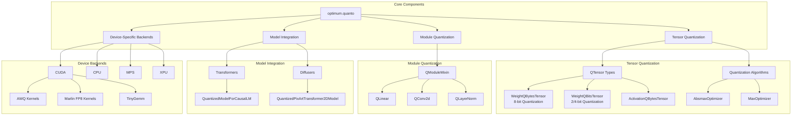
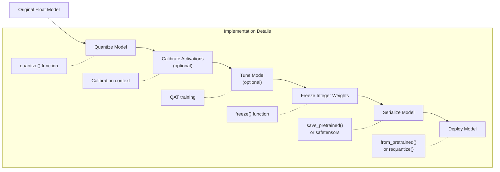
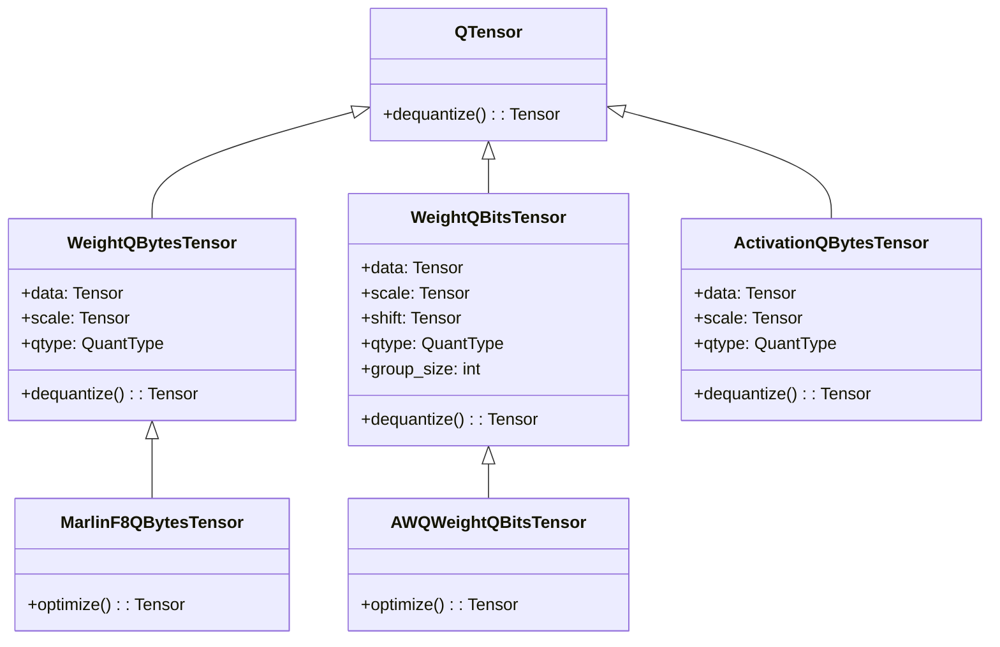
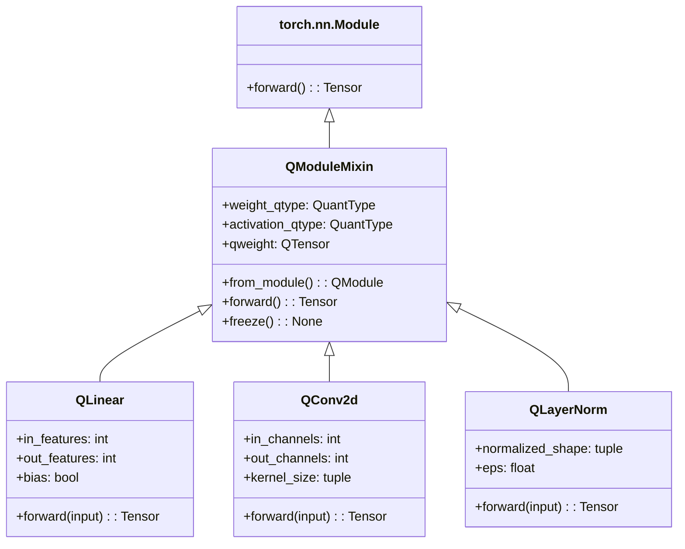
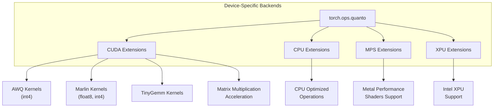

<!-- source: DeepWiki mcp.deepwiki.com · repo huggingface/optimum-quanto · page 1 Overview · fetched 2026-10-26 -->

# Overview

Relevant source files

The following files were used as context for generating this wiki page:

- [.github/PULL_REQUEST_TEMPLATE.md](.github/PULL_REQUEST_TEMPLATE.md)
- [CONTRIBUTING.md](CONTRIBUTING.md)
- [LICENSE](LICENSE)
- [Makefile](Makefile)
- [README.md](README.md)
- [external/awq/test_awq_kernels.py](external/awq/test_awq_kernels.py)
- [external/awq/test_awq_packing.py](external/awq/test_awq_packing.py)
- [external/smoothquant/README.md](external/smoothquant/README.md)
- [external/smoothquant/smoothquant.py](external/smoothquant/smoothquant.py)
- [pyproject.toml](pyproject.toml)
- [setup.sh](setup.sh)

Optimum Quanto is a PyTorch quantization backend for Hugging Face's optimum library. It provides a comprehensive system for quantizing deep learning models with a focus on ease of use and performance. This page introduces the purpose, architecture, and key features of Optimum Quanto.

For detailed information about getting started with the library, see [Getting Started](#2).

## Purpose and Key Features

Optimum Quanto enables efficient model compression through quantization, reducing memory requirements and potentially improving inference speed while maintaining model accuracy. The library has been designed with versatility and simplicity as core principles.

Key features include:

- **Full eager mode support**: Works with non-traceable models without requiring graph compilation
- **Multi-device compatibility**: Quantized models can run on any device including CUDA, CPU, and MPS (Metal Performance Shaders)
- **Automatic quantization handling**: Automatically inserts quantization/dequantization operations and quantized modules
- **Complete workflow**: Provides a seamless process from float model to dynamic to static quantized model
- **Flexible serialization**: Compatible with PyTorch `weight_only` and Hugging Face `safetensors`
- **Accelerated operations**: Optimized matrix multiplications on CUDA devices (int8-int8, fp16-int4, bf16-int8, bf16-int4)
- **Multiple precision support**: Supports int2, int4, int8, and float8 for weights; int8 and float8 for activations

Sources: [README.md:3-16](), [pyproject.toml:1-25]()

## System Architecture

Optimum Quanto follows a layered architecture design, with each layer handling specific aspects of the quantization process.

Sources: [README.md:228-299](), [external/awq/test_awq_kernels.py:38-153]()

## Quantization Workflow

The typical workflow when using Optimum Quanto involves several steps, from quantizing a model to deploying it.

Sources: [README.md:58-126](), [README.md:127-223]()

## Tensor Quantization

At the core of Optimum Quanto is tensor quantization. The library provides specialized tensor classes that efficiently represent tensors in lower precision formats.

Quanto uses a projection technique to minimize quantization errors by:
- Avoiding saturated values (mapped to the destination type min/max)
- Preventing zeroed values (below the smallest representable number)

The quantization approaches include:
- Symmetric per-tensor or per-channel for `int8` and `float8`
- Group-wise affine (with shift or 'zero-point') for lower bitwidth (int2, int4)

Sources: [README.md:228-246](), [external/awq/test_awq_packing.py:22-87]()

## Module Quantization

Optimum Quanto provides quantized versions of key PyTorch modules that are commonly used in deep learning models.

The supported quantized modules include:
- **QLinear**: Quantized version of `torch.nn.Linear` with quantized weights and optional quantized inputs/outputs
- **QConv2d**: Quantized version of `torch.nn.Conv2d` with quantized weights and optional quantized inputs/outputs
- **QLayerNorm**: Quantized version of `torch.nn.LayerNorm` with quantized outputs (weights and biases are not quantized)

Sources: [README.md:247-279]()

## Model Integration

Optimum Quanto seamlessly integrates with Hugging Face's transformers and diffusers libraries, providing helper classes for quantizing popular model architectures.

The integration provides:
- High-level API for quantizing, saving, and loading Hugging Face models
- Support for common model types including causal language models and diffusion models
- Selective quantization (e.g., excluding specific layers like `lm_head`)
- Seamless inclusion in existing pipelines

Sources: [README.md:58-119]()

## Hardware-Specific Backends

Optimum Quanto provides optimized backends for different hardware platforms to maximize performance of quantized operations.

The backend system provides:
- Optimized kernels for matrix multiplication with mixed-precision operations
- Specialized implementations for different quantization schemes (AWQ, Marlin, TinyGemm)
- Support for CPU, CUDA, MPS (Apple Metal), and Intel XPU devices
- Common interface through the `torch.ops.quanto` namespace

Sources: [external/awq/test_awq_kernels.py:38-153](), [README.md:14-16]()

## Advanced Quantization Techniques

Optimum Quanto implements several advanced quantization techniques to improve the accuracy and performance of quantized models.

### SmoothQuant

SmoothQuant is a technique that helps mitigate quantization errors in activations by "smoothing" the distribution of activation values. This is particularly useful for int8 quantization where large outlier values can cause most values to be quantized to zero.

The technique works by:
1. Collecting activation statistics during model calibration
2. Scaling the weights and inverse-scaling the activations to make the activation distribution more amenable to quantization
3. This results in better quantization accuracy while maintaining mathematical equivalence

Sources: [external/smoothquant/smoothquant.py:16-145](), [external/smoothquant/README.md:1-12](), [README.md:280-299]()

### AWQ (Activation-Aware Weight Quantization)

AWQ is an approach for low-bit weight quantization that takes into account activation patterns to improve quantization accuracy. The implementation includes specialized CUDA kernels for efficient inference.

Key features include:
- Groupwise quantization with configurable group size
- Per-group scaling and zero-point calculation
- Optimized packing formats for efficient memory access
- Specialized GEMM (General Matrix Multiplication) kernels

Sources: [external/awq/test_awq_kernels.py:38-153](), [external/awq/test_awq_packing.py:22-87]()

## Performance Characteristics

The performance of models quantized with Optimum Quanto varies depending on the quantization strategy and hardware:

- **Accuracy**: Models with int8/float8 weights and float8 activations typically maintain accuracy very close to the full-precision models
- **Latency**: When optimized kernels are available, inference speed is comparable to full-precision models when only weights are quantized
- **Memory Usage**: Memory requirements are approximately reduced by a factor of (float bits / quantized bits)

The optimal quantization strategy depends on the specific model architecture, task requirements, and target hardware.

Sources: [README.md:24-32]()

## Contributing

Optimum Quanto is an open-source project that welcomes contributions. Areas for contribution include:

- Fixing outstanding issues
- Implementing new kernels for different hardware
- Adding support for new model architectures
- Improving documentation and examples

The project follows standard open-source contribution practices with pull requests, code reviews, and continuous integration.

Sources: [CONTRIBUTING.md:17-222](), [Makefile:1-14](), [.github/PULL_REQUEST_TEMPLATE.md:1-30]()

---

