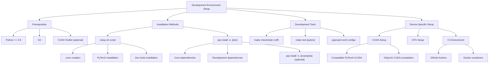
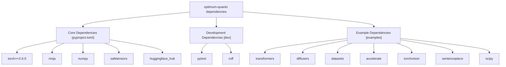
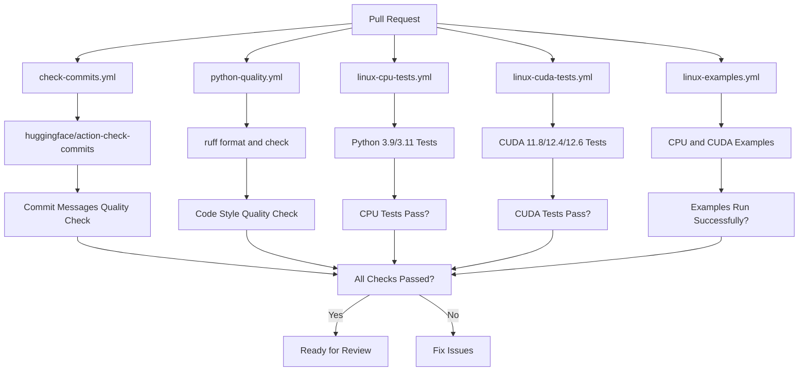
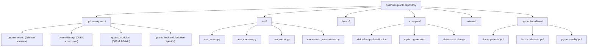

<!-- source: DeepWiki mcp.deepwiki.com · repo huggingface/optimum-quanto · page 10.1 Development Setup · fetched 2026-10-26 -->

# Development Setup

<details>
<summary>Relevant source files</summary>

The following files were used as context for generating this wiki page:

- [.github/workflows/check-commits.yml](.github/workflows/check-commits.yml)
- [.github/workflows/linux-cpu-tests.yml](.github/workflows/linux-cpu-tests.yml)
- [.github/workflows/linux-cuda-tests.yml](.github/workflows/linux-cuda-tests.yml)
- [.github/workflows/linux-examples.yml](.github/workflows/linux-examples.yml)
- [.github/workflows/python-quality.yml](.github/workflows/python-quality.yml)
- [Makefile](Makefile)
- [external/awq/test_awq_kernels.py](external/awq/test_awq_kernels.py)
- [external/awq/test_awq_packing.py](external/awq/test_awq_packing.py)
- [external/smoothquant/smoothquant.py](external/smoothquant/smoothquant.py)
- [pyproject.toml](pyproject.toml)
- [setup.sh](setup.sh)

</details>


This document provides detailed instructions for setting up a development environment for the Optimum-Quanto project. It is intended for developers who want to contribute to the codebase or make custom modifications to the quantization framework.

For information about testing your contributions, see [Testing Guidelines](#10.2).

## Prerequisites

Before setting up your development environment for Optimum-Quanto, ensure you have the following prerequisites installed:

- Python 3.9 or higher (supports 3.9, 3.10, and 3.11)
- Git
- CUDA toolkit (optional, for CUDA backend development)

Sources: [pyproject.toml:10-13](), [.github/workflows/linux-cpu-tests.yml:27-29]()

## Development Environment Setup

### Development Environment Overview

Development Setup Diagram


Sources: [pyproject.toml:17-40](), [setup.sh:1-18]()

### Method 1: Using the Setup Script

The repository provides a convenient setup script that creates a virtual environment and installs all necessary dependencies:

```bash
# For stable PyTorch
./setup.sh

# For PyTorch nightly build
./setup.sh 1
```

This script:
1. Creates a Python virtual environment in the `.venv` directory
2. Installs PyTorch, torchvision, and torchaudio
3. Installs development tools (ruff, pytest, build)
4. Installs common dependencies for examples

Sources: [setup.sh:1-18]()

### Method 2: Manual Installation

If you prefer to set up your environment manually, follow these steps:

1. Clone the repository:
   ```bash
   git clone https://github.com/huggingface/optimum-quanto.git
   cd optimum-quanto
   ```

2. Create and activate a virtual environment:
   ```bash
   python -m venv .venv
   source .venv/bin/activate  # On Windows: .venv\Scripts\activate
   ```

3. Install the package in development mode with development dependencies:
   ```bash
   pip install -e .[dev]
   ```

4. If you want to run the examples, install additional dependencies:
   ```bash
   pip install -e .[examples]
   ```

Sources: [pyproject.toml:30-40]()

## Project Dependencies

Optimum-Quanto has different dependency groups:

Project Dependencies


Sources: [pyproject.toml:22-40]()

### Core Dependencies

The core dependencies are required for the basic functionality of Optimum-Quanto:

| Dependency | Purpose |
|------------|---------|
| torch>=2.6.0 | PyTorch framework for tensor operations |
| ninja | Build system for CUDA extension compilation |
| numpy | Numerical computing library |
| safetensors | Secure tensor storage and loading |
| huggingface_hub | Integration with Hugging Face models |

Sources: [pyproject.toml:22]()

### Development Dependencies

For development and testing, additional packages are needed:

| Dependency | Purpose |
|------------|---------|
| pytest | Testing framework |
| ruff | Code linting and formatting |

Sources: [pyproject.toml:31]()

### Example Dependencies

To run the examples provided in the repository:

| Dependency | Purpose |
|------------|---------|
| transformers | Hugging Face Transformers library |
| diffusers | Hugging Face Diffusers library |
| datasets | Dataset loading and processing |
| accelerate | Distributed training utilities |
| torchvision | Computer vision utilities |
| sentencepiece | Tokenization for language models |
| scipy | Scientific computing utilities |

Sources: [pyproject.toml:32-40]()

## Development Tools and Workflow

### Code Quality Tools

Optimum-Quanto uses `ruff` for code formatting and linting, configured in `pyproject.toml`:

```bash
# Check code quality (linting)
make check

# Automatically fix code style issues
make style
```

These commands are shortcuts for:

```bash
# Equivalent to make check
ruff check --show-fixes optimum test bench examples
ruff format optimum test bench examples --diff

# Equivalent to make style
ruff check optimum test bench examples --fix
ruff format optimum test bench examples
```

Sources: [Makefile:1-11](), [pyproject.toml:53-69](), [.github/workflows/python-quality.yml:1-21]()

### Running Tests

To run the test suite:

```bash
# Run all tests
make test

# Or the equivalent command
python -m pytest -sv test
```

To run specific tests:

```bash
# Run only base tests (excluding models and CLI tests)
python -m pytest test --ignore=test/models --ignore=test/cli

# Run only model tests
python -m pytest test/models

# Run only CLI tests
python -m pytest test/cli
```

Sources: [Makefile:13-14](), [.github/workflows/linux-cpu-tests.yml:42-56]()

## Device-Specific Development

### CUDA Development

When working on CUDA-specific features:

1. Ensure you have a compatible CUDA toolkit installed
2. Install PyTorch with the appropriate CUDA version
3. The `ninja` build system will automatically compile CUDA extensions

Optimum-Quanto is tested with CUDA versions 11.8, 12.4, and 12.6 in the CI pipeline.

To run CUDA-specific tests:

```bash
# Run tests with CUDA support
python -m pytest test/...  # Automatically uses CUDA if available
```

Sources: [.github/workflows/linux-cuda-tests.yml:25-58]()

### CPU Development

For CPU-specific development:

1. No special setup is required beyond the standard dependencies
2. The codebase has optimization paths for CPU execution
3. Tests run automatically on CPU when CUDA is not available

Sources: [.github/workflows/linux-cpu-tests.yml:23-56]()

## Continuous Integration

The project uses GitHub Actions for continuous integration. Understanding the CI pipeline will help you ensure your contributions meet the project's quality standards.

CI Pipeline Diagram


Sources: [.github/workflows/check-commits.yml:1-18](), [.github/workflows/linux-cpu-tests.yml:1-81](), [.github/workflows/linux-cuda-tests.yml:1-59](), [.github/workflows/python-quality.yml:1-21](), [.github/workflows/linux-examples.yml:1-78]()

### CI Workflows

The CI system includes these main workflows:

1. **Commit Quality** (`check-commits.yml`): Ensures commit messages meet quality standards
2. **Code Quality** (`python-quality.yml`): Runs ruff to check code style and formatting
3. **CPU Tests** (`linux-cpu-tests.yml`): Runs tests on Linux with Python 3.9 and 3.11
4. **CUDA Tests** (`linux-cuda-tests.yml`): Runs tests on Linux with different CUDA versions
5. **Example Tests** (`linux-examples.yml`): Ensures examples run correctly on both CPU and CUDA

Sources: [.github/workflows/linux-cpu-tests.yml:18-56](), [.github/workflows/linux-cuda-tests.yml:18-58](), [.github/workflows/linux-examples.yml:18-77]()

### CI Environment

The CI system uses Docker containers for CUDA testing:

```yaml
container:
  image: pytorch/pytorch:2.6.0-cuda12.4-cudnn9-devel
  options: --gpus 0
```

This ensures consistent testing environments across different execution contexts.

Sources: [.github/workflows/linux-cuda-tests.yml:31-33](), [.github/workflows/linux-examples.yml:31-33]()

## Project Structure

The repository has the following structure:

Project Structure Diagram


Sources: [pyproject.toml:42-44](), [.github/workflows/linux-examples.yml:47-77]()

### Key Directories

| Directory | Purpose |
|-----------|---------|
| optimum/quanto/ | Main package code with quantization implementations |
| test/ | Test suite for the package |
| bench/ | Benchmarking utilities |
| examples/ | Example applications for different model types |
| external/ | External algorithms (e.g., SmoothQuant, AWQ) |
| .github/workflows/ | CI configuration |

Sources: [external/smoothquant/smoothquant.py:1-145](), [external/awq/test_awq_kernels.py:1-154](), [external/awq/test_awq_packing.py:1-89]()

## Commit Guidelines

When contributing to Optimum-Quanto, follow these commit message guidelines:

1. Each commit message should have at least 3 words
2. Avoid using "fixup" in commit messages
3. Keep the number of commits in a pull request to 10 or fewer

These guidelines are enforced by the `check-commits.yml` workflow.

Sources: [.github/workflows/check-commits.yml:1-18]()

## Conclusion

This development setup guide provides the essential information to get started contributing to Optimum-Quanto. By following these instructions, you'll be able to set up a proper development environment, understand the project structure, and follow the established workflows for code quality and testing.

---

