<!-- source: DeepWiki mcp.deepwiki.com · repo huggingface/optimum-quanto · page 2 Getting Started · fetched 2026-10-26 -->

# Getting Started

<details>
<summary>Relevant source files</summary>

The following files were used as context for generating this wiki page:

- [.github/PULL_REQUEST_TEMPLATE.md](.github/PULL_REQUEST_TEMPLATE.md)
- [CONTRIBUTING.md](CONTRIBUTING.md)
- [LICENSE](LICENSE)
- [README.md](README.md)
- [examples/nlp/text-classification/sst2/quantize_sst2_model.py](examples/nlp/text-classification/sst2/quantize_sst2_model.py)
- [examples/nlp/text-generation/quantize_causal_lm_model.py](examples/nlp/text-generation/quantize_causal_lm_model.py)
- [examples/vision/StableDiffusion/quantize_StableDiffusion.py](examples/vision/StableDiffusion/quantize_StableDiffusion.py)
- [examples/vision/StableDiffusion/requirements.txt](examples/vision/StableDiffusion/requirements.txt)
- [examples/vision/image-classification/mnist/quantize_mnist_model.py](examples/vision/image-classification/mnist/quantize_mnist_model.py)
- [examples/vision/object-detection/quantize_owl_model.py](examples/vision/object-detection/quantize_owl_model.py)
- [examples/vision/text-to-image/quantize_pixart_sigma.py](examples/vision/text-to-image/quantize_pixart_sigma.py)
- [external/smoothquant/README.md](external/smoothquant/README.md)

</details>


This guide provides a comprehensive introduction to installing and using Optimum Quanto, a versatile quantization backend for PyTorch models. You'll learn how to set up the library, understand the basic quantization workflow, and get familiar with its usage across different model types. For deeper conceptual understanding of quantization types and techniques, see [Core Concepts](#3).

## Installation

Optimum Quanto is available as a pip package and can be installed with a simple command:

```bash
pip install optimum-quanto
```

The library supports various hardware platforms including CUDA GPUs, Apple MPS, Intel XPU, and standard CPUs. For development purposes, you can install the library in editable mode with development dependencies:

```bash
pip install -e ".[dev]"
```

Sources: [README.md:50-56](), [CONTRIBUTING.md:120-128]()

## Supported Devices

Optimum Quanto works across multiple computing platforms:

| Device | Support | Notes |
|--------|---------|-------|
| CUDA (NVIDIA GPUs) | ✅ | Accelerated matrix multiplications for various precision combinations |
| CPU | ✅ | Works on all standard x86/ARM processors |
| MPS (Apple Silicon) | ✅ | Native support for Apple M-series chips |
| XPU (Intel GPUs) | ✅ | Support for Intel discrete GPUs |

When no device is specified, Optimum Quanto automatically selects the most appropriate device available in the following priority: CUDA > MPS > XPU > CPU.

Sources: [examples/nlp/text-generation/quantize_causal_lm_model.py:110-120](), [examples/vision/image-classification/mnist/quantize_mnist_model.py:108-118]()

## Quantization Workflow Overview

The quantization process in Optimum Quanto typically follows these steps:

```mermaid
flowchart LR
    A["Original Float Model"] --> B["Quantize"]
    B --> C["Calibrate (if using activation quantization)"]
    C --> D["Optional: Fine-tune"]
    D --> E["Freeze"]
    E --> F["Save/Serialize"]
    F --> G["Load Quantized Model"]
    
    style A fill:#f9f9f9,stroke:#333,stroke-width:1px
    style B fill:#f9f9f9,stroke:#333,stroke-width:1px
    style C fill:#f9f9f9,stroke:#333,stroke-width:1px
    style D fill:#f9f9f9,stroke:#333,stroke-width:1px
    style E fill:#f9f9f9,stroke:#333,stroke-width:1px
    style F fill:#f9f9f9,stroke:#333,stroke-width:1px
    style G fill:#f9f9f9,stroke:#333,stroke-width:1px
```



This workflow applies to both Hugging Face models and custom PyTorch models, with some API differences detailed in the following sections.

Sources: [README.md:58-223]()

## Using Optimum Quanto with Hugging Face Models

Optimum Quanto provides specialized classes for quantizing Hugging Face models with minimal code. Here's an example with a language model:

### Language Models

```python
from transformers import AutoModelForCausalLM
from optimum.quanto import QuantizedModelForCausalLM, qint4

# Load original model
model = AutoModelForCausalLM.from_pretrained('meta-llama/Meta-Llama-3-8B')

# Quantize model (weights only, excluding lm_head)
qmodel = QuantizedModelForCausalLM.quantize(model, weights=qint4, exclude='lm_head')

# Save the quantized model
qmodel.save_pretrained('./Llama-3-8B-quantized')

# Later, load the quantized model
from optimum.quanto import QuantizedModelForCausalLM
qmodel = QuantizedModelForCausalLM.from_pretrained('Llama-3-8B-quantized')
```

### Diffusion Models

For diffusion models, you can quantize specific components:

```python
from diffusers import PixArtTransformer2DModel
from optimum.quanto import QuantizedPixArtTransformer2DModel, qfloat8

# Load original transformer component
model = PixArtTransformer2DModel.from_pretrained("PixArt-alpha/PixArt-Sigma-XL-2-1024-MS", subfolder="transformer")

# Quantize with float8 precision
qmodel = QuantizedPixArtTransformer2DModel.quantize(model, weights=qfloat8)

# Save the quantized component
qmodel.save_pretrained("./pixart-sigma-fp8")
```

Sources: [README.md:58-119](), [examples/nlp/text-generation/quantize_causal_lm_model.py:137-147](), [examples/vision/text-to-image/quantize_pixart_sigma.py:21-31]()

## Low-Level Quantization API

For more control or when working with custom PyTorch models, you can use the low-level API:

### Step 1: Quantize

```python
from optimum.quanto import quantize, qint8

# Convert float model to dynamically quantized model
quantize(model, weights=qint8, activations=qint8)
```

### Step 2: Calibrate (for activation quantization)

```python
from optimum.quanto import Calibration

# Run representative data through the model to calibrate activation ranges
with Calibration(momentum=0.9):
    model(samples)
```

### Step 3: Fine-tune (optional)

```python
# Train the quantized model to recover accuracy
model.train()
for batch_idx, (data, target) in enumerate(train_loader):
    data, target = data.to(device), target.to(device)
    optimizer.zero_grad()
    output = model(data).dequantize()
    loss = torch.nn.functional.nll_loss(output, target)
    loss.backward()
    optimizer.step()
```

### Step 4: Freeze

```python
from optimum.quanto import freeze

# Replace float weights with quantized integer weights
freeze(model)
```

### Step 5: Serialize

```python
from safetensors.torch import save_file
from optimum.quanto import quantization_map
import json

# Save weights
save_file(model.state_dict(), 'model.safetensors')

# Save quantization information
with open('quantization_map.json', 'w') as f:
    json.dump(quantization_map(model), f)
```

### Step 6: Load

```python
from safetensors.torch import load_file
from optimum.quanto import requantize
import json

# Load state dict and quantization map
state_dict = load_file('model.safetensors')
with open('quantization_map.json', 'r') as f:
    qmap = json.load(f)

# Create empty model and requantize it
with torch.device('meta'):
    new_model = MyModel()
requantize(new_model, state_dict, qmap, device=torch.device('cuda'))
```

Sources: [README.md:121-223](), [examples/vision/image-classification/mnist/quantize_mnist_model.py:142-169]()

## Quantization Options

Optimum Quanto provides various quantization types:

| Quantization Type | Import | Description |
|-------------------|--------|-------------|
| 4-bit integer | `qint4` | Highest compression, good for weight-only quantization |
| 8-bit integer | `qint8` | Good balance between compression and accuracy |
| 8-bit float | `qfloat8` | Good for activations, preserves dynamic range |
| None | `None` | Skip quantization for specific parts |

```mermaid
classDiagram
    class "QuantizationTypes" {
        qint4: 4-bit integer quantization
        qint8: 8-bit integer quantization 
        qfloat8: 8-bit float quantization
        None: No quantization
    }
    
    class "QuantizationTargets" {
        weights: Model weights
        activations: Model activations
        exclude: Skip specific modules
    }
    
    "QuantizationTypes" -- "QuantizationTargets": applied to
```

Sources: [examples/nlp/text-generation/quantize_causal_lm_model.py:56-62](), [examples/vision/image-classification/mnist/quantize_mnist_model.py:89-90]()

## Complete Example: Text Generation

Here's a complete example showing how to quantize a text generation model, calibrate it, and generate text:

```python
import torch
from transformers import AutoModelForCausalLM, AutoTokenizer
from optimum.quanto import QuantizedModelForCausalLM, Calibration, qint8

# Load model and tokenizer
model = AutoModelForCausalLM.from_pretrained("facebook/opt-350m")
tokenizer = AutoTokenizer.from_pretrained("facebook/opt-350m")
tokenizer.pad_token_id = tokenizer.eos_token_id

# Quantize model
qmodel = QuantizedModelForCausalLM.quantize(model, weights=qint8, activations=qint8)

# Calibrate for activation quantization
cal_dataset = load_dataset("lambada", split=["validation"])[0].shuffle(seed=1)
with Calibration():
    for batch in cal_dataset.iter(batch_size=32):
        inputs = tokenizer(batch["text"], return_tensors="pt", padding=True)
        qmodel(inputs.input_ids.to(device), attention_mask=inputs.attention_mask.to(device))

# Generate text
prompt = "One of my fondest memory is"
inputs = tokenizer(prompt, return_tensors="pt")
outputs = qmodel.generate(
    input_ids=inputs.input_ids.to(device),
    max_new_tokens=20,
    do_sample=True,
    top_k=50,
    top_p=0.9,
)
generated_text = tokenizer.decode(outputs[0])
print(generated_text)
```

Sources: [examples/nlp/text-generation/quantize_causal_lm_model.py:25-147]()

## Complete Example: Image Classification

This example shows how to quantize an image classification model for MNIST and evaluate its performance:

```python
import torch
import torch.nn.functional as F
from torchvision import datasets, transforms
from transformers import AutoModel
from optimum.quanto import quantize, Calibration, freeze, qint8

# Load MNIST dataset
transform = transforms.Compose([
    transforms.ToTensor(),
    transforms.Normalize((0.1307,), (0.3081,)),
    transforms.Lambda(lambda x: torch.flatten(x)),
])
test_loader = torch.utils.data.DataLoader(
    datasets.MNIST("./data", train=False, download=True, transform=transform),
    batch_size=250
)

# Load model
model = AutoModel.from_pretrained("dacorvo/mnist-mlp", trust_remote_code=True)

# Test original model
model.eval()
test_loss = 0
correct = 0
with torch.no_grad():
    for data, target in test_loader:
        output = model(data)
        test_loss += F.nll_loss(output, target, reduction="sum").item()
        pred = output.argmax(dim=1, keepdim=True)
        correct += pred.eq(target.view_as(pred)).sum().item()
print(f"Float model accuracy: {100.0 * correct / len(test_loader.dataset):.2f}%")

# Quantize model
quantize(model, weights=qint8, activations=qint8)

# Calibrate model
with Calibration():
    model.eval()
    with torch.no_grad():
        for data, target in test_loader:
            model(data)

# Freeze model
freeze(model)

# Test quantized model
model.eval()
test_loss = 0
correct = 0
with torch.no_grad():
    for data, target in test_loader:
        output = model(data)
        test_loss += F.nll_loss(output, target, reduction="sum").item()
        pred = output.argmax(dim=1, keepdim=True)
        correct += pred.eq(target.view_as(pred)).sum().item()
print(f"Quantized model accuracy: {100.0 * correct / len(test_loader.dataset):.2f}%")
```

Sources: [examples/vision/image-classification/mnist/quantize_mnist_model.py:39-156]()

## Device Selection

All examples automatically select the best available device, but you can explicitly specify a device:

```python
import torch

if args.device is None:
    if torch.cuda.is_available():
        device = torch.device("cuda")
    elif torch.backends.mps.is_available():
        device = torch.device("mps")
    elif torch.xpu.is_available():
        device = torch.device("xpu")
    else:
        device = torch.device("cpu")
else:
    device = torch.device(args.device)
```

Sources: [examples/nlp/text-generation/quantize_causal_lm_model.py:110-120](), [examples/vision/image-classification/mnist/quantize_mnist_model.py:108-118](), [examples/nlp/text-classification/sst2/quantize_sst2_model.py:60-70]()

## Next Steps

Now that you've learned the basics of using Optimum Quanto, you may want to explore:

- [Core Concepts](#3) to understand quantization types and techniques in depth
- [System Architecture](#4) to learn about the inner workings of Optimum Quanto
- [Example Applications](#8) for more specialized use cases like diffusion models

For issues, feature requests, or contributions, please refer to the [Contributing](#10) guide.

Sources: [README.md:1-300](), [CONTRIBUTING.md:1-222]()

---

