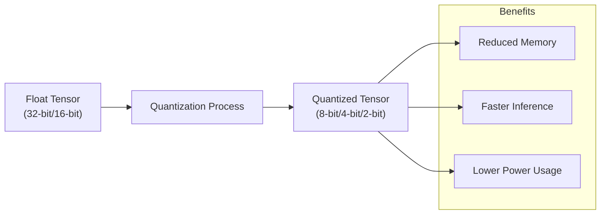
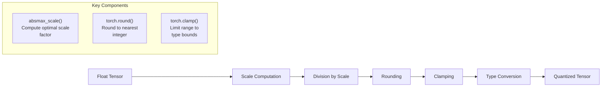
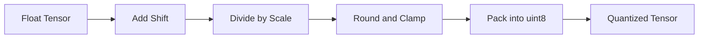
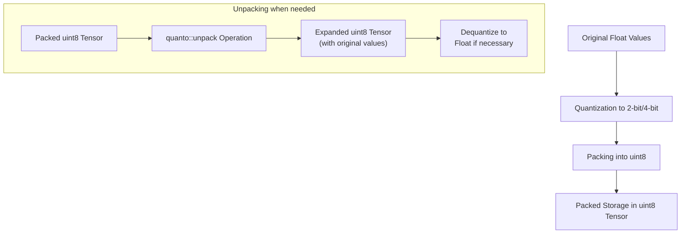
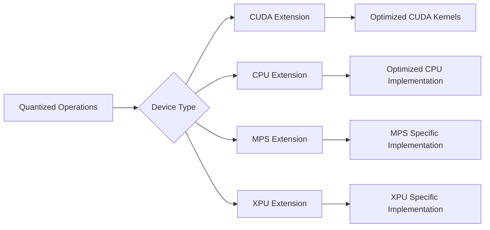
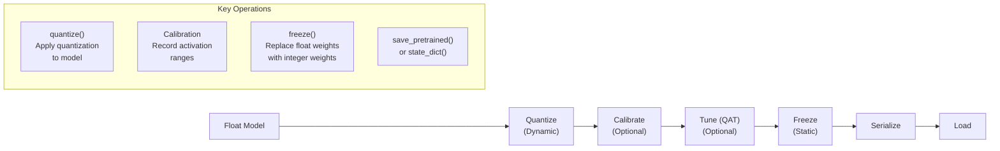
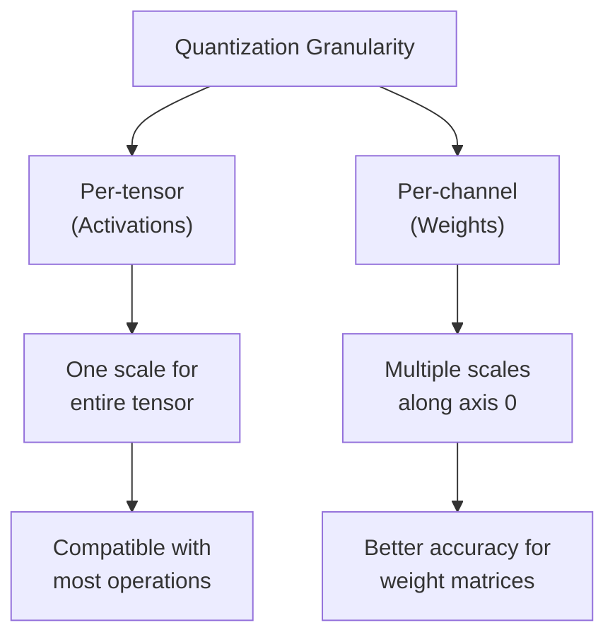
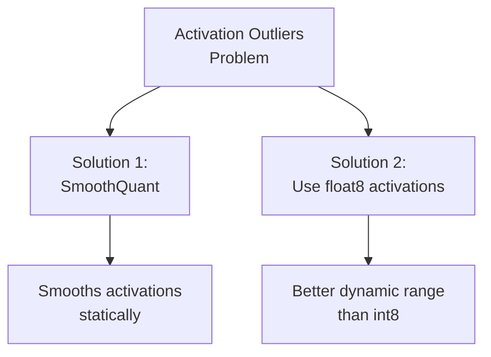
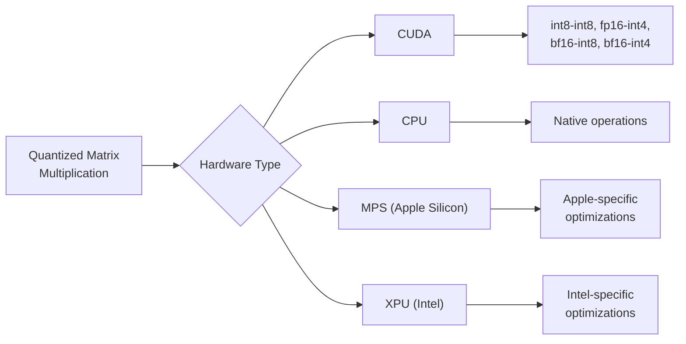

<!-- source: DeepWiki mcp.deepwiki.com · repo huggingface/optimum-quanto · page 3 Core Concepts · fetched 2026-10-26 -->

# Core Concepts

<details>
<summary>Relevant source files</summary>

The following files were used as context for generating this wiki page:

- [.github/PULL_REQUEST_TEMPLATE.md](.github/PULL_REQUEST_TEMPLATE.md)
- [CONTRIBUTING.md](CONTRIBUTING.md)
- [LICENSE](LICENSE)
- [README.md](README.md)
- [external/smoothquant/README.md](external/smoothquant/README.md)
- [optimum/quanto/library/__init__.py](optimum/quanto/library/__init__.py)
- [optimum/quanto/library/extensions/cpp/__init__.py](optimum/quanto/library/extensions/cpp/__init__.py)
- [optimum/quanto/library/extensions/extension.py](optimum/quanto/library/extensions/extension.py)
- [optimum/quanto/library/extensions/mps/__init__.py](optimum/quanto/library/extensions/mps/__init__.py)
- [optimum/quanto/library/quantize.py](optimum/quanto/library/quantize.py)
- [optimum/quanto/library/unpack.py](optimum/quanto/library/unpack.py)
- [test/tensor/test_absmax.py](test/tensor/test_absmax.py)

</details>


This page explains the fundamental concepts of quantization in optimum-quanto, providing a technical foundation for understanding how the library enables efficient model compression and acceleration. For specific quantization types and their use cases, see [Quantization Types](#3.1). For detailed information about differences between weight and activation quantization, see [Weight vs Activation Quantization](#3.2).

## What is Quantization?

Quantization is a technique used to reduce the precision of numerical values in deep learning models. By representing weights and activations with fewer bits than their original floating-point format (typically float32 or float16), quantized models require less memory and can execute operations more efficiently.



Sources: [README.md:14-16](), [optimum/quanto/library/quantize.py:15-78]()

## Quantization in optimum-quanto

Optimum-quanto provides a versatile quantization system that works in eager mode and supports multiple precision levels and hardware backends.

```mermaid
classDiagram
    class "Quantization Workflow" {
        +Quantize model
        +Calibrate activations
        +Tune (QAT - optional)
        +Freeze weights
        +Serialize
    }
    
    class "Quantization Types" {
        +int2
        +int4
        +int8
        +float8
    }
    
    class "Hardware Support" {
        +CUDA
        +CPU
        +MPS
        +XPU
    }
    
    "Quantization Workflow" --> "Quantization Types" : uses
    "Quantization Workflow" --> "Hardware Support" : adapts to
```

Sources: [README.md:5-16](), [optimum/quanto/library/extensions/extension.py:1-87]()

## Tensor Quantization

At the core of optimum-quanto is tensor quantization, which involves projecting values from a source tensor into an optimal range for a destination type.

### Symmetric Quantization

Symmetric quantization maps float values to integers using a symmetric range around zero. This is used for weights and activations in optimum-quanto.



Sources: [optimum/quanto/library/quantize.py:22-55](), [test/tensor/test_absmax.py:1-42]()

### Affine Quantization

For lower bitwidths (int2, int4), optimum-quanto uses affine quantization (with shift) to maximize representational capacity.



Sources: [optimum/quanto/library/quantize.py:58-78](), [optimum/quanto/library/unpack.py:1-54]()

## Packing for Lower Bitwidth

Since PyTorch doesn't natively support data types smaller than 8 bits, optimum-quanto implements bit packing for 2-bit and 4-bit quantization.



Sources: [optimum/quanto/library/unpack.py:18-54](), [optimum/quanto/library/extensions/cpp/__init__.py:34-36](), [optimum/quanto/library/extensions/mps/__init__.py:34-36]()

## Device-specific Optimizations

Optimum-quanto provides optimized implementations for different hardware backends through specialized extension modules.



Sources: [optimum/quanto/library/extensions/cpp/__init__.py:1-36](), [optimum/quanto/library/extensions/mps/__init__.py:1-36](), [optimum/quanto/library/extensions/extension.py:1-86]()

## Quantization Workflow

A typical quantization workflow in optimum-quanto consists of several stages:



Sources: [README.md:58-225]()

## Implementation Considerations

When implementing quantization in optimum-quanto, there are important technical considerations to keep in mind:

### Per-tensor vs Per-channel Quantization



Sources: [README.md:280-295]()

### Avoiding Quantization Pitfalls

Tensor quantization effectiveness can be impacted by outliers, particularly when quantizing activations to int8. Optimum-quanto provides solutions to address this:



Sources: [README.md:293-299](), [external/smoothquant/README.md:1-11]()

## Quantization Types Support

Optimum-quanto supports multiple quantization types, each with different precision-performance tradeoffs:

| Quantization Type | Bits | Use Case | Accuracy Impact | Speed Improvement |
|-------------------|------|----------|----------------|-------------------|
| int8             | 8    | General purpose, activations | Minimal | Good |
| float8           | 8    | Activations with outliers | Minimal | Good |
| int4             | 4    | Weights-only quantization | Moderate | Excellent |
| int2             | 2    | Extreme compression | Significant | Outstanding |

Sources: [README.md:14-16](), [README.md:26-30]()

## Hardware Acceleration

The optimum-quanto system includes hardware-specific optimizations for accelerated matrix multiplications:



Sources: [README.md:14](), [optimum/quanto/library/extensions/extension.py:13-54]()

This overview of core concepts provides the foundation for understanding how optimum-quanto implements quantization for deep learning models. The subsequent pages in this wiki will build upon these concepts to provide more detailed explanations of specific components and workflows.

---

