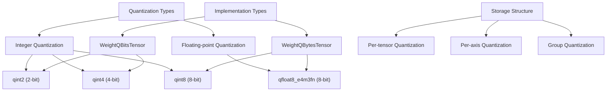
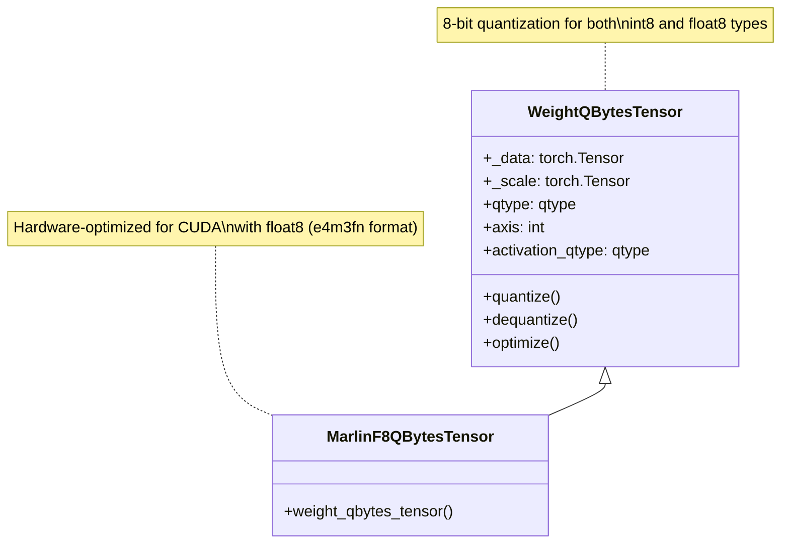
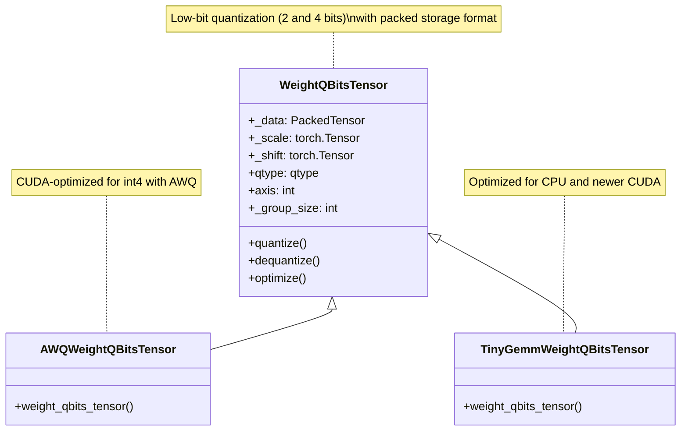
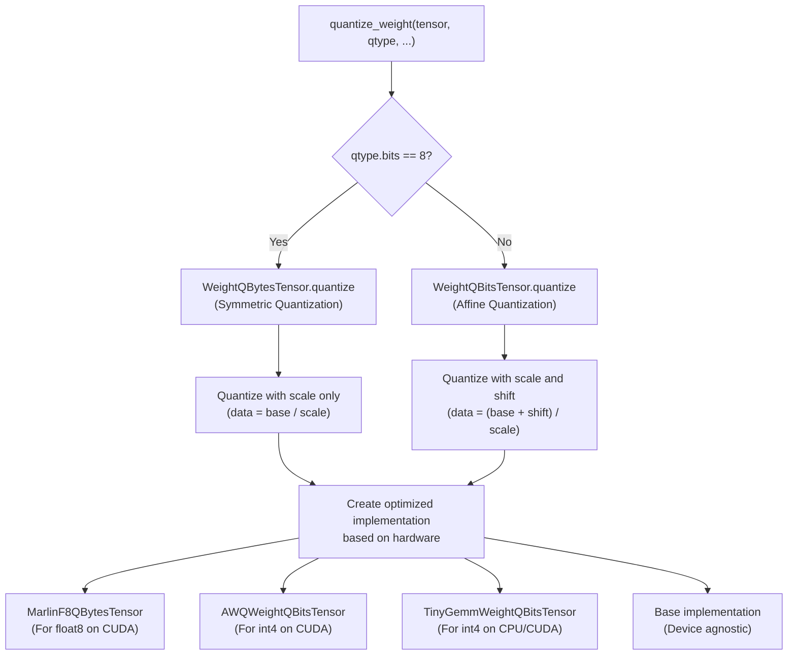
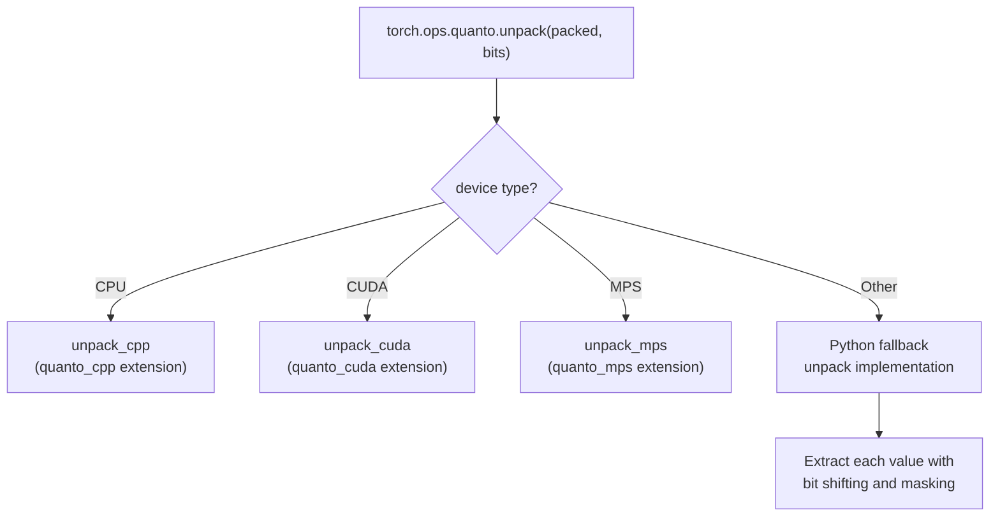

<!-- source: DeepWiki mcp.deepwiki.com · repo huggingface/optimum-quanto · page 3.1 Quantization Types · fetched 2026-10-26 -->

# Quantization Types

<details>
<summary>Relevant source files</summary>

The following files were used as context for generating this wiki page:

- [optimum/quanto/library/__init__.py](optimum/quanto/library/__init__.py)
- [optimum/quanto/library/extensions/cpp/__init__.py](optimum/quanto/library/extensions/cpp/__init__.py)
- [optimum/quanto/library/extensions/extension.py](optimum/quanto/library/extensions/extension.py)
- [optimum/quanto/library/extensions/mps/__init__.py](optimum/quanto/library/extensions/mps/__init__.py)
- [optimum/quanto/library/quantize.py](optimum/quanto/library/quantize.py)
- [optimum/quanto/library/unpack.py](optimum/quanto/library/unpack.py)
- [optimum/quanto/tensor/weights/qbits.py](optimum/quanto/tensor/weights/qbits.py)
- [optimum/quanto/tensor/weights/qbytes.py](optimum/quanto/tensor/weights/qbytes.py)
- [optimum/quanto/tensor/weights/quantization.py](optimum/quanto/tensor/weights/quantization.py)
- [test/tensor/test_absmax.py](test/tensor/test_absmax.py)

</details>


This page details the different quantization types supported in optimum-quanto, their characteristics, and how they are implemented in the codebase. For information about the difference between weight and activation quantization, see [Weight vs Activation Quantization](#3.2).

## Overview of Quantization Types

Optimum-quanto supports several quantization types with different precisions, each designed for specific trade-offs between model size, inference speed, and accuracy. The library implements both integer and floating-point quantization methods.



Sources: 
- [optimum/quanto/tensor/weights/qbytes.py:29-327]()
- [optimum/quanto/tensor/weights/qbits.py:31-302]()
- [optimum/quanto/tensor/weights/quantization.py:24-73]()

## Quantization Types and Precision

Optimum-quanto provides a variety of quantization types to balance between model size, computational efficiency, and quality:

| Quantization Type | Bits | Format | Implementation Class | Use Cases |
|-------------------|------|--------|----------------------|-----------|
| qint2 | 2 | Integer | WeightQBitsTensor | Ultra-low memory, high compression ratio |
| qint4 | 4 | Integer | WeightQBitsTensor | Good balance between quality and compression |
| qint8 | 8 | Integer | WeightQBytesTensor | Higher precision, standard quantization |
| qfloat8_e4m3fn | 8 | Float | WeightQBytesTensor (Marlin) | Precision for weights with wide dynamic range |

Sources:
- [optimum/quanto/tensor/weights/qbytes.py:85-144]()
- [optimum/quanto/tensor/weights/qbits.py:65-123]()

## Quantization Implementation Details

The implementation of quantization in optimum-quanto is split into two main tensor types:

### 1. WeightQBytesTensor (8-bit)

The `WeightQBytesTensor` handles 8-bit quantization (both integer and floating-point) and is implemented in [optimum/quanto/tensor/weights/qbytes.py]().



Key features:
- Supports both `qint8` and `qfloat8_e4m3fn` quantization types
- Quantizes with a symmetric pattern: `data = torch.round(base / scale)`
- Provides optimization for specific hardware with `MarlinF8QBytesTensor` subclass
- Automatically selects the best implementation based on the device and parameters

Sources:
- [optimum/quanto/tensor/weights/qbytes.py:85-144]()
- [optimum/quanto/tensor/weights/qbytes.py:157-166]()
- [optimum/quanto/library/quantize.py:28-55]()

### 2. WeightQBitsTensor (2-bit and 4-bit)

The `WeightQBitsTensor` handles low-bit quantization (2-bit and 4-bit) and is implemented in [optimum/quanto/tensor/weights/qbits.py]().



Key features:
- Supports `qint2` and `qint4` quantization types
- Uses `PackedTensor` to efficiently store multiple low-bit values in each byte
- Implements affine quantization: `data = torch.round((base + shift) / scale)`
- Supports grouped quantization with the `group_size` parameter
- Provides specialized subclasses for different hardware: `AWQWeightQBitsTensor` and `TinyGemmWeightQBitsTensor`

Sources:
- [optimum/quanto/tensor/weights/qbits.py:65-123]()
- [optimum/quanto/tensor/weights/qbits.py:139-149]()
- [optimum/quanto/library/quantize.py:64-78]()
- [optimum/quanto/library/unpack.py:21-54]()

## Quantization Process

The quantization process for weights follows different paths based on the bit-width:



Sources:
- [optimum/quanto/tensor/weights/quantization.py:27-73]()
- [optimum/quanto/tensor/weights/qbytes.py:31-65]()
- [optimum/quanto/tensor/weights/qbits.py:34-62]()

## Storage and Unpacking

For low-bit quantization (2-bit and 4-bit), values are packed into 8-bit storage units since PyTorch doesn't natively support lower bit-width tensors:

| Quantization Type | Values per Byte | Unpacking Process |
|-------------------|-----------------|-------------------|
| qint2 | 4 | Extract 4 separate 2-bit values from each byte |
| qint4 | 2 | Extract 2 separate 4-bit values from each byte |
| qint8/qfloat8 | 1 | Direct storage (no packing required) |

The unpacking process is implemented with both Python fallback and hardware-specific optimizations:



Sources:
- [optimum/quanto/library/unpack.py:21-54]()
- [optimum/quanto/library/extensions/cpp/__init__.py:34-36]()
- [optimum/quanto/library/extensions/mps/__init__.py:34-36]()

## Hardware Optimizations

Optimum-quanto automatically selects the most efficient implementation for each quantization type based on the hardware:

| Quantization Type | Hardware | Optimized Implementation |
|-------------------|----------|--------------------------|
| qfloat8_e4m3fn | CUDA (SM ≥ 8.0) | MarlinF8QBytesTensor |
| qint4 | CUDA (SM ≥ 8.0) | AWQWeightQBitsTensor |
| qint4 | CPU or CUDA (≥ 12.1) | TinyGemmWeightQBitsTensor |
| Any | Any | Base implementation (WeightQBytesTensor/WeightQBitsTensor) |

Key optimization criteria:
- Device type (CPU, CUDA, MPS)
- For CUDA: GPU architecture (Compute Capability)
- Tensor dimensions and alignment
- Extension availability

Sources:
- [optimum/quanto/tensor/weights/qbytes.py:87-143]()
- [optimum/quanto/tensor/weights/qbits.py:66-123]()
- [optimum/quanto/library/extensions/extension.py:77-86]()

## Choosing a Quantization Type

The choice of quantization type depends on your specific requirements:

| Quantization Type | Advantages | Disadvantages | Best For |
|-------------------|------------|--------------|----------|
| qint2 | Highest compression (16×) | Lowest precision | Text models in constrained environments |
| qint4 | Good compression (8×) | Moderate quality loss | General LLM inference |
| qint8 | Better precision | Lower compression (4×) | Vision models, critical applications |
| qfloat8_e4m3fn | Good for wide value ranges | Requires newer GPUs | Models with outlier parameters |

Sources:
- [optimum/quanto/tensor/weights/quantization.py:27-73]()
- [test/tensor/test_absmax.py:22-42]()

## Calibration and Scaling

For both `WeightQBytesTensor` and `WeightQBitsTensor`, appropriate scale computation is critical. One common method is absmax scaling:

```python
# Example of absmax scale computation
scale = absmax_scale(tensor, qtype, axis)
```

This determines the maximum absolute value in the tensor (per-tensor, per-axis, or per-group) and scales accordingly to fit the quantization range.

Sources:
- [test/tensor/test_absmax.py:26-42]()

The quantization types in optimum-quanto provide a flexible foundation for model compression, allowing you to balance size, speed, and accuracy according to your application's needs.

---

