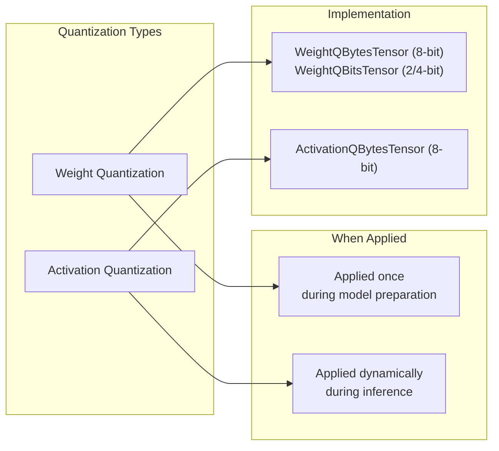
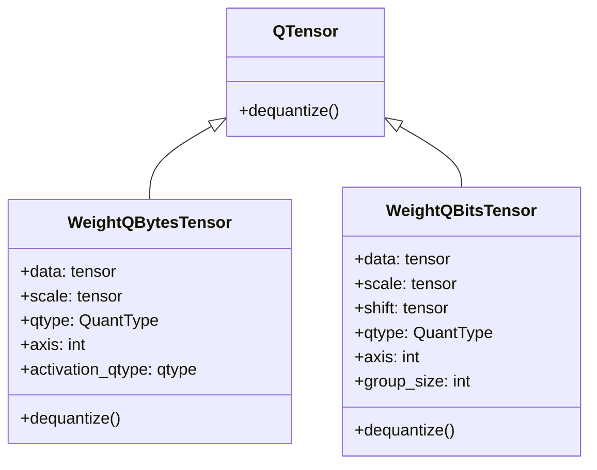
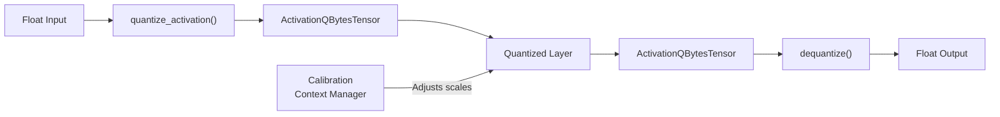
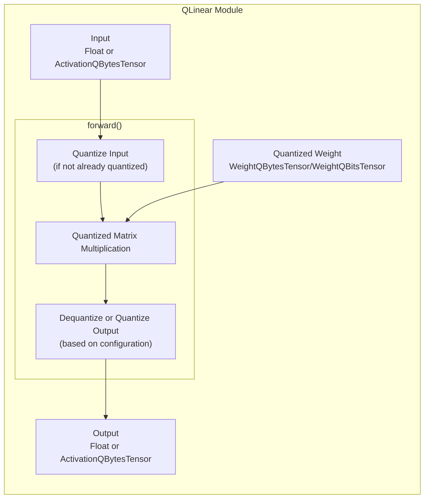
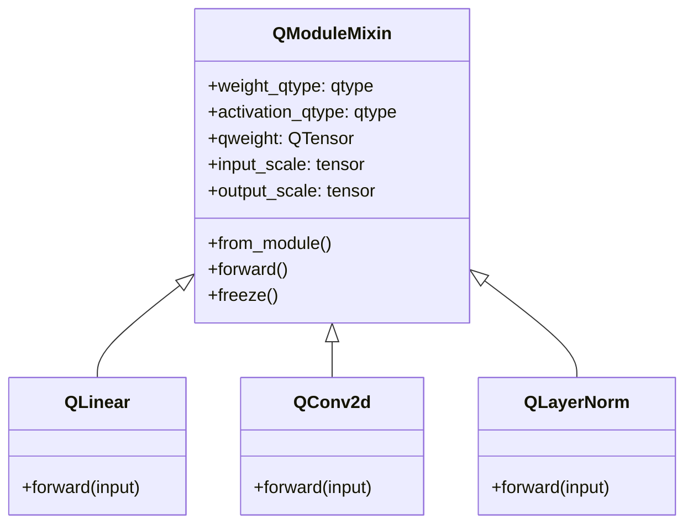
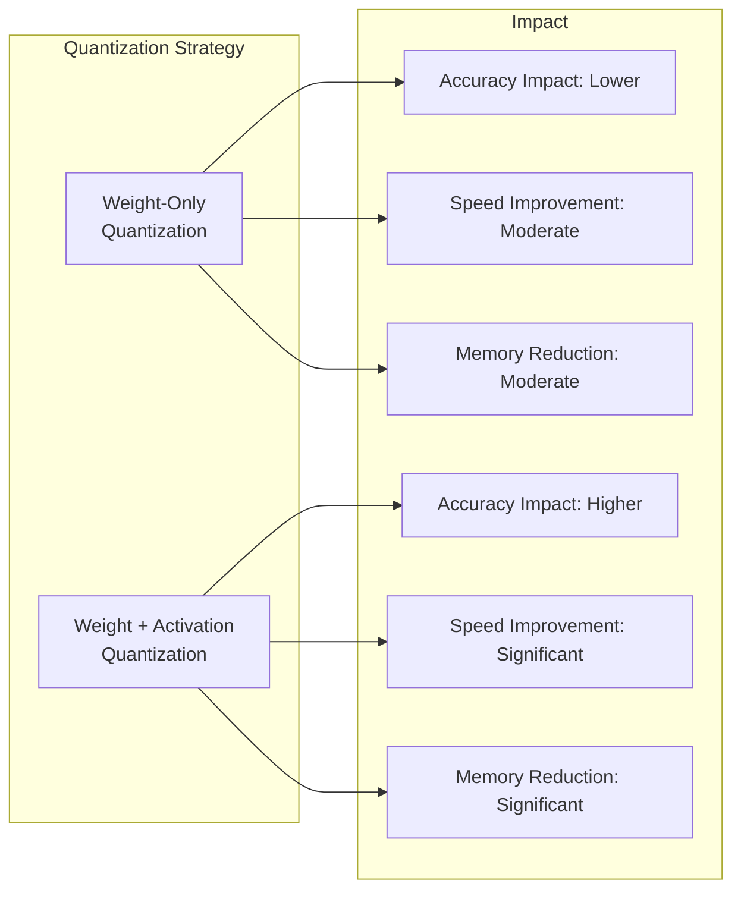

<!-- source: DeepWiki mcp.deepwiki.com · repo huggingface/optimum-quanto · page 3.2 Weight vs Activation Quantization · fetched 2026-10-26 -->

# Weight vs Activation Quantization

<details>
<summary>Relevant source files</summary>

The following files were used as context for generating this wiki page:

- [optimum/quanto/tensor/activations/qbytes.py](optimum/quanto/tensor/activations/qbytes.py)
- [optimum/quanto/tensor/function.py](optimum/quanto/tensor/function.py)
- [optimum/quanto/tensor/weights/qbits.py](optimum/quanto/tensor/weights/qbits.py)
- [optimum/quanto/tensor/weights/qbytes.py](optimum/quanto/tensor/weights/qbytes.py)
- [optimum/quanto/tensor/weights/quantization.py](optimum/quanto/tensor/weights/quantization.py)
- [test/library/test_quantize.py](test/library/test_quantize.py)
- [test/nn/test_calibrate.py](test/nn/test_calibrate.py)
- [test/nn/test_qattention.py](test/nn/test_qattention.py)
- [test/nn/test_qconv2d.py](test/nn/test_qconv2d.py)
- [test/nn/test_qlayernorm.py](test/nn/test_qlayernorm.py)
- [test/nn/test_qlinear.py](test/nn/test_qlinear.py)
- [test/quantize/test_quantize_mlp.py](test/quantize/test_quantize_mlp.py)
- [test/tensor/activations/test_activations_quantize.py](test/tensor/activations/test_activations_quantize.py)
- [test/tensor/weights/test_weight_qbytes_tensor_quantize.py](test/tensor/weights/test_weight_qbytes_tensor_quantize.py)

</details>


This page explains the key differences between weight quantization and activation quantization in optimum-quanto, how they are implemented, and how they work together to create efficient quantized models.

## Overview

Quantization in neural networks involves two primary components: weights (model parameters) and activations (layer inputs/outputs). While both share the goal of reducing precision to improve efficiency, they differ in implementation, timing, and optimization techniques.



Sources: [optimum/quanto/tensor/weights/qbytes.py](), [optimum/quanto/tensor/weights/qbits.py](), [optimum/quanto/tensor/activations/qbytes.py]()

## Weight Quantization

Weight quantization targets the model's parameters, which are static after training. In optimum-quanto, weights can be quantized to various bit precisions:

- 8-bit quantization using `WeightQBytesTensor`
- 2-bit and 4-bit quantization using `WeightQBitsTensor`



Sources: [optimum/quanto/tensor/weights/qbytes.py:85-276](), [optimum/quanto/tensor/weights/qbits.py:65-302]()

### Key Characteristics of Weight Quantization

1. **Quantization Axis**: Weights are typically quantized along specific dimensions (axis=0 for output features or axis=-1 for input features)
   
2. **Group Size**: For lower bit precision (2/4-bit), weights can be quantized in groups to maintain accuracy
   
3. **Static**: Applied once during model preparation and remains unchanged during inference
   
4. **Hardware Optimizations**: Can be specialized for different hardware (AWQ, Marlin FP8, TinyGemm)

Weight quantization is performed using the `quantize_weight` function:

```python
# Simplified usage pattern for weight quantization
quantize_weight(
    weight_tensor, 
    qtype=qint4,              # Quantization type (qint2, qint4, qint8, qfloat8)
    axis=0,                   # Quantization axis (0 or -1)
    scale=scale_tensor,       # Scaling factors
    shift=shift_tensor,       # Only needed for <8-bit quantization
    group_size=128,           # Only used for <8-bit quantization
    activation_qtype=None     # Optional hint about activation quantization
)
```

Sources: [optimum/quanto/tensor/weights/quantization.py:27-73]()

## Activation Quantization

Activation quantization targets the inputs and outputs of neural network layers during inference. In optimum-quanto, activations are quantized using `ActivationQBytesTensor`.



Sources: [optimum/quanto/tensor/activations/qbytes.py:46-92](), [test/nn/test_calibrate.py:23-61]()

### Key Characteristics of Activation Quantization

1. **Per-Tensor Scaling**: Typically applied using a single scale for the entire tensor
   
2. **Dynamic**: Applied during inference, with scales potentially adjusted based on actual data
   
3. **Calibration**: Requires a calibration phase to determine appropriate scaling factors
   
4. **Supported Types**: Currently supports 8-bit integer and 8-bit floating point formats

Activation quantization is controlled through the `Calibration` context manager, which collects statistics to determine appropriate scaling factors:

```python
# Simplified usage pattern for activation quantization
with Calibration():
    # First pass to collect statistics and set scales
    output = model(inputs)

# Subsequent inferences use the calibrated scales
quantized_output = model(inputs) 
```

Sources: [test/nn/test_calibrate.py:23-40](), [test/quantize/test_quantize_mlp.py:71-77]()

## Comparison Between Weight and Activation Quantization

| Aspect | Weight Quantization | Activation Quantization |
|--------|---------------------|-------------------------|
| Target | Model parameters (weights) | Layer inputs/outputs |
| When Applied | During model preparation | During inference |
| Implementation | `WeightQBytesTensor`, `WeightQBitsTensor` | `ActivationQBytesTensor` |
| Bit Precision | 2-bit, 4-bit, 8-bit | 8-bit |
| Supported Types | Integer, Floating-point | Integer, Floating-point |
| Scaling Method | Per-axis, Per-group | Per-tensor |
| Overhead | One-time cost | Runtime cost |
| Memory Impact | Reduced model size | Reduced activation memory |
| Hardware Support | Specialized kernels for various hardware | Device-dependent |

Sources: [test/nn/test_qlinear.py:37-57](), [test/nn/test_calibrate.py:23-40]()

## How They Work Together

Weight and activation quantization often work together in a quantized model. The following diagram illustrates their interaction within a quantized linear layer:



Sources: [test/nn/test_qlinear.py:37-57](), [test/nn/test_calibrate.py:23-40]()

The quantized module architecture in optimum-quanto supports both weight-only quantization and combined weight and activation quantization:



Sources: [test/nn/test_qlinear.py:37-57](), [test/nn/test_qconv2d.py:31-51](), [test/nn/test_qlayernorm.py:23-41]()

## Implementation Impact

The choice between weight-only and weight+activation quantization affects both accuracy and performance:



Sources: [test/quantize/test_quantize_mlp.py:83-116]()

## Practical Usage

Here's how both types of quantization are typically used together in optimum-quanto:

1. **Model Preparation**:
   - Quantize model weights to lower precision (4-bit or 8-bit)
   - Freeze the model to convert weights to quantized tensors

2. **Calibration**:
   - Run representative inputs through the model with `Calibration()` context
   - This sets appropriate scaling factors for activations

3. **Inference**:
   - Input tensors are dynamically quantized
   - Computations happen in low precision
   - Output can remain quantized or be dequantized based on needs

Example pattern for a model with both weight and activation quantization:

```python
# Prepare model with both weight and activation quantization
model = ...
quantize(model, weights=qint8, activations=qint8)
freeze(model)

# Calibration phase to set activation scales
with Calibration():
    model(calibration_inputs)

# Inference with quantized weights and activations
output = model(inputs)  # output is ActivationQBytesTensor if activations=qint8
```

Sources: [test/quantize/test_quantize_mlp.py:63-81]()

## Summary

Weight and activation quantization in optimum-quanto provide complementary approaches to model optimization:

- **Weight quantization** reduces model size and improves inference speed by storing parameters in lower precision.
- **Activation quantization** further improves performance by computing intermediate values in lower precision.

The framework allows flexible configuration of both, enabling users to make appropriate trade-offs between accuracy and efficiency based on their specific requirements and hardware limitations.

---

