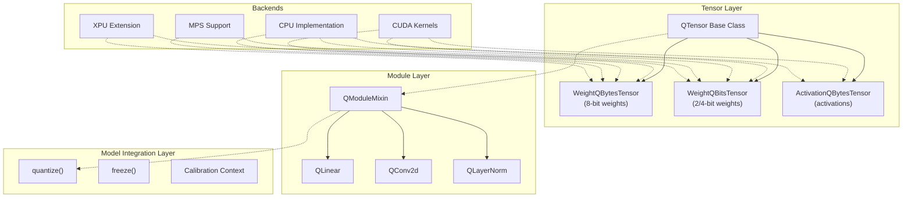
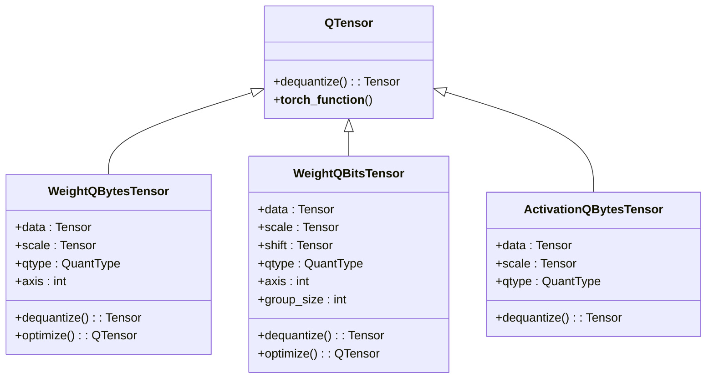
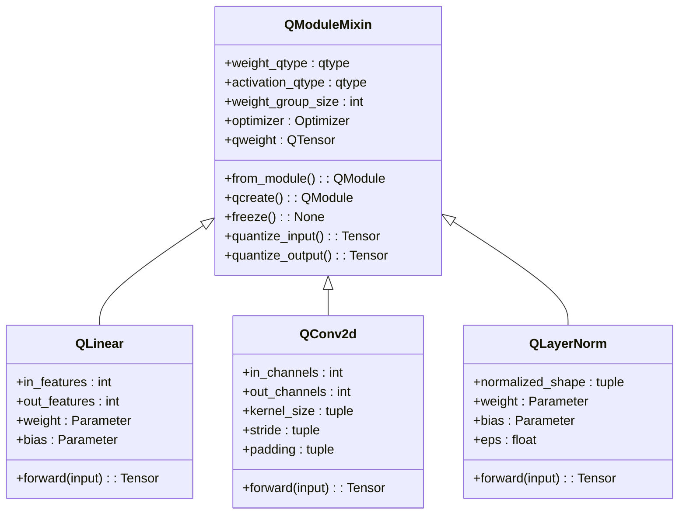
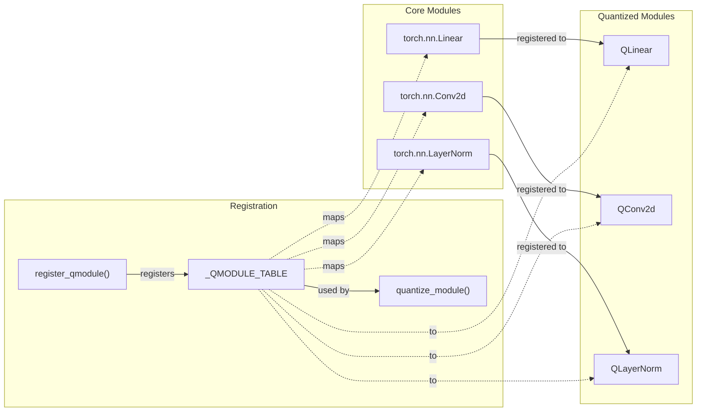
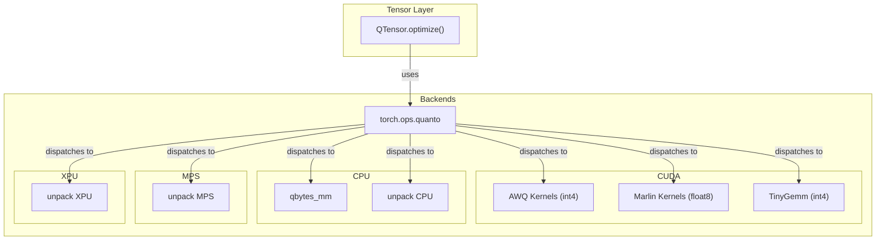
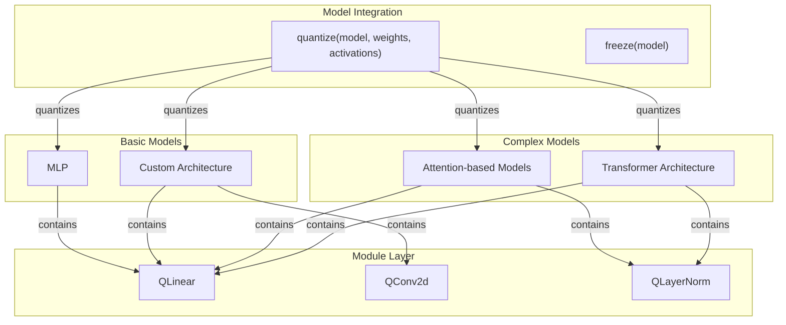
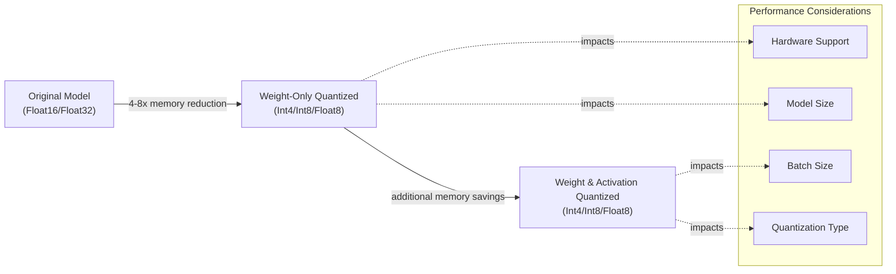

<!-- source: DeepWiki mcp.deepwiki.com · repo huggingface/optimum-quanto · page 4 System Architecture · fetched 2026-10-26 -->

# System Architecture

Relevant source files

The following files were used as context for generating this wiki page:

- [optimum/quanto/nn/qconv2d.py](optimum/quanto/nn/qconv2d.py)
- [optimum/quanto/nn/qlayernorm.py](optimum/quanto/nn/qlayernorm.py)
- [optimum/quanto/nn/qlinear.py](optimum/quanto/nn/qlinear.py)
- [optimum/quanto/nn/qmodule.py](optimum/quanto/nn/qmodule.py)
- [test/library/test_quantize.py](test/library/test_quantize.py)
- [test/nn/test_calibrate.py](test/nn/test_calibrate.py)
- [test/nn/test_qattention.py](test/nn/test_qattention.py)
- [test/nn/test_qconv2d.py](test/nn/test_qconv2d.py)
- [test/nn/test_qlayernorm.py](test/nn/test_qlayernorm.py)
- [test/nn/test_qlinear.py](test/nn/test_qlinear.py)
- [test/quantize/test_quantize_mlp.py](test/quantize/test_quantize_mlp.py)
- [test/tensor/activations/test_activations_quantize.py](test/tensor/activations/test_activations_quantize.py)
- [test/tensor/test_absmax.py](test/tensor/test_absmax.py)
- [test/tensor/weights/test_weight_qbytes_tensor_quantize.py](test/tensor/weights/test_weight_qbytes_tensor_quantize.py)

This document provides a comprehensive overview of the optimum-quanto system architecture. It explains the core components, their interactions, and how they work together to provide efficient model quantization. For specific details about quantization types, see [Quantization Types](#3.1), and for information about the differences between weight and activation quantization, see [Weight vs Activation Quantization](#3.2).

## Core Architecture Overview

Optimum-Quanto is structured as a layered system that enables quantization at different levels: tensors, modules, and models. Each layer builds on the one below to provide increasingly higher-level functionality.

Sources:
- [optimum/quanto/nn/qmodule.py:37-43]()
- [optimum/quanto/nn/qlinear.py:23-26]()
- [optimum/quanto/nn/qconv2d.py:23-26]()
- [optimum/quanto/nn/qlayernorm.py:23-26]()

## Tensor Quantization Architecture

The tensor layer forms the foundation of optimum-quanto, providing the basic data structures for quantized values.

### Tensor Types

- **QTensor**: Abstract base class for all quantized tensors
- **WeightQBytesTensor**: Represents 8-bit quantized weights (int8, float8)
- **WeightQBitsTensor**: Represents low-bit quantized weights (int2, int4)
- **ActivationQBytesTensor**: Represents quantized activations (int8, float8)

Each tensor type implements quantization, dequantization, and optimization methods specific to its use case.

Sources:
- [test/tensor/weights/test_weight_qbytes_tensor_quantize.py:30-71]()
- [test/tensor/activations/test_activations_quantize.py:30-61]()
- [test/library/test_quantize.py:32-103]()

## Module Quantization Architecture

The module layer provides quantized versions of PyTorch's standard modules, with the `QModuleMixin` class adding quantization functionality.

### Core Module Functionality

The `QModuleMixin` provides several key features:

1. **Dynamic Weight Quantization**: Quantizes weights on-the-fly during inference
2. **Weight and Activation Quantization Types**: Configurable quantization types
3. **Optimization Strategy**: Customizable quantization optimization (e.g., AbsmaxOptimizer, MaxOptimizer)
4. **Freezing**: Converting dynamically quantized modules to static quantized ones
5. **Serialization**: Custom state dict handling for quantized parameters

Sources:
- [optimum/quanto/nn/qmodule.py:94-310]()
- [optimum/quanto/nn/qlinear.py:27-50]()
- [optimum/quanto/nn/qconv2d.py:27-55]() 
- [optimum/quanto/nn/qlayernorm.py:27-53]()

## Quantization Registration System

Optimum-quanto uses a registration system to map PyTorch module types to their quantized equivalents, enabling automatic quantization of complex models.

The registration system enables:

1. **Automatic Module Replacement**: Converting standard PyTorch modules to quantized versions
2. **Extensibility**: Adding support for new module types
3. **Recursive Model Traversal**: Quantizing entire model architectures

Sources:
- [optimum/quanto/nn/qmodule.py:41-91]()
- [optimum/quanto/nn/qlinear.py:26-27]()
- [optimum/quanto/nn/qconv2d.py:26-27]()
- [optimum/quanto/nn/qlayernorm.py:26-27]()

## Quantization Workflow Architecture

The following diagram illustrates the typical workflow when using optimum-quanto, from the original float model to the loaded quantized model.

```mermaid
flowchart LR
    subgraph "1. Original Model"
        A1["Float32/Float16 Model"]
    end
    
    subgraph "2. Quantization"
        B1["quantize(model, weights=qint8)"]
        B2["Replace modules with quantized versions"]
        B3["Dynamic quantization during forward pass"]
        B1 --> B2 --> B3
    end
    
    subgraph "3. Calibration"
        C1["with Calibration():"]
        C2["Run representative inputs"]
        C3["Collect activation statistics"]
        C4["Set input_scale and output_scale"]
        C1 --> C2 --> C3 --> C4
    end
    
    subgraph "4. Freezing"
        D1["freeze(model)"]
        D2["Replace weights with QTensor"]
        D3["Optimize for target hardware"]
        D1 --> D2 --> D3
    end
    
    subgraph "5. Serialization & Loading"
        E1["save_pretrained()"]
        E2["from_pretrained()"]
        E1 --> E2
    end
    
    A1 --> B1
    B3 --> C1
    C4 --> D1
    D3 --> E1
```

### Key Workflow Stages

1. **Quantization**: Replace model modules with quantized versions that dynamically quantize weights
2. **Calibration**: Gather statistics on activations to set appropriate scaling factors
3. **Freezing**: Convert dynamic quantization to static quantization for inference efficiency
4. **Serialization & Loading**: Save and load quantized models with specialized formats

Sources:
- [test/nn/test_calibrate.py:23-101]()
- [test/quantize/test_quantize_mlp.py:63-146]()
- [test/nn/test_qlinear.py:196-227]()

## Device-Specific Backend Architecture

Optimum-quanto provides optimized implementations for different hardware platforms through its backend system.

### Backend Integration

The device-specific backends provide:

1. **Optimized Matrix Multiplication**: Hardware-specific implementations for quantized weights and activations
2. **Tensor Unpacking**: Efficient conversion between quantized and dequantized formats
3. **Specialized Kernels**: Implementations of algorithms like AWQ and Marlin
4. **Cross-Platform Support**: CUDA, CPU, MPS (Apple Silicon), and XPU (Intel GPUs)

These backends are exposed through the `torch.ops.quanto` namespace and are automatically selected based on the device the model is running on.

Sources:
- [test/nn/test_qlinear.py:124-129]()
- [test/nn/test_qattention.py:198-217]()
- [test/nn/test_qconv2d.py:82-104]()

## Model Integration Architecture

Optimum-quanto is designed to integrate seamlessly with higher-level model architectures, particularly those from the Hugging Face ecosystem.

### Integration Features

1. **Recursive Quantization**: Automatically handles nested module structures
2. **Mixed Precision Support**: Different quantization types for different parts of the model
3. **Architecture Preservation**: Maintains the original model architecture and interfaces
4. **Flexible Customization**: Allows specifying which modules to quantize and how

Sources:
- [test/nn/test_qattention.py:174-217]()
- [test/quantize/test_quantize_mlp.py:40-51]()

## Memory Efficiency and Performance

A key benefit of optimum-quanto is the reduction in memory usage and potential performance improvements.

### Key Performance Aspects

1. **Memory Reduction**: Significant memory savings, especially with 4-bit quantization
2. **Hardware Acceleration**: Specialized hardware support for different quantization types
3. **Throughput vs Accuracy**: Trade-offs between performance and model quality
4. **Hardware Selection**: Different devices have different optimal quantization strategies

Sources:
- [test/quantize/test_quantize_mlp.py:119-136]()

## Summary

The optimum-quanto architecture is designed as a layered system that provides flexible and efficient quantization capabilities at multiple levels:

1. **Tensor Layer**: Core quantized data structures
2. **Module Layer**: Quantized versions of standard PyTorch modules
3. **Model Integration**: Quantization of complete model architectures
4. **Device-Specific Backends**: Optimized implementations for different hardware

This architecture enables users to apply quantization to models with minimal changes to their workflow, while achieving significant memory savings and potential performance improvements, particularly on hardware with specialized support for quantized operations.

---

