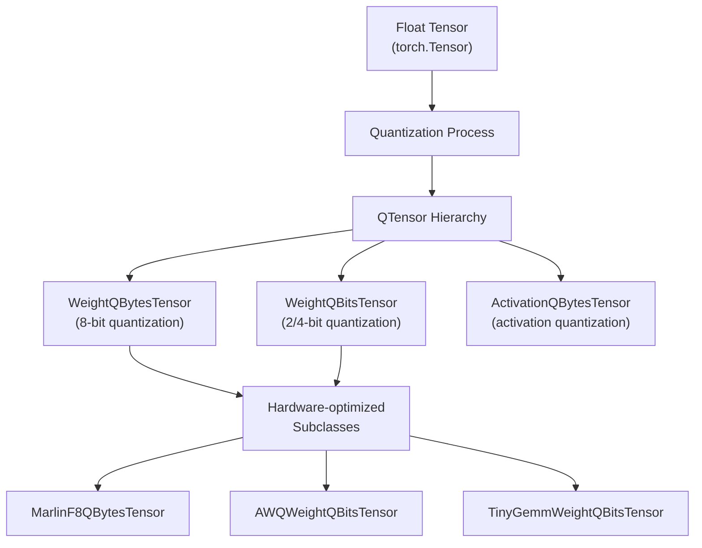
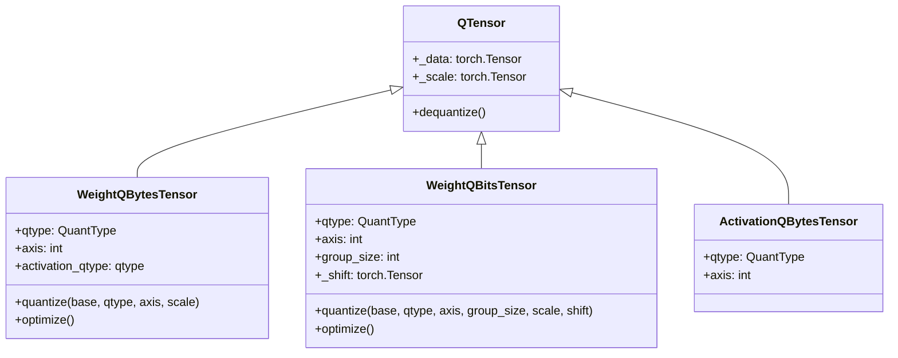
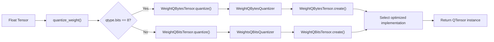
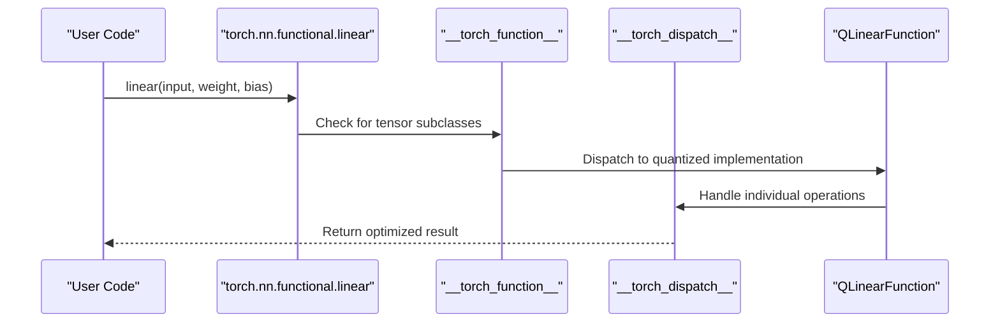
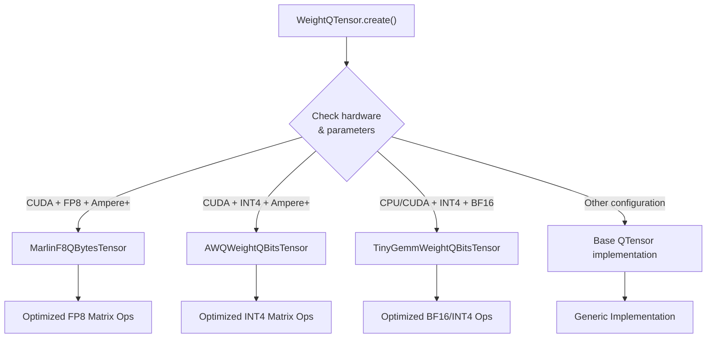
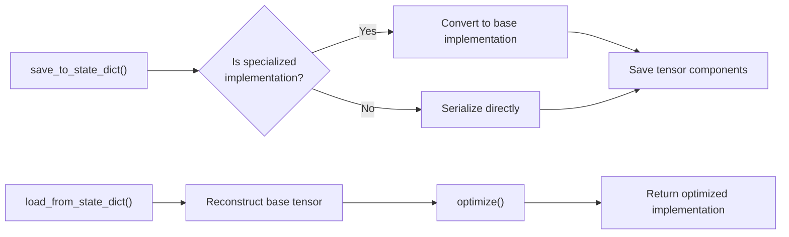

<!-- source: DeepWiki mcp.deepwiki.com · repo huggingface/optimum-quanto · page 4.1 Tensor Quantization · fetched 2026-10-26 -->

# Tensor Quantization

<details>
<summary>Relevant source files</summary>

The following files were used as context for generating this wiki page:

- [optimum/quanto/tensor/weights/qbits.py](optimum/quanto/tensor/weights/qbits.py)
- [optimum/quanto/tensor/weights/qbytes.py](optimum/quanto/tensor/weights/qbytes.py)
- [optimum/quanto/tensor/weights/quantization.py](optimum/quanto/tensor/weights/quantization.py)
- [test/tensor/ops/test_linear_dispatch.py](test/tensor/ops/test_linear_dispatch.py)
- [test/tensor/ops/test_mm_dispatch.py](test/tensor/ops/test_mm_dispatch.py)
- [test/tensor/test_absmax.py](test/tensor/test_absmax.py)

</details>


This document explains the core tensor quantization system in optimum-quanto, which provides the foundation for efficiently representing model weights and activations in reduced precision. Tensor quantization serves as the underlying infrastructure upon which module quantization (see [Module Quantization](#4.2)) and model integration (see [Model Integration](#4.3)) are built.

## Overview

Tensor quantization in optimum-quanto enables the conversion of standard floating-point PyTorch tensors into specialized quantized tensor formats that reduce memory footprint and increase computational efficiency. The library implements custom PyTorch tensor subclasses that handle quantization, dequantization, and efficient mathematical operations.



Sources: 
- [optimum/quanto/tensor/weights/qbytes.py:84-225](). 
- [optimum/quanto/tensor/weights/qbits.py:65-143]().

## Quantized Tensor Types

Optimum-quanto provides two primary categories of quantized tensors:

1. **Weight Tensors**: For model parameters (weights)
   - `WeightQBytesTensor`: 8-bit quantization (INT8, FLOAT8)
   - `WeightQBitsTensor`: Lower precision (INT2, INT4) with grouping support

2. **Activation Tensors**: For model activations/inputs
   - `ActivationQBytesTensor`: Used to quantize intermediate activations

Each tensor type offers specialized functionality for its intended use case, while sharing common interfaces for quantization and dequantization.



Sources:
- [optimum/quanto/tensor/weights/qbytes.py:85-157]()
- [optimum/quanto/tensor/weights/qbits.py:65-137]()

## Quantization Process

Quantization converts floating-point tensors to reduced-precision formats through a process of scaling and rounding. The main entry point for weight quantization is the `quantize_weight` function:



The quantization process involves:

1. **Scale Calculation**: Often using absmax scaling which determines the scaling factor
2. **Quantization**: Mapping floating-point values to integers
3. **Storage**: Efficiently packing quantized values (e.g., 4-bit values packed into 8-bit storage)
4. **Optimization Selection**: Choosing the most efficient backend implementation

Sources:
- [optimum/quanto/tensor/weights/quantization.py:27-73]()
- [optimum/quanto/tensor/weights/qbytes.py:31-65]()
- [optimum/quanto/tensor/weights/qbits.py:34-62]()

## Quantization Parameters

Quantization requires several parameters that control the process:

| Parameter | Description | Applies To |
|-----------|-------------|------------|
| `qtype` | Target quantization type (qint2, qint4, qint8, qfloat8) | All quantized tensors |
| `axis` | Dimension for per-axis quantization (0 or -1) | All quantized tensors |
| `scale` | Scaling factor(s) for quantization | All quantized tensors |
| `shift` | Zero-point or shift value | Required for WeightQBitsTensor |
| `group_size` | Number of elements in a quantization group | Used by WeightQBitsTensor |
| `activation_qtype` | Quantization type used for activations | Optional for WeightQBytesTensor |
| `optimized` | Whether to select optimized implementation | All quantized tensors |

The `absmax_scale` function is commonly used to calculate appropriate scaling factors:

```
scale = absmax_scale(tensor, qtype, axis)
```

Sources:
- [optimum/quanto/tensor/weights/quantization.py:27-73]()
- [test/tensor/test_absmax.py:22-42]()

## Operation Dispatching

Quantized tensors implement PyTorch's operator dispatch protocols to intercept and optimize operations such as matrix multiplication. This allows seamless integration with PyTorch operations while providing custom implementations.



The dispatch system works at two levels:
1. `__torch_function__`: Intercepts high-level functions like `torch.nn.functional.linear`
2. `__torch_dispatch__`: Handles lower-level ATEN operations like `matmul` and `mm`

Sources:
- [optimum/quanto/tensor/weights/qbytes.py:248-325]()
- [optimum/quanto/tensor/weights/qbits.py:247-302]()
- [test/tensor/ops/test_linear_dispatch.py:22-73]()
- [test/tensor/ops/test_mm_dispatch.py:22-44]()

## Hardware Optimization

Optimum-quanto automatically selects the most efficient tensor implementations based on hardware, quantization parameters, and available extensions:



Key optimization paths include:
- **Marlin**: Optimized for FP8 operations on NVIDIA Ampere+ GPUs
- **AWQ**: Optimized for INT4 quantization on NVIDIA Ampere+ GPUs
- **TinyGemm**: Optimized for BF16/INT4 operations on both CPU and NVIDIA GPUs

The `optimize()` method can be called on a base tensor to convert it to an optimized subclass after loading from storage.

Sources:
- [optimum/quanto/tensor/weights/qbytes.py:87-143]()
- [optimum/quanto/tensor/weights/qbits.py:67-123]()

## Serialization and Deserialization

Quantized tensors support serialization for model saving and loading. During serialization, specialized tensor subclasses are converted back to base implementations to ensure compatibility and portability.



The serialization process stores:
1. Quantized data tensors
2. Scale factors
3. Shift values (for sub-8-bit quantization)
4. Metadata (qtype, axis, group size)

Sources:
- [optimum/quanto/tensor/weights/qbytes.py:156-245]()
- [optimum/quanto/tensor/weights/qbits.py:151-245]()

## Usage Example

To quantize a tensor using the core tensor quantization system:

1. Calculate scale (and shift for sub-8-bit)
2. Quantize the tensor
3. Use the quantized tensor in operations

```python
# Calculate scale using absmax
scale = absmax_scale(weight_tensor, qint8, axis=0)

# Quantize the weight
qweight = quantize_weight(
    weight_tensor,
    qtype=qint8,
    axis=0,
    scale=scale
)

# Use in operations (automatically dispatched to optimized implementation)
output = torch.nn.functional.linear(input_tensor, qweight)
```

Sources:
- [optimum/quanto/tensor/weights/quantization.py:27-73]()
- [test/tensor/ops/test_linear_dispatch.py:22-44]()

---

