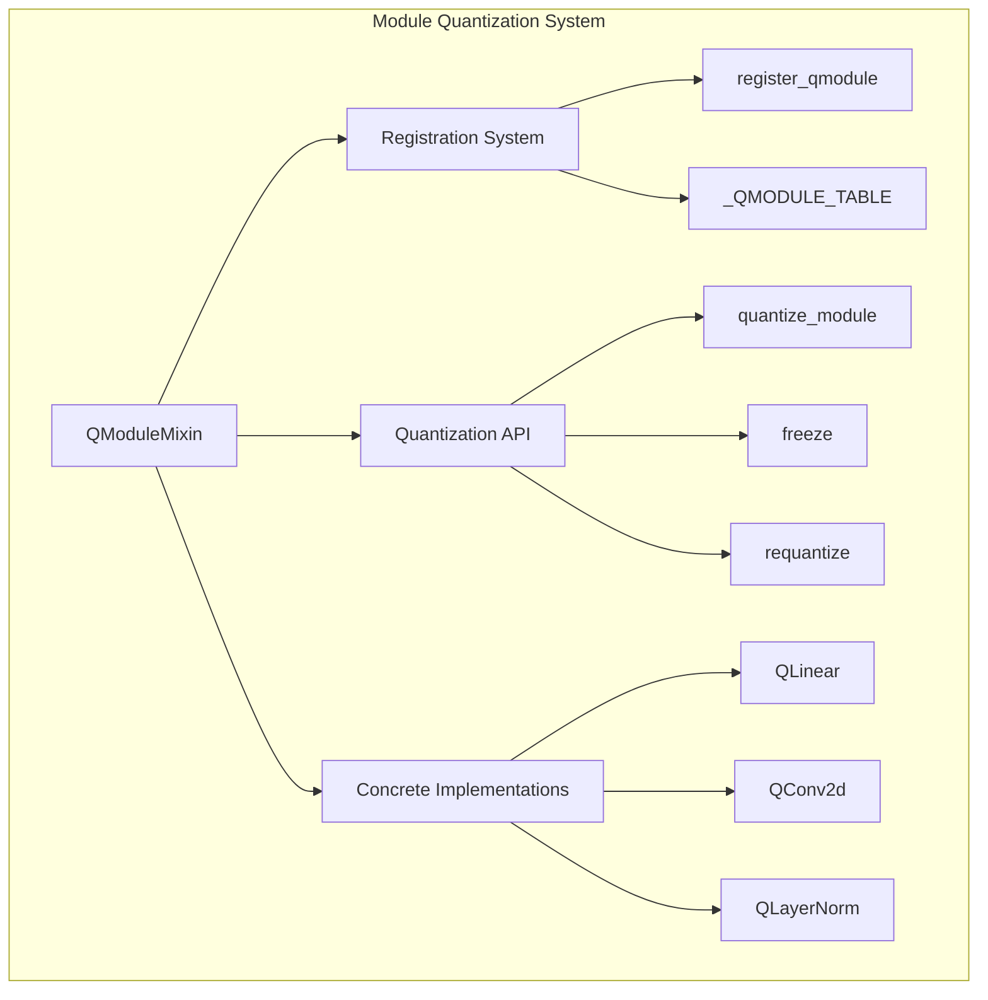
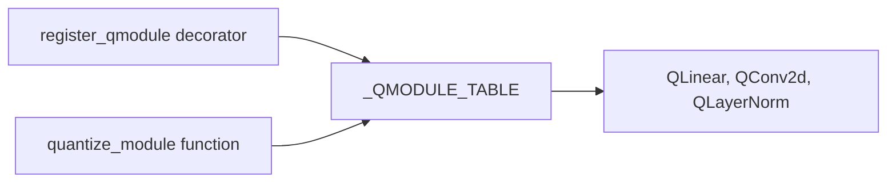
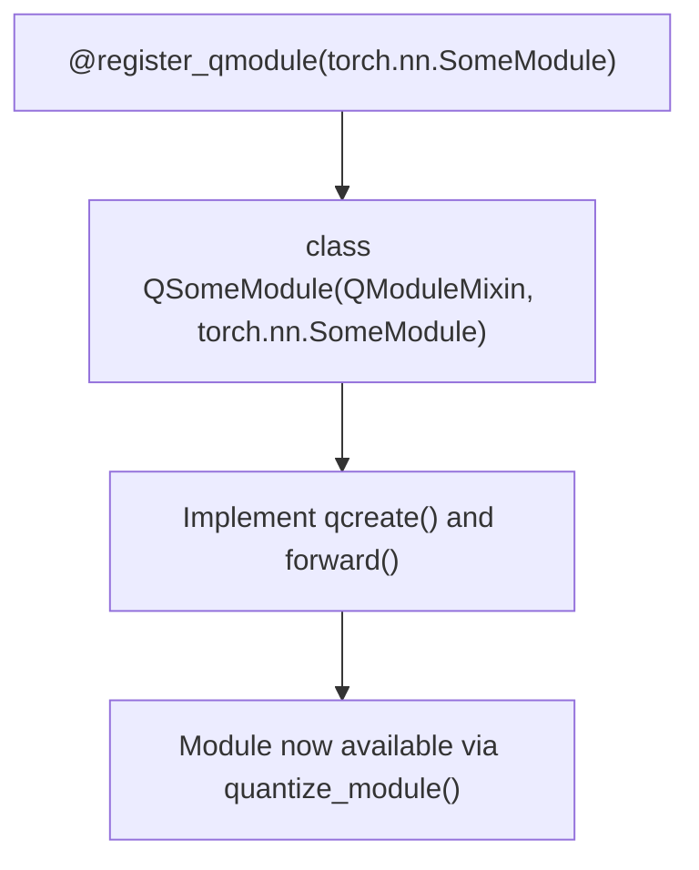
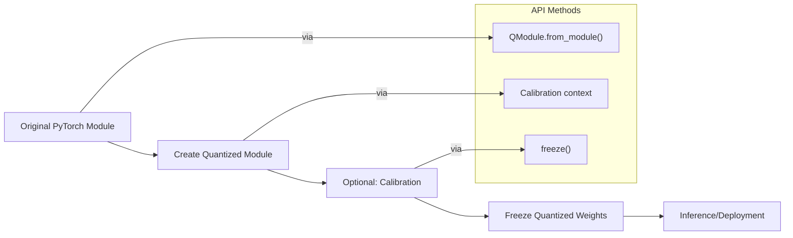
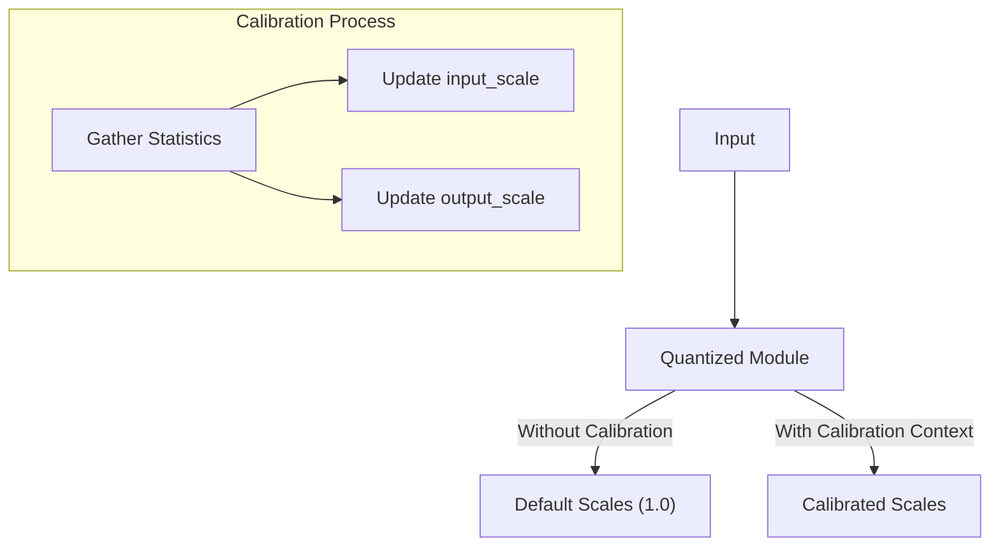
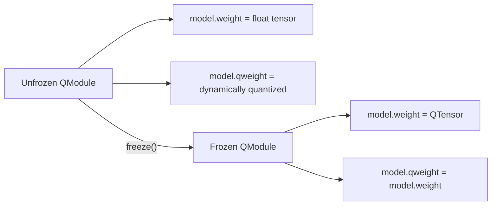
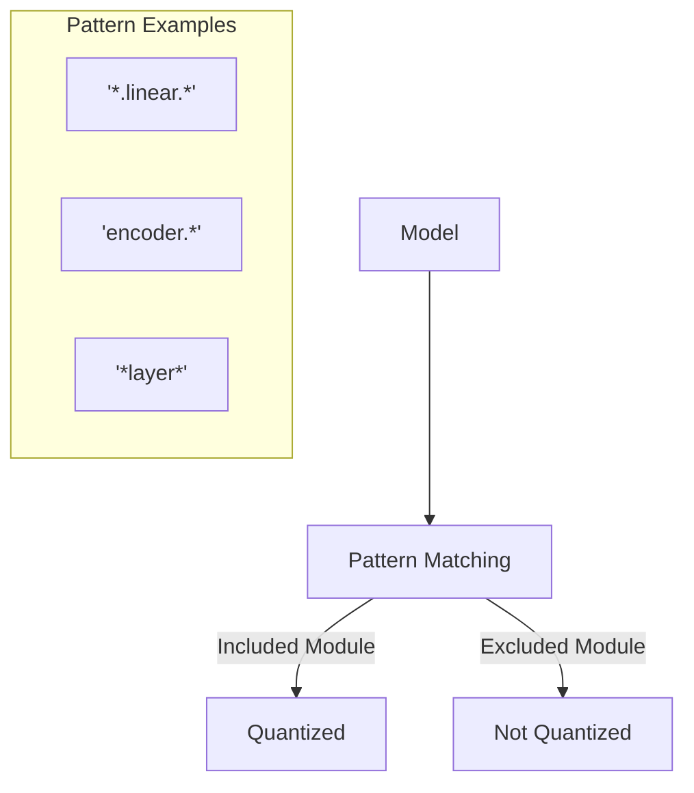
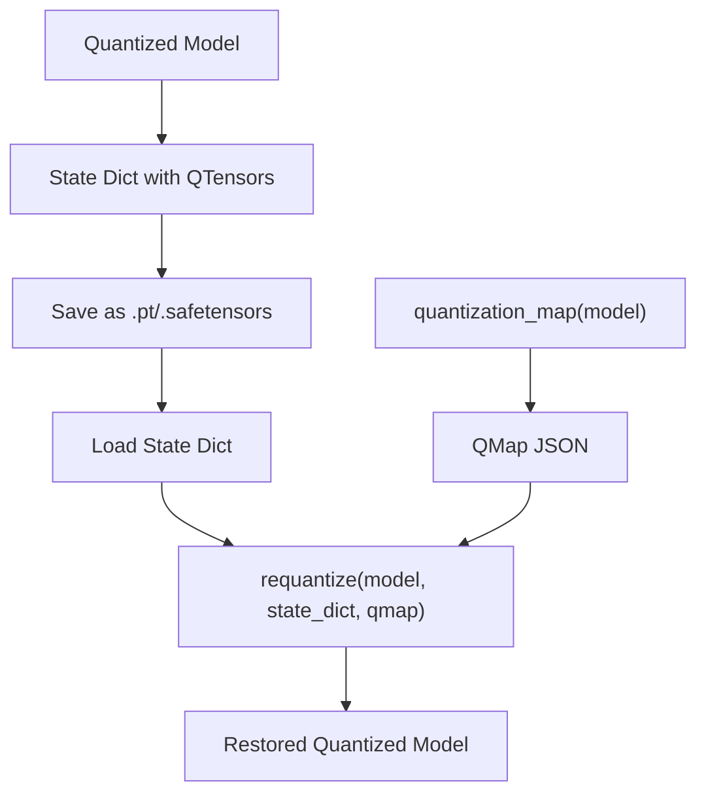
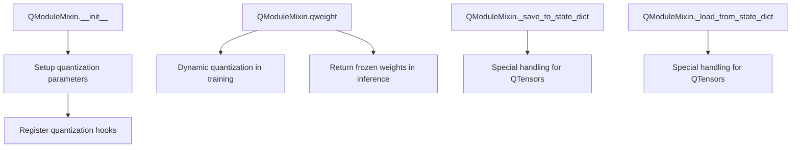

<!-- source: DeepWiki mcp.deepwiki.com · repo huggingface/optimum-quanto · page 4.2 Module Quantization · fetched 2026-10-26 -->

# Module Quantization

<details>
<summary>Relevant source files</summary>

The following files were used as context for generating this wiki page:

- [optimum/quanto/__init__.py](optimum/quanto/__init__.py)
- [optimum/quanto/nn/qconv2d.py](optimum/quanto/nn/qconv2d.py)
- [optimum/quanto/nn/qlayernorm.py](optimum/quanto/nn/qlayernorm.py)
- [optimum/quanto/nn/qlinear.py](optimum/quanto/nn/qlinear.py)
- [optimum/quanto/nn/qmodule.py](optimum/quanto/nn/qmodule.py)
- [optimum/quanto/quantize.py](optimum/quanto/quantize.py)
- [test/library/test_quantize.py](test/library/test_quantize.py)
- [test/nn/test_calibrate.py](test/nn/test_calibrate.py)
- [test/nn/test_qattention.py](test/nn/test_qattention.py)
- [test/nn/test_qconv2d.py](test/nn/test_qconv2d.py)
- [test/nn/test_qlayernorm.py](test/nn/test_qlayernorm.py)
- [test/nn/test_qlinear.py](test/nn/test_qlinear.py)
- [test/quantize/test_quantize_mlp.py](test/quantize/test_quantize_mlp.py)
- [test/quantize/test_quantize_patterns.py](test/quantize/test_quantize_patterns.py)
- [test/quantize/test_requantize.py](test/quantize/test_requantize.py)
- [test/tensor/activations/test_activations_quantize.py](test/tensor/activations/test_activations_quantize.py)
- [test/tensor/weights/test_weight_qbytes_tensor_quantize.py](test/tensor/weights/test_weight_qbytes_tensor_quantize.py)

</details>


This page documents the module quantization system in optimum-quanto, which allows you to convert standard PyTorch modules into their quantized counterparts. For information about tensor-level quantization, see [Tensor Quantization](#4.1), and for integrating quantized modules into larger models, see [Model Integration](#4.3).

## Overview

Module quantization provides a way to convert PyTorch modules (like Linear, Conv2d, and LayerNorm) into quantized versions that operate with reduced precision. The system consists of:

1. A registration mechanism for quantized modules
2. A mixin class that adds quantization capabilities to PyTorch modules
3. Concrete implementations for common module types
4. Utilities for module conversion, freezing, and serialization



Sources: [optimum/quanto/nn/qmodule.py](), [optimum/quanto/quantize.py]()

## Core Components

### QModuleMixin

The `QModuleMixin` is the foundation of module quantization in optimum-quanto. It adds quantization capabilities to PyTorch modules through the following features:

- Weight quantization (in various precisions)
- Activation quantization (optional)
- Forward pre/post hooks for quantizing inputs/outputs
- Serialization methods for quantized weights
- Methods for freezing quantized weights

```mermaid
classDiagram
    class QModuleMixin {
        +weight_qtype
        +activation_qtype
        +optimizer
        +input_scale
        +output_scale
        +qweight()
        +from_module()
        +freeze()
        +quantize_input()
        +quantize_output()
    }
    
    class torch.nn.Module {
        +forward()
        +parameters()
    }
    
    class "Quantized Module" {
        +forward()
        +qcreate()
    }
    
    torch.nn.Module <|-- QModuleMixin
    QModuleMixin <|-- "Quantized Module"
```

Sources: [optimum/quanto/nn/qmodule.py:94-310]()

### Registration System

The module registration system maintains a mapping between standard PyTorch modules and their quantized counterparts:



To register a new quantized module:



Sources: [optimum/quanto/nn/qmodule.py:41-91]()

## Quantized Module Types

Optimum-quanto provides quantized versions of common PyTorch modules:

### QLinear

Quantized version of `torch.nn.Linear`. Supports both weight quantization and activation quantization.

```python
# Example usage
linear = torch.nn.Linear(768, 768)
qlinear = QLinear.from_module(linear, weights=qint8, activations=None)
```

Sources: [optimum/quanto/nn/qlinear.py](), [test/nn/test_qlinear.py]()

### QConv2d

Quantized version of `torch.nn.Conv2d`. Supports both weight quantization and activation quantization.

```python
# Example usage
conv = torch.nn.Conv2d(3, 64, kernel_size=3)
qconv = QConv2d.from_module(conv, weights=qint4, activations=qint8)
```

Sources: [optimum/quanto/nn/qconv2d.py](), [test/nn/test_qconv2d.py]()

### QLayerNorm

Quantized version of `torch.nn.LayerNorm`. Primarily supports activation quantization rather than weight quantization.

```python
# Example usage
norm = torch.nn.LayerNorm(768)
qnorm = QLayerNorm.from_module(norm, activations=qint8)
```

Sources: [optimum/quanto/nn/qlayernorm.py](), [test/nn/test_qlayernorm.py]()

## Module Quantization Workflow

The typical workflow for quantizing modules involves these main steps:



Sources: [optimum/quanto/quantize.py](), [test/nn/test_calibrate.py]()

### Module Creation

Quantized modules are created from standard PyTorch modules using the `from_module` class method or the `quantize` function for bulk conversion:

```python
# Individual module quantization
qlinear = QLinear.from_module(linear, weights=qint8)

# Bulk model quantization
quantize(model, weights=qint8, include="*.attention.*")
```

The quantization process preserves the original module's weights while adding quantization capabilities.

Sources: [optimum/quanto/nn/qmodule.py:209-233](), [optimum/quanto/quantize.py:55-98]()

### Activation Calibration

When using activation quantization, modules need to be calibrated to determine appropriate scaling factors:



Example calibration code:

```python
# Calibration for activation quantization
with Calibration():
    outputs = model(inputs)
```

Sources: [test/nn/test_calibrate.py]()

### Freezing Quantized Weights

Freezing replaces the floating-point weights with their quantized counterparts to reduce memory usage:



Example freezing code:

```python
# Freeze all quantized modules in a model
freeze(model)
```

Sources: [optimum/quanto/nn/qmodule.py:302-307](), [optimum/quanto/quantize.py:143-146]()

## Selective Module Quantization

The `quantize` function allows for selective quantization of modules using include/exclude patterns:



Pattern matching uses Unix shell-style wildcards (not regular expressions):

```python
# Only quantize linear layers
quantize(model, weights=qint8, include="*.linear*")

# Quantize everything except normalization layers
quantize(model, weights=qint8, exclude="*norm*")
```

Sources: [optimum/quanto/quantize.py:55-98](), [test/quantize/test_quantize_patterns.py]()

## Model Serialization and Loading

Quantized models can be serialized and loaded using the PyTorch serialization mechanism with additional support for quantized tensors:



Example serialization workflow:

```python
# Save a quantized model
qmap = quantization_map(model)
torch.save(model.state_dict(), "model.pt")
with open("qmap.json", "w") as f:
    json.dump(qmap, f)

# Load a quantized model
state_dict = torch.load("model.pt")
requantize(model, state_dict, qmap)
```

Sources: [optimum/quanto/quantize.py:101-170](), [test/quantize/test_requantize.py]()

## Implementation Details

### QModuleMixin Implementation

The `QModuleMixin` class handles the complexities of quantized module creation, quantization, and serialization:



Key points:
- The `qweight` property dynamically quantizes weights during training
- Hooks are registered for input/output quantization when using activation quantization
- Special serialization methods handle the flattening/unflattening of QTensors

Sources: [optimum/quanto/nn/qmodule.py:94-310]()

### Module Registration Implementation

The registration system uses a Python decorator to populate a mapping table:

```python
@register_qmodule(torch.nn.Linear)
class QLinear(QModuleMixin, torch.nn.Linear):
    # Implementation
```

This allows the `quantize_module` function to look up the appropriate quantized module type for a given PyTorch module.

Sources: [optimum/quanto/nn/qmodule.py:44-78]()

## Common Usage Patterns

### Weight-Only Quantization

Quantize only the weights of modules, leaving activations in floating-point:

```python
# Weight-only quantization with int8
quantize(model, weights=qint8, activations=None)
```

This is typically the most stable form of quantization with minimal accuracy impact.

Sources: [test/quantize/test_quantize_mlp.py:83-86]()

### Weight and Activation Quantization

Quantize both weights and activations (requires calibration):

```python
# Quantize weights to int8 and activations to int8
quantize(model, weights=qint8, activations=qint8)

# Calibrate the model
with Calibration():
    model(inputs)
```

This provides more memory savings and performance improvements but may impact accuracy more significantly.

Sources: [test/quantize/test_quantize_mlp.py:97-116]()

### Mixed-Precision Quantization

Different quantization types can be used for different parts of the model:

```python
# Quantize attention layers to 4-bit
quantize(model, weights=qint4, include="*attention*")

# Quantize feedforward layers to 8-bit
quantize(model, weights=qint8, include="*feed_forward*")
```

This allows for more flexible performance-accuracy trade-offs.

Sources: [test/quantize/test_quantize_patterns.py]()

## Custom Quantized Modules

To create a custom quantized module:

1. Create a class that inherits from both `QModuleMixin` and the PyTorch module
2. Implement the `qcreate` class method to instantiate the module
3. Implement the `forward` method for quantized inference
4. Register the module using the `register_qmodule` decorator

Example template:

```python
@register_qmodule(torch.nn.SomeModule)
class QSomeModule(QModuleMixin, torch.nn.SomeModule):
    @classmethod
    def qcreate(cls, module, weights, activations, optimizer, device):
        # Create a new instance with appropriate parameters
        return cls(...)
        
    def forward(self, input):
        # Implementation using self.qweight
        return result
```

Sources: [optimum/quanto/nn/qmodule.py:44-78]()

## Conclusion

The module quantization system in optimum-quanto provides a flexible framework for converting PyTorch modules to quantized versions. By supporting various quantization types, selective quantization patterns, and both weight and activation quantization, it enables efficient deployment of models with reduced memory and computational requirements.

For deeper integration with model architectures like transformers or diffusers, refer to [Model Integration](#4.3).

---

