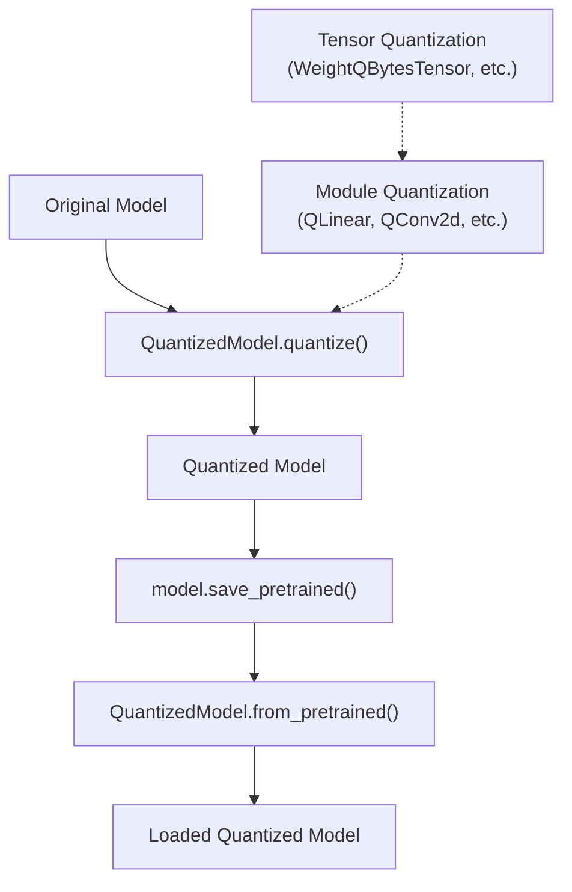
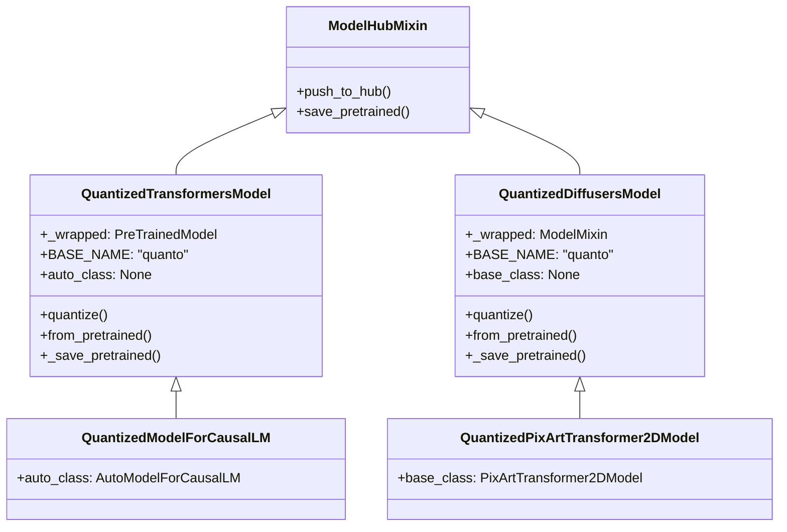
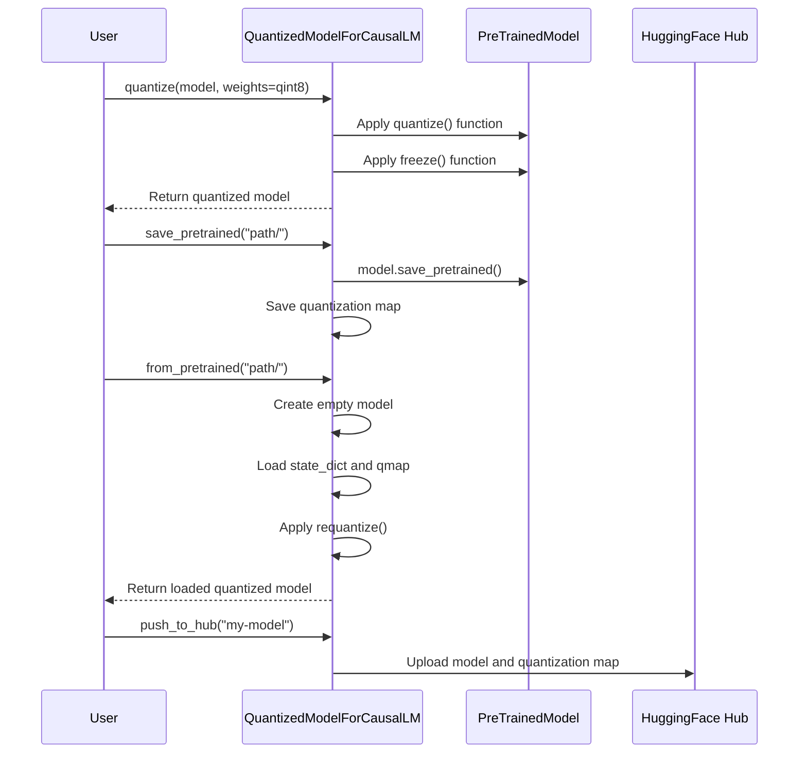
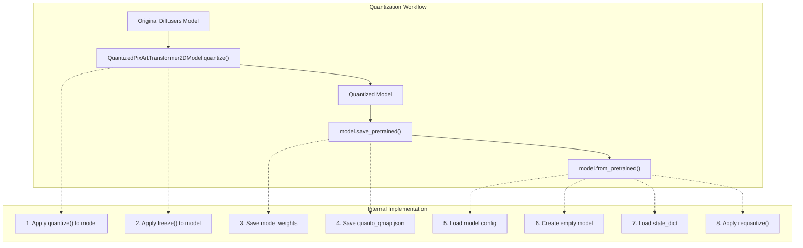
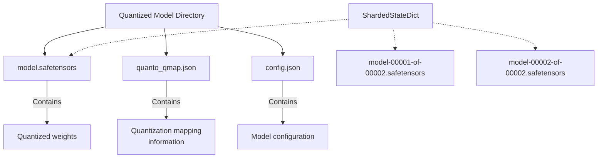
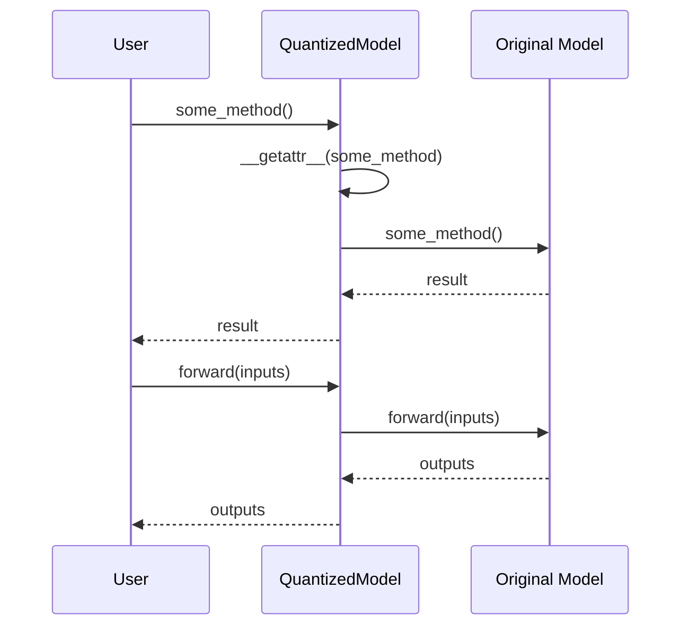
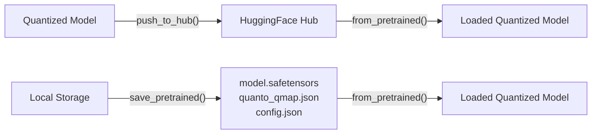

<!-- source: DeepWiki mcp.deepwiki.com · repo huggingface/optimum-quanto · page 4.3 Model Integration · fetched 2026-10-26 -->

# Model Integration

<details>
<summary>Relevant source files</summary>

The following files were used as context for generating this wiki page:

- [optimum/quanto/models/__init__.py](optimum/quanto/models/__init__.py)
- [optimum/quanto/models/diffusers_models.py](optimum/quanto/models/diffusers_models.py)
- [optimum/quanto/models/shared_dict.py](optimum/quanto/models/shared_dict.py)
- [optimum/quanto/models/transformers_models.py](optimum/quanto/models/transformers_models.py)
- [test/helpers.py](test/helpers.py)
- [test/models/conftest.py](test/models/conftest.py)
- [test/models/test_quantized_model_for_causal_lm.py](test/models/test_quantized_model_for_causal_lm.py)
- [test/models/test_quantized_model_for_pixart.py](test/models/test_quantized_model_for_pixart.py)

</details>


This page describes how Optimum-Quanto integrates with popular model frameworks such as HuggingFace Transformers and Diffusers. It explains the architecture and classes used to provide quantization capabilities to these models, enabling smaller model sizes and faster inference. For information about the core quantization techniques, see [Tensor Quantization](#4.1) and [Module Quantization](#4.2).

## Overview

Optimum-Quanto provides specialized wrapper classes that enable seamless integration with pre-existing model architectures from the HuggingFace ecosystem. These wrappers allow users to:

1. Quantize pre-trained models
2. Save quantized models to disk or the Hugging Face Hub
3. Load quantized models for inference
4. Access the original model's API through the wrapper

The integration follows a consistent pattern across different model frameworks:



Sources: [optimum/quanto/models/transformers_models.py:65-112](), [optimum/quanto/models/diffusers_models.py:67-116]()

## Integration Architecture

Optimum-Quanto's model integration consists of two primary wrapper classes:

1. `QuantizedTransformersModel` - Base class for Transformers integration
2. `QuantizedDiffusersModel` - Base class for Diffusers integration

These classes implement similar patterns but are tailored to their respective frameworks.



Sources: [optimum/quanto/models/transformers_models.py:38-184](), [optimum/quanto/models/diffusers_models.py:44-191]()

## Integration with Transformers

The `QuantizedTransformersModel` class provides a base for integrating with HuggingFace Transformers models. It follows a wrapper pattern, delegating most methods to the wrapped model while providing specialized functionality for quantization.

Key components:

1. `QuantizedTransformersModel.quantize()` - Static method to quantize a model in-place
2. `QuantizedTransformersModel.from_pretrained()` - Loads a quantized model from disk or the Hub
3. `QuantizedModelForCausalLM` - Specialized class for causal language models

### Quantization and Loading Workflow



Sources: [optimum/quanto/models/transformers_models.py:65-180](), [test/models/test_quantized_model_for_causal_lm.py:75-150]()

### Usage Example

The typical workflow for quantizing and using a Transformers model:

1. Load a pre-trained model
2. Quantize the model
3. Use the model or save it
4. Load the quantized model for inference

```python
# Import and quantize a model
from transformers import AutoModelForCausalLM
from optimum.quanto import QuantizedModelForCausalLM, qint8

model = AutoModelForCausalLM.from_pretrained("facebook/opt-125m")
quantized_model = QuantizedModelForCausalLM.quantize(model, weights=qint8)

# Save the model
quantized_model.save_pretrained("./quantized-opt-125m")

# Load the model
loaded_model = QuantizedModelForCausalLM.from_pretrained("./quantized-opt-125m")

# Use the model
inputs = tokenizer("Hello, world!", return_tensors="pt")
outputs = loaded_model(**inputs)
```

Sources: [test/models/test_quantized_model_for_causal_lm.py:11-46]()

## Integration with Diffusers

The `QuantizedDiffusersModel` class provides similar functionality for Diffusers models, with specialized implementations for specific model types like `QuantizedPixArtTransformer2DModel`.

Key components:

1. `QuantizedDiffusersModel.quantize()` - Static method to quantize a Diffusers model
2. `QuantizedDiffusersModel.from_pretrained()` - Loads a quantized model
3. `QuantizedPixArtTransformer2DModel` - Specialized class for PixArt models

### Diffusers Integration Workflow



Sources: [optimum/quanto/models/diffusers_models.py:72-178](), [test/models/test_quantized_model_for_pixart.py:11-37]()

### Saving and Loading

Both Transformers and Diffusers integration frameworks store quantization information in a `quanto_qmap.json` file alongside the model weights. This file contains the mapping of which layers have been quantized and with what quantization parameters.



Sources: [optimum/quanto/models/transformers_models.py:165-179](), [optimum/quanto/models/diffusers_models.py:180-186](), [optimum/quanto/models/shared_dict.py:22-54]()

## Shared Implementation

Both integration classes share similar patterns and functionality:

1. They both act as wrappers, delegating methods to the original model
2. They handle the quantization, serialization, and deserialization process
3. They both implement the `ModelHubMixin` interface for Hub integration

### Wrapper Pattern Implementation

The wrapper pattern allows the quantized model to maintain the same API as the original model while adding quantization-specific capabilities:



Sources: [optimum/quanto/models/transformers_models.py:47-62](), [optimum/quanto/models/diffusers_models.py:53-65]()

## Supported Models

Currently, Optimum-Quanto provides specialized integration for the following model types:

| Framework     | Model Type               | Quanto Class                      |
|---------------|--------------------------|-----------------------------------|
| Transformers  | Causal Language Models   | `QuantizedModelForCausalLM`       |
| Diffusers     | PixArt Transformer 2D    | `QuantizedPixArtTransformer2DModel` |

The architecture allows for easy extension to additional model types from both frameworks.

Sources: [optimum/quanto/models/transformers_models.py:182-183](), [optimum/quanto/models/diffusers_models.py:189-190]()

## HuggingFace Hub Integration

Both model integration classes implement the `ModelHubMixin` interface, which enables:

1. Pushing models to the Hub with `push_to_hub()`
2. Loading models from the Hub with `from_pretrained()`

The integration ensures that all quantization-specific information is correctly saved and loaded.



Sources: [test/models/test_quantized_model_for_causal_lm.py:106-128](), [test/models/test_quantized_model_for_pixart.py:92-112]()

## Implementation Details

### Requantization Process

When loading a quantized model, Optimum-Quanto uses a process called "requantization" to reconstruct the quantized tensors from the saved state:

1. Creates an empty model structure
2. Loads the quantization map
3. Applies the appropriate quantization to each layer based on the map
4. Loads the weights into the quantized structure

This process is handled by the `requantize()` function, which is called during `from_pretrained()`.

Sources: [optimum/quanto/models/transformers_models.py:114-162](), [optimum/quanto/models/diffusers_models.py:119-178]()

### Handling Sharded Models

For large models, Optimum-Quanto supports loading from sharded checkpoint files:

1. It detects if the model is sharded by looking for an index file
2. If sharded, it uses a `ShardedStateDict` to lazily load tensors
3. This allows efficient loading of large quantized models

Sources: [optimum/quanto/models/transformers_models.py:142-154](), [optimum/quanto/models/diffusers_models.py:161-173](), [optimum/quanto/models/shared_dict.py:22-54]()

---

