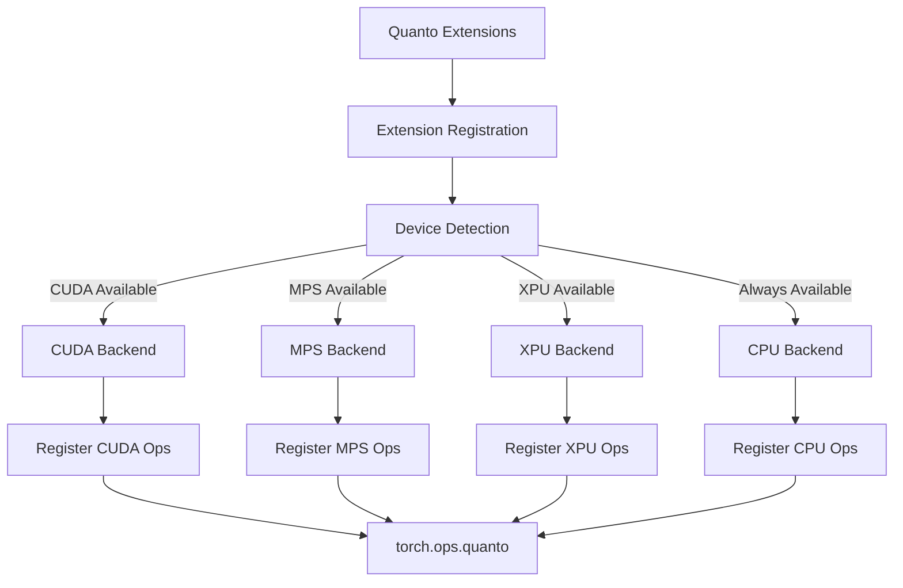
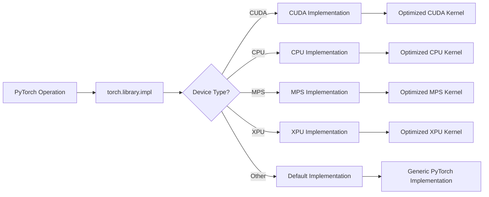
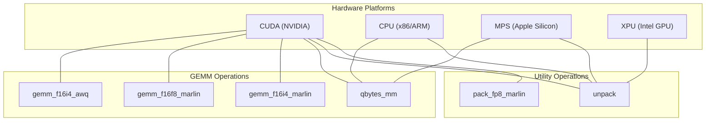
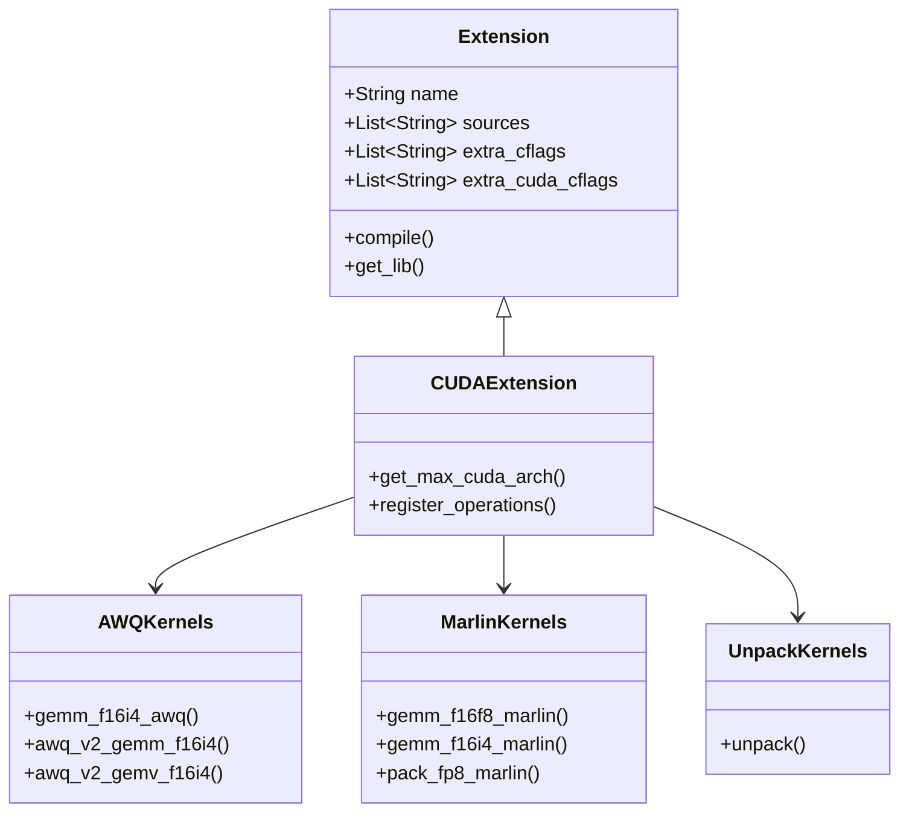
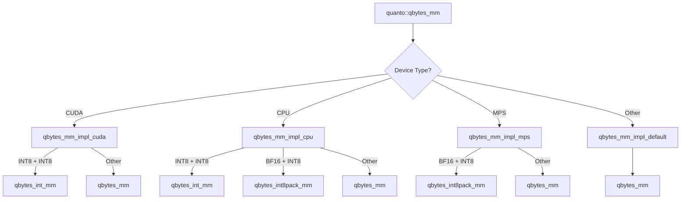
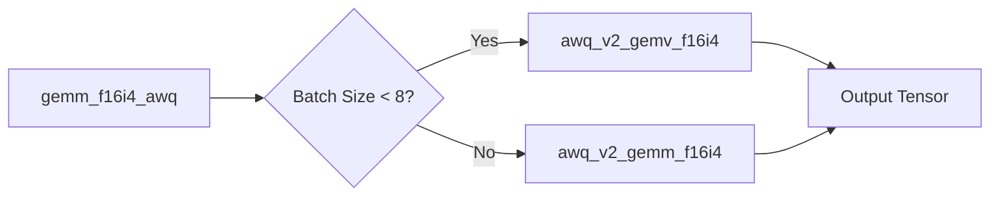
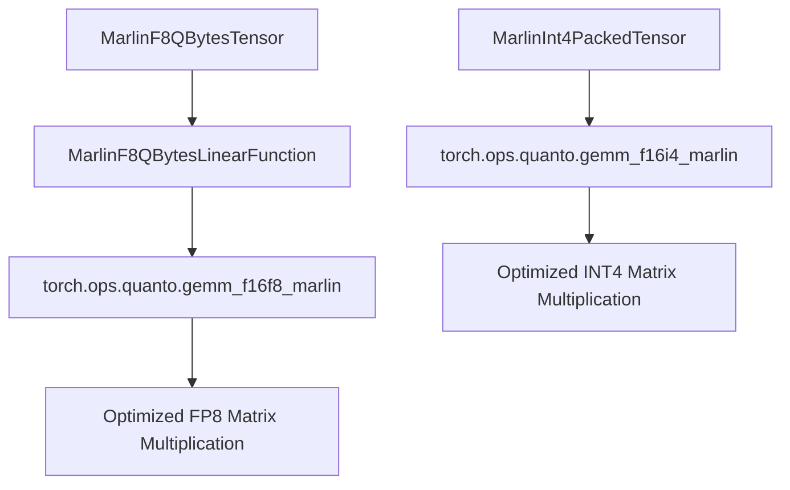

<!-- source: DeepWiki mcp.deepwiki.com · repo huggingface/optimum-quanto · page 4.4 Device-Specific Backends · fetched 2026-10-26 -->

# Device-Specific Backends

<details>
<summary>Relevant source files</summary>

The following files were used as context for generating this wiki page:

- [optimum/quanto/library/extensions/README.md](optimum/quanto/library/extensions/README.md)
- [optimum/quanto/library/extensions/__init__.py](optimum/quanto/library/extensions/__init__.py)
- [optimum/quanto/library/extensions/cuda/__init__.py](optimum/quanto/library/extensions/cuda/__init__.py)
- [optimum/quanto/library/extensions/xpu/__init__.py](optimum/quanto/library/extensions/xpu/__init__.py)
- [optimum/quanto/library/extensions/xpu/pybind_module.cpp](optimum/quanto/library/extensions/xpu/pybind_module.cpp)
- [optimum/quanto/library/extensions/xpu/unpack.h](optimum/quanto/library/extensions/xpu/unpack.h)
- [optimum/quanto/library/extensions/xpu/unpack.sycl](optimum/quanto/library/extensions/xpu/unpack.sycl)
- [optimum/quanto/library/qbytes_mm.py](optimum/quanto/library/qbytes_mm.py)
- [optimum/quanto/tensor/weights/marlin/fp8/__init__.py](optimum/quanto/tensor/weights/marlin/fp8/__init__.py)
- [optimum/quanto/tensor/weights/marlin/fp8/packed.py](optimum/quanto/tensor/weights/marlin/fp8/packed.py)
- [optimum/quanto/tensor/weights/marlin/fp8/qbits.py](optimum/quanto/tensor/weights/marlin/fp8/qbits.py)
- [test/library/test_extensions.py](test/library/test_extensions.py)
- [test/library/test_mm.py](test/library/test_mm.py)
- [test/tensor/weights/optimized/test_marlin_fp8_packed_tensor.py](test/tensor/weights/optimized/test_marlin_fp8_packed_tensor.py)

</details>


## Purpose and Scope

This page documents the device-specific backend implementations in optimum-quanto. These backends provide optimized implementations of core operations for different hardware platforms, ensuring efficient execution of quantized models across various devices. Each backend is tailored to the strengths and capabilities of its target hardware architecture.

For information about the tensor quantization system itself, see [Tensor Quantization](#4.1). For details on how modules use these backends, see [Module Quantization](#4.2).

## Backend Architecture Overview

Optimum-quanto implements a flexible extension system for device-specific backends. Each hardware platform has its own optimized implementation of core operations, registered through PyTorch's library dispatch mechanism.

### Extension Registration System



The extension registration system automatically detects available hardware and loads the appropriate backend implementations. All operations are exposed through the unified `torch.ops.quanto` namespace.

Sources: [optimum/quanto/library/extensions/__init__.py:15-44](), [optimum/quanto/library/extensions/extension.py]()

### Operation Dispatch Mechanism



Operations are registered with device-specific implementations using PyTorch's library dispatch system. When an operation is called, PyTorch automatically selects the appropriate implementation based on the device type of the input tensors.

Sources: [optimum/quanto/library/qbytes_mm.py:66-122](), [optimum/quanto/library/extensions/cuda/__init__.py:77-202]()

## Supported Hardware Platforms

### Overview of Supported Platforms

| Platform | Description | Key Features | Supported Precision Formats |
|----------|-------------|--------------|----------------------------|
| CUDA     | NVIDIA GPU support | Highly optimized kernels for matrix multiplication, AWQ, Marlin | INT2, INT4, INT8, FP8 |
| CPU      | x86/ARM processor support | Generic implementations with SIMD optimizations | INT2, INT4, INT8 |
| MPS      | Apple Silicon GPU support | Metal Performance Shaders integration | INT2, INT4, INT8 |
| XPU      | Intel GPU support | SYCL integration | INT2, INT4 |

Sources: [optimum/quanto/library/extensions/__init__.py:15-44](), [test/library/test_extensions.py:1-40]()

### Platform Compatibility Matrix



This diagram shows which operations are supported on each hardware platform. CUDA has the most comprehensive support, while other platforms support a subset of operations.

Sources: [optimum/quanto/library/extensions/cuda/__init__.py:77-202](), [optimum/quanto/library/qbytes_mm.py:66-122](), [optimum/quanto/library/extensions/xpu/__init__.py:39-41]()

## CUDA Backend

The CUDA backend provides highly optimized implementations for NVIDIA GPUs, with specialized kernels for different quantization formats and matrix multiplication operations.

### CUDA Implementation Details



The CUDA extension includes specialized kernels for AWQ, Marlin, and tensor unpacking operations. It automatically detects the maximum CUDA architecture supported by the installed CUDA toolkit and available GPU hardware.

Sources: [optimum/quanto/library/extensions/cuda/__init__.py:25-44](), [optimum/quanto/library/extensions/cuda/__init__.py:97-202]()

### Key CUDA Operations

1. **Tensor Unpacking**:
   - `unpack_cuda`: Unpacks quantized tensors (INT2, INT4) on CUDA devices

2. **Matrix Multiplication**:
   - `gemm_f16i4_awq`: Matrix multiplication for INT4 quantized weights using AWQ format
   - `gemm_f16f8_marlin`: Matrix multiplication for FP8 quantized weights using Marlin format
   - `gemm_f16i4_marlin`: Matrix multiplication for INT4 quantized weights using Marlin format
   - `qbytes_mm`: General matrix multiplication for byte-quantized weights (INT8, FP8)

3. **Tensor Packing**:
   - `pack_fp8_marlin`: Packs FP8 weights into Marlin format for optimal performance

Sources: [optimum/quanto/library/extensions/cuda/__init__.py:77-202](), [test/library/test_mm.py:27-189]()

## CPU Backend

The CPU backend provides implementations of core operations optimized for x86 and ARM processors, using SIMD instructions where available.

### Key CPU Operations

1. **Tensor Unpacking**:
   - `unpack`: Unpacks quantized tensors (INT2, INT4) on CPU

2. **Matrix Multiplication**:
   - `qbytes_mm_impl_cpu`: Optimized matrix multiplication for quantized weights on CPU
   - Specialized paths for INT8 weights (`qbytes_int_mm`) and BF16 activation with INT8 weights (`qbytes_int8pack_mm`)

Sources: [optimum/quanto/library/qbytes_mm.py:91-105]()

## MPS Backend (Apple Metal)

The MPS backend provides implementations for Apple Silicon GPUs using the Metal Performance Shaders framework.

### Key MPS Operations

1. **Tensor Unpacking**:
   - `unpack_mps`: Unpacks quantized tensors on Apple Silicon GPUs

2. **Matrix Multiplication**:
   - `qbytes_mm_impl_mps`: Matrix multiplication for quantized weights on MPS devices
   - Special handling for BF16 activations with INT8 weights

Sources: [optimum/quanto/library/qbytes_mm.py:108-122]()

## XPU Backend (Intel GPUs)

The XPU backend provides implementations for Intel GPUs using the SYCL programming model. This backend is available when using PyTorch 2.7+ on Linux with Intel GPU support.

### XPU Implementation Details

The XPU backend currently implements:

1. **Tensor Unpacking**:
   - `unpack_xpu`: Unpacks INT2 and INT4 quantized tensors on Intel GPUs
   - Uses SYCL kernels for parallel execution

Sources: [optimum/quanto/library/extensions/xpu/__init__.py:39-41](), [optimum/quanto/library/extensions/xpu/unpack.sycl:138-150]()

## Common Matrix Multiplication Interface

The `qbytes_mm` operation provides a unified interface for matrix multiplication with quantized weights across all supported devices.



This operation provides device-specific optimizations for common quantization formats while maintaining a consistent interface across all devices.

Sources: [optimum/quanto/library/qbytes_mm.py:25-122](), [test/library/test_mm.py:35-49]()

## Specialized Kernels

### AWQ (Activation-Aware Weight Quantization)

The AWQ kernels provide optimized implementations for INT4 quantized weights using the AWQ format, which improves accuracy by considering activation patterns.



The AWQ implementation dynamically selects between GEMV (matrix-vector) and GEMM (matrix-matrix) kernels based on the batch size for optimal performance.

Sources: [optimum/quanto/library/extensions/cuda/__init__.py:97-121](), [test/library/test_mm.py:58-100]()

### Marlin

Marlin is a specialized format for both INT4 and FP8 quantization, with kernels optimized for efficient matrix multiplication on NVIDIA GPUs.



Marlin includes special data layouts and permutations to optimize memory access patterns and computational efficiency.

Sources: [optimum/quanto/tensor/weights/marlin/fp8/qbits.py:28-51](), [optimum/quanto/library/extensions/cuda/__init__.py:177-202](), [test/library/test_mm.py:110-144]()

## Using Device-Specific Backends

Device-specific backends are used automatically when performing operations with quantized tensors. The system selects the appropriate implementation based on the device type of the input tensors.

### Extension Availability Check

```python
from optimum.quanto.library.extensions import is_extension_available

if is_extension_available("quanto_cuda"):
    # Use CUDA-specific operations
elif is_extension_available("quanto_mps"):
    # Use MPS-specific operations
elif is_extension_available("quanto_xpu"):
    # Use XPU-specific operations
else:
    # Fall back to CPU implementation
```

This pattern is used throughout the codebase to ensure operations are only dispatched to available backends.

Sources: [test/library/test_extensions.py:31-39](), [test/tensor/weights/optimized/test_marlin_fp8_packed_tensor.py:40-51]()

## Conclusion

The device-specific backends in optimum-quanto provide optimized implementations of core operations for different hardware platforms. These backends ensure efficient execution of quantized models across a variety of devices, from NVIDIA GPUs to Apple Silicon and Intel GPUs. By leveraging the strengths of each hardware platform, optimum-quanto maximizes the performance benefits of quantization while maintaining a consistent interface for end users.

---

