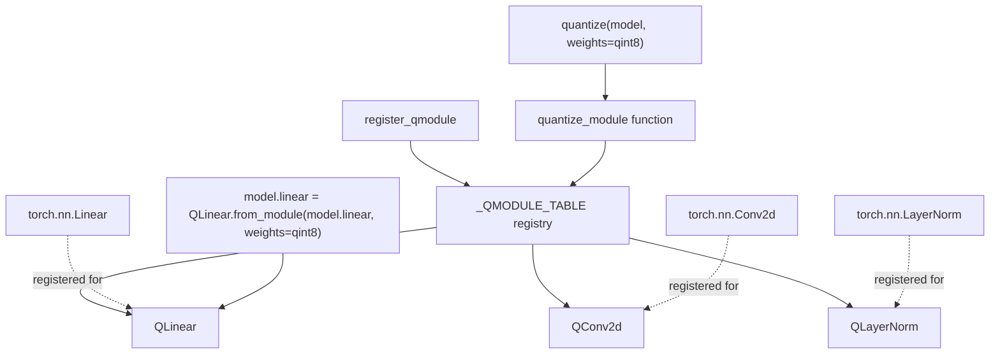
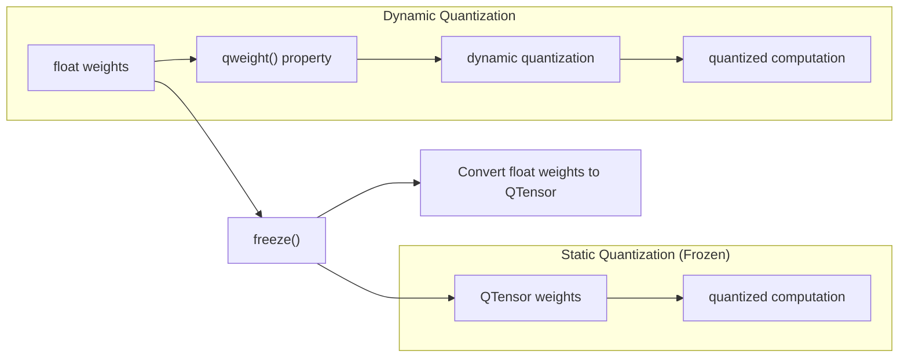
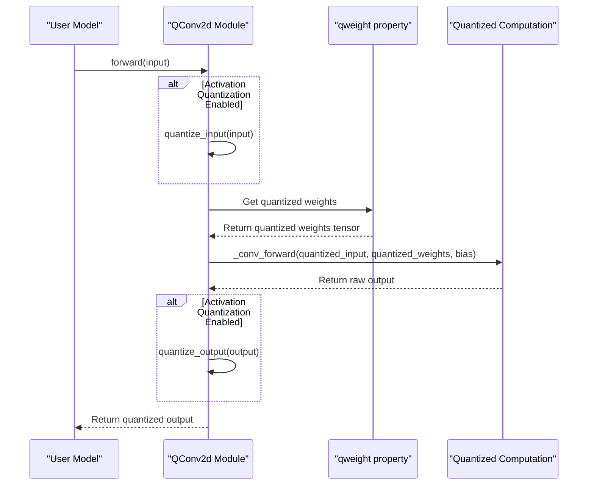
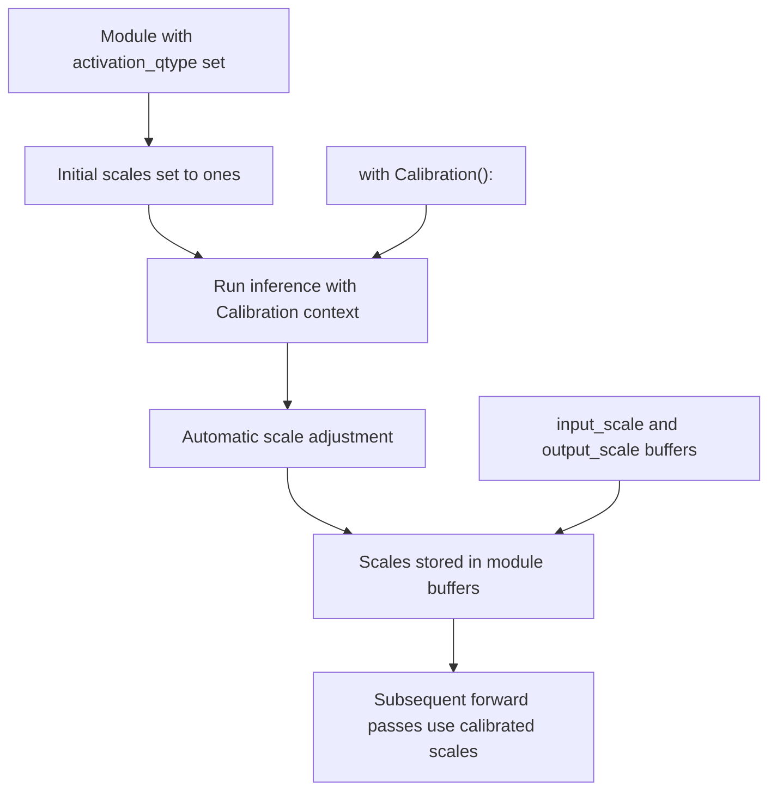
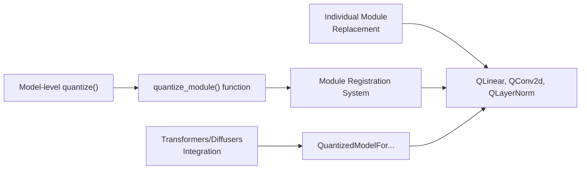

<!-- source: DeepWiki mcp.deepwiki.com · repo huggingface/optimum-quanto · page 5 Quantized Modules · fetched 2026-10-26 -->

# Quantized Modules

<details>
<summary>Relevant source files</summary>

The following files were used as context for generating this wiki page:

- [optimum/quanto/nn/qconv2d.py](optimum/quanto/nn/qconv2d.py)
- [optimum/quanto/nn/qlayernorm.py](optimum/quanto/nn/qlayernorm.py)
- [optimum/quanto/nn/qlinear.py](optimum/quanto/nn/qlinear.py)
- [optimum/quanto/nn/qmodule.py](optimum/quanto/nn/qmodule.py)
- [test/library/test_quantize.py](test/library/test_quantize.py)
- [test/nn/test_calibrate.py](test/nn/test_calibrate.py)
- [test/nn/test_qattention.py](test/nn/test_qattention.py)
- [test/nn/test_qconv2d.py](test/nn/test_qconv2d.py)
- [test/nn/test_qlayernorm.py](test/nn/test_qlayernorm.py)
- [test/nn/test_qlinear.py](test/nn/test_qlinear.py)
- [test/quantize/test_quantize_mlp.py](test/quantize/test_quantize_mlp.py)
- [test/tensor/activations/test_activations_quantize.py](test/tensor/activations/test_activations_quantize.py)
- [test/tensor/weights/test_weight_qbytes_tensor_quantize.py](test/tensor/weights/test_weight_qbytes_tensor_quantize.py)

</details>


This page details the quantized neural network module implementations in optimum-quanto. Specifically, it covers how standard PyTorch modules are transformed into their quantized equivalents, the common architecture underlying all quantized modules, and the specific implementations for linear layers, convolutional layers, and normalization layers.

For information about model-level integration of these modules, see [Model Integration](#4.3). For details on the underlying tensor quantization, see [Tensor Quantization](#4.1).

## Quantized Module Architecture

The quantized modules in optimum-quanto follow a common architecture based on a mixin pattern. Each quantized module inherits both from its corresponding PyTorch module and a special `QModuleMixin` class that adds quantization functionality.

```mermaid
classDiagram
    class "torch.nn.Module" {
        +forward()
    }
    
    class "QModuleMixin" {
        +weight_qtype
        +activation_qtype
        +optimizer
        +qweight: QTensor
        +from_module()
        +forward()
        +freeze()
        +quantize_input()
        +quantize_output()
    }
    
    class "QLinear" {
        +in_features
        +out_features
        +forward(input)
    }
    
    class "QConv2d" {
        +in_channels
        +out_channels
        +kernel_size
        +forward(input)
    }
    
    class "QLayerNorm" {
        +normalized_shape
        +eps
        +forward(input)
    }
    
    "torch.nn.Module" <|-- "QModuleMixin"
    "QModuleMixin" <|-- "QLinear"
    "torch.nn.Linear" <|-- "QLinear"
    "QModuleMixin" <|-- "QConv2d"
    "torch.nn.Conv2d" <|-- "QConv2d"
    "QModuleMixin" <|-- "QLayerNorm"
    "torch.nn.LayerNorm" <|-- "QLayerNorm"
```

Sources: 
- [optimum/quanto/nn/qmodule.py:94-310]()
- [optimum/quanto/nn/qlinear.py:26-50]()
- [optimum/quanto/nn/qconv2d.py:26-55]()
- [optimum/quanto/nn/qlayernorm.py:26-53]()

## Module Registration System

Optimum-quanto implements a registration system that allows automatic detection and quantization of PyTorch modules. This system maps standard PyTorch module types to their quantized counterparts.



Sources:
- [optimum/quanto/nn/qmodule.py:38-91]()
- [test/quantize/test_quantize_mlp.py:61-70]()

## Core Functionality: QModuleMixin

`QModuleMixin` is the foundation for all quantized modules, providing common functionality for quantization operations:

### Key Features:
- Maintains state for weight and activation quantization types
- Provides methods for dynamic quantization during forward passes
- Handles serialization and deserialization of quantized weights
- Manages quantization scales for both inputs and outputs
- Supports "freezing" modules to convert to static quantization

### Dynamic vs Static Quantization

A key concept in optimum-quanto is the distinction between dynamic and frozen (static) quantization:



Sources:
- [optimum/quanto/nn/qmodule.py:246-276]() - qweight property
- [optimum/quanto/nn/qmodule.py:302-310]() - freeze method

## QLinear Implementation

`QLinear` is a quantized version of the PyTorch `Linear` module that supports both weight and activation quantization.

### Features:

- Supports multiple weight quantization formats (int4, int8, float8)
- Optional activation quantization
- Automatic group size detection for int2/int4 quantization
- Gradient-aware operations (both weights and inputs)

### Usage Example:

```python
# Create a quantized linear layer from a standard linear layer
linear = torch.nn.Linear(768, 768)
qlinear = QLinear.from_module(linear, weights=qint8, activations=qint8)

# For activation quantization, run inference with calibration first
with Calibration():
    output = qlinear(input_tensor)
    
# After calibration, freeze for deployment
qlinear.freeze()
```

Sources:
- [optimum/quanto/nn/qlinear.py:26-50]()
- [test/nn/test_qlinear.py:37-57]()
- [test/nn/test_qlinear.py:140-163]()

## QConv2d Implementation

`QConv2d` provides a quantized version of PyTorch's `Conv2d` module with functionality similar to `QLinear`.

### Features:

- Preserves all parameters of the original Conv2d layer
- Supports both weight and activation quantization
- Maintains the same API as the original Conv2d module



Sources:
- [optimum/quanto/nn/qconv2d.py:26-55]()
- [test/nn/test_qconv2d.py:31-51]()

## QLayerNorm Implementation

`QLayerNorm` provides a quantized version of layer normalization, primarily focused on activation quantization rather than weight quantization.

### Key Differences:

- Unlike QLinear and QConv2d, QLayerNorm doesn't quantize its weights
- Returns `None` if activations quantization is not enabled
- Preserves the elementwise affine parameter from the original LayerNorm

Sources:
- [optimum/quanto/nn/qlayernorm.py:26-53]()
- [test/nn/test_qlayernorm.py:23-41]()

## Calibration Process

The calibration process is essential for modules using activation quantization, as it establishes appropriate scaling factors to minimize quantization error.



Sources:
- [test/nn/test_calibrate.py:23-39]()
- [optimum/quanto/nn/qmodule.py:282-300]() - quantize_input and quantize_output methods

## Serialization and Deserialization

Optimum-quanto provides specialized serialization for quantized modules, handling the storage and loading of quantized weights.

### Features:

- Serializes quantized weights as flattened tensors
- Preserves quantization parameters in the state dictionary
- Handles both frozen and unfrozen modules correctly
- Compatible with PyTorch's standard save/load mechanisms

Sources:
- [optimum/quanto/nn/qmodule.py:147-207]()
- [test/nn/test_qlinear.py:196-227]()

## Performance Considerations

Quantized modules can offer significant performance benefits, particularly in terms of memory usage and computational efficiency:

- Reduced memory footprint (especially for int4/int8 quantization)
- Potential speedups on supported hardware platforms
- Trade-off between precision and performance can be controlled via quantization types

Sources:
- [test/quantize/test_quantize_mlp.py:119-136]()

## Integration with Higher-Level APIs

These quantized modules serve as building blocks for model-level quantization. They can be used:

1. Directly, by replacing specific modules in a model
2. Automatically, through the `quantize()` function
3. As part of a complete quantized model workflow



Sources:
- [test/nn/test_qattention.py:174-189]()
- [test/quantize/test_quantize_mlp.py:61-70]()

## Practical Usage Workflow

A typical workflow for using quantized modules involves:

1. **Creation** - Initialize quantized modules from standard modules
2. **Calibration** - For activation quantization, gather statistics
3. **Freezing** - Convert to static quantization for deployment
4. **Serialization** - Save the quantized model for later use

Sources:
- [test/nn/test_qlinear.py:196-227]()
- [test/nn/test_calibrate.py:23-39]()

---

