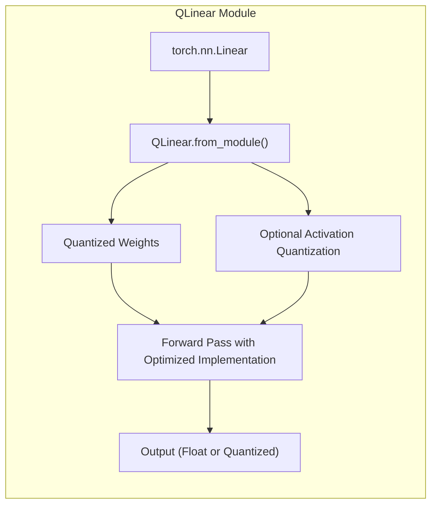
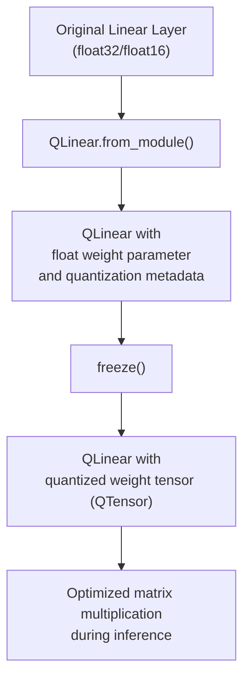
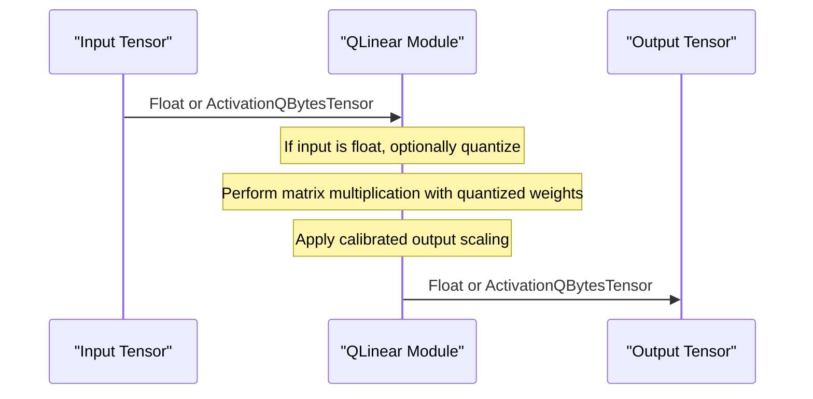
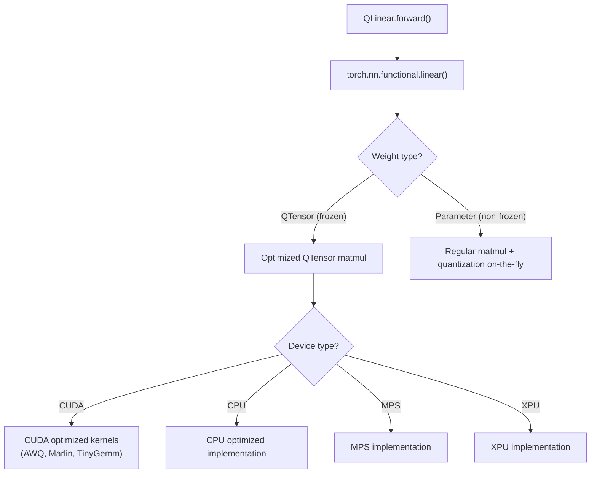
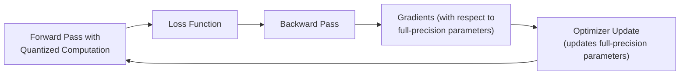

<!-- source: DeepWiki mcp.deepwiki.com · repo huggingface/optimum-quanto · page 5.1 QLinear · fetched 2026-10-26 -->

# QLinear

<details>
<summary>Relevant source files</summary>

The following files were used as context for generating this wiki page:

- [test/library/test_quantize.py](test/library/test_quantize.py)
- [test/nn/test_calibrate.py](test/nn/test_calibrate.py)
- [test/nn/test_qattention.py](test/nn/test_qattention.py)
- [test/nn/test_qconv2d.py](test/nn/test_qconv2d.py)
- [test/nn/test_qlayernorm.py](test/nn/test_qlayernorm.py)
- [test/nn/test_qlinear.py](test/nn/test_qlinear.py)
- [test/quantize/test_quantize_mlp.py](test/quantize/test_quantize_mlp.py)
- [test/tensor/activations/test_activations_quantize.py](test/tensor/activations/test_activations_quantize.py)
- [test/tensor/ops/test_linear_dispatch.py](test/tensor/ops/test_linear_dispatch.py)
- [test/tensor/ops/test_mm_dispatch.py](test/tensor/ops/test_mm_dispatch.py)
- [test/tensor/weights/test_weight_qbytes_tensor_quantize.py](test/tensor/weights/test_weight_qbytes_tensor_quantize.py)

</details>


QLinear is a quantized implementation of PyTorch's `torch.nn.Linear` module in optimum-quanto, designed to perform matrix multiplication with reduced precision. It serves as one of the core building blocks for deploying quantized neural networks, especially in transformer-based models. For information about other quantized modules, see [QConv2d and QLayerNorm](#5.2).

## Purpose and Overview

QLinear replaces standard full-precision linear layers with quantized alternatives that significantly reduce memory usage and improve inference speed while maintaining reasonable accuracy. It supports:

- Weight quantization (2-bit, 4-bit, 8-bit integer and 8-bit floating point)
- Optional activation quantization 
- Device-specific optimized implementations
- Dynamic calibration for activation quantization
- Serialization for saving and loading quantized models



Sources: [test/nn/test_qlinear.py:37-57](), [test/nn/test_qlinear.py:140-149]()

## Architecture

QLinear inherits from both `torch.nn.Module` and `QModuleMixin`, providing the interface and behavior of a standard PyTorch module with additional quantization capabilities.

```mermaid
classDiagram
    class "torch.nn.Module" {
        +forward()
    }
    
    class "QModuleMixin" {
        +weight_qtype
        +activation_qtype
        +qweight: QTensor
        +from_module()
        +forward()
        +freeze()
    }
    
    class "QLinear" {
        +in_features: int
        +out_features: int
        +weight: Parameter/QTensor
        +bias: Parameter
        +input_scale: Tensor
        +output_scale: Tensor
        +forward(input)
        +from_module(module, weights, activations)
        +freeze()
    }
    
    "torch.nn.Module" <|-- "QModuleMixin"
    "QModuleMixin" <|-- "QLinear"
```

Sources: [test/nn/test_qlinear.py:34](), [test/nn/test_qlinear.py:186-193](), [test/nn/test_qlinear.py:206-217]()

### Key Attributes

- `in_features`: Size of input features
- `out_features`: Size of output features
- `weight`: The weights tensor (full-precision Parameter or quantized QTensor)
- `bias`: Optional bias tensor
- `weight_qtype`: Type of weight quantization (e.g., qint4, qint8, qfloat8)
- `activation_qtype`: Type of activation quantization (optional)
- `input_scale`: Scale factor for input quantization
- `output_scale`: Scale factor for output quantization

Sources: [test/nn/test_qlinear.py:40](), [test/nn/test_qlinear.py:143-148](), [test/nn/test_qlinear.py:206-227]()

## Weight Quantization

QLinear supports several weight quantization types:

| Quantization Type | Bits | Description | Best Use Case |
|-------------------|------|-------------|---------------|
| qint4             | 4    | 4-bit integer quantization | Significant memory reduction with modest accuracy impact |
| qint8             | 8    | 8-bit integer quantization | Good balance of accuracy and memory reduction |
| qfloat8           | 8    | 8-bit floating point (various formats) | Better dynamic range than integer quantization |

When weights are quantized, the linear operation is performed using quantized matrix multiplication, which is faster and more memory-efficient than full-precision operations.



Sources: [test/nn/test_qlinear.py:60-66](), [test/nn/test_qlinear.py:121-129](), [test/nn/test_qlinear.py:186-193]()

## Activation Quantization

In addition to weight quantization, QLinear optionally supports activation quantization, which quantizes both inputs and outputs of the linear layer. This provides further memory and computation benefits, especially for intermediate activations in large models.

Supported activation quantization types include:
- qint8: 8-bit integer quantization
- qfloat8: Various 8-bit floating point formats (e4m3fn, e4m3fnuz, e5m2)

When activation quantization is enabled, QLinear accepts quantized inputs and produces quantized outputs, enabling efficient end-to-end quantized inference.



Sources: [test/nn/test_qlinear.py:79-96](), [test/nn/test_qlinear.py:101-115](), [test/nn/test_calibrate.py:23-40]()

## Calibration

Calibration is a crucial step when using activation quantization. It determines appropriate scaling factors for inputs and outputs to minimize quantization error. The `Calibration` context manager is used to collect statistics during forward passes and update the scaling factors accordingly.


Sources: [test/nn/test_calibrate.py:23-40](), [test/nn/test_qlinear.py:48-50](), [test/nn/test_qlinear.py:78-88]()

## Usage

### Creating a QLinear Module

There are two ways to create a QLinear module:

1. **From an existing Linear module**:
```python
# Convert an existing linear layer to QLinear
linear = torch.nn.Linear(input_size, output_size)
qlinear = QLinear.from_module(linear, weights=qint8, activations=None)
```

2. **Creating a new QLinear module directly**:
```python
# Create a new QLinear module
qlinear = QLinear(input_size, output_size, weights=qint8, activations=None, bias=True)
```

Sources: [test/nn/test_qlinear.py:39](), [test/nn/test_qlinear.py:216]()

### Forward Pass

QLinear's forward pass accepts either regular tensors or quantized activations (if activation quantization is enabled):

```python
# Regular forward pass with float tensors
output = qlinear(input_tensor)

# Forward pass with quantized activations
with Calibration():
    qoutput = qlinear(qinput)
```

Sources: [test/nn/test_qlinear.py:48-50](), [test/nn/test_calibrate.py:35-36]()

### Freezing

Freezing converts weights from full-precision parameters to quantized tensors, significantly reducing memory usage:

```python
# Freeze quantized weights
qlinear.freeze()
```

After freezing, the `weight` attribute becomes a `QTensor` instead of a `Parameter`, enabling optimized inference.

Sources: [test/nn/test_qlinear.py:186-188]()

### Serialization

QLinear supports serialization using PyTorch's standard save/load mechanisms:

```python
# Save QLinear state
torch.save(qlinear.state_dict(), "qlinear.pt")

# Load QLinear state
new_qlinear = QLinear(in_features, out_features, weights=qint8)
new_qlinear.load_state_dict(torch.load("qlinear.pt"))
```

Sources: [test/nn/test_qlinear.py:212-227]()

## Technical Details

### Matrix Multiplication Implementation

QLinear uses specialized matrix multiplication implementations for different quantization types and devices:



Sources: [test/tensor/ops/test_linear_dispatch.py:28-42](), [test/tensor/ops/test_mm_dispatch.py:22-44]()

### Device Support and Compatibility

QLinear supports multiple hardware backends with varying levels of optimization:

| Device | Weight-only Quantization | Activation Quantization | Float8 Support |
|--------|--------------------------|-------------------------|----------------|
| CUDA   | Full support             | Full support            | Yes            |
| CPU    | Full support             | Full support            | No             |
| MPS    | Limited support          | Limited support         | No             |
| XPU    | Limited support          | Limited support         | No             |

Sources: [test/nn/test_qlinear.py:89-90](), [test/nn/test_qlinear.py:107-108](), [test/nn/test_qlinear.py:123-128]()

## Gradient Propagation

Despite using quantization, QLinear maintains compatibility with PyTorch's automatic differentiation:

- Weight gradients are computed with respect to full-precision weights
- Input gradients are computed with respect to full-precision inputs
- Bias gradients work identically to standard Linear layers

This enables fine-tuning of models with QLinear layers, though the gradients are approximated due to quantization.



Sources: [test/nn/test_qlinear.py:143-178]()

## Example Workflow

A complete workflow using QLinear typically includes these steps:

1. **Model Creation**: Create or load a PyTorch model with Linear layers
2. **Quantization**: Replace Linear layers with QLinear using `from_module`
3. **Calibration**: Run representative inputs through the model with the `Calibration` context to set scaling factors
4. **Freezing**: Freeze quantized weights to enable optimized inference
5. **Inference**: Run inference with optimized quantized computation
6. **Serialization**: Save the quantized model for deployment

Sources: [test/quantize/test_quantize_mlp.py:61-85]()

## Conclusion

QLinear is a fundamental building block in optimum-quanto's quantization system, enabling significant memory and computational efficiency improvements for neural networks. By replacing standard linear layers with quantized alternatives, models can be deployed on resource-constrained devices while maintaining reasonable accuracy.

---

