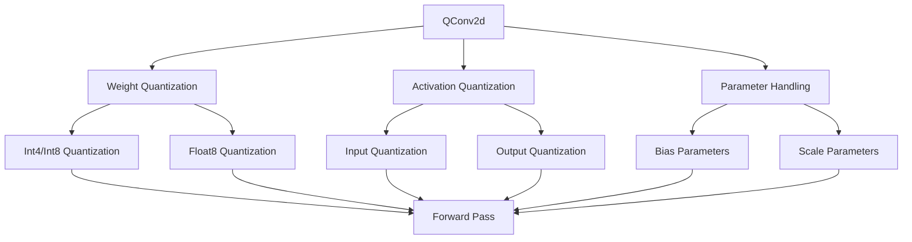
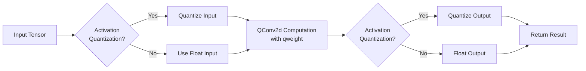
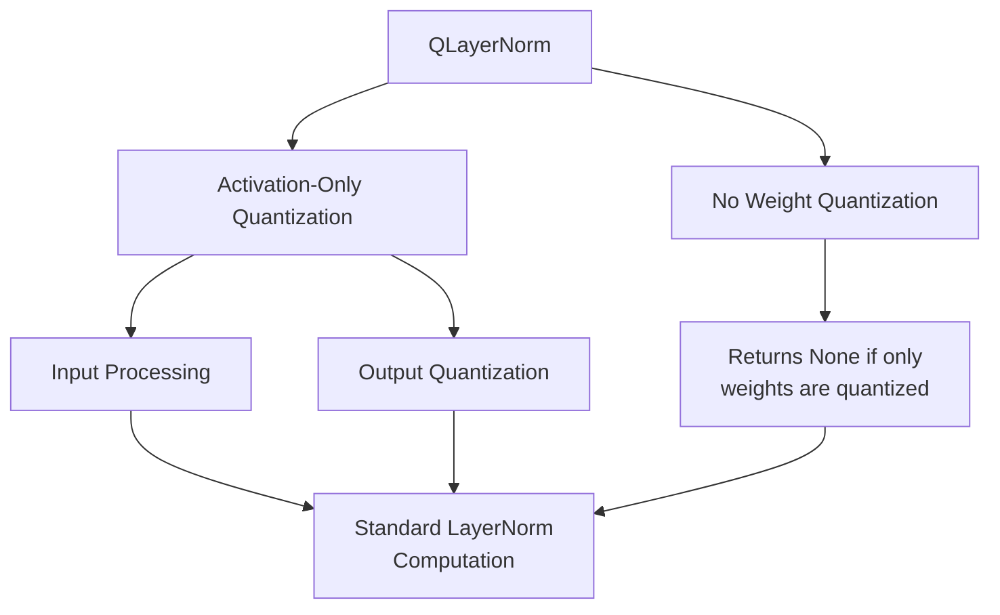
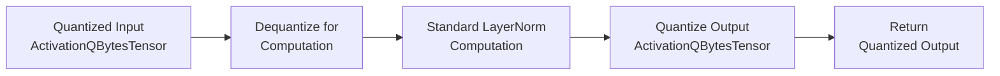
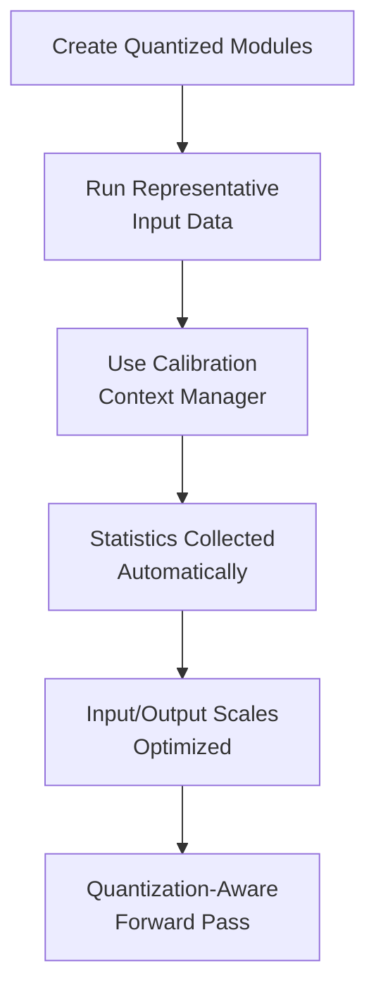

<!-- source: DeepWiki mcp.deepwiki.com · repo huggingface/optimum-quanto · page 5.2 QConv2d and QLayerNorm · fetched 2026-10-26 -->

# QConv2d and QLayerNorm

<details>
<summary>Relevant source files</summary>

The following files were used as context for generating this wiki page:

- [optimum/quanto/nn/qconv2d.py](optimum/quanto/nn/qconv2d.py)
- [optimum/quanto/nn/qlayernorm.py](optimum/quanto/nn/qlayernorm.py)
- [optimum/quanto/nn/qlinear.py](optimum/quanto/nn/qlinear.py)
- [optimum/quanto/nn/qmodule.py](optimum/quanto/nn/qmodule.py)
- [test/library/test_quantize.py](test/library/test_quantize.py)
- [test/nn/test_calibrate.py](test/nn/test_calibrate.py)
- [test/nn/test_qattention.py](test/nn/test_qattention.py)
- [test/nn/test_qconv2d.py](test/nn/test_qconv2d.py)
- [test/nn/test_qlayernorm.py](test/nn/test_qlayernorm.py)
- [test/nn/test_qlinear.py](test/nn/test_qlinear.py)
- [test/quantize/test_quantize_mlp.py](test/quantize/test_quantize_mlp.py)
- [test/tensor/activations/test_activations_quantize.py](test/tensor/activations/test_activations_quantize.py)
- [test/tensor/weights/test_weight_qbytes_tensor_quantize.py](test/tensor/weights/test_weight_qbytes_tensor_quantize.py)

</details>


QConv2d and QLayerNorm are quantized versions of PyTorch's standard Conv2d and LayerNorm modules in the optimum-quanto framework. These modules provide efficient quantization capabilities for convolutional neural networks and transformer architectures.

While they both serve the purpose of quantization, they have different focuses:
- QConv2d supports both weight and activation quantization, suitable for convolutional operations
- QLayerNorm focuses exclusively on activation quantization, as normalization layers typically have fewer parameters and benefit less from weight quantization

For information about the quantized linear layer implementation, see [QLinear](#5.1).

## Architecture

Both QConv2d and QLayerNorm follow a common architectural pattern defined by the QModuleMixin, which provides the core quantization functionality. They inherit from both the QModuleMixin and their respective PyTorch base classes.

### Class Hierarchy

```mermaid
classDiagram
    class "torch.nn.Module" {
        +forward()
    }
    
    class "QModuleMixin" {
        +weight_qtype
        +activation_qtype
        +qweight
        +from_module()
        +forward()
        +freeze()
    }
    
    class "torch.nn.Conv2d" {
        +weight
        +bias
        +forward()
    }
    
    class "torch.nn.LayerNorm" {
        +weight
        +bias
        +forward()
    }
    
    class "QConv2d" {
        +qcreate()
        +forward()
    }
    
    class "QLayerNorm" {
        +qcreate()
        +forward()
    }
    
    "torch.nn.Module" <|-- "QModuleMixin"
    "torch.nn.Module" <|-- "torch.nn.Conv2d"
    "torch.nn.Module" <|-- "torch.nn.LayerNorm"
    
    "QModuleMixin" <|-- "QConv2d"
    "torch.nn.Conv2d" <|-- "QConv2d"
    
    "QModuleMixin" <|-- "QLayerNorm"
    "torch.nn.LayerNorm" <|-- "QLayerNorm"
```

Sources: [optimum/quanto/nn/qmodule.py:94-311](), [optimum/quanto/nn/qconv2d.py:1-56](), [optimum/quanto/nn/qlayernorm.py:1-54]()

## QConv2d

QConv2d implements a quantized 2D convolutional layer that supports quantization of both weights and activations, preserving the functionality of standard Conv2d layers while operating with reduced precision.

### Implementation Details

QConv2d is implemented as a class that inherits from both QModuleMixin and torch.nn.Conv2d:



Sources: [optimum/quanto/nn/qconv2d.py:26-56](), [test/nn/test_qconv2d.py:31-51]()

The forward pass in QConv2d replaces the standard weights with quantized weights using the `qweight` property, which either returns frozen quantized weights or dynamically quantizes the weights during the forward pass.

### QConv2d Data Flow



Sources: [optimum/quanto/nn/qmodule.py:282-300](), [optimum/quanto/nn/qconv2d.py:54-55]()

### Supported Quantization Types

QConv2d supports a variety of quantization types:

| Weight Quantization | Activation Quantization |
|---------------------|-------------------------|
| qint4 (4-bit integer) | qint8 (8-bit integer) |
| qint8 (8-bit integer) | qfloat8_e5m2 (8-bit float) |
| qfloat8 variants (8-bit float) | qfloat8_e4m3fn (8-bit float) |
|                     | qfloat8_e4m3fnuz (8-bit float) |

Sources: [test/nn/test_qconv2d.py:54-123]()

## QLayerNorm

QLayerNorm is a quantized layer normalization module that focuses on activation quantization. Unlike QConv2d, it doesn't support weight quantization.

### Implementation Details

QLayerNorm is designed to work with quantized activations while maintaining the same normalization behavior as the standard LayerNorm:



Sources: [optimum/quanto/nn/qlayernorm.py:26-54](), [test/nn/test_qlayernorm.py:23-41]()

The key aspect of QLayerNorm is that it returns None if only weight quantization is requested (when `activations=None`), making it clear that it only supports activation quantization.

### QLayerNorm Data Flow



Sources: [optimum/quanto/nn/qlayernorm.py:52-53](), [test/nn/test_qlayernorm.py:23-41]()

### Supported Quantization Types

QLayerNorm only supports activation quantization:

| Weight Quantization | Activation Quantization |
|---------------------|-------------------------|
| Not supported | qint8 (8-bit integer) |
|              | qfloat8_e5m2 (8-bit float) |
|              | qfloat8_e4m3fn (8-bit float) |
|              | qfloat8_e4m3fnuz (8-bit float) |

Sources: [test/nn/test_qlayernorm.py:44-83](), [optimum/quanto/nn/qlayernorm.py:36-39]()

## Creating and Using Quantized Modules

Both QConv2d and QLayerNorm are typically created using their `from_module` static method, which converts an existing PyTorch module to its quantized equivalent:

```python
# For QConv2d (supports both weight and activation quantization)
conv = torch.nn.Conv2d(in_channels=3, out_channels=64, kernel_size=3)
qconv = QConv2d.from_module(conv, weights=qint8, activations=qint8)

# For QLayerNorm (only supports activation quantization)
norm = torch.nn.LayerNorm(normalized_shape=512)
qnorm = QLayerNorm.from_module(norm, activations=qint8)
```

Sources: [test/nn/test_qconv2d.py:32-33](), [test/nn/test_qlayernorm.py:25-26]()

## Calibration Process

When using activation quantization, a calibration process is necessary to determine appropriate scaling factors. This is done using the `Calibration` context manager:



Sources: [test/nn/test_calibrate.py:23-40](), [test/nn/test_qconv2d.py:37-39](), [test/nn/test_qlayernorm.py:29-30]()

Example calibration code:

```python
from optimum.quanto import Calibration

# Run calibration to set optimal scales
with Calibration():
    output = qmodule(input_data)
```

Sources: [test/nn/test_calibrate.py:35-36](), [test/nn/test_qlayernorm.py:29-30]()

## Integration Example

This example shows how QConv2d and QLayerNorm can be used together in a model:

```python
import torch
import torch.nn as nn
from optimum.quanto import quantize, Calibration, qint8, freeze

# Define a model with Conv2d and LayerNorm
class ConvNormModel(nn.Module):
    def __init__(self):
        super().__init__()
        self.conv = nn.Conv2d(3, 16, kernel_size=3)
        # LayerNorm for feature maps
        self.norm = nn.LayerNorm([16, 28, 28])
        
    def forward(self, x):
        x = self.conv(x)
        x = self.norm(x)
        return x

# Create and quantize the model
model = ConvNormModel()
quantize(model, weights=qint8, activations=qint8)

# Calibrate for activation quantization
with Calibration():
    model(sample_input)

# Freeze weights for inference
freeze(model)
```

Sources: [test/quantize/test_quantize_mlp.py:40-78](), [test/nn/test_qattention.py:173-189]()

## Performance Considerations

1. **Memory Usage**: QConv2d with weight quantization significantly reduces model size, especially important for large convolutional models
2. **Computational Efficiency**: Both modules can improve inference speed on hardware that supports quantized operations
3. **Accuracy Trade-offs**: Lower precision quantization (e.g., qint4) may affect model accuracy more than higher precision (e.g., qint8)
4. **Hardware Support**: Float8 quantization is not supported on all devices (specifically MPS and XPU)

Sources: [test/nn/test_qconv2d.py:84](), [test/nn/test_qconv2d.py:98-101](), [test/nn/test_qlayernorm.py:66-68]()

## Common Pitfalls and Limitations

1. **QLayerNorm weight-only quantization**: QLayerNorm will return None if only weight quantization is requested
2. **Platform compatibility**: Float8 quantization is not supported on all devices (test with `@pytest.mark.skip_device("mps")` and `@pytest.mark.skip_device("xpu")`)
3. **Activation Statistics**: For best results, calibration should be performed with data that is representative of the real inputs
4. **Quantization Precision**: For sensitive layers, higher precision quantization types may be necessary to maintain accuracy

Sources: [test/nn/test_qlayernorm.py:86-90](), [test/nn/test_qconv2d.py:84](), [test/nn/test_qlayernorm.py:66-68]()

---

