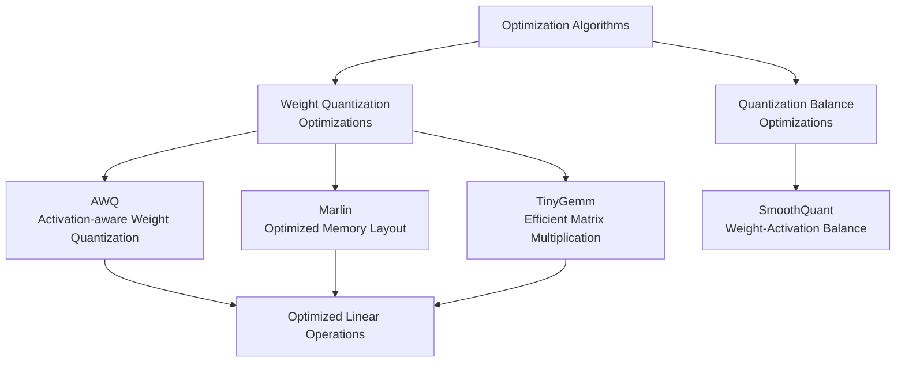
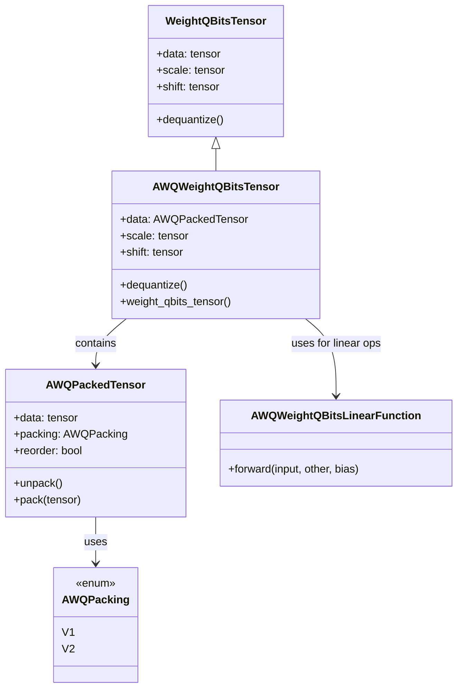
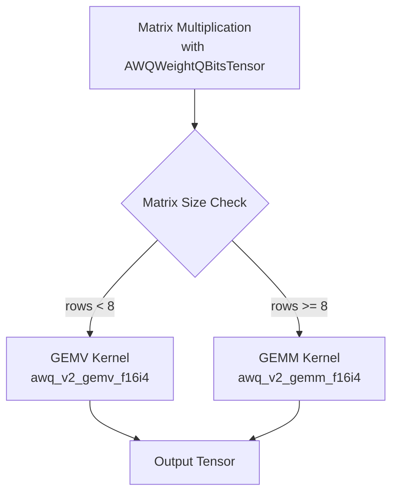
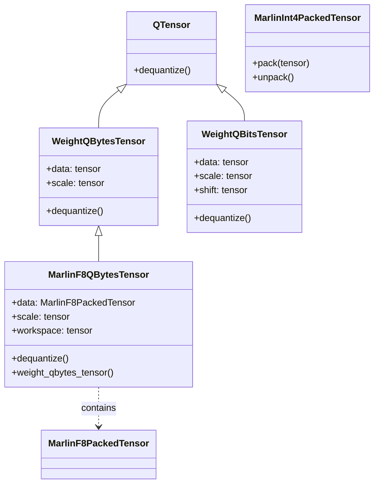
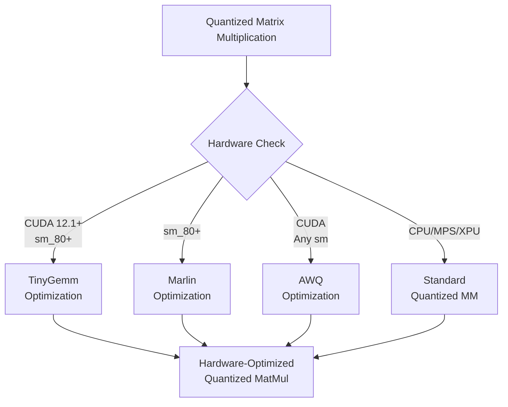
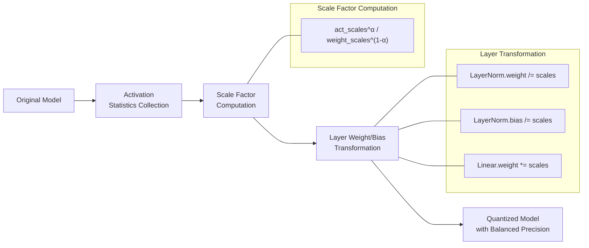
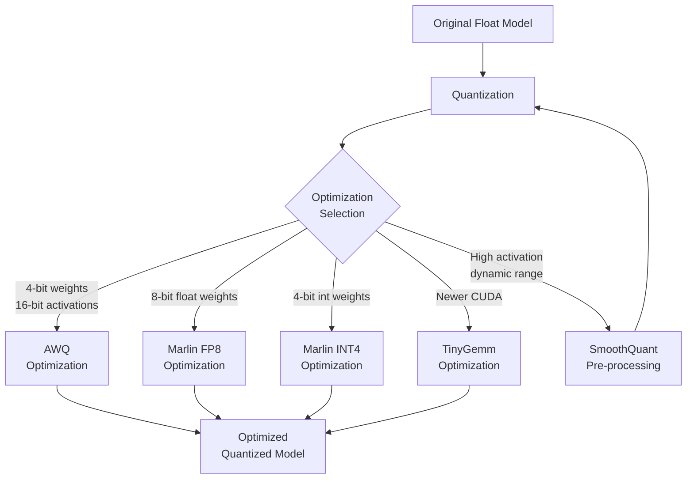

<!-- source: DeepWiki mcp.deepwiki.com · repo huggingface/optimum-quanto · page 6 Optimization Algorithms · fetched 2026-10-26 -->

# Optimization Algorithms

Relevant source files

The following files were used as context for generating this wiki page:

- [Makefile](Makefile)
- [bench/kernels/benchmark_w4a16.py](bench/kernels/benchmark_w4a16.py)
- [external/awq/test_awq_kernels.py](external/awq/test_awq_kernels.py)
- [external/awq/test_awq_packing.py](external/awq/test_awq_packing.py)
- [external/smoothquant/smoothquant.py](external/smoothquant/smoothquant.py)
- [optimum/quanto/library/extensions/cuda/__init__.py](optimum/quanto/library/extensions/cuda/__init__.py)
- [optimum/quanto/tensor/weights/awq/packed.py](optimum/quanto/tensor/weights/awq/packed.py)
- [optimum/quanto/tensor/weights/awq/qbits.py](optimum/quanto/tensor/weights/awq/qbits.py)
- [optimum/quanto/tensor/weights/marlin/fp8/__init__.py](optimum/quanto/tensor/weights/marlin/fp8/__init__.py)
- [optimum/quanto/tensor/weights/marlin/fp8/packed.py](optimum/quanto/tensor/weights/marlin/fp8/packed.py)
- [optimum/quanto/tensor/weights/marlin/fp8/qbits.py](optimum/quanto/tensor/weights/marlin/fp8/qbits.py)
- [optimum/quanto/tensor/weights/packing.py](optimum/quanto/tensor/weights/packing.py)
- [pyproject.toml](pyproject.toml)
- [setup.sh](setup.sh)
- [test/library/test_mm.py](test/library/test_mm.py)
- [test/tensor/weights/optimized/test_awq_packed_tensor.py](test/tensor/weights/optimized/test_awq_packed_tensor.py)
- [test/tensor/weights/optimized/test_awq_weight_qbits_tensor.py](test/tensor/weights/optimized/test_awq_weight_qbits_tensor.py)
- [test/tensor/weights/optimized/test_marlin_fp8_packed_tensor.py](test/tensor/weights/optimized/test_marlin_fp8_packed_tensor.py)
- [test/tensor/weights/optimized/test_marlin_qbytes_tensor.py](test/tensor/weights/optimized/test_marlin_qbytes_tensor.py)
- [test/tensor/weights/optimized/test_tinygemm_packed_tensor.py](test/tensor/weights/optimized/test_tinygemm_packed_tensor.py)

This page documents the specialized quantization optimization algorithms implemented in optimum-quanto. These algorithms enhance the efficiency and performance of quantized models by employing various techniques for optimal memory layout, computation patterns, and quantization balance. For general information about quantization types, see [Quantization Types](#3.1).

## Overview of Optimization Algorithms

Optimization algorithms in optimum-quanto can be categorized into two main types:
1. **Weight Quantization Optimizations** - Algorithms that optimize how weights are stored and processed
2. **Quantization Balance Optimizations** - Techniques that balance quantization between weights and activations

Sources: [optimum/quanto/tensor/weights/awq/qbits.py]()), [optimum/quanto/tensor/weights/marlin/fp8/qbits.py]()), [test/tensor/weights/optimized/test_tinygemm_packed_tensor.py]()), [external/smoothquant/smoothquant.py]())

## AWQ (Activation-Aware Weight Quantization)

AWQ is an optimization technique for low-bit weight quantization that considers activation patterns to preserve the quality of important weights during quantization.

### Implementation Details

In optimum-quanto, AWQ is implemented through specialized tensor classes and packing formats that optimize memory layout and computation:

Sources: [optimum/quanto/tensor/weights/awq/qbits.py:73-164]()), [optimum/quanto/tensor/weights/awq/packed.py:22-295]())

### Packing Formats

AWQ uses two packing formats for efficient storage and computation:

1. **V1 Packing**: Reorders columns in 4-bit integers for faster dequantization
   - Uses permutation pattern `[0, 2, 4, 6, 1, 3, 5, 7]` for reordering
   - Packs values into int32 tensor

2. **V2 Packing**: More advanced format for newer GPU architectures
   - Permutes rows to counter implicit permutation on Turing and Ampere GPUs
   - Interleaves groups of rows for efficient parallel processing
   - Packs values into int16 tensor

Sources: [optimum/quanto/tensor/weights/awq/packed.py:33-153]()), [test/tensor/weights/optimized/test_awq_packed_tensor.py:23-68]())

### CUDA Kernels

The AWQ implementation includes specialized CUDA kernels for efficient matrix multiplication:

- **GEMM Kernel**: For batched operations (multiple tokens)
- **GEMV Kernel**: Optimized for single token operations

Sources: [optimum/quanto/library/extensions/cuda/__init__.py:97-121]()), [test/library/test_mm.py:27-101]())

### Performance Characteristics

AWQ optimizations significantly improve inference speed while maintaining accuracy through:

1. Memory efficiency with 4-bit quantization
2. Reduced memory bandwidth requirements
3. Optimized memory access patterns
4. Specialized kernels for different operation sizes

The benchmarks indicate:
- Higher TFLOP/s compared to unoptimized quantization
- Especially beneficial for batch sizes >= 8

Sources: [bench/kernels/benchmark_w4a16.py:12-149]())

## Marlin and TinyGemm

Marlin and TinyGemm are optimization techniques focused on efficient matrix multiplication for quantized weights.

### Marlin Implementation

Marlin is implemented with two variants:

1. **Marlin FP8**: For 8-bit floating point quantization
2. **Marlin INT4**: For 4-bit integer quantization

Sources: [optimum/quanto/tensor/weights/marlin/fp8/qbits.py:28-168]()), [optimum/quanto/tensor/weights/marlin/fp8/packed.py:22-267]())

### Marlin FP8 Optimization

Marlin FP8 optimization uses several techniques for efficient computation:

1. **Custom Packing**: Repacks FP8 weights into int32 for efficient storage
2. **Column/Row Permutation**: Uses specific permutation patterns for memory access optimization
3. **Scale Permutation**: Applies scale factor transformations for efficient computation

The memory layout transformations enable better utilization of GPU memory bandwidth and compute units.

Sources: [optimum/quanto/tensor/weights/marlin/fp8/packed.py:22-158]()), [test/tensor/weights/optimized/test_marlin_fp8_packed_tensor.py:15-66]())

### TinyGemm Optimization

TinyGemm is a specialized optimization for newer CUDA architectures (CUDA 12.1+ and compute capability 8.0+). It focuses on leveraging hardware-specific features for efficient matrix multiplication with quantized weights.

Sources: [test/tensor/weights/optimized/test_tinygemm_packed_tensor.py:15-70]())

### Performance Comparison

Performance benchmarks show:

1. **Marlin vs AWQ**:
   - Marlin typically achieves higher TFLOP/s rates
   - AWQ may have better performance on specific hardware configurations
   - Both outperform naive quantized matrix multiplication

2. **Hardware Considerations**:
   - Marlin FP8 requires compute capability 8.0+ (Ampere architecture or newer)
   - TinyGemm requires CUDA 12.1+ and compute capability 8.0+

Sources: [bench/kernels/benchmark_w4a16.py:12-149]()), [test/library/test_mm.py:102-189]())

## SmoothQuant

SmoothQuant is a technique that balances quantization between weights and activations to improve overall quantization accuracy.

### Concept and Implementation

SmoothQuant addresses the challenge of quantizing models with high activation dynamic range by:

1. Collecting activation statistics across representative data
2. Computing scaling factors that balance the quantization difficulty between weights and activations
3. Applying these scales to layer normalization and linear/attention layers

Sources: [external/smoothquant/smoothquant.py:16-108]())

### Application to Model Architectures

SmoothQuant is implemented for various transformer architectures:

- **OPT**: Applies to self-attention and MLP blocks
- **BLOOM**: Adjusts query-key-value and MLP dense layers
- **LLaMA/Mistral**: Transforms attention projections and MLP gate/up projections

The implementation analyzes each architecture's specific structure to apply transformations at the right layers.

Sources: [external/smoothquant/smoothquant.py:76-108]())

## Performance and Usage Benchmarks

The optimization algorithms provide significant performance improvements:

| Algorithm | Typical Speedup | Memory Savings | Accuracy Impact |
|-----------|----------------|----------------|-----------------|
| AWQ       | 2-4x           | 8x (vs FP32)   | Minimal         |
| Marlin    | 3-5x           | 4-8x (vs FP32) | Minimal         |
| TinyGemm  | 3-5x           | 8x (vs FP32)   | Minimal         |
| SmoothQuant | 1-2x         | 4x (vs FP32)   | Improved over standard quantization |

Choosing the right optimization depends on:
1. Hardware availability (compute capability, CUDA version)
2. Model architecture
3. Performance vs accuracy requirements

Sources: [bench/kernels/benchmark_w4a16.py:74-127]())

## Integration with Quantization Workflow

These optimization algorithms integrate with the overall quantization workflow in optimum-quanto:

Sources: [optimum/quanto/tensor/weights/awq/qbits.py:73-164]()), [optimum/quanto/tensor/weights/marlin/fp8/qbits.py:28-168]()), [external/smoothquant/smoothquant.py:76-108]())

---

