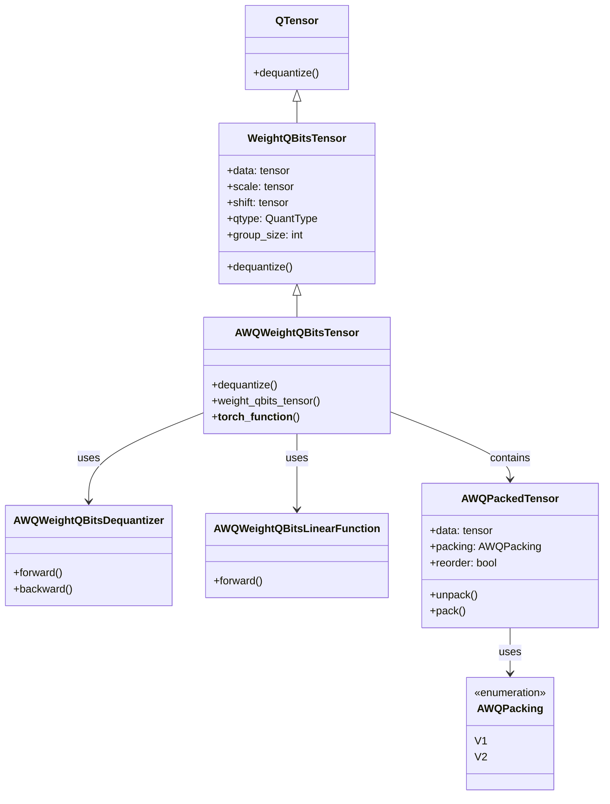
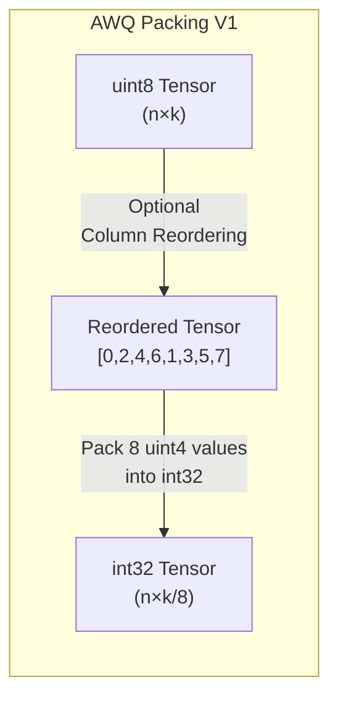
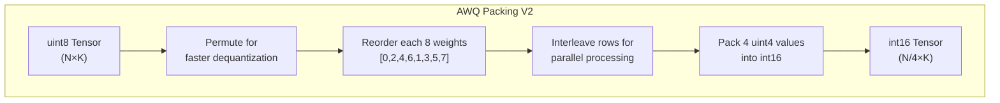
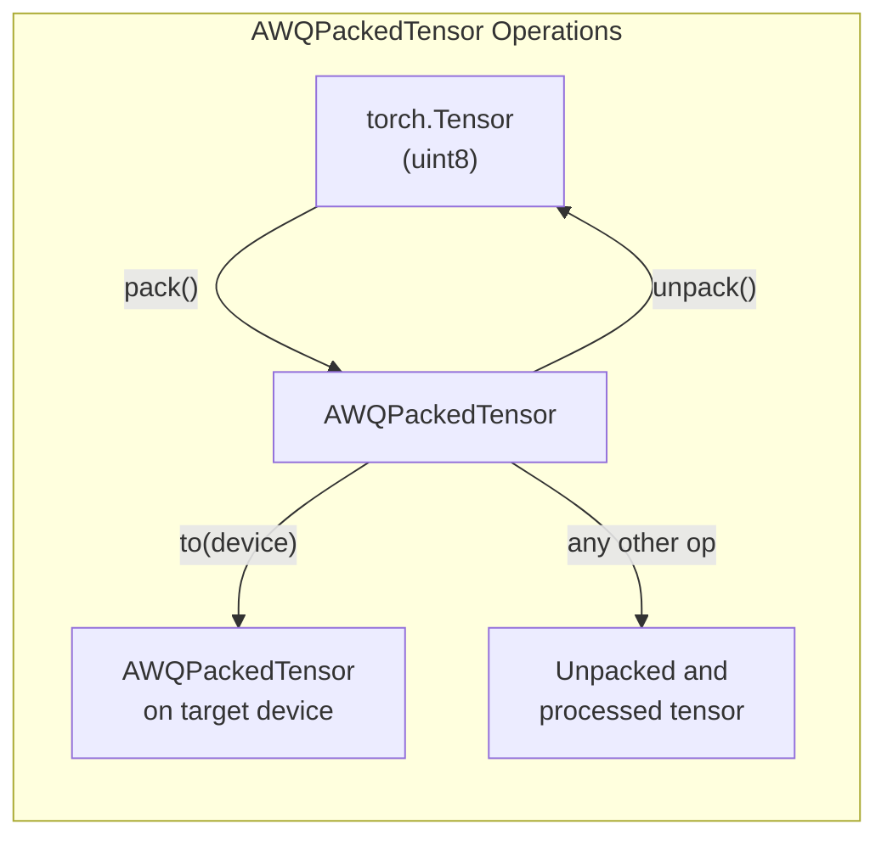
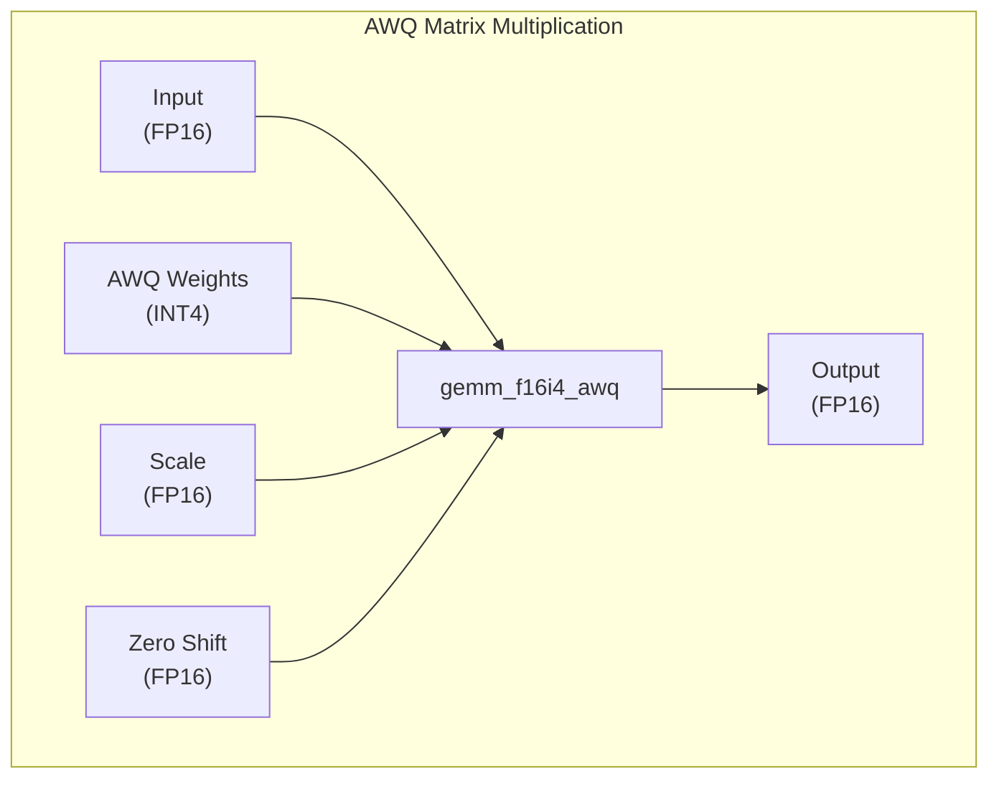
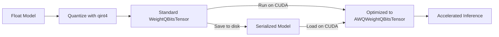

<!-- source: DeepWiki mcp.deepwiki.com · repo huggingface/optimum-quanto · page 6.1 AWQ (Activation-Aware Weight Quantization) · fetched 2026-10-26 -->

# AWQ (Activation-Aware Weight Quantization)

<details>
<summary>Relevant source files</summary>

The following files were used as context for generating this wiki page:

- [Makefile](Makefile)
- [bench/kernels/benchmark_w4a16.py](bench/kernels/benchmark_w4a16.py)
- [external/awq/test_awq_kernels.py](external/awq/test_awq_kernels.py)
- [external/awq/test_awq_packing.py](external/awq/test_awq_packing.py)
- [external/smoothquant/smoothquant.py](external/smoothquant/smoothquant.py)
- [optimum/quanto/tensor/weights/awq/packed.py](optimum/quanto/tensor/weights/awq/packed.py)
- [optimum/quanto/tensor/weights/awq/qbits.py](optimum/quanto/tensor/weights/awq/qbits.py)
- [optimum/quanto/tensor/weights/packing.py](optimum/quanto/tensor/weights/packing.py)
- [pyproject.toml](pyproject.toml)
- [setup.sh](setup.sh)
- [test/tensor/weights/optimized/test_awq_packed_tensor.py](test/tensor/weights/optimized/test_awq_packed_tensor.py)
- [test/tensor/weights/optimized/test_awq_weight_qbits_tensor.py](test/tensor/weights/optimized/test_awq_weight_qbits_tensor.py)
- [test/tensor/weights/optimized/test_marlin_qbytes_tensor.py](test/tensor/weights/optimized/test_marlin_qbytes_tensor.py)
- [test/tensor/weights/optimized/test_tinygemm_packed_tensor.py](test/tensor/weights/optimized/test_tinygemm_packed_tensor.py)

</details>


AWQ is a specialized quantization technique implemented in optimum-quanto that focuses on accelerating low-bit weight quantization by considering activation patterns. This page documents the implementation of AWQ in the optimum-quanto library, its core components, and how it integrates with the quantization workflow.

For information about other optimization algorithms like Marlin and TinyGemm, see [Marlin and TinyGemm](#6.2). For SmoothQuant, which focuses on activation quantization, see [SmoothQuant](#6.3).

## Core Concepts

AWQ (Activation-aware Weight Quantization) is a technique introduced in the paper "AWQ: Activation-aware Weight Quantization for LLM Compression and Acceleration". It differs from standard quantization by:

1. Analyzing activation patterns to identify which weights are most important
2. Preserving precision for weights that interact with the largest activations
3. Using specialized memory layouts and optimized CUDA kernels for efficient inference

In optimum-quanto, AWQ is implemented as specialized tensor classes and optimized backend operations for weights quantized to 4 bits.

Sources: [optimum/quanto/tensor/weights/awq/qbits.py](), [optimum/quanto/tensor/weights/awq/packed.py]()

## AWQ Architecture



Sources: [optimum/quanto/tensor/weights/awq/qbits.py](), [optimum/quanto/tensor/weights/awq/packed.py]()

## Tensor Packing Strategies

AWQ implements two different packing strategies to efficiently store and process 4-bit quantized weights:

### AWQ Packing V1

The first generation AWQ packing strategy (`AWQPacking.V1`) focuses on efficient column ordering for faster dequantization:



This packing strategy is based on the paper "Who Says Elephants Can't Run: Bringing Large Scale MoE Models into Cloud Scale Production" and optionally reorders columns using the pattern `[0, 2, 4, 6, 1, 3, 5, 7]` for faster dequantization.

### AWQ Packing V2

The second generation packing strategy (`AWQPacking.V2`) adds several optimizations for newer GPU architectures:



This more advanced packing strategy is optimized for Turing and Ampere GPU architectures and includes interleaving of groups of rows for more efficient parallel processing.

Sources: [optimum/quanto/tensor/weights/awq/packed.py:29-202]()

## AWQ Tensor Classes

### AWQPackedTensor

The `AWQPackedTensor` is a specialized tensor subclass that efficiently packs 4-bit integer values for GPU processing:



Key features:
- Supports two packing formats (V1 and V2)
- Only available on CUDA devices
- Automatically unpacks when moved to CPU
- Unpacks transparently when used in most operations

Sources: [optimum/quanto/tensor/weights/awq/packed.py:204-295]()

### AWQWeightQBitsTensor

The `AWQWeightQBitsTensor` extends `WeightQBitsTensor` to use AWQ-optimized formats and operations:

| Feature | Description |
|---------|-------------|
| Specialized dequantization | Uses `AWQWeightQBitsDequantizer` for faster unpacking |
| Matrix multiplication | Uses optimized `gemm_f16i4_awq` CUDA kernel |
| Automatic format conversion | Formats data, scale and shift for optimal computation |
| Serialization support | Can convert to/from standard `WeightQBitsTensor` |

When used in a `torch.nn.functional.linear` operation, the tensor automatically uses the optimized AWQ implementation without any changes to the model code.

Sources: [optimum/quanto/tensor/weights/awq/qbits.py:30-164]()

## Optimized CUDA Kernels

AWQ's performance benefits come from specialized CUDA kernels for matrix multiplication with 4-bit quantized weights:



Key optimizations:
1. Fast dequantization of packed 4-bit values
2. Efficient group-wise scaling
3. Batched processing for multiple tokens

These kernels are specialized for LLM inference where a relatively small input batch is multiplied by large weight matrices, which is the typical pattern in transformer decoder layers.

Sources: [bench/kernels/benchmark_w4a16.py:54-61](), [external/awq/test_awq_kernels.py:78-87]()

## Performance Benefits

AWQ provides significant performance improvements over standard floating-point operations, especially for larger models:

| Model | Tokens | AWQ Speedup | TFLOP/s |
|-------|--------|------------|---------|
| Llama-7B | 1-64 | 1.5-2.5x | 40-80 |
| Llama-13B | 1-64 | 1.8-2.8x | 50-100 |
| Llama-65B | 1-64 | 2.0-3.0x | 70-120 |
| Falcon-180B | 1-64 | 2.2-3.2x | 80-140 |

The speedup increases with model size due to:
1. More efficient memory bandwidth utilization
2. Reduced weight memory footprint (75% smaller than FP16)
3. Optimized processing of large weight matrices

Sources: [bench/kernels/benchmark_w4a16.py:73-127]()

## Integration with Quantization Workflow

AWQ integrates with the optimum-quanto quantization workflow as follows:



The conversion to AWQ format happens automatically when:
1. A model with `WeightQBitsTensor` weights is moved to a CUDA device
2. Linear operations are performed with the quantized weights
3. The model is loaded from disk onto a CUDA device

When saving models, AWQ tensors are converted back to standard format for maximum compatibility.

Sources: [optimum/quanto/tensor/weights/awq/qbits.py:97-114](), [test/tensor/weights/optimized/test_awq_weight_qbits_tensor.py:30-91]()

## Usage Example

AWQ is applied automatically when using the standard quantization workflow on a supported device:

1. Quantize a model with 4-bit weight quantization
2. Move the model to a CUDA device
3. Run inference with the model

Example code sequence (implementation details omitted):

```python
# Quantize model to 4-bit weights
quantized_model = quanto.quantize(model, weight_bits=4)

# Move to CUDA - AWQ optimization happens automatically
quantized_model = quantized_model.to("cuda")

# Run inference - uses optimized AWQ kernels
output = quantized_model(input_ids)
```

No explicit AWQ configuration is needed - the optimization is applied automatically when appropriate.

Sources: [test/tensor/weights/optimized/test_awq_weight_qbits_tensor.py:123-129]()

## Requirements and Limitations

AWQ optimizations in optimum-quanto:

- **Supported devices**: CUDA GPUs with compute capability ≥ 8.0 (Ampere, Ada Lovelace, or newer)
- **Supported quantization**: 4-bit weight quantization (qint4)
- **Supported group size**: 128 (hardcoded in the optimized kernels)
- **Supported operations**: Linear layers (matrix multiplication)

AWQ is not applied to:
- CPU or MPS devices
- 8-bit or other quantization formats
- Models with different grouping strategies

Sources: [test/tensor/weights/optimized/test_awq_weight_qbits_tensor.py:114-117](), [bench/kernels/benchmark_w4a16.py:66]()

---

