<!-- source: DeepWiki mcp.deepwiki.com · repo huggingface/optimum-quanto · page 6.2 Marlin and TinyGemm · fetched 2026-10-26 -->

# Marlin and TinyGemm

Relevant source files

The following files were used as context for generating this wiki page:

- [optimum/quanto/library/extensions/cuda/__init__.py](optimum/quanto/library/extensions/cuda/__init__.py)
- [optimum/quanto/library/qbytes_mm.py](optimum/quanto/library/qbytes_mm.py)
- [optimum/quanto/tensor/weights/marlin/fp8/__init__.py](optimum/quanto/tensor/weights/marlin/fp8/__init__.py)
- [optimum/quanto/tensor/weights/marlin/fp8/packed.py](optimum/quanto/tensor/weights/marlin/fp8/packed.py)
- [optimum/quanto/tensor/weights/marlin/fp8/qbits.py](optimum/quanto/tensor/weights/marlin/fp8/qbits.py)
- [test/library/test_mm.py](test/library/test_mm.py)
- [test/tensor/weights/optimized/test_marlin_fp8_packed_tensor.py](test/tensor/weights/optimized/test_marlin_fp8_packed_tensor.py)

## Overview

This document provides technical documentation on Marlin and TinyGemm, two specialized backend implementations in Optimum-Quanto that provide highly optimized matrix multiplication operations for quantized tensors. These implementations are designed to maximize performance for different quantization types (FP8 and int4) on CUDA devices with compute capability 8.0 or higher (NVIDIA Ampere architecture and above).

Sources: [optimum/quanto/library/extensions/cuda/__init__.py:47-74](), [test/library/test_mm.py:52-56]()

## Architecture Overview

Marlin and TinyGemm are both specialized GEMM (General Matrix Multiplication) implementations that optimize the memory layout and computation patterns for different quantization formats. They serve as accelerated backends for matrix multiplication operations with quantized weights.

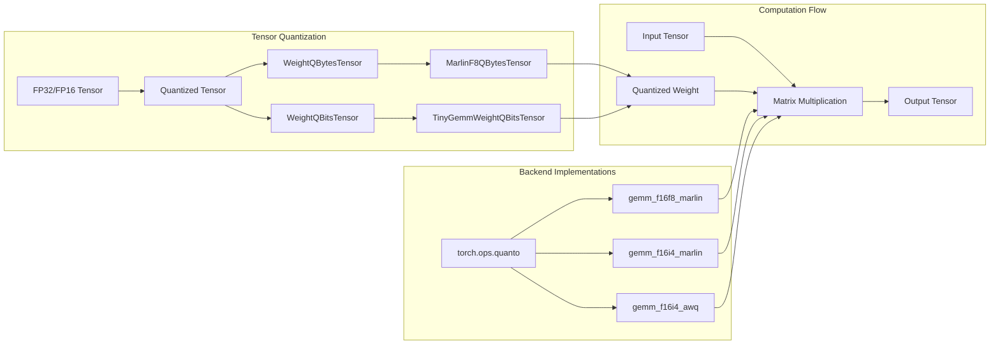

Diagram: Marlin and TinyGemm in the Optimum-Quanto Architecture

Sources: [optimum/quanto/library/extensions/cuda/__init__.py:124-202]()

## Marlin Implementation

Marlin is a specialized implementation focusing on optimized memory layouts and computation patterns to achieve maximum performance for matrix multiplications involving quantized weights.

### Key Characteristics

1. **Specialized Memory Layout**: Marlin uses carefully designed memory permutations to optimize memory access patterns and cache utilization.
2. **Support for Multiple Quantization Types**: Implementations for both FP8 (float8) and int4 quantization.
3. **CUDA-Specific Optimizations**: Tailored for GPUs with compute capability 8.0+ (Ampere and newer).

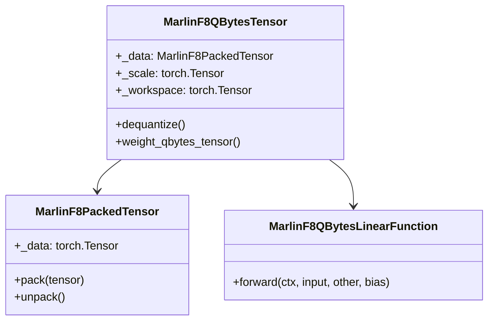

Diagram: Marlin FP8 Class Structure

Sources: [optimum/quanto/tensor/weights/marlin/fp8/packed.py:160-266](), [optimum/quanto/tensor/weights/marlin/fp8/qbits.py:28-167]()

### Marlin FP8 Implementation

The Marlin FP8 implementation is designed for efficient matrix multiplication with FP8 quantized weights. It uses the `float8_e4m3fn` data type (8-bit floating point with 4 exponent bits and 3 mantissa bits) which provides better numerical stability than integer quantization for certain applications.

#### Data Packing and Memory Optimization

A key optimization in Marlin FP8 is the packing of FP8 values into int32 tensors for efficient storage and computation:

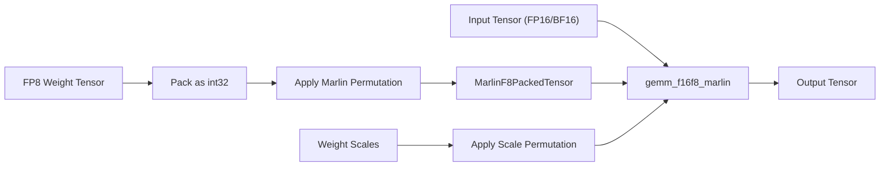

Diagram: Marlin FP8 Data Flow and Permutation

The packing process:
1. Every four FP8 values are packed into a single int32 value
2. The packed values are then rearranged according to a specific permutation pattern
3. The scales are also permuted in a corresponding pattern to match the weight layout

Sources: [optimum/quanto/tensor/weights/marlin/fp8/packed.py:22-69](), [optimum/quanto/tensor/weights/marlin/fp8/packed.py:176-187]()

#### Row and Column Permutations

Marlin uses sophisticated row and column permutations to optimize memory access patterns:

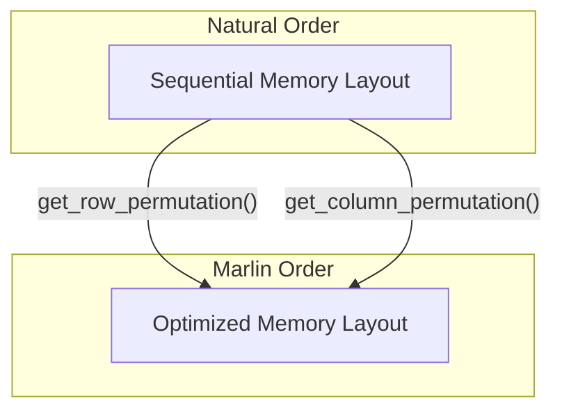

Diagram: Marlin Permutation Process

Sources: [optimum/quanto/tensor/weights/marlin/fp8/packed.py:78-157]()

### Marlin Int4 Implementation

The Marlin int4 implementation provides optimizations for 4-bit integer quantized weights:

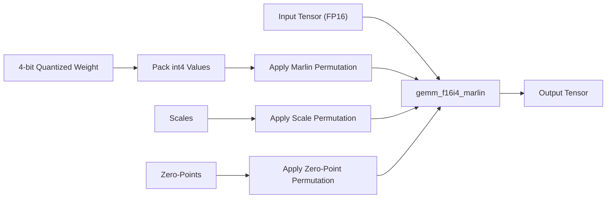

Diagram: Marlin Int4 Data Flow

Sources: [optimum/quanto/library/extensions/cuda/__init__.py:170-202](), [test/library/test_mm.py:147-189]()

## TinyGemm Implementation

TinyGemm is another specialized implementation for int4 quantized weights that focuses on maximum throughput for certain workload patterns. While not as heavily featured in the provided code as Marlin, it serves as an alternative implementation that may provide better performance in specific scenarios.

The main difference between TinyGemm and Marlin int4 is in the memory layout and computation patterns optimized for different hardware characteristics and workload sizes.

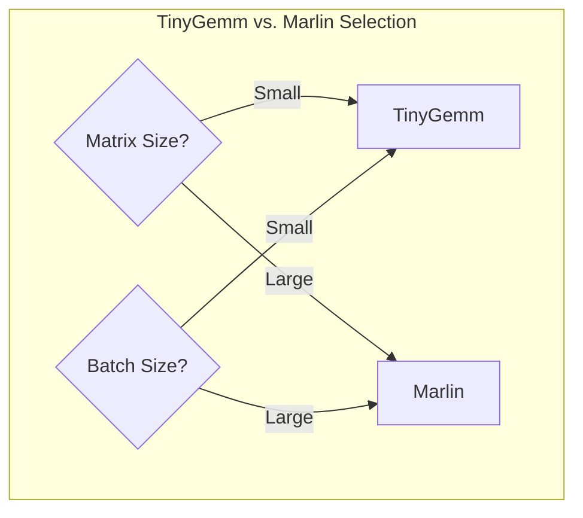

Diagram: Selection Logic Between TinyGemm and Marlin

Sources: [test/library/test_mm.py:57-100]() (implied from test patterns)

## CUDA Kernel Registration

Both Marlin and TinyGemm implementations are registered as CUDA kernels through the PyTorch dispatcher system:

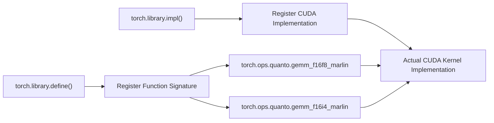

Diagram: CUDA Kernel Registration Process

Sources: [optimum/quanto/library/extensions/cuda/__init__.py:124-202]()

## Matrix Multiplication Implementation

The actual matrix multiplication operations use specialized CUDA kernels optimized for the specific quantization formats:

### FP8 Marlin Matrix Multiplication

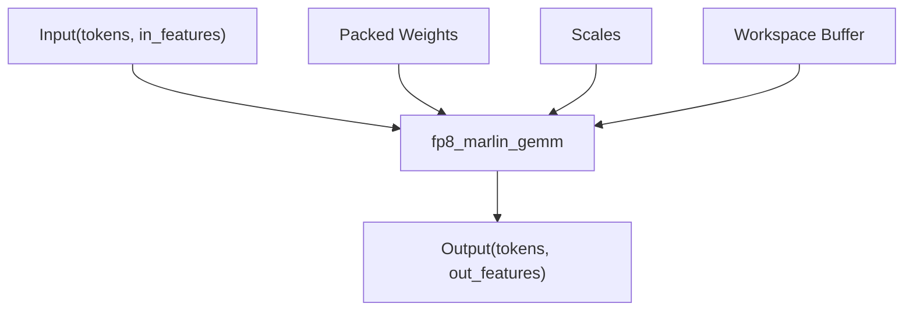

Diagram: FP8 Marlin Matrix Multiplication

Sources: [optimum/quanto/library/extensions/cuda/__init__.py:138-152](), [test/library/test_mm.py:110-144]()

### Int4 Marlin Matrix Multiplication

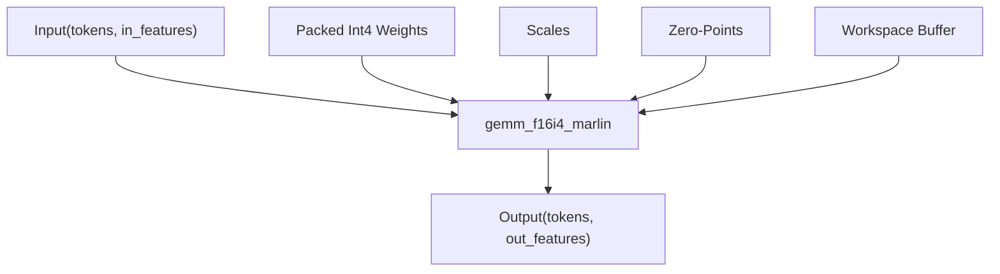

Diagram: Int4 Marlin Matrix Multiplication

Sources: [optimum/quanto/library/extensions/cuda/__init__.py:176-202](), [test/library/test_mm.py:153-189]()

## Usage in Practice

To use Marlin or TinyGemm optimizations in practice, you typically don't need to call the CUDA kernels directly. Instead, the quantized tensor classes handle the optimized implementations automatically when doing matrix multiplications:

| Implementation | Quantization Type | Usage Scenario | Hardware Requirement |
|----------------|-------------------|----------------|----------------------|
| Marlin FP8     | float8_e4m3fn     | When numerical stability is important | CUDA compute capability ≥ 8.0 |
| Marlin Int4    | int4              | When maximum compression is needed | CUDA compute capability ≥ 8.0 |
| TinyGemm       | int4              | For specific workload patterns | CUDA compute capability ≥ 8.0 |

When using a `MarlinF8QBytesTensor` for weights, matrix multiplications through `torch.nn.functional.linear` are automatically dispatched to the optimized CUDA kernels.

Sources: [optimum/quanto/tensor/weights/marlin/fp8/qbits.py:142-167]()

## Performance Considerations

### Hardware Requirements

Both Marlin and TinyGemm require NVIDIA GPUs with compute capability 8.0 or higher (Ampere architecture or newer):

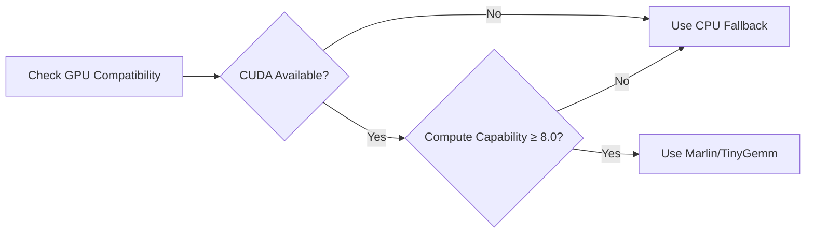

Diagram: Hardware Compatibility Check

Sources: [optimum/quanto/library/extensions/cuda/__init__.py:25-45](), [test/library/test_mm.py:52-56](), [test/library/test_mm.py:103-106](), [test/library/test_mm.py:147-150]()

### Fallback Mechanism

When the specialized kernels aren't available or applicable, a fallback mechanism uses standard PyTorch operations through the `qbytes_mm` implementation:

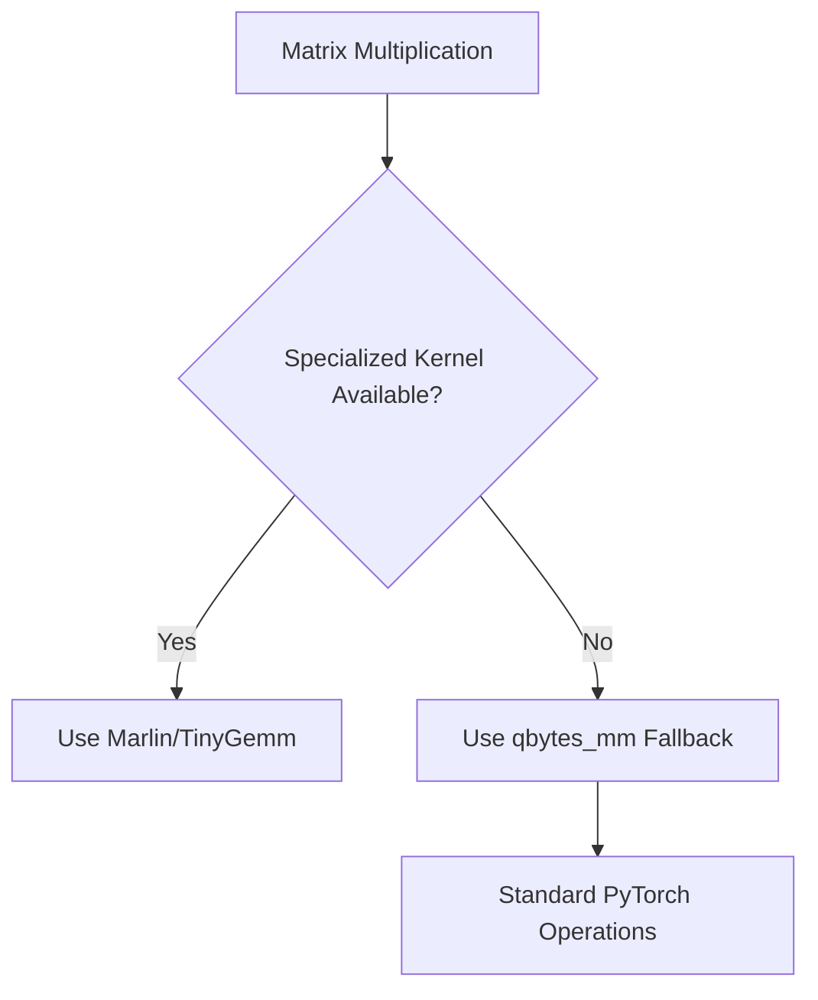

Diagram: Fallback Mechanism

Sources: [optimum/quanto/library/qbytes_mm.py:25-122]()

## Integration with Optimum-Quanto

Marlin and TinyGemm are integrated into the broader Optimum-Quanto architecture as specialized optimization implementations for matrix multiplication operations with quantized weights. They are part of the optimization layer that enables efficient execution of quantized models.

See [Optimization Algorithms](#6) for more information on the overall approach to optimization in Optimum-Quanto, and [AWQ (Activation-Aware Weight Quantization)](#6.1) for another optimization approach.

---

