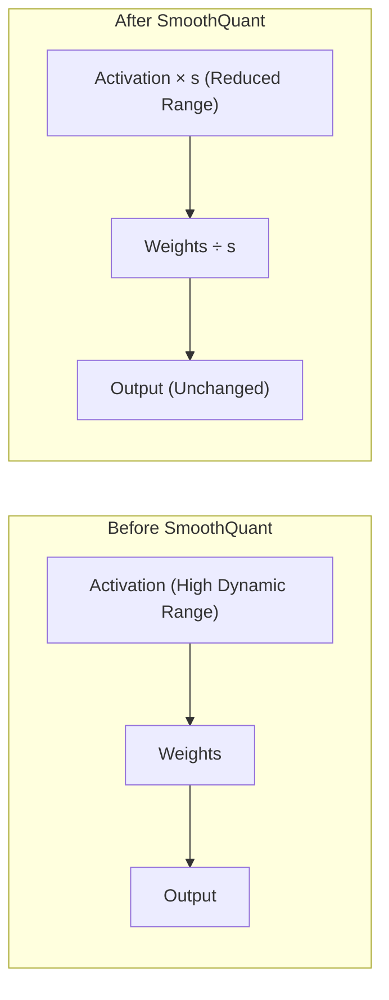
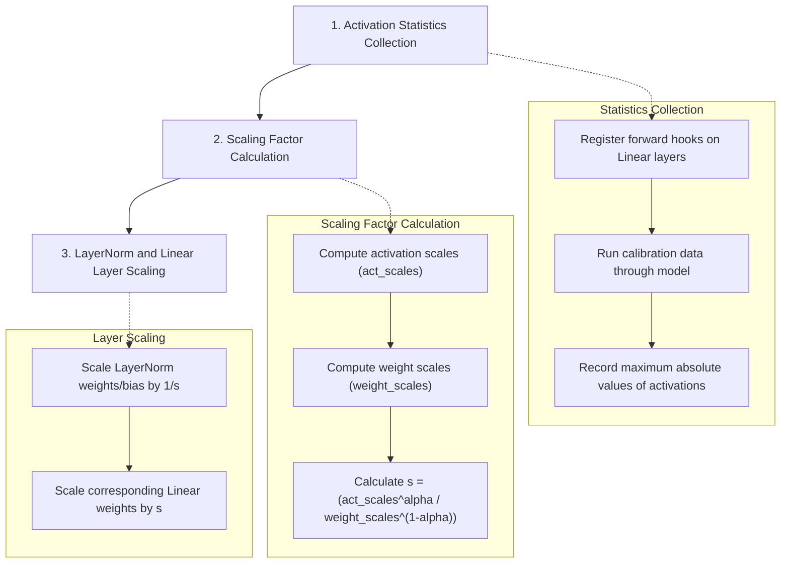
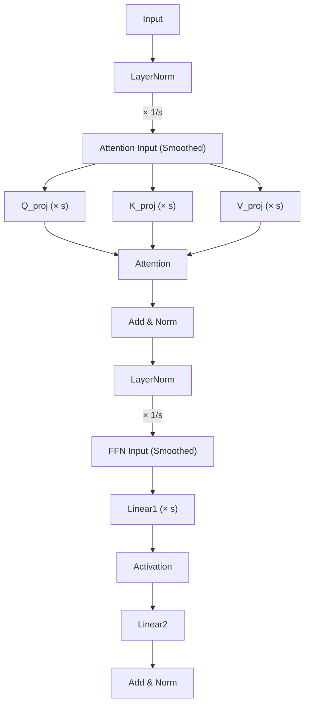
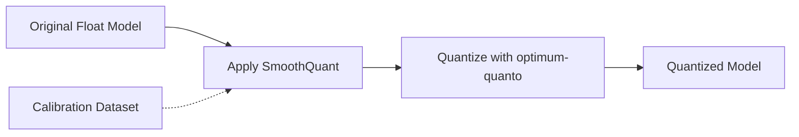

<!-- source: DeepWiki mcp.deepwiki.com · repo huggingface/optimum-quanto · page 6.3 SmoothQuant · fetched 2026-10-26 -->

# SmoothQuant

<details>
<summary>Relevant source files</summary>

The following files were used as context for generating this wiki page:

- [Makefile](Makefile)
- [external/awq/test_awq_kernels.py](external/awq/test_awq_kernels.py)
- [external/awq/test_awq_packing.py](external/awq/test_awq_packing.py)
- [external/smoothquant/smoothquant.py](external/smoothquant/smoothquant.py)
- [pyproject.toml](pyproject.toml)
- [setup.sh](setup.sh)

</details>


SmoothQuant is a quantization preprocessing technique that improves quantization accuracy for transformer-based models by redistributing the quantization difficulty between activations and weights. This technique is particularly effective when quantizing models where activations have high dynamic range with outliers, which is common in large language models.

For information about other quantization optimizations like AWQ and Marlin, see [AWQ (Activation-Aware Weight Quantization)](#6.1) and [Marlin and TinyGemm](#6.2).

## Concept and Theory

SmoothQuant addresses a fundamental challenge in quantization: activations and weights in neural networks often have very different statistical distributions. Activations typically have higher dynamic ranges with outliers, making them difficult to quantize accurately, while weights tend to have more uniform distributions.

The key insight of SmoothQuant is to introduce complementary scaling factors between layer normalization and linear layers:



The mathematical principle is straightforward:
- Original computation: `y = x * W`
- With scaling: `y = (x * s) * (W / s) = x' * W'`

This scaling doesn't change the mathematical function of the model, but it makes both activations and weights more amenable to quantization.

Sources: [external/smoothquant/smoothquant.py:52-73]()

## Implementation Details

SmoothQuant in optimum-quanto employs a three-step process:



The `alpha` parameter (default 0.5) controls how the quantization difficulty is distributed between activations and weights:
- `alpha = 0`: All difficulty shifted to weights
- `alpha = 1`: All difficulty shifted to activations
- `alpha = 0.5`: Even distribution (default)

Sources: [external/smoothquant/smoothquant.py:16-49](), [external/smoothquant/smoothquant.py:52-73]()

## Application to Transformer Models

SmoothQuant is specifically designed to work with transformer architectures. The technique is applied to two critical paths in a transformer block:



The implementation includes special handling for different transformer architectures:
- OPT
- BLOOM
- LLaMA
- Mistral

Each architecture has specific patterns for identifying the layer normalization and linear layer pairs that need smoothing.

Sources: [external/smoothquant/smoothquant.py:76-108]()

## Workflow and Usage

SmoothQuant is typically used as a preprocessing step before applying quantization:



The process requires a representative dataset to calibrate the activation scales. The smoothing operation is a one-time preprocessing step that doesn't affect the inference workflow after quantization.

```python
# Example usage pattern
from external.smoothquant.smoothquant import get_act_scales, smooth_lm

# Load calibration dataset
dataset = load_dataset("lambada", split="validation[:512]").shuffle()

# Collect activation statistics
act_scales = get_act_scales(model, tokenizer, dataset, num_samples=512, seq_len=512)

# Apply SmoothQuant
smooth_lm(model, act_scales, alpha=0.5)

# Now the model is ready for quantization with optimum-quanto
```

Sources: [external/smoothquant/smoothquant.py:111-144]()

## Benefits and Limitations

### Benefits
- Improves quantization accuracy, especially for activation-sensitive operations
- Preserves the mathematical function of the model
- Compatible with other quantization techniques in optimum-quanto
- Particularly effective for transformer-based architectures

### Limitations
- Requires a calibration dataset
- Most effective for specific architectures (transformers)
- Adds preprocessing overhead (one-time cost)
- Performance gains are model-dependent

## Integration with optimum-quanto

While SmoothQuant is included as an external reference implementation in the optimum-quanto repository, it can be used as a complementary technique alongside the core quantization methods provided by optimum-quanto.

The typical workflow is:
1. Apply SmoothQuant to the model using the reference implementation
2. Proceed with quantization using optimum-quanto's quantization methods
3. Benefit from improved quantization accuracy in the resulting model

Sources: [external/smoothquant/smoothquant.py]()

## Conclusion

SmoothQuant is a powerful preprocessing technique that can significantly improve the quantization results for transformer models. By redistributing the quantization difficulty between activations and weights, it addresses one of the fundamental challenges in neural network quantization. When used in conjunction with optimum-quanto's quantization methods, it can lead to better quality quantized models, especially when both weights and activations are quantized.

---

