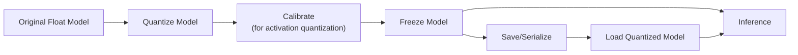
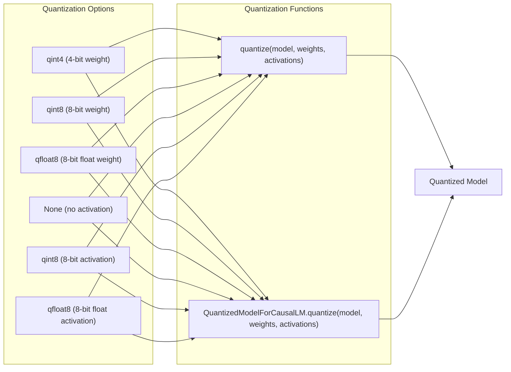
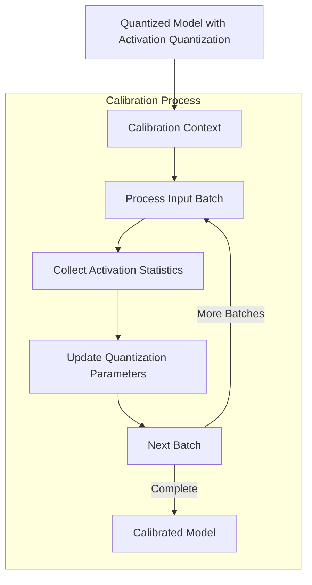
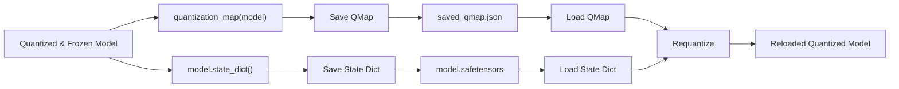

<!-- source: DeepWiki mcp.deepwiki.com · repo huggingface/optimum-quanto · page 7 Workflow Guide · fetched 2026-10-26 -->

# Workflow Guide

<details>
<summary>Relevant source files</summary>

The following files were used as context for generating this wiki page:

- [examples/nlp/text-classification/sst2/quantize_sst2_model.py](examples/nlp/text-classification/sst2/quantize_sst2_model.py)
- [examples/nlp/text-generation/quantize_causal_lm_model.py](examples/nlp/text-generation/quantize_causal_lm_model.py)
- [examples/vision/StableDiffusion/quantize_StableDiffusion.py](examples/vision/StableDiffusion/quantize_StableDiffusion.py)
- [examples/vision/StableDiffusion/requirements.txt](examples/vision/StableDiffusion/requirements.txt)
- [examples/vision/image-classification/mnist/quantize_mnist_model.py](examples/vision/image-classification/mnist/quantize_mnist_model.py)
- [examples/vision/object-detection/quantize_owl_model.py](examples/vision/object-detection/quantize_owl_model.py)
- [examples/vision/text-to-image/quantize_pixart_sigma.py](examples/vision/text-to-image/quantize_pixart_sigma.py)
- [optimum/quanto/__init__.py](optimum/quanto/__init__.py)
- [optimum/quanto/quantize.py](optimum/quanto/quantize.py)
- [test/quantize/test_quantize_patterns.py](test/quantize/test_quantize_patterns.py)
- [test/quantize/test_requantize.py](test/quantize/test_requantize.py)

</details>


This document provides a comprehensive guide to the standard workflow when using optimum-quanto for model quantization. It covers the complete process from loading a model through quantization, calibration, freezing, and serialization. For detailed information about specific quantization types and techniques, see [Quantization Types](#3.1) and [Optimization Algorithms](#6).

## Quantization Workflow Overview

The quantization workflow in optimum-quanto follows a consistent pattern regardless of model type:



Sources: [examples/nlp/text-generation/quantize_causal_lm_model.py:138-147](), [examples/vision/image-classification/mnist/quantize_mnist_model.py:136-169](), [examples/nlp/text-classification/sst2/quantize_sst2_model.py:77-96]()

## Step 1: Loading a Model

The first step is to load the model you want to quantize. This typically uses the standard model loading functions from libraries like `transformers`, `diffusers`, or other frameworks.

```python
# For transformers models
from transformers import AutoModelForCausalLM
model = AutoModelForCausalLM.from_pretrained("model_name", torch_dtype=torch_dtype)

# For diffusers models
from diffusers import DiffusionPipeline
pipe = DiffusionPipeline.from_pretrained("model_name", torch_dtype=torch_dtype)
```

Sources: [examples/nlp/text-generation/quantize_causal_lm_model.py:129-132](), [examples/vision/StableDiffusion/quantize_StableDiffusion.py:25-27]()

## Step 2: Quantizing the Model

Once you have loaded the model, you can quantize it using the `quantize()` function or model-specific quantization methods:



For general models, use the `quantize()` function:

```python
from optimum.quanto import quantize, qint8, qint4, qfloat8

# Quantize with 8-bit weights and no activation quantization
quantize(model, weights=qint8, activations=None)

# Quantize with 4-bit weights and 8-bit activation
quantize(model, weights=qint4, activations=qint8)

# You can also use include/exclude patterns to control which modules get quantized
quantize(model, weights=qint8, include="encoder*")
quantize(model, weights=qint8, exclude="decoder*")
```

For causal language models, you can use the specialized `QuantizedModelForCausalLM` class:

```python
from optimum.quanto import QuantizedModelForCausalLM, qint8

qmodel = QuantizedModelForCausalLM.quantize(model, weights=qint8, activations=qint8)
```

Sources: [optimum/quanto/quantize.py:55-98](), [examples/nlp/text-generation/quantize_causal_lm_model.py:138-140](), [examples/vision/image-classification/mnist/quantize_mnist_model.py:140-142](), [examples/nlp/text-classification/sst2/quantize_sst2_model.py:78-80]()

## Step 3: Calibrating Activations

If you're using activation quantization, you need to calibrate the model by running representative input data through it. This allows optimum-quanto to collect statistics about activation ranges for proper quantization:



```python
from optimum.quanto import Calibration

# For simple calibration
with Calibration():
    # Run some representative inputs through the model
    model(inputs)

# For more detailed calibration
with Calibration(streamline=True, debug=True):
    # Process dataset for calibration
    for batch in dataset:
        model(batch)
```

Sources: [examples/nlp/text-generation/quantize_causal_lm_model.py:143-146](), [examples/vision/image-classification/mnist/quantize_mnist_model.py:144-146](), [examples/nlp/text-classification/sst2/quantize_sst2_model.py:82-84]()

## Step 4: Freezing the Model

After calibration, you should freeze the model to finalize the quantization parameters and convert all appropriate tensors to their quantized format:

```python
from optimum.quanto import freeze

# Freeze the model to finalize quantization
freeze(model)
```

This step converts weights from their temporary representation to the final quantized format, which is important for both performance and memory optimization.

Sources: [examples/vision/image-classification/mnist/quantize_mnist_model.py:155](), [examples/nlp/text-classification/sst2/quantize_sst2_model.py:85]()

## Step 5: Serialization and Loading

After quantizing a model, you'll typically want to save it for future use. You can do this using standard serialization mechanisms with additional quantization information:



The serialization workflow:

```python
from optimum.quanto import freeze, quantization_map, requantize
from safetensors.torch import save_file, load_file

# Get the quantization map that describes how the model was quantized
qmap = quantization_map(model)

# Save the model state dictionary and quantization map
save_file(model.state_dict(), "model.safetensors")
# Save qmap to JSON (not shown here)

# Later, to load the model:
model_reloaded = CreateEmptyModel()  # Create an empty model with the same architecture
state_dict = load_file("model.safetensors")

# Requantize the model with the saved state
requantize(model_reloaded, state_dict, qmap, device)
```

For Hugging Face models, you can use the standard `save_pretrained()` and `from_pretrained()` methods which will handle the quantization map automatically.

Sources: [examples/vision/image-classification/mnist/quantize_mnist_model.py:158-169](), [test/quantize/test_requantize.py:50-72]()

## Common Patterns and Best Practices

### Device Selection

It's important to select the appropriate device based on availability. Here's a common pattern for device selection:

```python
if args.device is None:
    if torch.cuda.is_available():
        device = torch.device("cuda")
    elif torch.backends.mps.is_available():
        device = torch.device("mps")
    elif torch.xpu.is_available():
        device = torch.device("xpu")
    else:
        device = torch.device("cpu")
else:
    device = torch.device(args.device)
```

Sources: [examples/nlp/text-generation/quantize_causal_lm_model.py:110-120](), [examples/vision/image-classification/mnist/quantize_mnist_model.py:108-118]()

### Selecting Quantization Types

Choosing the right quantization types depends on your needs:

| Type | Precision | Memory Usage | Accuracy | Hardware Support |
|------|-----------|--------------|----------|------------------|
| qint4 | 4-bit integer | Lowest | Lower | Limited |
| qint8 | 8-bit integer | Low | Medium | Good |
| qfloat8 | 8-bit float | Low | Higher | Limited |
| None (fp16/bf16) | 16-bit float | High | Highest | Excellent |

For most use cases:
- Start with `weights=qint8, activations=None` for a good balance
- Use `weights=qint4` for maximum memory savings if accuracy allows
- Use `weights=qfloat8` if you need better accuracy than qint8 but still need memory savings

Sources: [examples/nlp/text-generation/quantize_causal_lm_model.py:87-96](), [examples/vision/StableDiffusion/quantize_StableDiffusion.py:17-22]()

### Inclusion and Exclusion Patterns

You can use Unix shell-style wildcards to control which parts of your model get quantized:

```python
# Only quantize the encoder part
quantize(model, weights=qint8, include="encoder*")

# Quantize everything except the embedding layers
quantize(model, weights=qint8, exclude="*embedding*")

# Quantize only specific parts
quantize(model, weights=qint8, include=["*.linear_layer_*", "*.mlp.*"])
```

Sources: [optimum/quanto/quantize.py:80-87](), [test/quantize/test_quantize_patterns.py:88-110]()

## Example Workflows

### Text Generation Models

```python
from transformers import AutoModelForCausalLM, AutoTokenizer
from optimum.quanto import Calibration, QuantizedModelForCausalLM, qint8

# 1. Load model
model = AutoModelForCausalLM.from_pretrained("facebook/opt-350m", torch_dtype=torch.float16).to(device)
tokenizer = AutoTokenizer.from_pretrained("facebook/opt-350m")

# 2. Quantize model
qmodel = QuantizedModelForCausalLM.quantize(model, weights=qint8, activations=qint8)

# 3. Calibrate (if using activation quantization)
cal_dataset = load_dataset("lambada", split=["validation"])[0]
with Calibration(streamline=True):
    for batch in cal_dataset.iter(batch_size=32):
        inputs = tokenizer(batch["text"], return_tensors="pt", padding=True)
        qmodel(inputs.input_ids.to(device), attention_mask=inputs.attention_mask.to(device))

# 4. Use for generation
inputs = tokenizer("One of my fondest memory is", return_tensors="pt")
outputs = qmodel.generate(
    input_ids=inputs.input_ids.to(device),
    max_new_tokens=20,
    do_sample=True,
)
```

Sources: [examples/nlp/text-generation/quantize_causal_lm_model.py:129-147]()

### Vision Models

```python
from transformers import AutoModel, AutoTokenizer
from optimum.quanto import Calibration, freeze, qint8, quantize

# 1. Load model
model = AutoModel.from_pretrained("dacorvo/mnist-mlp")

# 2. Quantize model
quantize(model, weights=qint8, activations=qint8)

# 3. Calibrate (if using activation quantization)
with Calibration():
    for data, _ in test_loader:
        model(data.to(device))

# 4. Freeze the model
freeze(model)

# 5. Save and reload
qmap = quantization_map(model)
save_file(model.state_dict(), "model.safetensors")

# Later, to load:
model_reloaded = AutoModel.from_config(config)
requantize(model_reloaded, state_dict, qmap, device)
```

Sources: [examples/vision/image-classification/mnist/quantize_mnist_model.py:136-169]()

### Diffusion Models

```python
from diffusers import DiffusionPipeline
from optimum.quanto import freeze, qint8, quantize

# 1. Load the pipeline
pipe = DiffusionPipeline.from_pretrained("runwayml/stable-diffusion-v1-5", torch_dtype=torch.float16).to(device)

# 2. Quantize just the UNet component
quantize(pipe.unet, weights=qint8)
freeze(pipe.unet)

# 3. Use for inference
images = pipe(
    prompt="ghibli style, a fantasy landscape with castles",
    num_inference_steps=50,
    generator=torch.manual_seed(0),
).images
```

Sources: [examples/vision/StableDiffusion/quantize_StableDiffusion.py:25-33](), [examples/vision/StableDiffusion/quantize_StableDiffusion.py:112-117]()

## Conclusion

This workflow guide has covered the essential steps for quantizing models with optimum-quanto. By following these patterns, you can efficiently convert your models to use lower precision, reducing memory usage and potentially improving inference speed while maintaining acceptable accuracy.

For more detailed information on specific quantization techniques, refer to [Optimization Algorithms](#6) and for information about quantized module implementations, see [Quantized Modules](#5).

---

