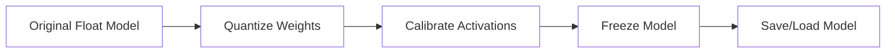
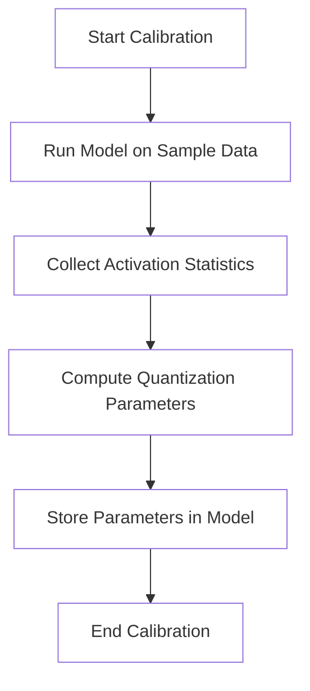
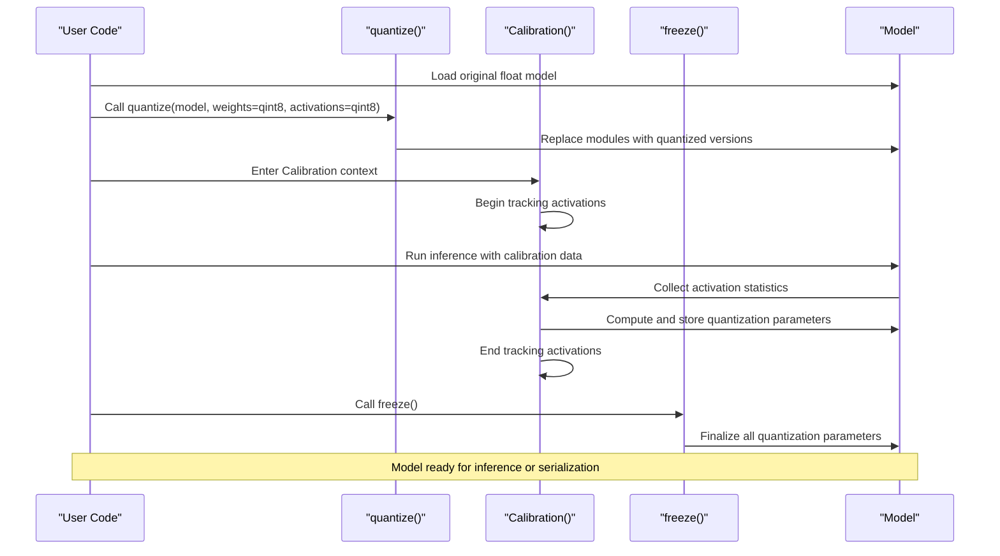

<!-- source: DeepWiki mcp.deepwiki.com · repo huggingface/optimum-quanto · page 7.1 Quantization and Calibration · fetched 2026-10-26 -->

# Quantization and Calibration

<details>
<summary>Relevant source files</summary>

The following files were used as context for generating this wiki page:

- [examples/nlp/text-classification/sst2/quantize_sst2_model.py](examples/nlp/text-classification/sst2/quantize_sst2_model.py)
- [examples/nlp/text-generation/quantize_causal_lm_model.py](examples/nlp/text-generation/quantize_causal_lm_model.py)
- [examples/vision/StableDiffusion/quantize_StableDiffusion.py](examples/vision/StableDiffusion/quantize_StableDiffusion.py)
- [examples/vision/StableDiffusion/requirements.txt](examples/vision/StableDiffusion/requirements.txt)
- [examples/vision/image-classification/mnist/quantize_mnist_model.py](examples/vision/image-classification/mnist/quantize_mnist_model.py)
- [examples/vision/object-detection/quantize_owl_model.py](examples/vision/object-detection/quantize_owl_model.py)
- [examples/vision/text-to-image/quantize_pixart_sigma.py](examples/vision/text-to-image/quantize_pixart_sigma.py)
- [optimum/quanto/__init__.py](optimum/quanto/__init__.py)
- [optimum/quanto/quantize.py](optimum/quanto/quantize.py)
- [test/quantize/test_quantize_patterns.py](test/quantize/test_quantize_patterns.py)
- [test/quantize/test_requantize.py](test/quantize/test_requantize.py)

</details>


This document details the process of quantizing models and calibrating their activations in optimum-quanto. It covers the essential steps in the quantization workflow, from initializing a float model to producing a production-ready quantized model. For information about saving and loading quantized models, see [Freezing and Serialization](#7.2).

## Overview

Quantization is the process of converting a model's weights and/or activations from higher precision (typically float32 or float16) to lower precision formats (int8, int4, float8). Calibration is the process of collecting statistics on activation values during inference to ensure optimal quantization parameters for activations.

Together, these processes form the critical first steps in the optimum-quanto workflow:



Sources: [optimum/quanto/quantize.py](), [examples/nlp/text-generation/quantize_causal_lm_model.py:137-147]()

## Quantization Types

Optimum-quanto supports several quantization types for both weights and activations:

| Type | Description | Precision | Use Cases |
|------|-------------|-----------|-----------|
| `qint8` | 8-bit integer quantization | 8 bits | Good balance of quality and size reduction |
| `qint4` | 4-bit integer quantization | 4 bits | Maximum size reduction, some quality loss |
| `qfloat8` | 8-bit floating point quantization | 8 bits | Better accuracy than int8 for some models |
| `None` | No quantization | Original precision | Used to disable activation quantization |

The quantization type is specified when calling the quantization function:

```mermaid
classDiagram
    class "Quantization Parameters" {
        +weights: Optional[qtype]
        +activations: Optional[qtype]
    }
    
    class "qtype options" {
        qint8
        qint4
        qfloat8
        None
    }
    
    "Quantization Parameters" --> "qtype options"
```

Sources: [examples/nlp/text-generation/quantize_causal_lm_model.py:56-62](), [examples/vision/image-classification/mnist/quantize_mnist_model.py:89-90]()

## Workflow Steps

### 1. Initial Quantization

The first step is to apply weight quantization to the model using the `quantize()` function. This replaces standard PyTorch modules with their quantized equivalents:

```python
from optimum.quanto import quantize, qint8, qint4, qfloat8

# Quantize weights only
quantize(model, weights=qint8)

# Quantize both weights and activations
quantize(model, weights=qint8, activations=qint8)
```

Under the hood, this replaces modules like `torch.nn.Linear` with `QLinear` which uses quantized weights.

Sources: [optimum/quanto/quantize.py:55-98](), [examples/nlp/text-generation/quantize_causal_lm_model.py:140]()

### 2. Calibration

When activation quantization is applied, calibration is required to determine appropriate quantization parameters for activation tensors. This involves running representative data through the model to collect statistics:

```python
from optimum.quanto import Calibration

# Calibrate the model by running inference on sample data
with Calibration():
    model(sample_input)
```

The `Calibration` context manager automatically tracks activations and computes quantization parameters based on the observed values.



Sources: [examples/nlp/text-generation/quantize_causal_lm_model.py:142-146](), [examples/vision/image-classification/mnist/quantize_mnist_model.py:143-146](), [examples/nlp/text-classification/sst2/quantize_sst2_model.py:81-84]()

### 3. Freezing

After calibration, the model should be frozen to finalize the quantization process. Freezing converts all dynamic quantized tensors into static quantized tensors, which improves performance:

```python
from optimum.quanto import freeze

# Freeze the model to finalize quantization
freeze(model)
```

This step is essential for models with activation quantization that have been calibrated.

Sources: [optimum/quanto/quantize.py:143-147](), [examples/vision/image-classification/mnist/quantize_mnist_model.py:155]()

## Example: Complete Workflow

Below is an example of the complete quantization and calibration workflow for a text generation model:



Sources: [examples/nlp/text-generation/quantize_causal_lm_model.py:137-147](), [examples/vision/image-classification/mnist/quantize_mnist_model.py:136-155]()

## Practical Implementation

### Text Generation Models

For text generation models, the workflow typically involves:

```python
# Import necessary components
from optimum.quanto import Calibration, QuantizedModelForCausalLM, qint8

# 1. Load the original model
model = AutoModelForCausalLM.from_pretrained("model_name")

# 2. Quantize the model
qmodel = QuantizedModelForCausalLM.quantize(model, weights=qint8, activations=qint8)

# 3. Calibrate with sample data
with Calibration():
    # Run sample data through the model
    calibrate(qmodel, tokenizer, dataset, device, batch_size=32)

# 4. Model is ready for inference or serialization
```

Sources: [examples/nlp/text-generation/quantize_causal_lm_model.py:137-147]()

### Vision Models

For vision models, the workflow is similar:

```python
# Import necessary components
from optimum.quanto import Calibration, quantize, freeze, qint8

# 1. Load the original model
model = AutoModel.from_pretrained("model_name")

# 2. Quantize the model directly
quantize(model, weights=qint8, activations=qint8)

# 3. Calibrate with sample data
with Calibration():
    # Run inference with the test data loader
    test(model, device, test_loader)

# 4. Freeze the model
freeze(model)

# 5. Model is ready for inference or serialization
```

Sources: [examples/vision/image-classification/mnist/quantize_mnist_model.py:136-156]()

## Advanced Options

### Selective Quantization

You can selectively quantize parts of a model using the `include` and `exclude` parameters:

```python
# Only quantize the transformer part of a model
quantize(model, weights=qint8, include="transformer*")

# Quantize everything except the heads
quantize(model, weights=qint8, exclude="*head*")
```

These patterns use Unix shell-style wildcards to match module names.

Sources: [optimum/quanto/quantize.py:82-98](), [test/quantize/test_quantize_patterns.py:61-110]()

### Calibration Options

The `Calibration` context manager accepts optional parameters:

```python
# Enable streamlining to remove redundant quantize/dequantize operations
with Calibration(streamline=True):
    model(sample_input)

# Enable debug output during calibration
with Calibration(debug=True):
    model(sample_input)
```

The `streamline` option optimizes the model by removing consecutive quantize/dequantize operations, which can improve performance.

Sources: [examples/nlp/text-generation/quantize_causal_lm_model.py:144]()

## Conclusion

Quantization and calibration form the foundation of creating efficient, low-precision models with optimum-quanto. The workflow provides a straightforward path to converting standard PyTorch models into quantized versions that offer significant memory savings and potentially faster inference.

After completing the quantization and calibration steps described in this document, you should proceed to freeze and then serialize your model for deployment or further use. For details on these next steps, see [Freezing and Serialization](#7.2).

---

