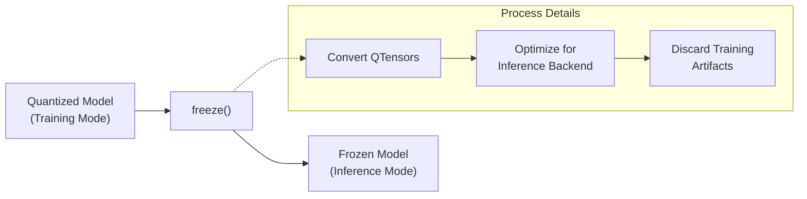
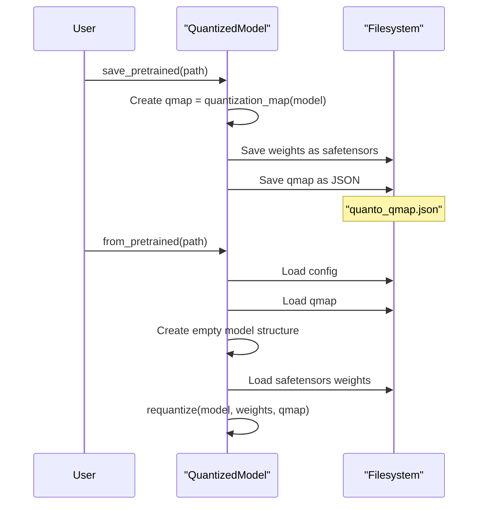
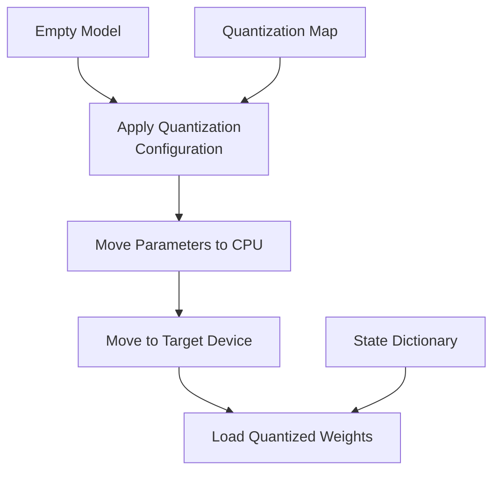
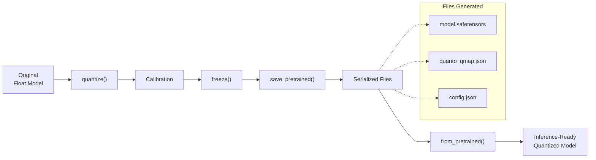

<!-- source: DeepWiki mcp.deepwiki.com · repo huggingface/optimum-quanto · page 7.2 Freezing and Serialization · fetched 2026-10-26 -->

# Freezing and Serialization

<details>
<summary>Relevant source files</summary>

The following files were used as context for generating this wiki page:

- [optimum/quanto/__init__.py](optimum/quanto/__init__.py)
- [optimum/quanto/models/__init__.py](optimum/quanto/models/__init__.py)
- [optimum/quanto/models/diffusers_models.py](optimum/quanto/models/diffusers_models.py)
- [optimum/quanto/models/shared_dict.py](optimum/quanto/models/shared_dict.py)
- [optimum/quanto/models/transformers_models.py](optimum/quanto/models/transformers_models.py)
- [optimum/quanto/quantize.py](optimum/quanto/quantize.py)
- [test/quantize/test_quantize_patterns.py](test/quantize/test_quantize_patterns.py)
- [test/quantize/test_requantize.py](test/quantize/test_requantize.py)

</details>


This document explains how to freeze quantized models for inference and how to save and load them in optimum-quanto. Freezing is the process of converting quantization-aware training models to efficient inference models, while serialization enables storing and loading these quantized models. For information about the initial quantization and calibration process, see [Quantization and Calibration](#7.1).

## Freezing Process

After quantization and calibration, models need to be "frozen" before deployment for inference. Freezing converts the weight and activation tensors from their dynamic training representation to a static, optimized inference representation.



Sources: [optimum/quanto/quantize.py:143-147]()

The `freeze` function iterates through all modules in a model and calls the `freeze` method on any module that inherits from `QModuleMixin`. This transforms the internal representation of quantized weights to formats optimized for inference.

```python
# Freezing a model after quantization and calibration
from optimum.quanto import freeze

# After quantization and calibration are complete
freeze(model)
```

When a model is frozen, it can no longer be used for quantization-aware training, as its parameters have been converted to inference-optimized format.

Sources: [optimum/quanto/quantize.py:143-147](), [optimum/quanto/models/transformers_models.py:111-112](), [optimum/quanto/models/diffusers_models.py:114-115]()

## Quantization Map

The quantization map is a key component of the serialization process. It stores metadata about how each module in the model was quantized, including:

- Which modules were quantized
- The quantization type used for weights
- The quantization type used for activations

```mermaid
classDiagram
    class QuantizationMap {
        module_name: string
        weights: qtype
        activations: qtype
    }
    
    class QMap {
        "module.linear1": {"weights": "qint8", "activations": "none"}
        "module.linear2": {"weights": "qint4", "activations": "qint8"}
        ...
    }
    
    QuantizationMap --|> QMap
```

The `quantization_map` function generates this mapping by examining all modules in a model and recording the quantization configuration of those that inherit from `QModuleMixin`:

```python
from optimum.quanto import quantization_map

# Generate the quantization map
qmap = quantization_map(model)
```

This map is essential for both saving and loading quantized models, as it records how each module should be quantized when the model is reloaded.

Sources: [optimum/quanto/quantize.py:149-170]()

## Serialization Workflow

The serialization process in optimum-quanto extends Hugging Face's standard model saving and loading workflows to handle quantized models.



Sources: [optimum/quanto/models/transformers_models.py:165-179](), [optimum/quanto/models/diffusers_models.py:180-186]()

### Saving Quantized Models

Quantized models provide a specialized `save_pretrained` method that:

1. Saves the model weights using safetensors format
2. Saves the quantization map as a JSON file named `quanto_qmap.json`

```python
# Saving a quantized model
model.save_pretrained("path/to/save/directory")
```

For models with tied weights (common in language models), the serialization process also verifies if quantized modules have broken weight tying and updates the configuration accordingly.

Sources: [optimum/quanto/models/transformers_models.py:165-179]()

### Loading Quantized Models

Loading a quantized model involves a specialized `from_pretrained` class method that:

1. Downloads or locates the model files
2. Loads the quantization map
3. Creates an empty model structure
4. Applies quantization based on the map
5. Loads the weights into the quantized structure

```python
# Loading a quantized model
from optimum.quanto.models import QuantizedModelForCausalLM

model = QuantizedModelForCausalLM.from_pretrained("path/to/model/directory")
```

This process uses the `requantize` function, which reapplies the quantization configuration and loads the weights into the appropriate format.

Sources: [optimum/quanto/models/transformers_models.py:114-163](), [optimum/quanto/models/diffusers_models.py:118-178]()

## Requantization Process

The `requantize` function is a core component of loading quantized models. It implements the following steps:

1. Quantizes an empty model based on the quantization map
2. Moves model parameters to CPU before materializing quantized weights
3. Transfers the model to the target device
4. Loads the quantized state dictionary



This approach optimizes memory usage during model loading, which is particularly important for large models.

Sources: [optimum/quanto/quantize.py:101-140](), [test/quantize/test_requantize.py:40-98]()

## Model-Specific Serialization

Optimum-quanto provides specialized classes for different model types:

| Model Type | Base Class | Description |
|------------|------------|-------------|
| Transformers | `QuantizedTransformersModel` | Base class for all quantized transformers models |
| Causal LM | `QuantizedModelForCausalLM` | For autoregressive language models like GPT |
| Diffusers | `QuantizedDiffusersModel` | Base class for all quantized diffusers models |
| PixArt | `QuantizedPixArtTransformer2DModel` | For PixArt image generation models |

Each class implements specialized serialization and deserialization logic to handle the specific requirements of that model type.

Sources: [optimum/quanto/models/transformers_models.py:38-184](), [optimum/quanto/models/diffusers_models.py:44-190]()

## Complete Workflow Example

The following diagram illustrates the complete workflow from quantization to deploying a serialized model:



Here's a complete example demonstrating the process:

```python
from optimum.quanto import qint8, quantize, Calibration, freeze
from optimum.quanto.models import QuantizedModelForCausalLM
from transformers import AutoModelForCausalLM

# 1. Load the original model
model = AutoModelForCausalLM.from_pretrained("gpt2")

# 2. Quantize the model
quantize(model, weights=qint8)

# 3. Calibrate (for activation quantization if needed)
with Calibration():
    model("This is a calibration input")

# 4. Freeze the model
freeze(model)

# 5. Create a quantized model wrapper
quantized_model = QuantizedModelForCausalLM(model)

# 6. Save the model
quantized_model.save_pretrained("./quantized-gpt2")

# 7. Later, load the model
loaded_model = QuantizedModelForCausalLM.from_pretrained("./quantized-gpt2")
```

Sources: [optimum/quanto/models/transformers_models.py:69-162](), [optimum/quanto/models/diffusers_models.py:72-178](), [optimum/quanto/quantize.py:55-98]()

## Device Considerations

When loading quantized models, pay attention to device placement:

1. By default, models are loaded to the same device as the model's parameters
2. For loading large models that may not fit in memory, the `requantize` function supports loading parameters to CPU first
3. When using sharded weights (common for large models), optimum-quanto uses a specialized `ShardedStateDict` to efficiently load weights without loading all shards into memory simultaneously

```python
# Loading a quantized model to a specific device
from optimum.quanto.models import QuantizedModelForCausalLM
import torch

model = QuantizedModelForCausalLM.from_pretrained("path/to/model", device_map="auto")
# Or specify a particular device
model = QuantizedModelForCausalLM.from_pretrained("path/to/model", device_map={"": torch.device("cuda:0")})
```

Sources: [optimum/quanto/quantize.py:105-111](), [optimum/quanto/models/transformers_models.py:142-154](), [optimum/quanto/models/shared_dict.py:22-54]()

---

