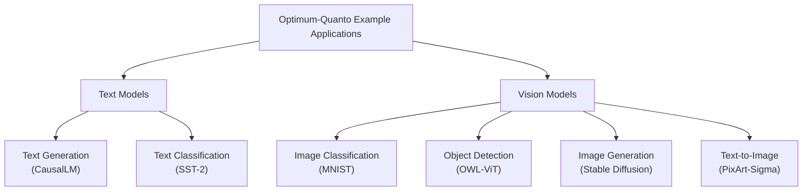
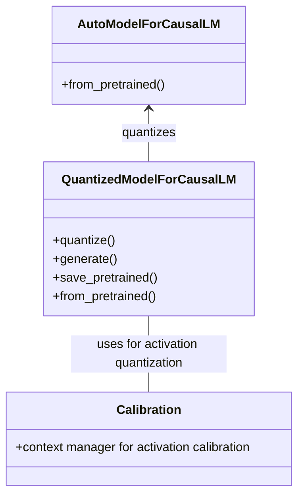
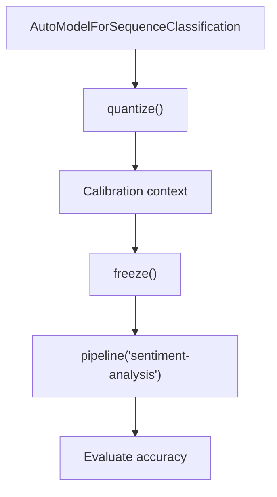
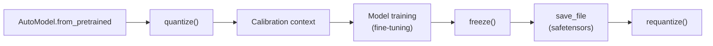
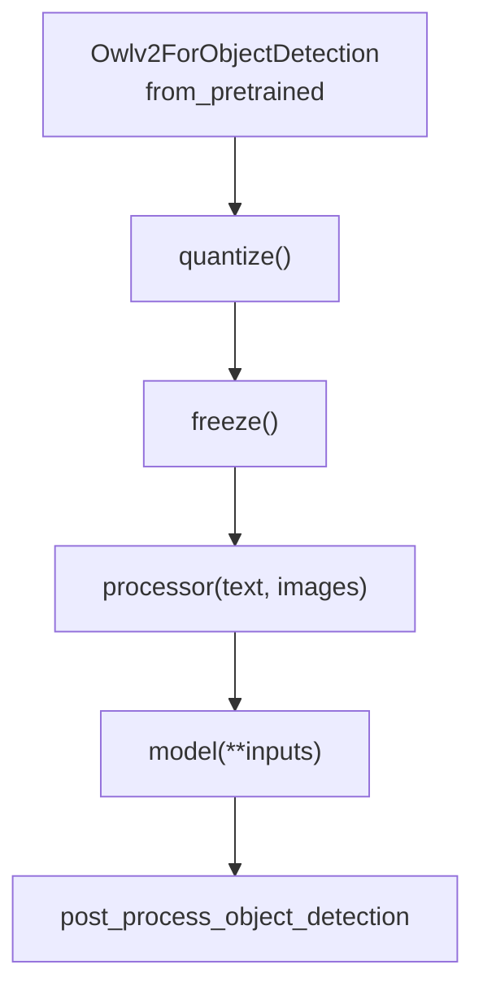
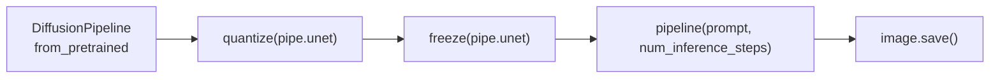
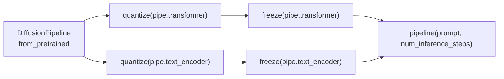
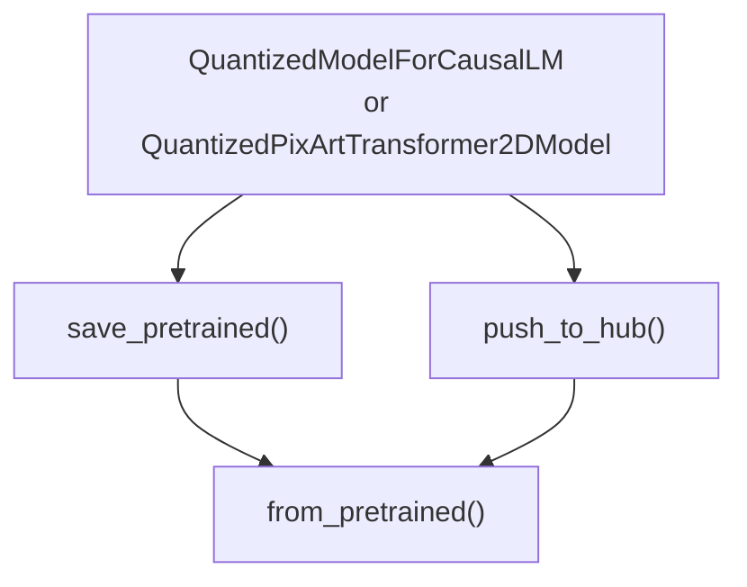

<!-- source: DeepWiki mcp.deepwiki.com · repo huggingface/optimum-quanto · page 8 Example Applications · fetched 2026-10-26 -->

# Example Applications

<details>
<summary>Relevant source files</summary>

The following files were used as context for generating this wiki page:

- [examples/nlp/text-classification/sst2/quantize_sst2_model.py](examples/nlp/text-classification/sst2/quantize_sst2_model.py)
- [examples/nlp/text-generation/quantize_causal_lm_model.py](examples/nlp/text-generation/quantize_causal_lm_model.py)
- [examples/vision/StableDiffusion/quantize_StableDiffusion.py](examples/vision/StableDiffusion/quantize_StableDiffusion.py)
- [examples/vision/StableDiffusion/requirements.txt](examples/vision/StableDiffusion/requirements.txt)
- [examples/vision/image-classification/mnist/quantize_mnist_model.py](examples/vision/image-classification/mnist/quantize_mnist_model.py)
- [examples/vision/object-detection/quantize_owl_model.py](examples/vision/object-detection/quantize_owl_model.py)
- [examples/vision/text-to-image/quantize_pixart_sigma.py](examples/vision/text-to-image/quantize_pixart_sigma.py)
- [test/helpers.py](test/helpers.py)
- [test/models/conftest.py](test/models/conftest.py)
- [test/models/test_quantized_model_for_causal_lm.py](test/models/test_quantized_model_for_causal_lm.py)
- [test/models/test_quantized_model_for_pixart.py](test/models/test_quantized_model_for_pixart.py)

</details>


This page demonstrates practical applications of optimum-quanto for quantizing various types of models. It showcases complete examples that cover the entire workflow from loading a model to quantizing it and using it for inference. For detailed information about the quantization process itself, see [Workflow Guide](#7).

## Overview of Example Applications

Optimum-quanto supports quantization of various model types across different domains. The example applications in the repository demonstrate how to apply quantization to:



Sources: [examples/nlp/text-generation/quantize_causal_lm_model.py](), [examples/nlp/text-classification/sst2/quantize_sst2_model.py](), [examples/vision/image-classification/mnist/quantize_mnist_model.py](), [examples/vision/object-detection/quantize_owl_model.py](), [examples/vision/StableDiffusion/quantize_StableDiffusion.py](), [examples/vision/text-to-image/quantize_pixart_sigma.py]()

## Common Application Workflow

While the specifics vary by model type, all example applications follow a similar workflow:


The main components of this workflow include:

1. **Loading the model**: Using the appropriate model class from libraries like `transformers` or `diffusers`
2. **Applying quantization**: Using `quantize()` for generic models or specialized methods like `QuantizedModelForCausalLM.quantize()`
3. **Calibration**: Running sample inputs through the model to calibrate activation quantization parameters
4. **Freezing**: Optional step to convert quantized tensors to their optimized representations
5. **Inference**: Running the quantized model on actual tasks
6. **Serialization**: Saving the quantized model for later use or distribution

Sources: [examples/nlp/text-generation/quantize_causal_lm_model.py](), [examples/vision/image-classification/mnist/quantize_mnist_model.py]()

## Text Models

### Text Generation (Causal Language Models)

Text generation is one of the primary applications for quantization, as large language models can benefit significantly from reduced memory usage and increased inference speed.



The example workflow for quantizing a causal language model:

1. **Load model and tokenizer**:
   ```python
   model = AutoModelForCausalLM.from_pretrained(model_id)
   tokenizer = AutoTokenizer.from_pretrained(model_id)
   ```

2. **Quantize the model**:
   ```python
   qmodel = QuantizedModelForCausalLM.quantize(model, weights=weights, activations=activations)
   ```

3. **Calibrate for activation quantization** (if needed):
   ```python
   with Calibration(streamline=True):
       calibrate(qmodel, tokenizer, cal_dataset, device, batch_size)
   ```

4. **Generate text with the quantized model**:
   ```python
   outputs = qmodel.generate(input_ids, max_new_tokens=max_new_tokens)
   ```

Key features of the text generation example:
- Supports different weight quantization types: `int4`, `int8`, `float8`
- Supports activation quantization with `int8` or `float8`
- Includes performance measurement for generation speed
- Optional streamlining to remove consecutive quantize/dequantize operations

Sources: [examples/nlp/text-generation/quantize_causal_lm_model.py:140-147](), [test/models/test_quantized_model_for_causal_lm.py:11-46]()

### Text Classification

The text classification example demonstrates how to quantize models for tasks such as sentiment analysis.



The workflow includes:

1. **Load the model**:
   ```python
   model = AutoModelForSequenceClassification.from_pretrained(model_id)
   ```

2. **Apply quantization**:
   ```python
   quantize(model, weights=weights, activations=activations)
   ```

3. **Calibrate and freeze**:
   ```python
   with Calibration():
       evaluate_model(model, tokenizer, dataset, device, batch_size)
   freeze(model)
   ```

4. **Use for inference**:
   ```python
   p = pipeline("sentiment-analysis", model, tokenizer=tokenizer)
   results = p(KeyDataset(dataset, "sentence"), batch_size=batch_size)
   ```

The example also demonstrates:
- Measuring accuracy impact of quantization
- Serializing and reloading the quantized model
- Compatibility with Hugging Face pipelines

Sources: [examples/nlp/text-classification/sst2/quantize_sst2_model.py:77-96]()

## Vision Models

### Image Classification

The MNIST image classification example shows how to quantize a simple vision model.



The workflow includes:

1. **Load model and dataset**:
   ```python
   model = AutoModel.from_pretrained(args.model)
   dataset = datasets.MNIST("./data", train=False, download=True)
   ```

2. **Quantize and calibrate**:
   ```python
   quantize(model, weights=weights, activations=activations)
   with Calibration():
       test(model, device, test_loader)
   ```

3. **Fine-tune the quantized model** (unique to this example):
   ```python
   optimizer = torch.optim.Adadelta(model.parameters(), lr=0.5)
   train(50, model, device, train_loader, optimizer, 1)
   ```

4. **Freeze and serialize**:
   ```python
   freeze(model)
   save_file(model.state_dict(), file_path)
   ```

5. **Reload with requantize**:
   ```python
   requantize(model_reloaded, state_dict, quantization_map(model), device)
   ```

This example uniquely demonstrates:
- Post-quantization fine-tuning
- Detailed serialization with safetensors
- Requantization from saved state

Sources: [examples/vision/image-classification/mnist/quantize_mnist_model.py:139-169]()

### Object Detection

This example shows how to quantize an object detection model (OWL-ViT).



Key aspects include:

1. **Load model and processor**:
   ```python
   processor = AutoProcessor.from_pretrained(model_id)
   model = Owlv2ForObjectDetection.from_pretrained(model_id)
   ```

2. **Quantize with optional head exclusion**:
   ```python
   if args.exclude_heads:
       quantize(model.owlv2, weights=weights_qtype)
   else:
       quantize(model, weights=weights_qtype)
   freeze(model)
   ```

3. **Run inference**:
   ```python
   inputs = processor(text=texts, images=image, return_tensors="pt")
   outputs = model(**inputs)
   results = processor.post_process_object_detection(outputs, threshold=0.2)
   ```

This example demonstrates:
- Selective quantization (excluding specific modules)
- Working with complex vision model outputs
- Measuring memory usage on different devices

Sources: [examples/vision/object-detection/quantize_owl_model.py:94-115]()

### Diffusion Models

Optimum-quanto supports quantization of diffusion models, including Stable Diffusion and PixArt-Sigma.

#### Stable Diffusion



The Stable Diffusion example:
1. Loads the pipeline: `pipe = DiffusionPipeline.from_pretrained(CKPT, torch_dtype=torch_dtype)`
2. Quantizes only the UNet component: `quantize(pipe.unet, weights=unet_dtype)`
3. Freezes the UNet: `freeze(pipe.unet)`
4. Runs the pipeline with the quantized UNet: `pipeline(prompt=args.prompt, num_inference_steps=args.num_inference_steps)`

Sources: [examples/vision/StableDiffusion/quantize_StableDiffusion.py:91-117]()

#### PixArt-Sigma



For PixArt-Sigma, the example:
1. Loads the pipeline: `pipe = DiffusionPipeline.from_pretrained(model_id, torch_dtype=torch_dtype)`
2. Quantizes multiple components:
   ```python
   quantize(pipe.transformer, weights=qtype)
   freeze(pipe.transformer)
   quantize(pipe.text_encoder, weights=qtype)
   freeze(pipe.text_encoder)
   ```
3. Runs the pipeline with the quantized components: `pipeline(prompt=args.prompt, num_inference_steps=NUM_INFERENCE_STEPS)`

These examples demonstrate:
- Selectively quantizing components within a pipeline
- Memory consumption measurement
- Performance benchmarking

Sources: [examples/vision/text-to-image/quantize_pixart_sigma.py:21-29](), [examples/vision/text-to-image/quantize_pixart_sigma.py:82-89](), [test/models/test_quantized_model_for_pixart.py:11-37]()

## Quantized Model Integration with Hugging Face Hub

The example applications can be integrated with the Hugging Face Hub to share and reuse quantized models.



This workflow includes:

1. **Creating a quantized model**:
   ```python
   quantized = QuantizedModelForCausalLM.quantize(model, weights=qtype)
   ```

2. **Saving locally or pushing to Hub**:
   ```python
   quantized.save_pretrained(directory)
   # or
   quantized.push_to_hub(repo_id, token=token)
   ```

3. **Loading the quantized model**:
   ```python
   requantized = QuantizedModelForCausalLM.from_pretrained(repo_id)
   ```

This integration enables:
- Sharing quantized models with the community
- Versioning and tracking quantized models
- Easy deployment of quantized models

Sources: [test/models/test_quantized_model_for_causal_lm.py:86-102](), [test/models/test_quantized_model_for_pixart.py:90-110]()

## Best Practices and Considerations

When working with the example applications, consider the following best practices:

| Application Type | Recommended Quantization | Considerations |
|------------------|--------------------------|----------------|
| Text Generation | weights: int8, activations: int8 | Best balance of quality and performance for most LLMs |
| Text Classification | weights: int8, activations: none | Classification heads often benefit from staying in full precision |
| Image Classification | weights: int8, activations: int8 | Can usually tolerate aggressive quantization |
| Object Detection | weights: int8, exclude_heads: True | Detection heads should typically remain in full precision |
| Diffusion Models | weights: int8, selective component quantization | UNet compression yields the most memory savings |

General tips:
1. Start with int8 weights quantization before trying more aggressive options like int4
2. Calibrate activation quantization on a representative dataset
3. Benchmark accuracy and performance to find the right trade-offs
4. Consider selective quantization for quality-sensitive components

Sources: [examples/nlp/text-generation/quantize_causal_lm_model.py:137-147](), [examples/vision/object-detection/quantize_owl_model.py:97-102](), [examples/vision/StableDiffusion/quantize_StableDiffusion.py:91-93]()

---

