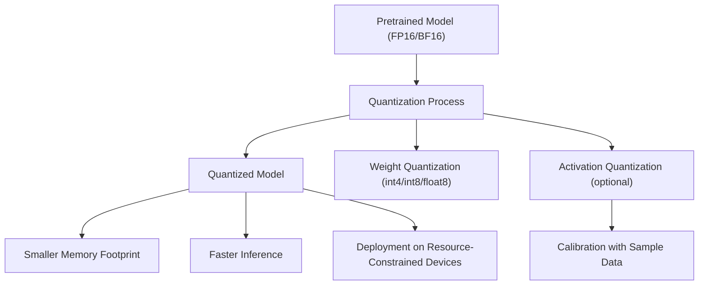
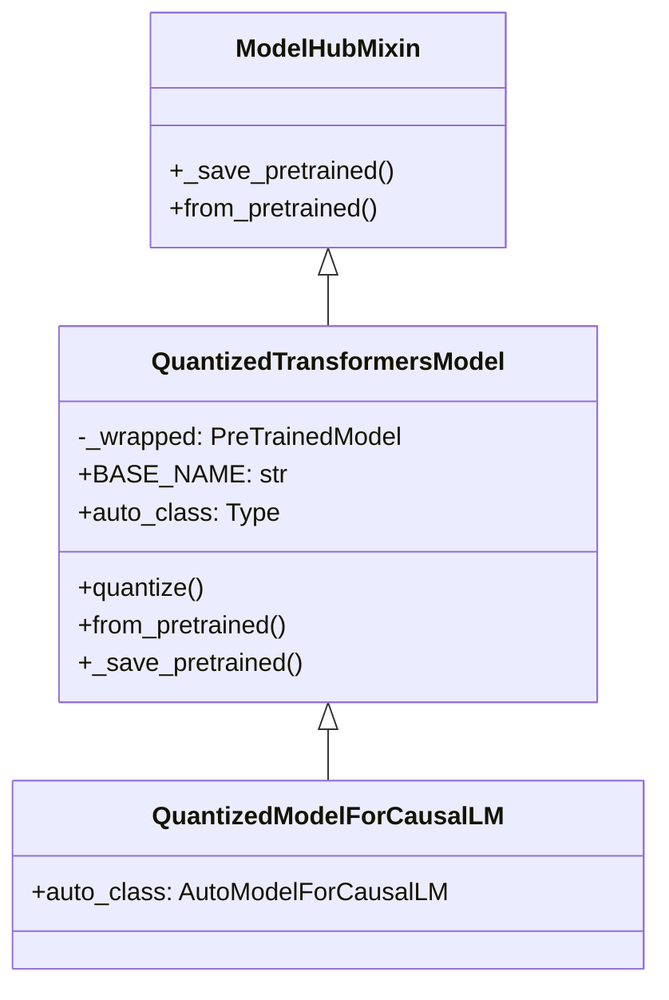
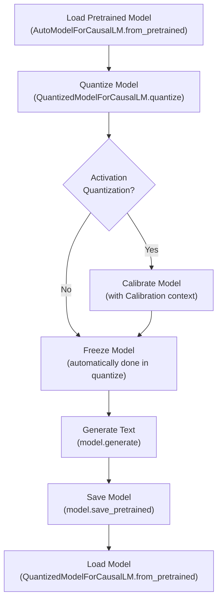
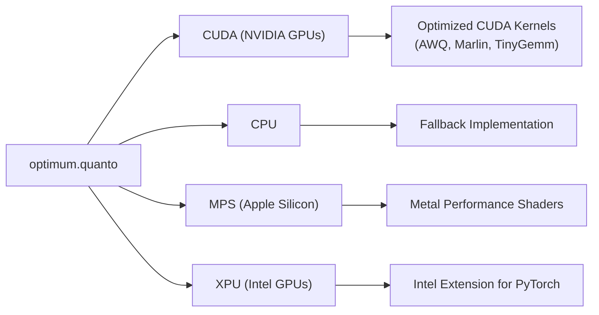

<!-- source: DeepWiki mcp.deepwiki.com · repo huggingface/optimum-quanto · page 8.1 Text Generation Models · fetched 2026-10-26 -->

# Text Generation Models

<details>
<summary>Relevant source files</summary>

The following files were used as context for generating this wiki page:

- [examples/nlp/text-classification/sst2/quantize_sst2_model.py](examples/nlp/text-classification/sst2/quantize_sst2_model.py)
- [examples/nlp/text-generation/quantize_causal_lm_model.py](examples/nlp/text-generation/quantize_causal_lm_model.py)
- [examples/vision/StableDiffusion/quantize_StableDiffusion.py](examples/vision/StableDiffusion/quantize_StableDiffusion.py)
- [examples/vision/StableDiffusion/requirements.txt](examples/vision/StableDiffusion/requirements.txt)
- [examples/vision/image-classification/mnist/quantize_mnist_model.py](examples/vision/image-classification/mnist/quantize_mnist_model.py)
- [examples/vision/object-detection/quantize_owl_model.py](examples/vision/object-detection/quantize_owl_model.py)
- [examples/vision/text-to-image/quantize_pixart_sigma.py](examples/vision/text-to-image/quantize_pixart_sigma.py)
- [optimum/quanto/models/__init__.py](optimum/quanto/models/__init__.py)
- [optimum/quanto/models/diffusers_models.py](optimum/quanto/models/diffusers_models.py)
- [optimum/quanto/models/shared_dict.py](optimum/quanto/models/shared_dict.py)
- [optimum/quanto/models/transformers_models.py](optimum/quanto/models/transformers_models.py)

</details>


This document provides a technical guide for quantizing and deploying text generation models using optimum-quanto. It focuses specifically on causal language models (CLMs) that enable text continuation and generation tasks. For information about vision and diffusion models, see [Vision and Diffusion Models](#8.2).

## Overview of Text Generation Model Quantization

Quantization of text generation models enables significant memory footprint reduction and potential inference speedups while maintaining acceptable generation quality. This is particularly valuable for large language models (LLMs) with billions of parameters that would otherwise require substantial computational resources.



Sources: [examples/nlp/text-generation/quantize_causal_lm_model.py:139-146](), [optimum/quanto/models/transformers_models.py:69-112]()

## QuantizedModelForCausalLM Class

The primary class for working with quantized text generation models is `QuantizedModelForCausalLM`, which provides a streamlined interface for quantizing, saving, and loading causal language models.



Sources: [optimum/quanto/models/transformers_models.py:28-29](), [optimum/quanto/models/transformers_models.py:182-184]()

## Quantization Workflow for Text Generation Models

The workflow for quantizing and using a text generation model involves several key steps:



Sources: [examples/nlp/text-generation/quantize_causal_lm_model.py:25-148](), [optimum/quanto/models/transformers_models.py:69-179]()

### Loading a Model

First, load a pretrained model using the Transformers library:

```python
from transformers import AutoModelForCausalLM, AutoTokenizer

model = AutoModelForCausalLM.from_pretrained("facebook/opt-350m", torch_dtype=torch.float16)
tokenizer = AutoTokenizer.from_pretrained("facebook/opt-350m")
```

### Quantizing the Model

Next, quantize the model using `QuantizedModelForCausalLM.quantize()`:

```python
from optimum.quanto import QuantizedModelForCausalLM, qint8, qint4, qfloat8

# Select quantization types
weights = qint8       # For weights (8-bit integer quantization)
activations = qint8   # For activations (8-bit integer quantization)

# Quantize the model
qmodel = QuantizedModelForCausalLM.quantize(model, weights=weights, activations=activations)
```

Sources: [examples/nlp/text-generation/quantize_causal_lm_model.py:140](), [optimum/quanto/models/transformers_models.py:69-112]()

### Calibrating Activations (Optional)

If using activation quantization, calibration is necessary to gather statistics about activation values using representative data:

```python
from optimum.quanto import Calibration
from datasets import load_dataset

# Load calibration dataset
cal_dataset = load_dataset("lambada", split="validation")

# Calibrate the model
with Calibration(streamline=True):
    for batch in cal_dataset.iter(batch_size=32):
        inputs = tokenizer(batch["text"], return_tensors="pt", padding=True)
        qmodel(inputs.input_ids, attention_mask=inputs.attention_mask)
```

Sources: [examples/nlp/text-generation/quantize_causal_lm_model.py:42-53](), [examples/nlp/text-generation/quantize_causal_lm_model.py:144-146]()

### Generating Text

Once the model is quantized and calibrated (if necessary), you can use it to generate text:

```python
# Prepare input
prompt = "One of my fondest memory is"
inputs = tokenizer(prompt, return_tensors="pt", padding=True)

# Generate text
outputs = qmodel.generate(
    input_ids=inputs.input_ids,
    max_new_tokens=20,
    attention_mask=inputs.attention_mask,
    do_sample=True,
    top_k=50,
    top_p=0.9,
)

# Decode output
generated_text = tokenizer.decode(outputs[0])
print(generated_text)
```

Sources: [examples/nlp/text-generation/quantize_causal_lm_model.py:25-39](), [examples/nlp/text-generation/quantize_causal_lm_model.py:147]()

### Saving and Loading Quantized Models

To save a quantized model:

```python
qmodel.save_pretrained("path/to/save/model")
```

To load a previously quantized model:

```python
loaded_model = QuantizedModelForCausalLM.from_pretrained("path/to/saved/model")
```

The saved model includes a `quanto_qmap.json` file containing information about the quantization configuration.

Sources: [optimum/quanto/models/transformers_models.py:114-164](), [optimum/quanto/models/transformers_models.py:165-179]()

## Quantization Types and Their Effects

optimum-quanto supports several quantization types, each with different trade-offs:

| Quantization Type | Memory Reduction | Performance Impact | Quality Impact |
|-------------------|------------------|-------------------|------------------|
| Weight `qint8` | ~2x | Moderate speedup | Minimal |
| Weight `qint4` | ~4x | Variable | Moderate |
| Weight `qfloat8` | ~2x | Moderate speedup | Minimal |
| Activation `qint8` | Runtime only | May be slower | Minimal |
| Activation `qfloat8` | Runtime only | May be slower | Minimal |

Sources: [examples/nlp/text-generation/quantize_causal_lm_model.py:56-62]()

## Complete Example

Here's a complete example script for quantizing a causal language model:

```python
import torch
from transformers import AutoModelForCausalLM, AutoTokenizer
from datasets import load_dataset
from optimum.quanto import QuantizedModelForCausalLM, Calibration, qint8

# Load model and tokenizer
model_name = "facebook/opt-350m"
model = AutoModelForCausalLM.from_pretrained(model_name, torch_dtype=torch.float16)
tokenizer = AutoTokenizer.from_pretrained(model_name)
tokenizer.pad_token_id = tokenizer.eos_token_id
tokenizer.padding_side = "left"

# Quantize model
qmodel = QuantizedModelForCausalLM.quantize(model, weights=qint8, activations=qint8)

# Calibrate model (for activation quantization)
cal_dataset = load_dataset("lambada", split="validation").shuffle(seed=1)
with Calibration(streamline=True):
    for batch in cal_dataset.iter(batch_size=32, take=4):
        inputs = tokenizer(batch["text"], return_tensors="pt", padding=True)
        qmodel(inputs.input_ids.to(device), attention_mask=inputs.attention_mask.to(device))

# Generate text
prompt = "One of my fondest memory is"
inputs = tokenizer(prompt, return_tensors="pt")
outputs = qmodel.generate(
    input_ids=inputs.input_ids.to(device),
    max_new_tokens=20,
    attention_mask=inputs.attention_mask.to(device),
    do_sample=True,
    top_k=50,
    top_p=0.9,
)
generated_text = tokenizer.decode(outputs[0])
print(f"Generated: '{generated_text}'")

# Save the model
qmodel.save_pretrained("./quantized-opt-350m")
```

Sources: [examples/nlp/text-generation/quantize_causal_lm_model.py:65-151]()

## Command-Line Tool

optimum-quanto provides a command-line tool for quantizing causal language models. You can run the example script with various options:

```bash
python quantize_causal_lm_model.py \
    --model facebook/opt-350m \
    --prompt "One of my fondest memory is" \
    --max_new_tokens 20 \
    --batch_size 32 \
    --weights int8 \
    --activations int8 \
    --load_dtype float16
```

Available options:

| Option | Description |
|--------|-------------|
| `--model` | Model ID from Hugging Face Hub or local path |
| `--prompt` | Text generation prompt |
| `--max_new_tokens` | Maximum number of tokens to generate |
| `--batch_size` | Batch size for evaluation and calibration |
| `--validation_batch` | Number of batches for calibration |
| `--load_dtype` | Precision for initial model loading (float16, float32, bfloat16) |
| `--weights` | Weight quantization type (int4, int8, float8) |
| `--activations` | Activation quantization type (none, int8, float8) |
| `--no-streamline` | Disable removal of consecutive quantize/dequantize operations |
| `--debug` | Enable detailed feedback during calibration |

Sources: [examples/nlp/text-generation/quantize_causal_lm_model.py:65-106]()

## Device Support

The quantization and inference capabilities in optimum-quanto support multiple device types:



Sources: [examples/nlp/text-generation/quantize_causal_lm_model.py:108-120]()

## Performance Considerations

When working with quantized text generation models, consider these factors:

1. **Hardware Compatibility**: Different quantization types may have optimized implementations on specific hardware.

2. **Model Size**: Larger models benefit more from quantization in terms of memory savings.

3. **Calibration Data**: The quality and representativeness of calibration data can significantly impact activation quantization effectiveness.

4. **Quality vs Efficiency Trade-off**: Higher bit-width quantization (e.g., int8) generally preserves more quality but offers less memory savings than lower bit-width (e.g., int4).

5. **Streamlining**: Enable streamlining to remove unnecessary quantize/dequantize operations, which can improve performance.

Sources: [examples/nlp/text-generation/quantize_causal_lm_model.py:99-102]()

## Conclusion

optimum-quanto provides a powerful yet straightforward approach to quantizing text generation models, making LLMs more accessible on resource-constrained hardware. By following the workflow described in this document, you can significantly reduce the memory footprint of your models while maintaining acceptable generation quality.

---

