<!-- source: DeepWiki mcp.deepwiki.com · repo huggingface/optimum-quanto · page 8.2 Vision and Diffusion Models · fetched 2026-10-26 -->

# Vision and Diffusion Models

<details>
<summary>Relevant source files</summary>

The following files were used as context for generating this wiki page:

- [examples/nlp/text-classification/sst2/quantize_sst2_model.py](examples/nlp/text-classification/sst2/quantize_sst2_model.py)
- [examples/nlp/text-generation/quantize_causal_lm_model.py](examples/nlp/text-generation/quantize_causal_lm_model.py)
- [examples/vision/StableDiffusion/quantize_StableDiffusion.py](examples/vision/StableDiffusion/quantize_StableDiffusion.py)
- [examples/vision/StableDiffusion/requirements.txt](examples/vision/StableDiffusion/requirements.txt)
- [examples/vision/image-classification/mnist/quantize_mnist_model.py](examples/vision/image-classification/mnist/quantize_mnist_model.py)
- [examples/vision/object-detection/quantize_owl_model.py](examples/vision/object-detection/quantize_owl_model.py)
- [examples/vision/text-to-image/quantize_pixart_sigma.py](examples/vision/text-to-image/quantize_pixart_sigma.py)
- [optimum/quanto/models/__init__.py](optimum/quanto/models/__init__.py)
- [optimum/quanto/models/diffusers_models.py](optimum/quanto/models/diffusers_models.py)
- [optimum/quanto/models/shared_dict.py](optimum/quanto/models/shared_dict.py)
- [optimum/quanto/models/transformers_models.py](optimum/quanto/models/transformers_models.py)

</details>


This document details how to use Optimum-Quanto to quantize and deploy vision and diffusion models. It covers the quantization workflow for image classification, object detection, stable diffusion, and text-to-image generation models. For text generation model quantization, see [Text Generation Models](#8.1).

## Vision Models Quantization

Optimum-Quanto supports quantization of various vision models, including image classification and object detection. This section explores the implementation and usage patterns for these model types.

### Image Classification Models

Quantizing image classification models follows the standard Optimum-Quanto workflow:

1. Load the original float model
2. Apply quantization with specified precision (int4, int8, or float8)
3. Calibrate for activation quantization
4. Freeze the model for inference

The following diagram illustrates this workflow:

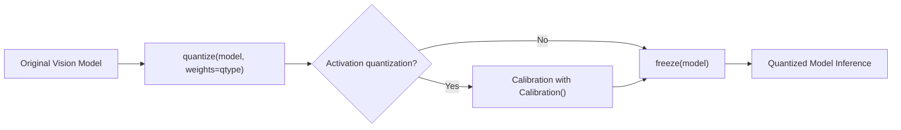

Sources: [examples/vision/image-classification/mnist/quantize_mnist_model.py:140-147](), [examples/vision/object-detection/quantize_owl_model.py:96-102]()

Example implementation for MNIST image classification model quantization:

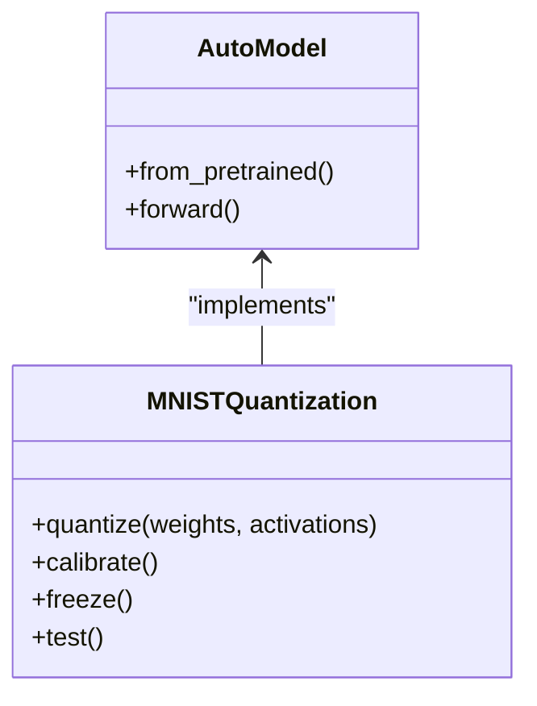

Sources: [examples/vision/image-classification/mnist/quantize_mnist_model.py]()

The quantized model can be evaluated for performance and accuracy metrics:

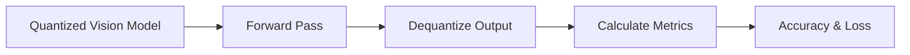

Sources: [examples/vision/image-classification/mnist/quantize_mnist_model.py:39-62]()

### Object Detection Models

Object detection models like Owlv2 can also be quantized with Optimum-Quanto. These models typically have more complex architectures with multiple components.

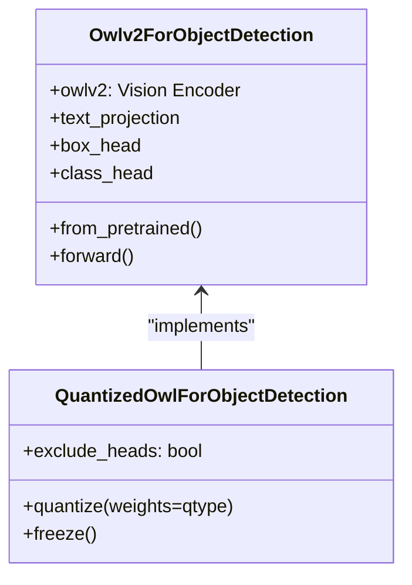

Sources: [examples/vision/object-detection/quantize_owl_model.py:94-102]()

The quantization process allows selective quantization of model components. For example, you can choose to exclude the detection heads from quantization:

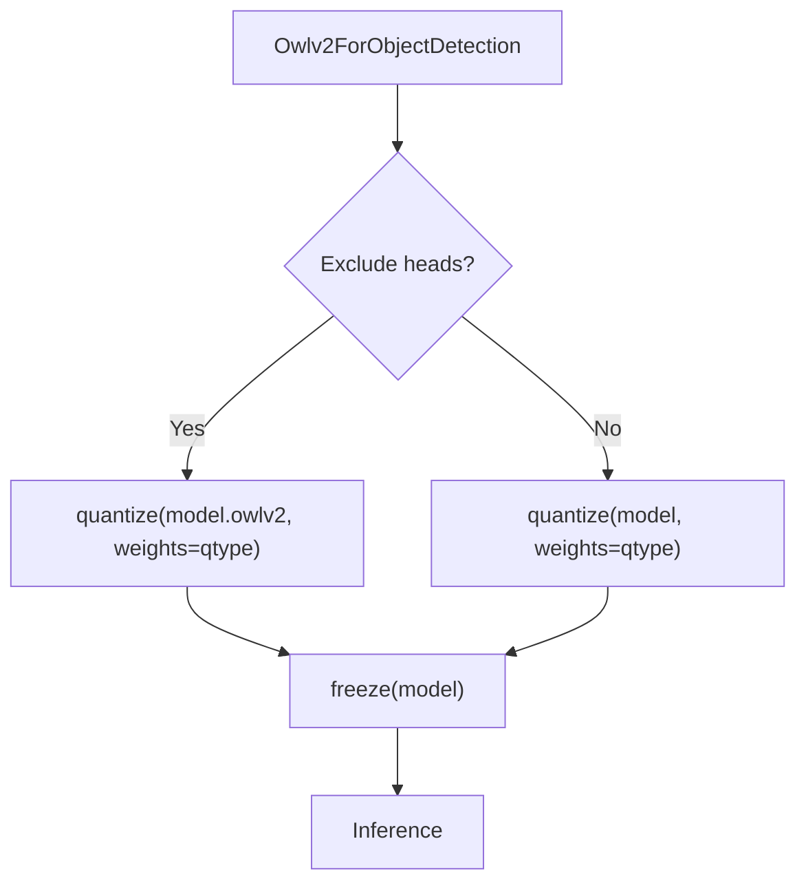

Sources: [examples/vision/object-detection/quantize_owl_model.py:96-102]()

## Diffusion Models Architecture

Diffusion models consist of multiple components that can be quantized independently. The main components include:

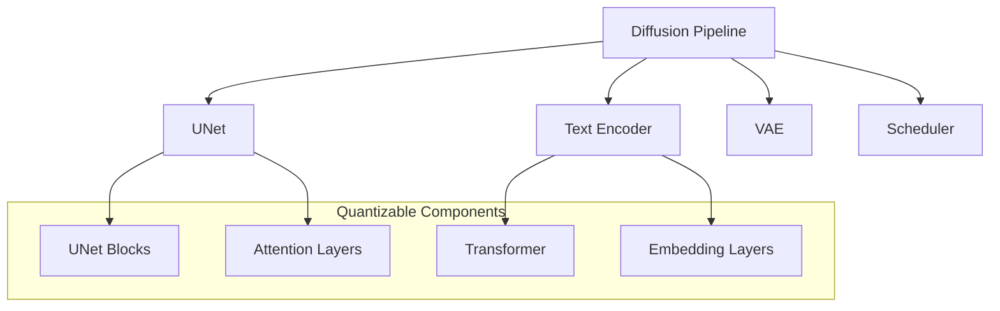

Sources: [examples/vision/StableDiffusion/quantize_StableDiffusion.py:25-31](), [examples/vision/text-to-image/quantize_pixart_sigma.py:22-28]()

## Quantizing Diffusion Models

### Stable Diffusion Quantization

Stable Diffusion models can be quantized using various precisions depending on your performance and accuracy needs:

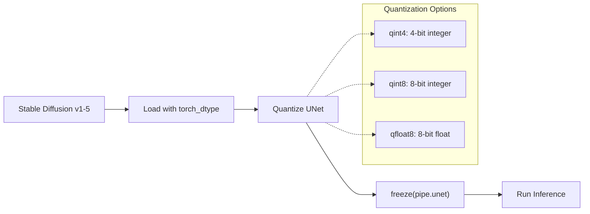

Sources: [examples/vision/StableDiffusion/quantize_StableDiffusion.py:25-33]()

Performance metrics like inference time and memory usage can be measured for different quantization configurations:

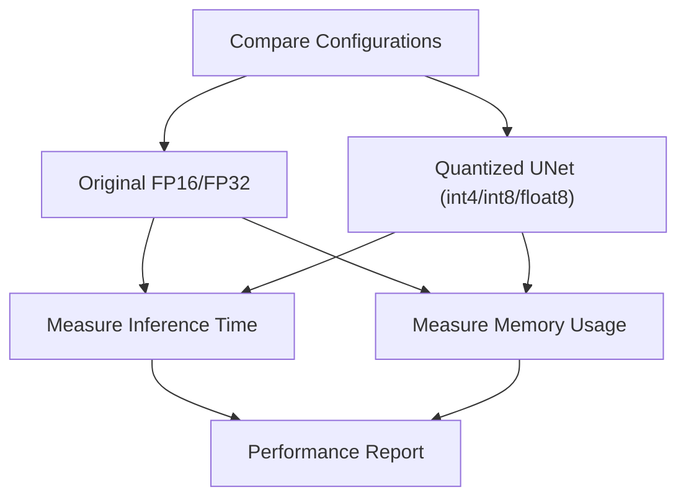

Sources: [examples/vision/StableDiffusion/quantize_StableDiffusion.py:94-109]()

### PixArt Quantization

PixArt models (like PixArt-Sigma) have a different architecture and quantization approach:

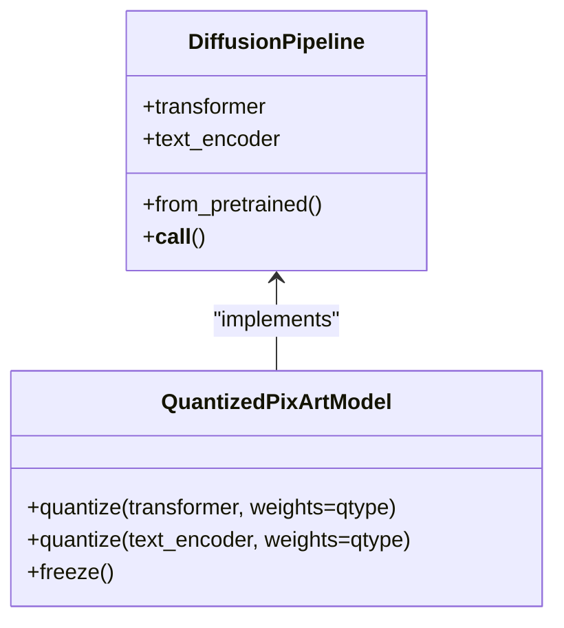

Sources: [examples/vision/text-to-image/quantize_pixart_sigma.py:22-31]()

The quantization process involves multiple components:

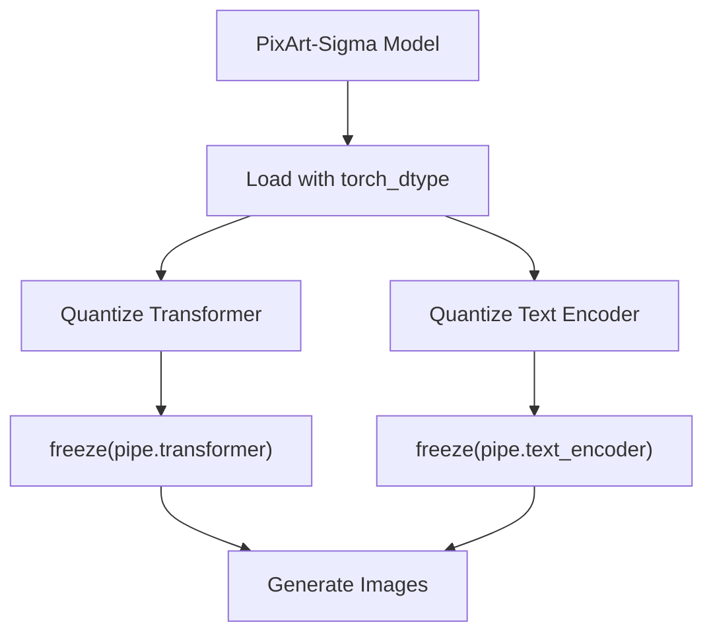

Sources: [examples/vision/text-to-image/quantize_pixart_sigma.py:22-31](), [examples/vision/text-to-image/quantize_pixart_sigma.py:82-89]()

## Implementation Classes

Optimum-Quanto provides specialized classes for quantized diffusion models:

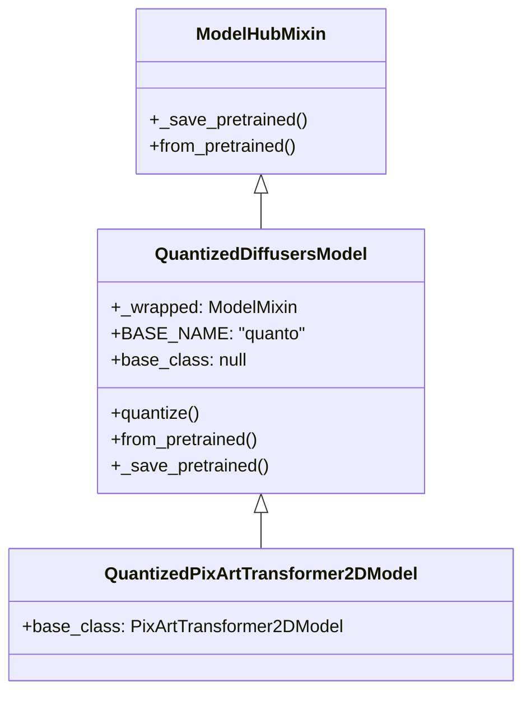

Sources: [optimum/quanto/models/diffusers_models.py:44-190]()

The `QuantizedDiffusersModel` class provides the following key functionality:

1. Wrapping a quantized diffusers model
2. Quantizing a float model with `quantize` static method
3. Loading a quantized model with `from_pretrained` static method
4. Saving a quantized model with `_save_pretrained` method

The `QuantizedPixArtTransformer2DModel` class specializes this functionality for PixArt transformer models.

Sources: [optimum/quanto/models/diffusers_models.py:189-190]()

## Quantization Workflow

The complete workflow for quantizing and using vision and diffusion models follows these steps:

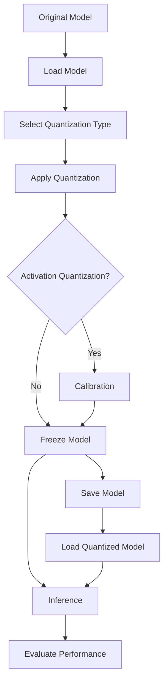

Sources: [examples/vision/image-classification/mnist/quantize_mnist_model.py:137-169](), [examples/vision/StableDiffusion/quantize_StableDiffusion.py:91-117]()

### Key API Functions

The core API functions for quantizing vision and diffusion models are:

1. `quantize(model, weights=qtype, activations=qtype)` - Apply quantization to model
2. `Calibration()` - Context manager for calibrating activation quantization
3. `freeze(model)` - Freeze the model for inference
4. `QuantizedDiffusersModel.from_pretrained()` - Load a quantized diffusion model
5. `model.save_pretrained()` - Save a quantized model

Sources: [examples/vision/StableDiffusion/quantize_StableDiffusion.py:25-33](), [examples/vision/image-classification/mnist/quantize_mnist_model.py:140-155]()

## Performance Considerations

When quantizing vision and diffusion models, consider the following performance aspects:

| Quantization Type | Memory Reduction | Speed Improvement | Quality Impact |
|-------------------|------------------|-------------------|----------------|
| qint4             | Highest (75%)    | Moderate          | Higher         |
| qint8             | High (50%)       | Good              | Moderate       |
| qfloat8           | High (50%)       | Good              | Lower          |
| Float16 (baseline)| None             | None              | None           |

The choice of quantization type depends on your specific requirements:

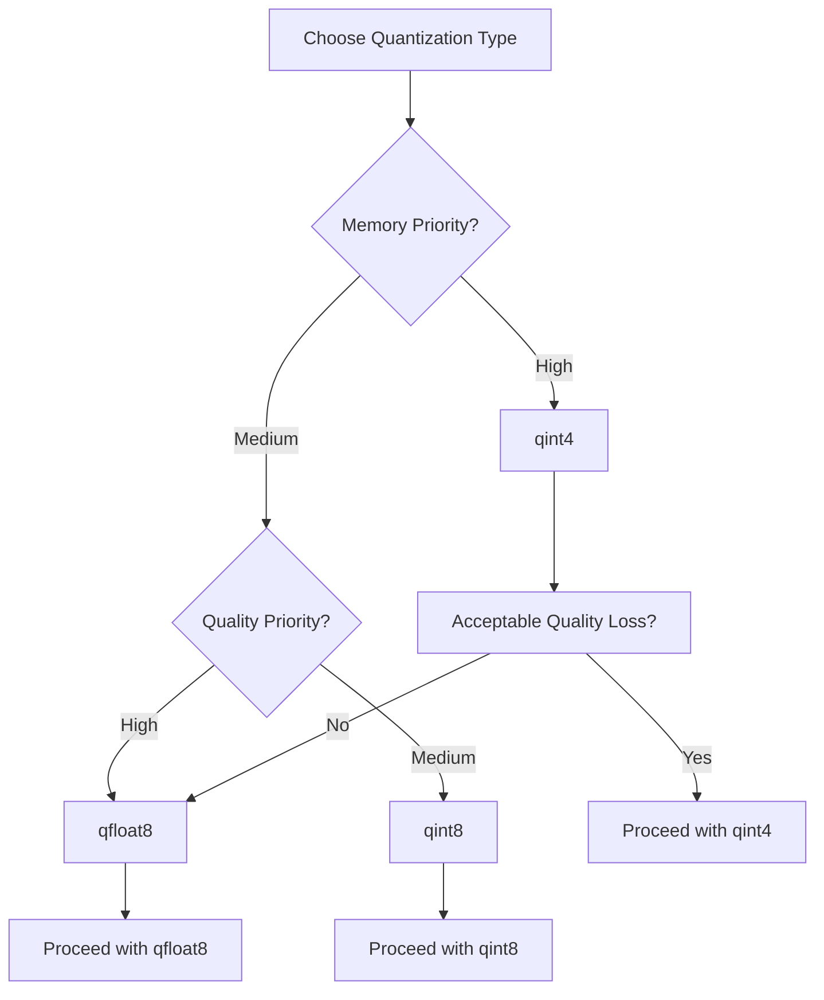

Sources: [examples/vision/StableDiffusion/quantize_StableDiffusion.py:106-109](), [examples/vision/text-to-image/quantize_pixart_sigma.py:73-77]()

## Example Usage

### Quantizing a Stable Diffusion Model

```python
# Load the pipeline
pipe = DiffusionPipeline.from_pretrained("runwayml/stable-diffusion-v1-5", torch_dtype=torch.float16)

# Quantize the UNet component with 8-bit integer quantization
quantize(pipe.unet, weights=qint8)
freeze(pipe.unet)

# Generate images with the quantized model
image = pipe(
    prompt="ghibli style, a fantasy landscape with castles",
    num_inference_steps=50,
    generator=torch.manual_seed(0)
).images[0]
```

Sources: [examples/vision/StableDiffusion/quantize_StableDiffusion.py:25-33](), [examples/vision/StableDiffusion/quantize_StableDiffusion.py:112-117]()

### Quantizing a PixArt Model

```python
# Load the pipeline
pipe = DiffusionPipeline.from_pretrained("PixArt-alpha/PixArt-Sigma-XL-2-1024-MS", torch_dtype=torch.float16)

# Quantize the transformer and text encoder components
quantize(pipe.transformer, weights=qint8)
freeze(pipe.transformer)
quantize(pipe.text_encoder, weights=qint8)
freeze(pipe.text_encoder)

# Generate images with the quantized model
image = pipe(
    prompt="ghibli style, a fantasy landscape with castles",
    num_inference_steps=50,
    generator=torch.manual_seed(0)
).images[0]
```

Sources: [examples/vision/text-to-image/quantize_pixart_sigma.py:22-31](), [examples/vision/text-to-image/quantize_pixart_sigma.py:82-89]()

This comprehensive approach to quantizing vision and diffusion models enables significant memory and speed improvements while maintaining acceptable quality for various applications.

---

