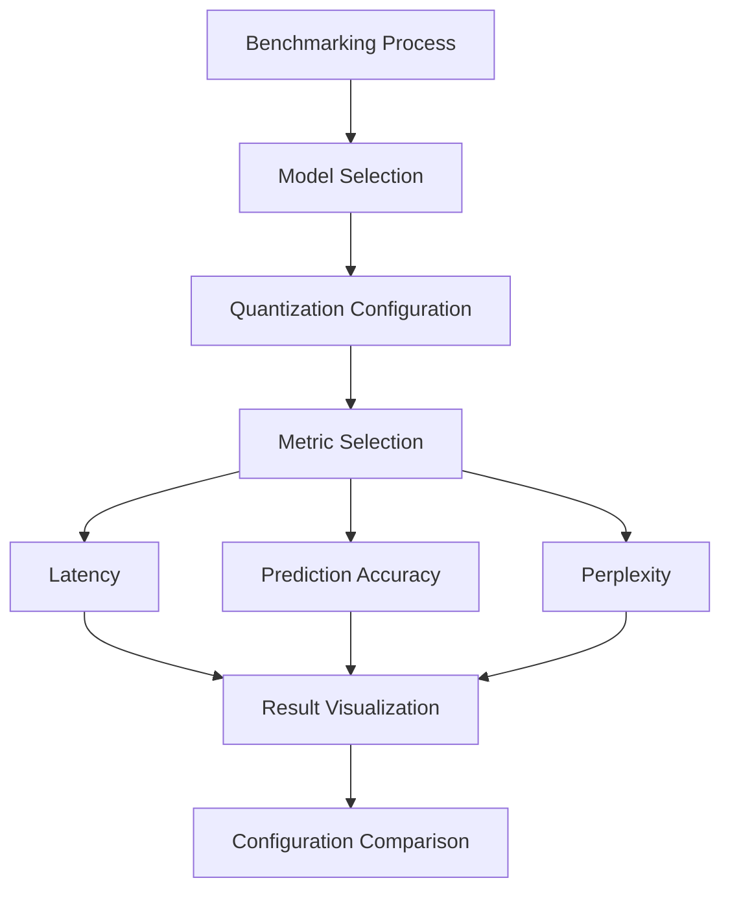
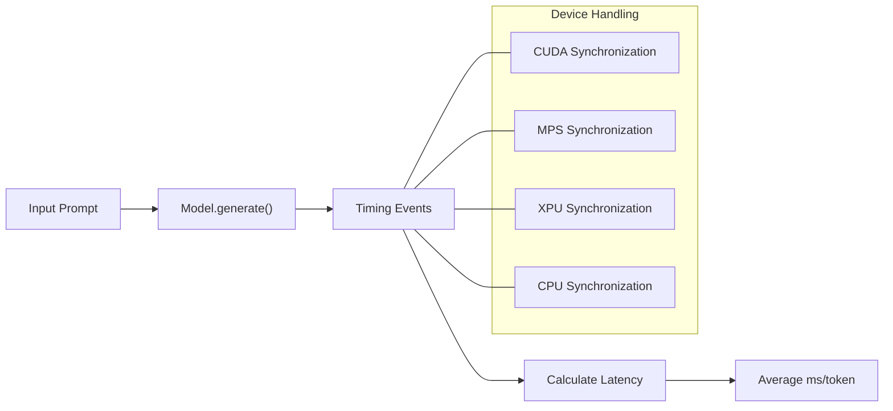
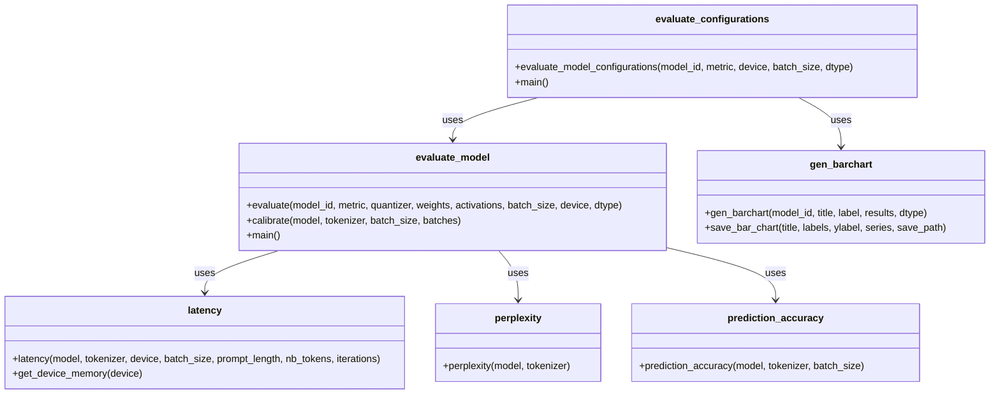
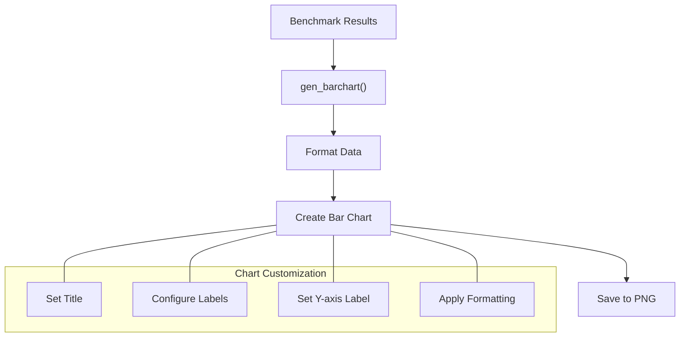
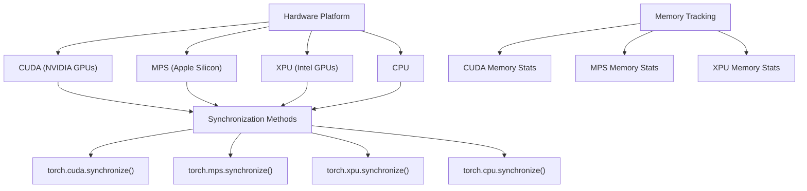
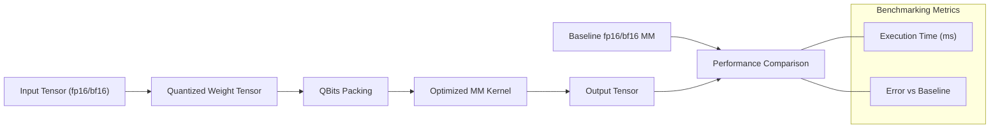

<!-- source: DeepWiki mcp.deepwiki.com · repo huggingface/optimum-quanto · page 9 Benchmarking · fetched 2026-10-26 -->

# Benchmarking

<details>
<summary>Relevant source files</summary>

The following files were used as context for generating this wiki page:

- [bench/generation/README.md](bench/generation/README.md)
- [bench/generation/evaluate_configurations.py](bench/generation/evaluate_configurations.py)
- [bench/generation/evaluate_model.py](bench/generation/evaluate_model.py)
- [bench/generation/gen_barchart.py](bench/generation/gen_barchart.py)
- [bench/generation/metrics/latency.py](bench/generation/metrics/latency.py)
- [bench/generation/setup/hqq.py](bench/generation/setup/hqq.py)
- [bench/kernels/benchmark.py](bench/kernels/benchmark.py)
- [bench/torch_kernels/test_int_mm.py](bench/torch_kernels/test_int_mm.py)
- [bench/torch_kernels/test_weight_int4pack_mm.py](bench/torch_kernels/test_weight_int4pack_mm.py)
- [bench/torch_kernels/test_weight_int8pack_mm.py](bench/torch_kernels/test_weight_int8pack_mm.py)

</details>


This page provides a comprehensive guide to benchmarking quantized models with optimum-quanto. It explains how to measure and compare the performance of models with different quantization configurations across various metrics and hardware platforms.

## Overview of Benchmarking in optimum-quanto

Optimum-quanto provides a structured benchmarking framework to evaluate the impact of quantization on model performance. The framework allows users to measure three key aspects of model performance:

1. **Model Quality** - How quantization affects prediction accuracy and perplexity
2. **Inference Efficiency** - How quantization affects latency and memory usage
3. **Hardware Performance** - How different backends and hardware platforms perform with quantized models



Sources: [bench/generation/evaluate_model.py:51-83](), [bench/generation/README.md:1-13]()

## Benchmarking Metrics

Optimum-quanto uses three primary metrics to evaluate quantized models:

### 1. Latency

Measures the average time per token during text generation, providing insight into inference speed.



Sources: [bench/generation/metrics/latency.py:24-105]()

### 2. Prediction Accuracy

Evaluates the model's ability to correctly predict the last token in prompts from the Lambada dataset.

### 3. Perplexity

Measures how well the model predicts the next token in a sequence, calculated on the WikiText dataset.

Sources: [bench/generation/README.md:5-7]()

## Benchmarking Framework

### Core Components



Sources: [bench/generation/evaluate_model.py:15-137](), [bench/generation/evaluate_configurations.py:15-120](), [bench/generation/metrics/latency.py:15-119](), [bench/generation/gen_barchart.py:15-89]()

## Running Benchmarks

### Basic Usage

The primary script for benchmarking is `evaluate_model.py`, which allows evaluating a model with specific quantization settings against a chosen metric:

```
python evaluate_model.py --model MODEL_ID --metric METRIC --quantizer QUANTIZER --weights WEIGHT_TYPE --activations ACTIVATION_TYPE
```

Where:
- `MODEL_ID`: Hugging Face model ID (e.g., "facebook/opt-350m")
- `METRIC`: One of "latency", "prediction", "perplexity"
- `QUANTIZER`: Quantization method (e.g., "quanto", "awq", "bnb", "hqq")
- `WEIGHTS`: Weight quantization type (e.g., "none", "int4", "int8", "float8")
- `ACTIVATIONS`: Activation quantization type (e.g., "none", "int8", "float8")

Sources: [bench/generation/evaluate_model.py:86-133]()

### Evaluating Multiple Configurations

For comparing multiple quantization configurations, `evaluate_configurations.py` provides a convenient way to test a matrix of weight and activation quantization types:

```
python evaluate_configurations.py --model MODEL_ID --metric METRIC --json --png
```

This script tests the model with the following configurations:
- Native precision (fp16/bf16)
- int4, int8, and float8 weight quantization
- Native and float8 activation quantization

The `--json` and `--png` flags enable output of results to JSON and PNG bar chart formats.

Sources: [bench/generation/evaluate_configurations.py:26-116]()

## Visualizing Results

Benchmark results can be visualized using the built-in bar chart generation:



The resulting bar charts compare different weight quantization types (int4, int8, float8) against different activation quantization types, making it easy to identify the optimal configuration for your use case.

Sources: [bench/generation/gen_barchart.py:23-73](), [bench/generation/README.md:15-82]()

## Hardware-Specific Benchmarking

Optimum-quanto supports benchmarking on multiple hardware platforms, with device-specific optimizations for each:



Each hardware platform has specific synchronization methods and memory tracking to ensure accurate benchmarking.

Sources: [bench/generation/metrics/latency.py:25-56](), [bench/generation/metrics/latency.py:107-119]()

## Kernel-Level Benchmarking

In addition to model-level benchmarking, optimum-quanto provides tools for benchmarking specific kernels and operations, such as matrix multiplication with quantized weights:

### Weight-Quantized Matrix Multiplication



Sources: [bench/torch_kernels/test_weight_int4pack_mm.py:21-126](), [bench/torch_kernels/test_weight_int8pack_mm.py:21-69](), [bench/torch_kernels/test_int_mm.py:21-78]()

## Example Benchmark Results

The benchmarking framework has been used to compare various models and quantization configurations. Below are example metrics for a few popular models:

### Performance vs Accuracy Trade-offs

| Configuration | Latency (ms/token) | Prediction Accuracy | Perplexity |
|---------------|-------------------|---------------------|------------|
| W16A16 (baseline) | 10-30 | 95-98% | Model-dependent |
| W4A16 | 3-10 | 90-95% | Slightly higher |
| W8A16 | 5-15 | 92-97% | Nearly baseline |
| W8A8 | 4-12 | 91-96% | Slightly higher |
| W4A8 | 2-8 | 88-94% | Higher than baseline |

The README file in the benchmark directory contains detailed charts for specific models like Meta-Llama-3.1-8B, Mistral-7B-Instruct-v0.3, and Google Gemma-2B.

Sources: [bench/generation/README.md:15-82]()

## Conclusion

Benchmarking is an essential part of the quantization workflow, allowing users to make informed decisions about the trade-offs between model size, speed, and accuracy. The optimum-quanto benchmarking framework provides a comprehensive set of tools for evaluating these trade-offs across different quantization configurations and hardware platforms.

For detailed guidance on interpreting benchmark results and selecting optimal configurations, see [Performance Metrics](#9.1).

---

